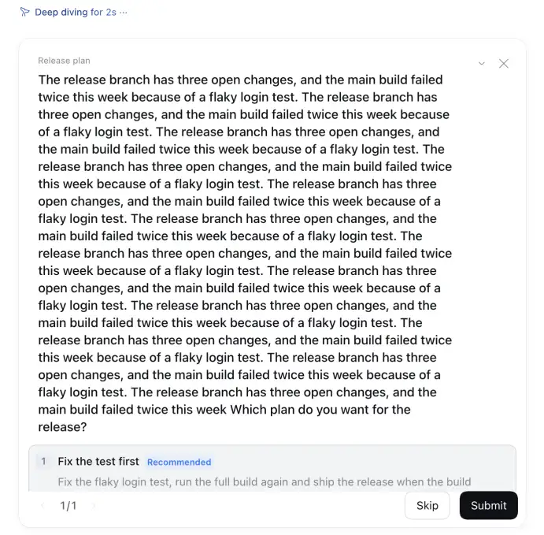
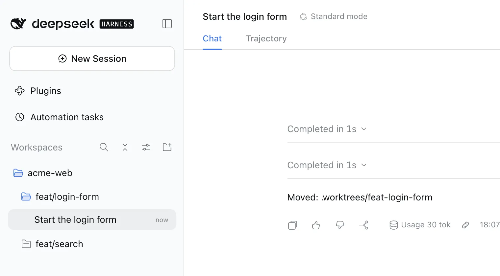

# dsh-composer-plus — Composer Plus para DeepSeek Harness

[](https://www.npmjs.com/package/dsh-composer-plus)
[](https://github.com/furkancak1r/dsh-composer-plus/actions/workflows/test.yml)
[](LICENSE)

[English](README.md) · [中文](README.zh.md) · [Türkçe](README.tr.md) · **Español** · [Português (Brasil)](README.pt-BR.md) · [Français](README.fr.md) · [Deutsch](README.de.md) · [Русский](README.ru.md) · [日本語](README.ja.md) · [한국어](README.ko.md) · [Bahasa Indonesia](README.id.md) · [Tiếng Việt](README.vi.md) · [हिन्दी](README.hi.md)

Esta es una traducción. La versión de referencia es el [README.md](README.md) en inglés.

Mejoras de comodidad al estilo de Codex para la interfaz de escritorio y web de [DeepSeek Harness](https://github.com/deepseek-ai/deepseek-harness) (dsh): un panel de cambios, ideas de funciones en tarjetas que se deslizan, búsqueda en el texto de los mensajes desde la barra lateral, revertir turnos con restauración de archivos, eliminar chats a la Papelera, el nombre del proyecto debajo del editor, el estado del proyecto en la barra lateral, historial de entrada, un atajo para el modo plan, Continuar con un clic, reanudar los chats en ejecución tras un reinicio, arrastrar y soltar en la cola, enlaces directos a sesiones, exportar el chat como Markdown, permisos de la revisión automática por chat, notificaciones en segundo plano, acceso desde el iPhone con la app Tether y actualizaciones automáticas.

**En una línea:** un único plugin de DeepSeek Harness (npm `dsh-composer-plus`, que aparece como **Composer Plus** en Configuración → Plugins) que añade un panel de cambios de git, tarjetas de ideas de funciones al estilo de Tinder, una búsqueda en la barra lateral que también encuentra palabras dentro de los mensajes, la reversión de turnos con ↶ (solo el chat, o el chat y los archivos), Eliminar chat, el nombre del proyecto debajo del editor, el historial de entrada con ↑/↓, un interruptor de `/plan` con Shift+Tab, ▶ Continuar con un clic, Reanudar tras reiniciar, reordenar la cola arrastrando y soltando, Copiar enlace de sesión, Exportar como Markdown, “Permitir en este chat” para la revisión automática, notificaciones en segundo plano, acceso desde el iPhone (Conexión móvil, app Tether), 11 idiomas adicionales para la interfaz y actualizaciones automáticas.

<p align="center"></p>

Plugin comunitario no oficial. Las únicas llamadas de red son las de la comprobación de actualizaciones (las versiones publicadas en GitHub y el registro de npm). Desactiva **Actualizaciones automáticas** para que no se hagan al iniciar. **Ideas de funciones** llama al modelo de tu propio chat solo cuando haces clic en **Sugerir funciones**. **Predicción del siguiente mensaje** (activada de forma predeterminada) llama al modelo elegido en Configuración (el predeterminado de dsh, salvo que elijas otro) una vez después de cada turno terminado, sin ningún clic. Desactívala en **Configuración → Composer Plus** para detener estas llamadas. **Completar al escribir** (desactivado de forma predeterminada) llama al modelo elegido para esta función (de forma predeterminada, el de la predicción) en cada pausa mientras escribes, después de que lo actives. **Mejorar prompt** solo llama a un modelo cuando haces clic en su varita mágica. **Comprobación del objetivo** (activada de forma predeterminada) llama a un modelo una vez cada vez que el agente marca un `/goal` como completado en una ronda automática. **Conexión móvil** (desactivada de forma predeterminada) acepta conexiones del iPhone desde tu red local o tu tailnet solo después de que la actives.

## Instalación

**App de escritorio:** Configuración → Plugins → **Añadir plugin** → escribe `dsh-composer-plus` → **Activar ahora**.
También puedes pegar `https://github.com/furkancak1r/dsh-composer-plus` en lugar del nombre de npm.

**Perfil web / CLI:**

```sh
dsh plugin --profile web add dsh-composer-plus
```

Después, reinicia dsh. (La CLI no puede instalar en el perfil de escritorio: de eso se encarga la app).

> El pnpm de dsh omite las versiones publicadas hace menos de 24 horas. Justo después de una versión nueva, añade la versión: `dsh-composer-plus@1.15.0`.

## Funciones

<!-- BEGIN GENERATED FEATURES: edit docs/features.json, then run npm run build:readme -->

| Función | Cómo usarla | Captura |
|---|---|---|
| **Panel de cambios** | <a id="feature-changespanel"></a>Barra lateral derecha → `+` → **Cambios**. Elige **Sin confirmar**, **Sin preparar**, **Preparados** o **Rama** para ver los archivos cambiados con sus contadores `+/-`; haz clic en un archivo para ver su diff. **Último turno** abre la revisión propia de dsh del último turno. Haz clic en el nombre de la rama (o elige **Árbol**) para ver el árbol de ramas: haz clic en una rama de arriba para ir a ella y en un commit para ver sus archivos y sus diffs. **Este chat** muestra solo los archivos que escribieron las herramientas de archivos del chat abierto (write, edit), en todos sus turnos, y su diff total desde su primer mensaje. El botón **␣** oculta los cambios de espacios en blanco (`git diff -w`): no se muestran las líneas que solo cambiaron en la sangría o en los finales de línea. El menú **…** de un archivo → **Chats que cambiaron este archivo** muestra los chats del mismo repositorio cuyas herramientas de escritura o edición cambiaron ese archivo, del más reciente al más antiguo, con la petición que lo hizo; un clic abre ese chat en esa petición. | <a href="assets/features/changesPanel.webp"></a> |
| **Ideas de funciones** | <a id="feature-featureideas"></a>Barra lateral derecha → `+` → **Ideas de funciones** → **Sugerir funciones**. El modelo del propio chat lee un breve resumen del proyecto del chat (los archivos del nivel superior, el principio del README y del manifiesto, un esquema del resto del README, los títulos de los commits recientes) y sugiere hasta 8 funciones. Las muestra como un montón de tarjetas en el idioma de la interfaz de dsh. Desliza una tarjeta hacia la derecha (o haz clic en **✓**, o pulsa `→`; en todos los casos la tarjeta sale volando hacia su lado) para iniciar un nuevo chat en el mismo proyecto: empieza en modo plan con la idea como petición, así que nada cambia antes de que apruebes el plan. Para saltarte el plan, haz clic en **▶ Crear ahora** (o pulsa `↑`; la tarjeta sale volando hacia arriba): el nuevo chat empieza enseguida con la idea como una petición normal, y el modelo hace el cambio y ejecuta sus comprobaciones (las aprobaciones se aplican como siempre). Desliza hacia la izquierda (o **✕**, o `←`) para omitirla; **Deshacer** (o `Z`) recupera una tarjeta omitida. Haz clic en **↓** (o pulsa `↓`) para guardar una buena idea para más tarde: va a la lista **Después** del proyecto, que aparece en todos los chats de la misma carpeta de proyecto (también tras un reinicio). **Después (N)** abre la lista; **Planificar** inicia el mismo chat en modo plan para la idea y **Crear ahora**, el chat sin plan; los dos la quitan de la lista. **Planificar todo (N)** inicia un solo chat en modo plan para todas las ideas de la lista, así que las partes comunes se planifican una sola vez. **Quitar de la lista** la elimina. **Copiar como lista de tareas** copia toda la lista al portapapeles como una lista de tareas de Markdown (`- [ ] Title — Summary`, una línea por idea) para un gestor de incidencias o un archivo TODO; no hace ninguna llamada de red. **Abrir issue en GitHub** en una idea abre una issue con su título y su resumen (y por qué importa) en el repositorio de GitHub del proyecto, con tu propia sesión de GitHub CLI (`gh`); después aparece junto a la idea el enlace **Issue #N**, que abre la issue. **Más ideas** añade tarjetas. Para recibir ideas sobre un solo tema, escribe un **Tema de enfoque** corto en el campo junto a **Sugerir funciones** (como máximo 80 caracteres; `Enter` también pide sugerencias), o haz clic en uno de los temas fijos que hay debajo: **Rendimiento**, **Accesibilidad**, **Pruebas**, **Seguridad**, **Usabilidad** o **Documentación** (haz clic otra vez para quitarlo). Entonces el modelo solo sugiere funciones sobre ese tema; un campo vacío significa cualquier función. Las ideas no se sugieren dos veces en un proyecto: cada idea sugerida (omitida, guardada o iniciada) va al **Historial** del proyecto, se le indica al modelo que no vuelva a sugerirlas y se descarta un título repetido. **Historial** las muestra como **Iniciada** o **Sugerida**; **Olvidar** (u **Olvidar todo**) deja que una vuelva a aparecer; una idea que sigue en la lista **Después** queda fuera de las sugerencias hasta que la quitas de allí. El modelo solo se ejecuta cuando haces clic. | <a href="assets/features/featureIdeas.webp"></a> |
| **Búsqueda en el contenido** | <a id="feature-contentsearch"></a>La búsqueda propia de la barra lateral de dsh (la lupa junto a **Espacios de trabajo**; `Cmd+K` en la app de escritorio, `Cmd+Alt+K` en un navegador) también encuentra chats por las palabras de tus mensajes y de las respuestas, no solo por el título, y muestra el texto que coincide debajo del chat. dsh ya incluye esta búsqueda, pero viene desactivada; esta función la activa con un archivo de índice de búsqueda en tu equipo. El índice se crea en la primera búsqueda después de iniciar dsh (unos 15 s para 250 chats, consulta Límites) y se conserva para los siguientes inicios. Activada de forma predeterminada; un cambio se aplica después de reiniciar dsh. | <a href="assets/features/contentSearch.webp"></a> |
| **Revertir turno** | <a id="feature-turnrollback"></a>Pasa el puntero por encima de uno de tus mensajes y haz clic en **↶** (junto a Copiar). **Solo el chat** quita ese mensaje y todo lo que viene después (respuestas, llamadas a herramientas) del chat y del contexto del modelo, y vuelve a poner el mensaje en el editor: cámbialo y envíalo de nuevo. **Chat y archivos** primero muestra los archivos del proyecto que cambiaron desde ese mensaje y después también los devuelve a su estado anterior, incluidos los cambios hechos por comandos (`bash`), no solo por las herramientas de edición de dsh. Si hay un turno en ejecución, primero se detiene. El registro del chat nunca se reescribe: un marcador oculto esconde la parte retirada, igual que el propio `/compact` de dsh esconde los mensajes antiguos. Si [dsh-rewind-plugin](https://www.npmjs.com/package/dsh-rewind-plugin) está instalado, ese plugin hace este trabajo y Composer Plus no muestra un segundo botón. Después de revertir, aparece una barra **Rehacer** encima del editor: inicia un chat nuevo desde justo antes de revertir (los mismos mensajes y el mismo contexto) y, con **Chat y archivos**, devuelve también los archivos. Un archivo que cambiaste después de revertir aparece en la lista y se conserva, salvo que marques la casilla que lo sobrescribe. | <a href="assets/features/turnRollback.webp"></a> |
| **Eliminar chat** | <a id="feature-deletechat"></a>Barra lateral → menú **…** de un chat (o clic derecho) → **Eliminar…** → **Eliminar**. dsh por sí solo solo puede archivar. El chat se detiene (su turno, sus trabajos en segundo plano, sus subagentes y sus recordatorios, igual que con el archivado propio de dsh) y su historial guardado, con los chats de sus subagentes, se mueve a la Papelera de macOS (en otros sistemas: `$DSH_HOME/trash`). Para recuperarlo, devuelve la carpeta a su sitio y reinicia dsh: aparece en la vista **Solo archivadas** de la barra lateral. | <a href="assets/features/deleteChat.webp"></a> |
| **Nombre del proyecto en el compositor** | <a id="feature-projectname"></a>La fila que hay debajo del editor (turnos, tokens, aciertos de caché, contexto) empieza con el nombre del proyecto del chat, así que siempre ves en qué proyecto trabaja un chat. Es el título del proyecto en dsh, o el nombre de la carpeta si el proyecto no tiene título. Pasa el puntero por encima para ver la ruta completa de la carpeta. Haz clic en él para encontrar el chat en la barra lateral, en la vista de lista o de proyectos: la barra lateral y el proyecto se abren (también un proyecto contraído y su **Mostrar N sesiones más**), la lista se desplaza hasta el chat y el chat parpadea durante 5 segundos. | <a href="assets/features/projectName.webp"></a> |
| **Historial de entrada** | <a id="feature-inputhistory"></a>Con el editor vacío, pulsa `↑` / `↓` para recorrer los mensajes que enviaste, como en una terminal. | <a href="assets/features/inputHistory.webp"></a> |
| **Modo plan con Shift+Tab** | <a id="feature-plantoggle"></a>`Shift+Tab` añade `/plan ` al principio del borrador (púlsalo otra vez para quitarlo). Si el chat ya está en modo plan, `Shift+Tab` sale de él. | <a href="assets/features/planToggle.webp"></a> |
| **Mantener el foco en el editor** | <a id="feature-keepfocus"></a>Después de enviar un comando `/` o una skill, el cursor se queda en el editor y puedes volver a escribir enseguida. También funciona con macros de teclado que escriben un comando y pulsan `Enter`. dsh pone el editor en solo lectura mientras resuelve el comando, y entonces el navegador le quita el foco. Esta función le devuelve el foco, salvo que lo tenga un menú, un diálogo u otro campo. | <a href="assets/features/keepFocus.webp"></a> |
| **Ajustar la tarjeta de pregunta a la ventana** | <a id="feature-questionfit"></a>Cuando el agente te hace una pregunta, la pregunta y sus respuestas se desplazan juntas en la tarjeta, y **Omitir** y **Enviar** siguen a la vista abajo. La tarjeta usa la altura de la ventana (menos 200 px para la cabecera del chat y una franja del chat), así que crece y se reduce con la ventana. Sin esta función, dsh limita la tarjeta al 60 % de la ventana (520 px como máximo) y solo se desplazan las respuestas: una pregunta larga puede dejar fuera de la tarjeta su propio final, las respuestas y los botones. | <a href="assets/features/questionFit.webp"></a> |
| **Continuar con un clic** | <a id="feature-continuebutton"></a>Después de un turno detenido, fallido o cortado, el editor vacío muestra **▶**. Un clic reanuda la conversación existente sin escribir en el campo de entrada ni añadir un mensaje visible al chat (el modelo recibe una breve nota oculta de “continúa desde donde te detuviste”, porque algunos proveedores, como Claude, rechazan una petición que termina con una respuesta del asistente). Los mensajes de la cola se quedan en ella: ▶ continúa solo la tarea detenida y después se ejecuta la cola. Un turno completado mantiene el botón normal de enviar. | <a href="assets/features/continueButton.webp"></a> |
| **Reanudar tras reiniciar** | <a id="feature-resumeafterrestart"></a>Desactivada de forma predeterminada: actívala en **Configuración → Composer Plus**. Si sales de dsh (o se cierra) mientras un chat está trabajando, ese chat continúa solo cuando vuelves a abrir dsh, con la misma nota oculta que Continuar con un clic. Si había una ronda de un objetivo (`/goal`) en ejecución, el objetivo sigue con su siguiente ronda (dsh pausa los objetivos en cada inicio hasta que los reanudas). Los chats que detuviste, que terminaron o que fallaron no continúan. dsh no tiene ningún ajuste para esto: solo marca ese turno como interrumpido. | <a href="assets/features/resumeAfterRestart.webp"></a> |
| **Arrastrar y soltar en la cola** | <a id="feature-queuereorder"></a>Los mensajes en cola tienen un asa (⠿). Arrástrala para reordenar, o pon el foco en el asa y pulsa `↑` / `↓`. `Esc` cancela. | <a href="assets/features/queueReorder.webp"></a> |
| **Editar el mensaje en cola en su sitio** | <a id="feature-queueedit"></a>Haz doble clic en un mensaje en cola, o haz clic en su botón Editar (**Editar mensaje en cola**). Se abre un editor en la fila: cambia el texto, quita una imagen o un archivo con su ✕, o añade otros nuevos con el clip (**Añadir imágenes o archivos**) o pegando una imagen. `Enter` guarda, `Esc` cancela y `Shift+Enter` añade una línea. El mensaje conserva su lugar en la cola, y las imágenes y archivos que conservas no cambian. Mientras el editor está abierto, la cola no se puede reordenar. En Tether: menú del mensaje en cola → Edit. | <a href="assets/features/queueEdit.webp"></a> |
| **Copiar enlace de sesión** | <a id="feature-copydeeplink"></a>Haz clic derecho en un chat de la barra lateral → **Copiar enlace de sesión**. Pega el enlace `dsh-session:…` en otro chat para adjuntar ese chat como contexto de solo lectura. dsh 0.2.1 tiene su propia opción **Copiar ID de sesión**, que copia solo el id; esta opción aparece justo después. | <a href="assets/features/copyDeeplink.webp"></a> |
| **Copiar enlace del mensaje** | <a id="feature-copymessagelink"></a>Pasa el puntero por encima de un mensaje y haz clic en **🔗** (en su fila de acciones; en una respuesta, junto a la hora). El enlace es el enlace de sesión más el número del mensaje: `dsh-session:…#42`. Pégalo en un mensaje y envíalo: en dsh 0.2.1 y versiones posteriores, el enlace aparece como un chip. Un clic abre ese chat, se desplaza hasta el mensaje y lo resalta durante 2 segundos. Como un enlace de sesión, también adjunta ese chat como contexto de solo lectura. | <a href="assets/features/copyMessageLink.webp"></a> |
| **Exportar chat como Markdown** | <a id="feature-exportmarkdown"></a>Haz clic derecho en un chat de la barra lateral (o abre su menú **…**) → **Exportar como Markdown…**. Un diálogo muestra cuántos mensajes tiene el chat. **Copiar al portapapeles** copia el chat como Markdown y **Guardar archivo .md** lo guarda como `<chat title>.md` mediante la descarga del navegador (en la app de escritorio de dsh: en tu carpeta Descargas o con un diálogo para guardar, según la configuración de tu sistema). El archivo tiene el título del chat, el nombre del proyecto y la fecha, y después una sección `## Tú` o `## Asistente` por cada mensaje. Los bloques de código quedan como están; un bloque de código que un mensaje deja abierto se cierra. | <a href="assets/features/exportMarkdown.webp"></a> |
| **Copiar ruta del proyecto** | <a id="feature-copyprojectpath"></a>Haz clic derecho en un proyecto de la barra lateral → **Copiar ruta** copia la ruta completa de su carpeta. | <a href="assets/features/copyProjectPath.webp"></a> |
| **Búsqueda de proyectos en un chat nuevo** | <a id="feature-projectpicker"></a>Chat nuevo → el botón de proyecto encima del editor. Los proyectos aparecen en orden A–Z, con un cuadro **Buscar proyectos** arriba. Escribe parte de un nombre (sin distinguir mayúsculas ni acentos) y pulsa `Enter` para elegir la primera coincidencia. Si nada coincide, aparece **Ningún proyecto coincide**. El orden de proyectos guardado de dsh en la barra lateral no cambia. | <a href="assets/features/projectPicker.webp"></a> |
| **Espacio de trabajo predeterminado para Nueva sesión** | <a id="feature-defaultworkspace"></a>Configuración → Composer Plus → **Espacio de trabajo predeterminado para Nueva sesión** → **Abrir Nueva sesión en**: elige un proyecto o **Carpeta general (default-workspace)** (la opción predeterminada: la propia carpeta de dsh `Documents/deepseek-harness/default-workspace`, que se crea en el primer uso). Después, **Nueva sesión** en la parte superior de la barra lateral (y su atajo) siempre abre el chat nuevo allí, también mientras está abierto un chat de otro proyecto. El `+` junto a un proyecto sigue abriendo ese proyecto, y el botón de proyecto encima del editor del chat nuevo sigue cambiando el proyecto. | <a href="assets/features/defaultWorkspace.webp"></a> |
| **Buscar en el chat** | <a id="feature-findinchat"></a>Pulsa `Cmd+F` en un Mac (`Ctrl+F` en Windows y Linux) en un chat: se abre un cuadro de búsqueda sobre él. Escribe una palabra: se resaltan todas las coincidencias en los mensajes y respuestas que hay en pantalla, la actual con un color más intenso, y el cuadro muestra n / total. `Enter` o `↓` va a la coincidencia siguiente y `Shift+Enter` o `↑` a la anterior (también los botones de flecha); el chat desplaza la coincidencia hasta el centro. No importan las mayúsculas, los acentos ni la ı sin punto del turco. `Esc` cierra el cuadro y devuelve el cursor a donde estaba. La búsqueda sigue el chat mientras llega una respuesta. | <a href="assets/features/findInChat.webp"></a> |
| **Una rama por chat** | <a id="feature-worktreechats"></a>Chat nuevo → el botón main (icono de rama) entre el botón de proyecto y el botón de modo → **Nueva rama**; luego escribe el primer mensaje y envíalo. El primer mensaje puede llevar imágenes y archivos. La IA nombra la rama (`feat/…`, `fix/…`) a partir de ese mensaje, Composer Plus crea para ella un worktree de git en `<project>/.worktrees/`, copia los archivos ignorados que lista `.worktreeinclude` (por ejemplo `.env` y `node_modules/`) y abre allí un chat nuevo con tu mensaje. La cabecera del chat abierto muestra ⑂ rama · N cambios · ↑ ↓ (o **sin enviar**); haz clic en ella para abrir **Cambios**. El mismo menú lista los worktrees abiertos: elige uno para iniciar un chat en él. Para ver las carpetas de las ramas dentro de su proyecto en la barra lateral, elige en dsh **Opciones de vista** → **Árbol de espacios de trabajo**. | <a href="assets/features/worktreeChats.webp"></a> |
| **Ramas en el árbol de espacios de trabajo** | <a id="feature-branchtree"></a>Configuración → Composer Plus → **Ramas en el árbol de espacios de trabajo** (desactivado por defecto). Cada rama que tiene una carpeta de worktree en `<project>/.worktrees/` aparece entonces como un proyecto dentro de su proyecto; elige **Opciones de vista** → **Árbol de espacios de trabajo** de dsh para verla anidada. Una rama cuya carpeta se borra sale de la lista, y dsh muestra sus chats en **Sin agrupar**. Cuando el agente de un chat en la carpeta del proyecto crea una rama y cambia a ella (`git switch -c`, `git checkout -b`) sin cambios sin confirmar en la carpeta, la carpeta del proyecto vuelve a su rama anterior, la rama recibe su propia carpeta y el chat se mueve allí: una copia se abre en el proyecto de la rama y sigue con la tarea, y el chat anterior se archiva. La lista se revisa al iniciar, cada 30 segundos, después de cada turno y cuando vuelves a la ventana. | <a href="assets/features/branchTree.webp"></a> |
| **Predicción del siguiente mensaje** | <a id="feature-nextprediction"></a>Activada de forma predeterminada; puedes desactivarla en **Configuración → Composer Plus**. Cuando el agente termina un turno (no uno detenido o fallido), el editor vacío muestra en gris una predicción de tu siguiente mensaje, con la indicación **Tab para aceptar**. `Tab` pone el texto en el editor, pero no lo envía. `Esc` la oculta durante ese turno. Si empiezas a escribir, también se oculta, y un turno nuevo la sustituye. El menú **Modelo** bajo el interruptor muestra los modelos propios de dsh (la misma lista que el menú de modelos de dsh). **Predeterminado de dsh** está seleccionado de forma predeterminada y sigue el modelo predeterminado de dsh. Cada turno terminado cuesta una llamada breve al modelo. En Tether, la predicción aparece encima del editor vacío: tócala para ponerla en el campo. | <a href="assets/features/nextPrediction.webp"></a> |
| **Completar al escribir** | <a id="feature-typingcompletion"></a>Desactivado de forma predeterminada; puedes activarlo en **Configuración → Composer Plus**. Mientras escribes, un texto gris justo después del cursor muestra cómo puede seguir tu mensaje. `Tab` lo añade al mensaje, pero no lo envía. `Esc` lo oculta. Solo sugiere tus propias palabras siguientes: nunca una respuesta para ti, ni textos de error o nombres inventados. Si el mensaje parece completo o el modelo no está seguro, no aparece nada. Si escribes las letras siguientes del texto gris, este se mantiene, sin una nueva llamada al modelo. Tiene su propio menú **Modelo** bajo su interruptor. Su primera opción, **Igual que la predicción del siguiente mensaje**, usa el modelo de **Predicción del siguiente mensaje** (es la opción predeterminada); elige otro modelo para usar uno distinto en cada función, por ejemplo un modelo más rápido para las compleciones. Hace una llamada al modelo en cada pausa mientras escribes, así que gasta muchos más tokens que la predicción: elige un modelo rápido y de bajo coste. No se ejecuta con un comando de barra, con un mensaje que tenga un chip de archivo ni cuando el cursor no está al final. En Tether, el resto aparece encima del campo mientras escribes: tócalo para añadirlo. | <a href="assets/features/typingCompletion.webp"></a> |
| **Mejorar prompt** | <a id="feature-promptimprove"></a>Escribe una petición aproximada y luego haz clic en la varita mágica (**Mejorar prompt**) junto al menú de modelos. Una llamada al modelo la reescribe como un prompt más claro: primero el objetivo, pasos numerados cortos cuando hay varias partes y la comprobación que hay que ejecutar. Lee este chat (sin los mensajes revertidos), el README, AGENTS.md y el manifiesto del proyecto, los archivos modificados y los archivos cuyo nombre coincide con tus palabras, y mantiene tu idioma. Nunca inventa nombres de archivo. El texto nuevo sustituye tu borrador, pero no se envía: léelo, edítalo y luego pulsa `Enter`. `Cmd/Ctrl+Z` recupera tu texto en un solo paso, y el botón (**Deshacer mejora**) también. Si escribes mientras trabaja, tu texto nuevo se mantiene. `Esc` o un segundo clic lo cancela. Tiene su propio menú **Modelo** en Configuración (predeterminado: **Igual que el modelo del chat**). No funciona con comandos de barra ni con un mensaje que tenga un chip de archivo. En Tether, la varita está junto al campo. | <a href="assets/features/promptImprove.webp"></a> |
| **Comprobación del objetivo** | <a id="feature-goalcheck"></a>Empieza un objetivo con `/goal`. Cuando el agente marca el objetivo como completado en una ronda automática, el objetivo solo se cierra tras dos comprobaciones. Primero, el comando de prueba del proyecto se ejecuta en la carpeta del chat, con el modo sandbox del chat. El comando es el tuyo o el que se encuentra en `package.json`, `Makefile`, `Cargo.toml`, `go.mod` o pytest. Si el paso más reciente del propio agente fue una ejecución correcta de esa prueba, no se vuelve a ejecutar. Después, una llamada independiente al modelo, sin herramientas, lee el objetivo, este chat, `git status` y el resultado de la prueba. Si una comprobación falla, el objetivo sigue activo y el agente lee el motivo; luego continúa la ronda siguiente. Una fila bajo la barra del objetivo (**Comprobación del objetivo**) muestra la prueba y el último resultado. **Editar** define tu propio comando de prueba y un límite de tiempo o de tokens; al superar el límite, el objetivo queda bloqueado. **Ejecutar ahora** ejecuta la comprobación sin cerrar el objetivo. Tiene su propio menú **Modelo** en Configuración (predeterminado: **Igual que el modelo del chat**). Cuando completas el objetivo tú mismo, no se comprueba nada. | <a href="assets/features/goalCheck.webp"></a> |
| **Permitir en este chat** | <a id="feature-allowforchat"></a>Cuando la revisión automática te pregunta, la tarjeta de aprobación muestra **Permitir en este chat**: a partir de entonces, la misma herramienta en el mismo chat queda permitida, con cualquier argumento, hasta que termina el límite de tiempo (1 hora por defecto; elígelo en **Configuración → Composer Plus → Permitir en este chat**). Después, el agente vuelve a preguntar. Un chip en la cabecera muestra los permisos concedidos con su hora de fin y permite revocarlos. Los permisos se mantienen tras un reinicio. | <a href="assets/features/allowForChat.webp"></a> |
| **Estado del proyecto** | <a id="feature-projectstatus"></a>La fila de un proyecto en la barra lateral muestra el mismo indicador de en ejecución / en espera / terminado que sus chats, así que un proyecto contraído también te dice que un chat de dentro está trabajando o te necesita. Primero se muestra un chat que te espera, luego un chat terminado que aún no has abierto (el punto verde, también mientras otro chat sigue en ejecución) y luego el indicador de en ejecución. Pasa el puntero por encima para ver los detalles. | <a href="assets/features/projectStatus.webp"></a> |
| **Rama de Git en las filas de chat** | <a id="feature-sessionbranch"></a>Cada fila de chat de la barra lateral muestra una pequeña etiqueta gris con la rama de git en la que estaba la carpeta del proyecto del chat en su último turno (por ejemplo `main` o `feature/login`; un HEAD separado muestra su id de commit corto entre paréntesis). Dos chats de un mismo proyecto en ramas distintas ya no se ven iguales, y ves enseguida cuándo vas a continuar un chat en la rama equivocada. Pasa el puntero por la etiqueta para ver el nombre completo. La parte Host lee la rama (`git branch --show-current`, solo lectura) cuando un turno empieza y cuando termina; un chat sin turnos desde que instalaste esto, o una carpeta que no es un repositorio git, no muestra etiqueta. Si la fila de proyecto sobre el chat tiene el mismo nombre que la rama (por ejemplo, una carpeta de «Una rama por chat»), la fila del chat no muestra la etiqueta, pero «En una sola lista» sí la muestra. | <a href="assets/features/sessionBranch.webp"></a> |
| **Marcar todo como leído** | <a id="feature-markprojectread"></a>En la barra lateral, haz clic en el botón **…** de un proyecto → **Marcar todo como leído**. Todos los chats de ese proyecto pierden su punto verde de no leído a la vez; los demás proyectos conservan los suyos. La opción aparece en gris (**No hay chats sin leer**) cuando el proyecto no tiene ninguno. | <a href="assets/features/markProjectRead.webp"></a> |
| **Proyectos activos primero** | <a id="feature-activeprojectsfirst"></a>Cuando un chat empieza a ejecutarse o te necesita, su proyecto sube al principio de la barra lateral con la animación de filas propia de dsh (el mismo movimiento que al arrastrarlo allí). Los proyectos terminados se quedan donde están; arrástralos a donde quieras, como siempre. Los movimientos se guardan en el orden de proyectos de dsh, así que al desactivar esta función se mantiene el orden actual. | <a href="assets/features/projectStatus.webp"></a> |
| **Filtro de proyectos recientes** | <a id="feature-recentprojects"></a>Barra lateral → opciones de vista (icono de controles deslizantes) → **Activos en las últimas 2 horas**. Mientras está seleccionado, la barra lateral solo muestra los proyectos con un chat activo en las últimas 2 horas: un chat actualizado en ese tiempo, un chat en ejecución o en espera, el chat abierto o un chat terminado que aún no has abierto (el punto verde de “terminado” de dsh), también después de las 2 horas. Los proyectos sin un chat así se ocultan, también los nuevos y vacíos. Selecciónalo otra vez para mostrar todos los proyectos. La elección se guarda en este dispositivo. | <a href="assets/features/recentProjects.webp"></a> |
| **Contraer todos los proyectos** | <a id="feature-collapseprojects"></a>Mientras hay un proyecto abierto en la barra lateral, aparece un botón junto a las opciones de vista (icono de controles deslizantes). Haz clic en él para cerrar a la vez todos los proyectos abiertos, por ejemplo 3 proyectos abiertos de 5. El botón se oculta de nuevo cuando no hay ningún proyecto abierto. | <a href="assets/features/collapseProjects.webp"></a> |
| **Ordenar por estado** | <a id="feature-statusorder"></a>Barra lateral → opciones de vista → **Ordenar por** → **Por estado** (con **En una sola lista**). Primero aparecen los chats terminados (el punto de “terminado” de dsh, que también recibe un turno que acabó con un error), luego los chats en ejecución o en espera, luego los chats con una automatización activa (Tareas automatizadas) y, por último, el resto en el orden de dsh. Al abrir un chat terminado, este baja. Solo cambia la vista: selecciona **Manual** o **Última actualización** para volver. | <a href="assets/features/statusOrder.webp"></a> |
| **Notificaciones en segundo plano** | <a id="feature-notifications"></a>Mientras dsh está en segundo plano, recibes una notificación cuando un turno termina (la primera línea de la respuesta) o cuando un chat de verdad te espera: una aprobación (el nombre de la herramienta), una respuesta (la pregunta) o la revisión de un plan. Una solicitud tiene que seguir abierta 1,5 s después, así que las aprobaciones que se responden automáticamente (permisos de la revisión automática, otros plugins) no generan ningún aviso, y una notificación se retira en cuanto se responde su solicitud. La insignia del Dock o de la barra de tareas cuenta los chats en espera. Al hacer clic se abre ese chat. | <a href="assets/features/notifications.webp"></a> |
| **Idioma de la aplicación** | <a id="feature-language"></a>Configuración → Composer Plus → **Idioma de la aplicación** cambia toda la interfaz de dsh a Türkçe, Español, Português (Brasil), Français, Deutsch, Русский, 日本語, 한국어, Bahasa Indonesia, Tiếng Việt o हिन्दी (consulta más abajo). | <a href="assets/features/language.webp"></a> |
| **Conexión móvil (iPhone)** | <a id="feature-mobileconnect"></a>Usa dsh desde tu iPhone con la app [Tether](tether/), en la misma red Wi-Fi o a través de [Tailscale](https://tailscale.com). Actívala en **Configuración → Composer Plus** (está desactivada de forma predeterminada, porque abre un puerto de red en este Mac). Después haz clic en **Conexión móvil**, abajo a la izquierda de la barra lateral: escanea el código QR con la Cámara del iPhone (toca **Open in Tether**) o con **Scan code** en Tether, toca **Connect** y haz clic en **Approve**. Primero instala Tether: sin la app, la Cámara no puede abrir el código. El teléfono muestra tus chats, envía mensajes (con fotos: el **+** del editor → Camera, Photos o Paste image), responde aprobaciones y preguntas, y cambia de modelo y de agente. Empareja todos los Mac que quieras: el nombre del Mac, arriba a la izquierda en la app, te permite cambiar entre ellos. El panel **Conexión móvil** muestra los iPhone emparejados con su última conexión: **Remove** desconecta uno al instante. “Tailscale only” rechaza la red local (para una red Wi-Fi compartida), y el registro de accesos muestra quién intentó conectarse. En Tether, “Settings → Privacy” bloquea la app con Face ID. | <a href="assets/features/mobileConnect.webp"></a> |
| **Actualizaciones automáticas** | <a id="feature-autoupdate"></a>Al iniciar dsh, el plugin consulta la [última versión publicada en GitHub](https://github.com/furkancak1r/dsh-composer-plus/releases/latest). Si es más reciente y ya está en npm, instala esa versión exacta con el gestor de plugins propio de dsh (el mismo camino que Configuración → Plugins) y te avisa. Reinicia dsh para cargarla. **Configuración → Composer Plus → Actualizaciones de Composer Plus** muestra la versión y tiene los botones **Buscar actualizaciones** / **Actualizar ahora**. La primera vez que dsh se inicia con la nueva versión, una ventana **Novedades de Composer Plus N** muestra una vez las notas de esa versión (de la misma comprobación de actualizaciones, sin otra llamada de red); **Cerrar** o `Esc` la cierra. | <a href="assets/features/autoUpdate.webp"></a> |

<!-- END GENERATED FEATURES -->

Los botones, la información emergente, los avisos y las notificaciones siguen el idioma elegido en dsh (consulta Idioma de la aplicación más abajo).

## Configuración

Cada función se puede activar o desactivar por separado en **Configuración → Composer Plus** de dsh. Cada fila tiene una captura pequeña: pasa el puntero por encima para ver una vista previa más grande, o haz clic para abrirla a tamaño completo (`Esc` la cierra). El cuadro **Buscar funciones** de la parte superior filtra la página por nombre o descripción (en cualquier idioma, sin distinguir mayúsculas ni acentos); `Esc` lo vacía. Cada fila tiene un interruptor y una breve descripción. El pequeño **?** junto al nombre de una fila abre la parte de este README que describe esa función, en el README del idioma de la interfaz de dsh. Los cambios se aplican de inmediato, sin reiniciar, y se recuerdan en ese dispositivo. Todo está activado de forma predeterminada, salvo **Conexión móvil**, **Reanudar tras reiniciar** y **Completar al escribir**. El Host de dsh guarda los interruptores de estas tres funciones y los de **Búsqueda en el contenido**, **Revertir turno**, **Predicción del siguiente mensaje** y **Comprobación del objetivo**, así que se aplican a todas las ventanas y se mantienen tras un reinicio. El Host también guarda el **Modelo** elegido para **Predicción del siguiente mensaje**, el de **Completar al escribir** (por defecto **Igual que la predicción del siguiente mensaje**), el de **Mejorar prompt**, el de **Comprobación del objetivo** (ambos por defecto **Igual que el modelo del chat**) y el **Límite de tiempo** de **Permitir en este chat** (1 hora por defecto). **Búsqueda en el contenido** solo cambia después de reiniciar dsh (dsh la lee al iniciar); hasta entonces, su fila dice **Reinicia dsh para aplicar este cambio.**

<p align="center"></p>

### Idioma de la aplicación

Abre **Configuración → Composer Plus → Idioma de la aplicación** y elige **Idioma del sistema** o uno de los 13 idiomas:

English · 中文 · Türkçe · Español · Português (Brasil) · Français · Deutsch · Русский · 日本語 · 한국어 · Bahasa Indonesia · Tiếng Việt · हिन्दी

<p align="center"></p>

Toda la app cambia de inmediato. La elección es la propia preferencia guardada de dsh, `locale.preference` (la misma que General → Idioma), así que se mantiene tras los reinicios. **Idioma del sistema** borra esa elección: la app de escritorio sigue el idioma del sistema operativo, la interfaz web sigue el idioma del navegador, y un idioma no compatible pasa a inglés. Instalar el plugin nunca cambia un idioma que ya elegiste.

Cada paquete tiene 3280 textos: todos los textos de la interfaz de dsh `0.2.0-rc.2` y `0.2.1-rc.2` (chats, barra lateral, configuración, aprobaciones, recordatorios, vistas previas de archivos, gestor de plugins, mercado de plugins), los controles propios del plugin y el popular plugin [dsh-rewind](https://github.com/SiriLee/dsh-rewind). No se traducen: tus mensajes, la salida del modelo, el código, los nombres de los comandos de barra (`/plan`, `/compact`), las etiquetas que pertenecen al proveedor, como el nivel de razonamiento `High`, los textos de otros plugins, ni los menús nativos y los diálogos de actualización de la app de escritorio (dsh solo los incluye en inglés y chino). Los textos que añada una versión más nueva de dsh aparecen en inglés hasta que se actualicen los paquetes. Si otro plugin ya ofrece un idioma, ese plugin lo mantiene.

## Atajos de teclado

| Tecla | Dónde | Acción |
|---|---|---|
| `↑` / `↓` | editor vacío | mensaje enviado anterior / siguiente |
| `Shift+Tab` | editor | añadir o quitar `/plan `, o salir del modo plan |
| `↑` / `↓` | asa de la cola con el foco | mover el mensaje en cola |
| `Esc` | mientras arrastras | cancelar el movimiento |
| `→` / `←` | página Ideas de funciones | crear / omitir la tarjeta superior |
| `↓` | página Ideas de funciones | guardar la tarjeta superior en la lista Después del proyecto |
| `↑` | página Ideas de funciones | crear ahora la tarjeta superior, sin plan |
| `Z` | página Ideas de funciones | recuperar la última tarjeta omitida |
| `Enter` | menú de proyectos de un chat nuevo, cuadro de búsqueda | elegir la primera coincidencia |
| `↑` / `↓` | menú de proyectos de un chat nuevo | moverse por los proyectos que se muestran |
| `Esc` | menú de proyectos de un chat nuevo, cuadro de búsqueda | borrar la búsqueda (púlsala otra vez para cerrar el menú) |
| `Tab` | editor vacío con una predicción | poner la predicción en el editor |
| `Tab` | compleción gris tras el cursor | añadir la compleción al mensaje |
| `Esc` | editor vacío con una predicción | ocultar la predicción |
| `Cmd/Ctrl+Z` | editor, después de **Mejorar prompt** | recuperar el texto que escribiste |
| `Esc` | editor, mientras **Mejorar prompt** trabaja | cancelar la mejora |
| `Enter` / `Esc` | editor del mensaje en cola | guardar / cancelar la edición |
| `Cmd+F` en un Mac, `Ctrl+F` en Windows y Linux | chat abierto | abrir **Buscar en el chat** |
| `Enter` / `Shift+Enter`, `↓` / `↑` | cuadro de **Buscar en el chat** | coincidencia siguiente / anterior |
| `Esc` | cuadro de **Buscar en el chat** | cerrar el cuadro |

Un menú `/` o `@` abierto se queda con estas teclas.

## Compatibilidad

Probado en dsh `0.2.0-rc.2` (escritorio y web) y `0.2.1-rc.2` (web). La CI ejecuta las pruebas en cada push.

## Privacidad y seguridad

- **Continuar:** el endpoint local autenticado solo reanuda el último turno interrumpido, rechaza las peticiones obsoletas o duplicadas y mantiene los hooks de aprobación existentes. No envía un nuevo mensaje del usuario.
- **Reanudar tras reiniciar:** desactivada hasta que la actives. La parte Host solo guarda los ids de los chats y sus horas de inicio en `$DSH_HOME/storages/dsh-composer-plus/resume.json` (permisos solo para el propietario), y nada sale de tu equipo. Solo continúa un chat cuando el propio registro de dsh indica que fue dsh (no tú) quien detuvo su último turno. Las aprobaciones y la revisión automática se aplican al turno continuado como siempre.

- **Panel de cambios:** git se ejecuta en modo de solo lectura en tu equipo, en la carpeta del propio chat, a través del canal `/api` autenticado de dsh. Nunca hace commits, nunca prepara archivos ni ejecuta fetch, y solo muestra las rutas que el propio git listó. El árbol lista hasta 1000 ramas locales y remotas y muestra los 300 commits más recientes de una rama: su línea de primer padre, así que un commit de merge representa los commits que trajo. Nunca cambia de rama (checkout). **Este chat** lee el registro propio del chat para saber qué archivos escribieron sus herramientas de archivos, y los compara con la instantánea de Revertir turno del chat en una carpeta temporal que se elimina al momento; no escribe nada en tu repositorio ni en el almacén de instantáneas.
- **Ideas de funciones:** no se ejecuta nada hasta que haces clic en **Sugerir funciones**. Entonces la parte Host lee solo la carpeta del propio chat (el navegador nunca envía una ruta): los nombres de las entradas del nivel superior, los primeros 6 kB del README, de AGENTS.md y del manifiesto (`package.json`, `pyproject.toml`, `Cargo.toml`, `go.mod`, …), un esquema del resto del README (títulos, filas de tablas, elementos de listas; 6 kB como máximo) y los títulos de los commits más recientes (`git log --format=%s`, 6 kB como máximo), con un máximo de 28 kB en total. Omite `.env*`, los archivos de claves y carpetas como `node_modules`, y solo lee archivos normales que estén dentro de la carpeta: omite los enlaces simbólicos que apuntan fuera de la carpeta, los FIFO y los dispositivos. Este resumen va al modelo que usa el chat, con los ajustes de proveedor propios de dsh, en una sola petición; no se añade a ningún chat. No se escribe nada en el proyecto. Una idea deslizada a la derecha inicia un nuevo chat en modo plan, así que las aprobaciones y la revisión del plan se aplican como siempre. **Crear ahora** inicia el chat sin modo plan: el modelo puede cambiar archivos enseguida, con las aprobaciones habituales del chat y la revisión automática. Las ideas guardadas para después (título, resumen, motivo, esfuerzo) se guardan junto con la ruta de la carpeta del proyecto en `storages/dsh-composer-plus/later.json`, dentro del directorio home de dsh (archivo solo para el propietario); nada va al proyecto. El historial de ideas sugeridas (título, resumen, motivo, esfuerzo, fecha, si se inició) se guarda de la misma forma en `storages/dsh-composer-plus/idea-history.json`, como máximo 200 por proyecto (las más antiguas salen primero); sus títulos van al modelo con el siguiente **Sugerir funciones** de ese proyecto.
- **Búsqueda en el contenido:** ningún código nuevo busca en tus chats: el plugin solo activa el índice de mensajes propio de dsh (SQLite FTS5, `dsh-session-query-sqlite`) y le da un archivo, `$DSH_HOME/cache/composer-plus/session-search.db` (archivo y carpeta solo para el propietario). El archivo contiene el texto de tus mensajes y de los del asistente, así que es tan privado como los registros de chat de `$DSH_HOME/sessions`. Nada sale de tu equipo. Es una copia que dsh puede volver a crear: puedes eliminarla mientras dsh está cerrado. El interruptor está en `$DSH_HOME/storages/dsh-composer-plus/content-search.json`.
- **Revertir turno:** antes de cada uno de tus mensajes, el Host toma una instantánea git de la carpeta del chat en su propio almacén, `$DSH_HOME/cache/composer-plus/rollback/<chat>.git` (carpeta solo para el propietario). Contiene copias de los archivos de esa carpeta que git ve (no de los archivos ignorados), así que es tan privado como el proyecto. Lee los objetos de tu repositorio (no copia lo que git ya tiene) y nunca escribe en el índice, el `HEAD`, las ramas, las etiquetas, el stash ni la configuración de tu repositorio; el único cambio que git hace allí es una marca de tiempo más reciente en los archivos de objetos que reutiliza (esto retrasa su limpieza con `git gc`). Una reversión con archivos solo escribe archivos normales dentro de la carpeta del chat; omite los enlaces simbólicos, las tuberías y todo lo que esté fuera de la carpeta. Nada sale de tu equipo. Puedes eliminar el almacén mientras dsh está cerrado (entonces la reversión solo funciona para el chat, hasta que haya mensajes nuevos). **Eliminar chat** también elimina el almacén de ese chat. El interruptor está en `$DSH_HOME/storages/dsh-composer-plus/rollback.json`. Una reversión con archivos también guarda los archivos tal como estaban justo antes de ella (`refs/r/…` en el mismo almacén), para **Rehacer**; las reversiones rehechas se listan en `$DSH_HOME/storages/dsh-composer-plus/redone.json` (solo para el propietario).
- **Abrir issue en GitHub** (Ideas de funciones → lista **Después**): solo se ejecuta cuando haces clic. La parte Host ejecuta tu propio GitHub CLI (`gh issue create`) en la carpeta del chat, con el título y el resumen guardados de la idea (y por qué importa); `gh` usa su propio inicio de sesión y el remoto de GitHub de la carpeta, así que la issue va a ese repositorio con tu cuenta, y GitHub la muestra a todos los que pueden ver ese repositorio. dsh quita de los comandos que inicia las variables con nombre de token; si le diste a `gh` un token mediante `GH_TOKEN` o `GITHUB_TOKEN`, el plugin solo le pasa esas variables a `gh`. El enlace de la issue se guarda con la idea en `later.json`.
- **Chats que cambiaron este archivo** (Cambios, menú «…» de un archivo): la parte Host lee los registros de los chats cuya carpeta está en el mismo repositorio, tal como los guarda dsh, y devuelve el título de cada chat, la hora y la primera línea de la petición; nunca abre el archivo en sí.
- **Rama de Git en las filas de chat:** la parte Host ejecuta `git branch --show-current` (solo lectura) en la carpeta del chat cuando un turno empieza y cuando termina, y solo guarda el id del chat, el nombre de la rama y la hora en `$DSH_HOME/storages/dsh-composer-plus/session-branches.json` (archivo solo para el propietario, los 2000 chats más recientes). El interruptor está en `branches.json`, junto a él.
- **Buscar en el chat** solo se ejecuta en la página: lee el texto que muestra la página y no envía nada.
- **Exportar chat como Markdown:** la parte Host lee solo el registro propio del chat (los mismos mensajes que muestra dsh) y se los pasa a la página; no lee ningún archivo del proyecto y no envía nada por la red. El Markdown va solo a tu portapapeles o al archivo que guardas.
- **Eliminar chat:** mueve a la Papelera las carpetas de registro propias del chat (`$DSH_HOME/sessions/<project>/<chat>`). No toca la carpeta del proyecto.
- **Permitir en este chat:** los permisos concedidos se guardan, con la hora en que se concedieron, en `$DSH_HOME/storages/dsh-composer-plus/chat-grants.json` (archivo con permisos solo para el propietario). Un permiso cubre una herramienta exacta en un chat, hasta que termina el límite de tiempo (1 hora por defecto). Si esa herramienta puede escribir, el permiso también cubre cualquier escritura. Revócalo desde el chip de la cabecera.
- La revisión automática sigue ejecutándose en cada llamada; los fallos de la revisión nunca se permiten automáticamente.
- **Conexión móvil:** desactivada hasta que la actives. Mientras está activada, la parte Host ejecuta la pasarela de Tether: HTTPS en el puerto 19390, que solo acepta tu subred Wi-Fi y tu tailnet (100.64.0.0/10), y una página de emparejamiento en `127.0.0.1:19391` (solo este Mac). Un teléfono necesita un código de un solo uso del código QR (válido 5 minutos) y que hagas clic en **Approve** en el Mac. El teléfono fija el certificado de la pasarela. El Mac solo guarda un hash del token de cada teléfono (30 días, se renueva mientras se usa); **Remove** cierra de inmediato las conexiones de ese teléfono. Los teléfonos solo pueden llamar a una lista permitida de métodos de dsh (chats, prompts, adjuntos, comandos de barra, aprobaciones, preguntas, modelos, agentes, objetivos), no a la configuración, las credenciales, el explorador de archivos ni la terminal. «Tailscale only» rechaza todas las conexiones desde la red local, también las que ya están abiertas. El registro de accesos guarda los 200 intentos de conexión más recientes (hora, dirección IP, nombre del dispositivo, permitido o rechazado, y el motivo) en `access.json`; nunca guarda un token ni un código de emparejamiento. Datos: `$DSH_HOME/storages/dsh-composer-plus/mobile/` (archivos solo para el propietario). Detalles: [tether/README.md](tether/README.md).
- **Actualizaciones:** la parte Host pide a `api.github.com` la última versión publicada y a `registry.npmjs.org` esa versión exacta; no se envía nada sobre ti ni sobre tus chats. La instalación usa el gestor de plugins de dsh (`pnpm add dsh-composer-plus@<version>`; cuando dsh 0.2.1 lo rechaza para un plugin ya instalado, `pnpm add https://registry.npmjs.org/dsh-composer-plus/-/dsh-composer-plus-<version>.tgz`, y después el perfil indica esa URL como origen del plugin), así que se aplican las comprobaciones propias de dsh del registro, de los scripts y de la compatibilidad de versiones. Nunca se instalan etiquetas de prerelease ni versiones anteriores.
- **Predicción del siguiente mensaje:** activada de forma predeterminada; desactívala en **Configuración → Composer Plus** para detener estas llamadas al modelo. Después de cada turno terminado, la parte Host envía tus propios mensajes del chat y las respuestas de texto del agente (sin salida de herramientas, sin contexto oculto ni razonamiento), como máximo unos 6.000 caracteres (la parte más reciente), al modelo elegido (el predeterminado de dsh, salvo que elijas otro). Va con los ajustes de proveedor propios de dsh, en una sola petición. No se guarda nada en el chat: la predicción no se añade al historial del chat. El interruptor y el modelo elegido están en `$DSH_HOME/storages/dsh-composer-plus/predict.json` (archivo solo para el propietario).
- **Completar al escribir:** desactivado hasta que lo actives. Mientras está activado, en cada pausa mientras escribes, la parte Host envía el texto que llevas escrito y tus propios mensajes del chat y las respuestas de texto del agente (sin salida de herramientas, sin contexto oculto ni razonamiento), como máximo unos 3.000 caracteres del chat, al modelo elegido en **Completar al escribir** (de forma predeterminada, el modelo de **Predicción del siguiente mensaje**). Una pausa más reciente detiene la petición anterior. No se guarda nada en el chat. El interruptor está en `$DSH_HOME/storages/dsh-composer-plus/complete.json` (archivo solo para el propietario).
- **Mejorar prompt:** no se ejecuta nada hasta que haces clic en la varita mágica. Entonces la parte Host envía tu borrador, tus propios mensajes del chat y las respuestas de texto del agente (sin salida de herramientas, sin contexto oculto, sin razonamiento ni mensajes revertidos; como máximo unos 6.000 caracteres, la parte más reciente), el mismo resumen del proyecto que **Ideas de funciones** (con las mismas reglas de archivos: sin `.env*` ni archivos de claves, sin enlaces simbólicos que salgan de la carpeta, sin FIFO), las rutas que `git status` muestra como modificadas y hasta 30 rutas con seguimiento o sin seguimiento (no ignoradas) cuyos nombres comparten palabras con tu borrador, al modelo elegido en **Mejorar prompt** (de forma predeterminada, el modelo del propio chat), en una sola petición. No se envía el contenido de ningún archivo aparte de ese resumen. No se escribe nada en el chat ni en el proyecto: la respuesta solo sustituye tu borrador en el editor, y tú decides si lo envías. El modelo elegido está en `$DSH_HOME/storages/dsh-composer-plus/improve.json` (archivo solo para el propietario).
- **Comprobación del objetivo:** solo se ejecuta cuando el agente marca un `/goal` como completado en una ronda automática (o cuando haces clic en **Ejecutar ahora**). La parte Host ejecuta el comando de prueba en la carpeta del chat con el modo sandbox del chat (como la propia herramienta `bash` de dsh: la misma política de acceso a archivos; si ese sandbox no puede iniciarse, la prueba no se ejecuta y la comprobación falla). Para encontrar el comando solo lee `package.json`, `Makefile`, `Cargo.toml`, `go.mod`, `pyproject.toml` y `pytest.ini`, como archivos normales dentro de la carpeta (sin enlaces simbólicos que salgan de ella, sin FIFO). Después envía el objetivo, el chat desde que empezó el objetivo (tus mensajes, las respuestas del agente, las llamadas a herramientas recortadas a 1.000 caracteres y los últimos 2.000 caracteres de cada resultado de herramienta; sin razonamiento ni pasos revertidos; como máximo unos 60.000 caracteres, la parte más reciente), `git status --short` y el final de la salida de la prueba al modelo elegido en **Comprobación del objetivo** (de forma predeterminada, el modelo del propio chat), en una sola petición sin herramientas. La salida de las herramientas puede contener lo que leyó el agente, así que esta petición puede incluir partes de tus archivos, igual que el propio chat. No se escribe nada en el chat ni en el proyecto. Tu comando de prueba, los límites, el último resultado (con el final de su salida) y el modelo elegido están en `$DSH_HOME/storages/dsh-composer-plus/goal-check.json` (archivo solo para el propietario, los 500 chats más recientes).

## Solución de problemas

- **No hay notificaciones en macOS:** Ajustes del Sistema → Notificaciones → DeepSeek Harness → permitir. Elige Alertas para que se queden en pantalla.
- **Faltan ▶, las asas de la cola, el estado del proyecto, la opción de proyectos recientes, Contraer todos los proyectos, Copiar ruta, el cuadro de búsqueda de proyectos, la predicción del siguiente mensaje, la compleción al escribir, Permitir en este chat o el clic derecho después de actualizar dsh:** estos elementos se enganchan al HTML actual de dsh, porque dsh aún no tiene un espacio para ellos. Si dsh cambia ese marcado, se ocultan solos; nada más se rompe. Por favor, abre una [incidencia](https://github.com/furkancak1r/dsh-composer-plus/issues).
- **«Error al actualizar» o «no se instaló desde npm»:** una copia enlazada desde una carpeta local o renombrada no puede actualizarse sola; reinstala `dsh-composer-plus` desde Configuración → Plugins. En los demás casos, el mensaje muestra la primera línea del error de pnpm; **Buscar actualizaciones** lo vuelve a intentar.
- **Conexión móvil dice que la pasarela no está en ejecución:** "no IPv4 address on en0" significa que este Mac no tiene dirección Wi-Fi ni Ethernet; "EADDRINUSE" significa que otro dsh (u otra app) usa el puerto 19390 o 19391. Solo un dsh a la vez puede ejecutar Conexión móvil.
- **Conexión móvil, Reanudar tras reiniciar o Búsqueda en el contenido dicen «Reinicia dsh»:** el plugin se actualizó mientras dsh estaba en ejecución (o, en el caso de Búsqueda en el contenido, cambiaste el interruptor); el nuevo estado se carga tras reiniciar.
- **La búsqueda solo encuentra títulos:** Búsqueda en el contenido está desactivada, dsh no se ha reiniciado desde que la activaste o instalaste el plugin, o la palabra solo está en la salida de una herramienta (consulta Límites).
- **No hay botón ↶ en mis mensajes:** Revertir turno está desactivado, el chat es un chat de subagente, o dsh-rewind-plugin está instalado (usa su botón ↶). Después de una actualización, reinicia dsh.
- **Chat y archivos aparece en gris:** el proyecto no es un repositorio git, no hay ninguna instantánea de antes de ese mensaje (el mensaje es anterior al plugin, o una de las 50 instantáneas más recientes la sustituyó), o no cambió ningún archivo.
- **Eliminar dice que otro dsh tiene abierto este chat:** un segundo dsh que usa el mismo directorio home de dsh tiene el bloqueo del chat. Cierra esa ventana o ese dsh y vuelve a eliminarlo. Mientras tanto, el chat sigue archivado.
- **Mi iPhone no puede conectarse después de activar «Tailscale only»:** Tailscale debe estar activado en el Mac y en el iPhone. El panel Conexión móvil avisa cuando está desactivado en el Mac. El registro de accesos muestra cada intento rechazado con su motivo.
- **Un chat no continuó tras un reinicio:** Reanudar tras reiniciar estaba desactivado cuando dsh se cerró, detuviste tú mismo ese turno, el turno ya había terminado (completado o fallido), el chat estaba archivado, o había más de 20 chats en ejecución (continúan los 20 más recientes).
- **La cola está vacía tras un reinicio:** el propio dsh vacía la cola al cerrarse. Reanudar tras reiniciar solo la devuelve en un chat que continúa; en los demás chats, envía los mensajes de nuevo. Un mensaje que quitaste justo antes del cierre puede volver: quítalo de nuevo.
- **Abrir issue en GitHub dice «gh could not open the issue»:** el mensaje es la primera línea del propio `gh`. Ejecuta `gh auth status` en una terminal e inicia sesión con `gh auth login`; la carpeta del chat debe tener un remoto de GitHub (`git remote -v`). «not installed or not on the PATH of dsh» significa que dsh no encontró `gh`: instálalo o inicia dsh desde una terminal donde `gh` funcione.
- **No hay etiqueta de rama en una fila de chat:** el chat no tuvo ningún turno desde que instalaste esta versión, su carpeta no es un repositorio git o **Rama de Git en las filas de chat** está desactivada. Después de una actualización, reinicia dsh (la parte Host registra la rama).
- **Comprobación del objetivo dice que la prueba terminó con el código 127 o «not found»:** dsh iniciado desde el Finder o el Dock puede tener un PATH más corto que tu terminal, así que no encuentra `npm`, `pnpm` ni `cargo`. Inicia dsh desde una terminal, o define tu propio comando de prueba con la ruta completa en **Comprobación del objetivo** → **Editar**. **Ejecutar ahora** muestra el resultado al momento.
- **El objetivo no se cierra y el agente sigue trabajando:** **Comprobación del objetivo** encontró una prueba fallida o trabajo pendiente; la fila bajo el objetivo muestra el motivo (pasa el puntero por el resultado para ver los detalles). Corrige la causa o el comando de prueba, o completa el objetivo tú mismo con `/goal` o con la barra del objetivo (eso no se comprueba).
- **La instalación falla justo después de una versión nueva:** añade la versión (`dsh-composer-plus@1.15.0`); consulta la nota de instalación de más arriba.

## Límites

- Continuar sin mensaje depende del ciclo de vida `agent/pre-step` → `agent/request` de dsh. Vuelve a comprobar la compatibilidad cuando actualices dsh.
- **Ideas de funciones** guarda las tarjetas en memoria para cada chat hasta que dsh o la página se recargan; después, **Sugerir funciones** vuelve a preguntar al modelo. Las tarjetas llegan en el idioma de la interfaz que tiene dsh cuando haces clic; si cambias el idioma, las tarjetas que ya están en el montón conservan el suyo y **Más ideas** usa el nuevo. El modelo solo ve el breve resumen del proyecto, no el código, así que una idea puede repetir algo que el proyecto ya tiene: omítela. El nuevo chat solo se ejecuta en modo plan cuando el perfil tiene el comando `/plan` de dsh; si no, la idea se envía como un primer mensaje normal. La lista **Después** pertenece a la ruta de la carpeta del chat: la misma carpeta abierta a través de un enlace simbólico tiene su propia lista. Guarda como máximo 50 ideas por proyecto (quita una para añadir más) y cada título solo una vez. Arrastrar una tarjeta solo decide entre izquierda y derecha; usa **↓** para guardarla y **▶** para crearla ahora. Una repetición se detecta solo por su título: el modelo aún puede sugerir una idea anterior con otro nombre; omítela. Cuando el modelo responde solo con ideas anteriores, no aparece nada nuevo: vuelve a hacer clic. Un tema de enfoque muy concreto hace que esto pase más a menudo; usa un tema más amplio o quítalo. El tema de enfoque se queda en el campo de cada chat hasta que dsh o la página se recargan.
- **Exportar chat como Markdown** incluye solo tus propios mensajes y las respuestas de texto del asistente: se quedan fuera las llamadas a herramientas y su salida, el razonamiento, las imágenes (una línea `[image]` las marca), el contexto oculto y los mensajes que Revertir turno o dsh-rewind-plugin quitaron. Las respuestas de un mismo turno se unen en una sola sección. Una exportación incluye como máximo unos 4 millones de caracteres; de un chat más largo se exporta su primera parte y una nota.
- **Reanudar tras reiniciar** continúa el turno; no lo repite. Una llamada a herramienta que estaba en ejecución al cerrar termina con el resultado “outcome unknown” de dsh, y se le indica al modelo que no repita el trabajo terminado, pero un comando que no es seguro ejecutar dos veces puede volver a ejecutarse. Los subagentes, las aprobaciones y las preguntas que estaban abiertos no se restauran: su chat padre continúa y vuelve a preguntar. Como máximo continúan 20 chats en cada inicio.
- **Reanudar tras reiniciar** y la cola: dsh vacía la cola de un chat al cerrarse. El plugin devuelve tus mensajes en cola a partir del registro del chat, con su orden, sus ediciones, imágenes y archivos; se ejecutan después del turno reanudado. Solo los chats que continúan recuperan su cola (interruptor activado y cierre durante el turno). dsh registra igual que quites tú los últimos mensajes de la cola: si los quitas y dsh se cierra antes de que empiece el paso siguiente, vuelven.

- **Búsqueda en el contenido** es la búsqueda propia de dsh, así que tiene los límites de dsh. Solo busca en los mensajes del usuario y del asistente: no busca en la salida de las herramientas (comandos, contenido de archivos, resultados) ni en el razonamiento, y no tiene ningún filtro por mensajes del usuario, del asistente o de herramientas. Coincide con palabras completas, no con partes de una palabra (`deploy` no encuentra `deployment`); las letras con acento coinciden sin él (`seker` encuentra `şeker`). Muestra una fila por chat, con el fragmento de 240 caracteres de dsh, y como máximo 20 filas.
- **Búsqueda en el contenido**: coste medido en una copia de 247 registros de chat reales (159 MB, dsh 0.2.1-rc.2, Apple Silicon, 32 GB). La primera búsqueda tras un inicio crea el índice en unos 15 s. Durante ese tiempo, el Host de dsh no responde a nada durante unos 7 s, así que los demás chats dejan de transmitir en ese momento (la página en sí no se congela). La memoria del Host crece en torno a 1,1 GB en el pico; un minuto después sigue unos 0,5–0,6 GB por encima del inicio, hasta que dsh se cierra. El archivo de índice ocupa unos 165 MB. Las búsquedas posteriores tardan unos 0,5 s. Tras un reinicio, la primera búsqueda tarda aproximadamente 1 s (solo se añaden los chats nuevos o cambiados) y añade unos 70 MB. Desactívala si tu equipo tiene poca memoria.
- **Búsqueda en el contenido** solo se aplica después de reiniciar dsh, y todos los dsh que usan el mismo directorio home de dsh comparten el archivo de índice: ejecuta solo uno de esos dsh a la vez (dsh permite un único propietario por archivo de índice).
- **Revertir turno** solo restaura archivos en un repositorio git, y solo en la carpeta del chat. Conserva las 50 instantáneas más recientes de cada chat. Los archivos ignorados (`.gitignore`, `info/exclude`, tu archivo global de ignorados), las carpetas vacías, los enlaces simbólicos y los submódulos no se restauran; un archivo que estaba ignorado cuando se tomó la instantánea nunca se elimina, aunque el turno haya cambiado las reglas de ignorado. Un archivo que git no puede leer queda fuera de la instantánea. Cada uno de tus mensajes ejecuta un `git add --all` de la carpeta del chat en el almacén privado: en una carpeta muy grande con muchos archivos sin seguimiento, esto puede tardar unos segundos, y la siguiente llamada a herramienta lo espera (como máximo 10 s; después, la instantánea termina en segundo plano). Si el `git gc` de tu repositorio elimina un objeto que necesita una instantánea antigua, ese archivo aparece como no restaurado. Solo vuelve al editor el texto del mensaje: añade otra vez sus imágenes o archivos. Los chats de subagentes no tienen ↶ (los cambios de archivos de un subagente cuentan como cambios del chat que lo inició). El chat exportado (`/export`) sigue teniendo los mensajes retirados. La idea de un marcador oculto que retira parte de un chat viene de [dsh-rewind-plugin](https://github.com/SiriLee/dsh-rewind) de SiriLee (MIT); Composer Plus no usa nada de su código.
- **Eliminar chat** necesita el archivado de dsh (dsh 0.2.0 y posteriores). Un chat (o uno de los chats de sus subagentes) que no se detiene en 15 s, o que tiene abierto otro dsh, sigue archivado y no se mueve nada. En sistemas distintos de macOS, la carpeta de la papelera tiene que estar en el mismo disco que el historial de chats. Un chat abierto que eliminas se queda en la memoria de dsh, archivado y oculto, hasta que dsh se reinicia. Vacía tú la Papelera; dsh no lo hace.
- La cola de dsh no tiene una acción `move`, así que la parte Host del plugin mueve el propio mensaje dentro de la cola de dsh (un solo cambio, el mismo mensaje). Los mensajes con imágenes o archivos también se mueven. Solo se mueven tus propios mensajes: una ronda de un objetivo o una respuesta a una pregunta en la cola se queda donde está. Si un mensaje empieza a enviarse mientras arrastras, no se mueve nada y un aviso lo indica.
- dsh 0.2.1 carga una actualización de inmediato cuando la nueva versión no cambia ningún ajuste de dsh; en caso contrario, y en dsh 0.2.0, reinicia dsh para cargarla. El plugin nunca reinicia dsh por ti. Los perfiles web/CLI sin el gestor de plugins de dsh solo avisan de que hay una versión nueva.
- **Permitir en este chat** cuenta el límite de tiempo desde el momento en que se concede el permiso. Un nuevo límite de tiempo se aplica al instante a los permisos vigentes, así que uno más corto puede terminarlos al instante. Los permisos de la versión 1.12 y anteriores no tienen hora: después de la actualización, el agente vuelve a preguntar una vez por esas herramientas.
- **Mantener el foco en el editor** solo devuelve el foco después de un comando `/` o una skill. Mientras dsh resuelve el comando, el editor queda en solo lectura unos milisegundos, así que las teclas que pulses en ese tiempo se pierden. Si el menú `/` de dsh sigue abierto, `Enter` elige la fila resaltada y no envía.
- **Ajustar la tarjeta de pregunta a la ventana** cambia solo la tarjeta de pregunta de dsh, no la tarjeta de revisión del plan. Encuentra la tarjeta por el marcado de dsh (`data-question-key`, `data-question-scroll`); si una actualización de dsh cambia ese marcado, la tarjeta se ve como la dibuja dsh. La altura de la tarjeta sigue a la ventana, no al chat: en un chat dentro de un panel lateral estrecho, una tarjeta alta puede sobresalir por encima del chat.
- **Conexión móvil** solo funciona en macOS (usa `en0`, `openssl`, `swift` y `dns-sd`). Usa los puertos fijos 19390 y 19391, así que solo un dsh por Mac puede ejecutarla a la vez (cada Mac es una entrada en la lista de Mac del teléfono). El teléfono solo recibe notificaciones mientras Tether está abierta o acaba de pasar a segundo plano (no hay servicio push). La app de iOS aún no está en la App Store: compílala desde `tether/ios` con Xcode. «Tailscale only» sigue necesitando una dirección Wi-Fi o Ethernet en el Mac (la pasarela solo se inicia con una). El registro de accesos es propio de cada Mac y solo guarda los 200 intentos más recientes; un intento repetido en menos de un minuto suma uno a la misma fila. El bloqueo de la app Tether no oculta las vistas previas de las notificaciones en la pantalla bloqueada del iPhone: desactívalas en Ajustes de iOS. Los puntos verdes de Tether siguen al Mac: un chat que abres en dsh también pierde su punto en el teléfono. Un chat que abres en Tether pierde su punto solo en los teléfonos. El punto propio de dsh en el Mac se queda hasta que abres el chat allí.
- Un enlace de sesión funciona dentro de los chats; hacer clic en él no abre el chat. Un enlace creado con **Copiar enlace del mensaje** abre su mensaje solo en dsh 0.2.1 y posteriores, y solo desde un mensaje de un chat (dsh 0.2.0 no tiene reglas de texto de usuario, así que allí el enlace se copia, pero se muestra como texto normal). Un mensaje que una reversión quitó, o que la compactación eliminó del historial que carga dsh, no se puede mostrar: el enlace lo indica. Los botones 🔗 se enganchan a las filas de mensajes de dsh; si una actualización de dsh cambia ese marcado, no aparecen.
- **Marcar todo como leído** cambia los puntos de no leído propios de dsh mediante una parte de dsh que no es una API pública (la lista `completionUnread` del estado de sesión de dsh). Si una actualización de dsh le cambia el nombre, el elemento no aparece. El elemento va en el menú «…» del proyecto de dsh, que no tiene un espacio para plugins; si dsh cambia ese menú, el elemento tampoco aparece.
- **Editar el mensaje en cola en su sitio** no cambia un mensaje que empezó a enviarse mientras tanto ni sobrescribe un mensaje que cambió mientras tanto (por ejemplo, en Tether en el iPhone): un aviso lo indica. Una imagen nueva necesita un modelo que acepte imágenes (se aplican los límites de imagen propios de dsh), y un archivo nuevo debe terminar de subirse antes de que puedas guardar. Solo se pueden editar tus propios mensajes en cola: una ronda de un objetivo o una respuesta a una pregunta en la cola, no. Tras una actualización del plugin, solo las ediciones de texto funcionan al momento: reinicia dsh antes de guardar un mensaje con imágenes o archivos (la parte Host se carga al iniciar).
- **Rehacer** nunca cambia el chat revertido: inicia un chat nuevo desde justo antes de la reversión (la bifurcación propia de dsh, el mismo contexto del modelo), así que el chat nuevo tiene otro id y otro título. Solo se puede rehacer la reversión más reciente de un chat, una vez, y solo mientras no haya nada después (un mensaje nuevo quita la opción). Un archivo que cambiaste después de la reversión se conserva, salvo que marques la casilla que lo sobrescribe. Rehacer necesita la instantánea que guardó la reversión (la misma ventana de 50 entradas); una reversión hecha antes de esta versión, o con **Solo el chat**, solo recupera los mensajes.
- **Este chat** solo cuenta los archivos que escribieron las herramientas de archivos de dsh (`write`, `edit`, `str_replace_editor`). Los archivos que cambió un comando (`bash`) no están en esta vista; aparecen en **Sin confirmar**. Sin una instantánea de Revertir turno del chat (Revertir turno desactivado, dsh-rewind-plugin instalado o un chat anterior al plugin), la vista compara con el último commit y lo indica. Revertir turno guarda las 50 instantáneas más recientes de un chat: en un chat más largo, la vista compara con la más antigua que se guardó, indica desde qué mensaje y no cuenta los cambios anteriores. **Ocultar cambios de espacios en blanco** es `git diff -w`: también se oculta una línea que solo cambió en los espacios de su interior.
- **Abrir issue en GitHub** necesita GitHub CLI (`gh`) en el PATH de dsh y un remoto de GitHub en la carpeta del chat. Se ejecuta como máximo 60 s; si `gh` tarda más, la issue puede existir en GitHub sin su enlace en la lista (antes de volver a hacer clic, mira en GitHub: la lista solo lee el enlace de una ejecución terminada, así que otro clic puede abrir una segunda issue). Una carpeta con más de un remoto de GitHub usa el valor predeterminado del propio `gh` (`gh repo set-default`).
- **Chats que cambiaron este archivo** solo conoce las herramientas de archivos de dsh (`write`, `edit`, `str_replace_editor`), como **Este chat**: un cambio hecho por un comando (`bash`) no aparece. Lee los 300 chats más recientes del repositorio (según cuándo se crearon) y lo indica cuando hay más; muestra como máximo 100 filas. Un archivo renombrado aparece con el nombre que escribió la herramienta. No cuenta un chat cuya carpeta está fuera del repositorio (tampoco a través de otra ruta a los mismos archivos). La primera vez que se abre después de iniciar dsh, lee todos los registros de chat del repositorio (unos 4 s para 275 chats); las siguientes veces solo lee los chats que cambiaron desde entonces.
- **Rama de Git en las filas de chat** muestra la rama de la carpeta del chat cuando su último turno empezó o terminó, no la rama actual: un cambio de rama fuera de un turno aparece después del siguiente turno. Los chats de antes de esta versión no muestran etiqueta hasta su siguiente turno. La etiqueta va en el marcado de las filas de chat de dsh (dsh no tiene un espacio ahí); si una actualización de dsh cambia ese marcado, no aparece ninguna etiqueta. Si la fila de proyecto sobre el chat tiene el mismo nombre que la rama (por ejemplo, una carpeta de «Una rama por chat»), la fila del chat no muestra la etiqueta, pero «En una sola lista» sí la muestra.
- **Una rama por chat**: cuando se elimina la carpeta de la rama de un chat (`<project>/.worktrees/<name>`), por ejemplo cuando el propio agente del chat quita el worktree y elimina la rama, el siguiente paso del chat lo saca de esa carpeta. El proyecto de la carpeta de la rama desaparece de la barra lateral, y el chat aparece en Sin agrupar y sigue abierto. En dsh 0.2.1 y posteriores, el chat continúa en la carpeta principal del proyecto, y el modelo recibe una nota sobre la nueva carpeta. En dsh 0.2.0, el chat conserva la carpeta eliminada: un comando allí falla hasta que empieces un chat nuevo. El cambio ocurre solo en el siguiente paso del chat, así que el proyecto de una rama eliminada que ningún chat usa se queda en la barra lateral: quítalo con el menú de proyecto de dsh. Mientras un chat se mueve, **Nueva rama** en el mismo repositorio responde «inténtalo de nuevo». Con el interruptor apagado, vuelve a aparecer el error propio de dsh («working-directory: directory does not exist»).
- **Ramas en el árbol de espacios de trabajo** escribe en git sin un clic: cuando mueve un chat, devuelve la carpeta del proyecto a su rama anterior (`git switch`) y añade un worktree (`git worktree add`). Nunca borra una rama, un worktree ni un archivo. dsh no puede cambiar la carpeta de un chat, así que un chat movido es una copia (la bifurcación propia de dsh, con un id nuevo) y el chat anterior se archiva. La copia sigue con la tarea detenida; una llamada a herramienta que se ejecutaba cuando apareció la rama termina con un rechazo, y el agente la vuelve a ejecutar en la carpeta nueva. Un objetivo del chat anterior no se mueve con él. Solo se mueve un chat cuya carpeta es la carpeta principal del repositorio, y solo por una rama que creó y a la que cambió en ese turno (`git switch -c`, `git checkout -b`): una rama hecha solo con `git branch`, una carpeta con cambios sin confirmar, un worktree vinculado o una subcarpeta no mueven nada. En el árbol solo aparecen los worktrees que están directamente en `<project>/.worktrees/` y tienen una rama; un worktree separado (detached) o uno en otro lugar no aparece. La copia se abre sola solo cuando su chat era el abierto (el plugin lo lee de la fila de la barra lateral de dsh); si no, está en el proyecto de la rama.
- **Buscar en el chat** solo busca en lo que muestra la página: los mensajes y respuestas cargados (desplázate hacia arriba o haz clic en **Cargar anteriores** para ver los más antiguos), no en los pasos de herramientas cerrados ni en el texto plegado dentro de la salida de una herramienta. Cuenta como máximo 2.000 coincidencias (después, «2000+»). Usa la API de resaltado del navegador (Chromium 105 y posteriores; la app de escritorio la tiene): en un navegador más antiguo, el recuento y los saltos funcionan sin el color. `Cmd+F` en un Mac (`Ctrl+F` en Windows y Linux) solo lo abre mientras hay un chat en pantalla; en otros lugares, la búsqueda propia del navegador funciona como antes. En un Mac, `Ctrl+F` mantiene su uso de macOS en los campos de texto (el cursor avanza un carácter).
- Al hacer clic en una notificación enviada antes de un reinicio, solo se trae dsh al frente.
- Los proyectos activos se mueven con el orden de proyectos guardado de dsh, así que el nuevo orden se mantiene tras un reinicio. Los chats que no pertenecen a ningún proyecto («Sin agrupar») no se pueden mover; dsh siempre los muestra al final.
- dsh no tiene un punto de extensión en el menú de opciones de vista de la barra lateral, así que la opción de proyectos recientes se añade al menú propio de dsh. Si una actualización de dsh cambia ese menú, la opción no aparece y todos los proyectos siguen visibles. El filtro funciona sobre las filas de proyecto, así que **En una sola lista** no se filtra. Úsalo con **Espacio de trabajo**: en **Árbol de espacios de trabajo**, una carpeta padre oculta también oculta los proyectos activos que contiene. **Por estado** tiene el mismo tipo de límite: dsh no tiene un espacio para el orden, así que la opción y el orden de las filas se enganchan al marcado del menú y de la lista de dsh.
- dsh tampoco tiene un menú de fila de proyecto ni un espacio en la cabecera de Espacios de trabajo. **Copiar ruta** encuentra la fila del proyecto por el marcado de filas de dsh, y **Contraer todos los proyectos** se coloca en la cabecera de dsh y cierra cada proyecto abierto con el mismo clic que la fila del proyecto. Si una actualización de dsh cambia ese marcado, el clic derecho muestra el menú del navegador y el botón no aparece.
- dsh tampoco tiene un punto de extensión en el menú de proyectos de un chat nuevo, así que el cuadro **Buscar proyectos** y el orden A–Z se enganchan al marcado del menú de dsh. Si una actualización de dsh cambia ese marcado, el menú aparece tal como lo dibuja dsh: en el orden guardado y sin el cuadro. El orden A–Z es solo una vista: no cambia el orden de proyectos guardado de dsh.
- dsh tampoco tiene un punto de extensión que elija dónde se abre **Nueva sesión**. **Espacio de trabajo predeterminado para Nueva sesión** envuelve un método de dsh que no es una API pública (`startSession` del servicio de espacios de trabajo de dsh). Si una actualización de dsh le cambia el nombre, **Nueva sesión** se abre donde elija dsh (el proyecto abierto o el más reciente). Toda llamada que no indica un proyecto usa el predeterminado: el botón de la barra lateral, su atajo, el logotipo y también **Nueva** en la página **Tareas automatizadas**. dsh sigue abriendo el último chat al iniciar. La carpeta general se crea y se añade a tus proyectos en el primer uso; en Windows o Linux con la carpeta Documents movida puede ser otra carpeta distinta de la de dsh.
- dsh tampoco tiene un punto de extensión para una indicación en el editor, así que el texto de **Predicción del siguiente mensaje** se coloca sobre el texto de ejemplo propio de dsh (`[data-composer-placeholder]`). Si una actualización de dsh cambia ese marcado, no aparece ninguna predicción. Mientras está activada, cada turno terminado cuesta una llamada breve al modelo.
- **Completar al escribir** muestra su texto mediante la indicación propia del editor de dsh (el estilo `--dsh-composer-hint` que dsh usa para la indicación del argumento de un comando de barra). No se ejecuta con un comando de barra, con un mensaje que tenga un chip de archivo o de símbolo ni cuando el cursor no está al final del mensaje. Si una actualización de dsh cambia ese estilo, no aparece ninguna compleción. Cada pausa mientras escribes cuesta una llamada al modelo.
- **Mejorar prompt** solo ve un breve resumen del proyecto, las rutas modificadas y las rutas cuyos nombres coinciden con tus palabras: no el código en sí. Por eso puede pasar por alto el archivo correcto, y solo nombra rutas que recibió. Lee el texto nuevo antes de enviarlo. No se ejecuta con un comando de barra ni con un mensaje que tenga un chip de archivo o de símbolo (el texto nuevo es texto plano, así que perdería el chip), y un mensaje puede tener como máximo 8.000 caracteres. Las imágenes siguen adjuntas: solo cambia el texto. Cada clic cuesta una llamada al modelo; un modelo potente puede tardar un minuto (`Esc` lo cancela).
- **Comprobación del objetivo** solo comprueba una finalización que el agente hace en una ronda automática del objetivo: una finalización que pides en el chat, `/goal` y la barra del objetivo no se comprueban. El agente puede cambiar las pruebas o los archivos del comando de prueba por sí mismo; el verificador lee el chat y puede verlo, pero puede equivocarse en ambos sentidos (un «no terminado» erróneo cuesta una ronda más; un «terminado» erróneo cierra el objetivo). El verificador ve el chat y `git status`, no el código en sí. Una ejecución de prueba solo se reutiliza cuando el paso más reciente del agente que puede cambiar archivos fue su propia ejecución correcta de `bash` con exactamente el mismo comando en la misma carpeta; un comando con una tubería (`| tail`) o `&&` no se reutiliza. El presupuesto se mide cuando termina un turno, así que un turno puede superarlo. Solo cuentan las llamadas al modelo del propio chat (no las de sus subagentes). `update_goal` espera mientras se ejecuta la comprobación (la prueba como máximo 15 minutos, el verificador como máximo 3 minutos). Una bifurcación recibe un nuevo id de chat, así que empieza sin el comando de prueba ni los límites propios del chat original. Cada finalización que llega al verificador cuesta una llamada al modelo.
- Se ha pedido soporte integrado en el proyecto original: `move` para la cola en [#773](https://github.com/deepseek-ai/deepseek-harness/discussions/773) y un estado de Continuar en [#9269](https://github.com/deepseek-ai/deepseek-harness/discussions/9269).

## Preguntas frecuentes

**¿Cómo añado un panel de cambios / diff de git a DeepSeek Harness?** Instala `dsh-composer-plus` y luego ve a barra lateral derecha → `+` → **Cambios**.

**¿Puede dsh sugerir funciones para mi proyecto, deslizando tarjetas como en Tinder?** Sí: barra lateral derecha → `+` → **Ideas de funciones** → **Sugerir funciones**. Desliza a la derecha para iniciar un nuevo chat que planifique la función, haz clic en **▶ Crear ahora** para iniciar un chat que la cree enseguida sin plan, o desliza a la izquierda para omitirla.

**¿Puede la búsqueda de la barra lateral de dsh encontrar un chat por una palabra de sus mensajes, no solo por su título?** Sí, con **Búsqueda en el contenido** (activada de forma predeterminada): reinicia dsh una vez después de instalar el plugin y usa la lupa junto a **Espacios de trabajo**. Los chats que coinciden muestran el texto alrededor de la palabra.

**¿Puedo deshacer un turno y editar mi prompt, como en OpenCode o Claude Code?** Sí, con **Revertir turno**: haz clic en **↶** en el mensaje, elige **Chat y archivos**, edita el texto que vuelve al editor y envíalo.

**¿Puedo eliminar un chat en lugar de archivarlo?** Sí, con **Eliminar chat**: **…** → **Eliminar…**. El historial va a la Papelera, así que un error se puede deshacer.

**¿Cómo veo a qué proyecto pertenece un chat?** Mira la fila que hay debajo del editor: con **Nombre del proyecto en el compositor** (activada de forma predeterminada) empieza con el nombre del proyecto. Pasa el puntero por encima para ver la ruta de la carpeta.

**¿Cómo tengo historial de mensajes con ↑/↓ en el editor de dsh?** Instala este plugin; con el editor vacío, `↑` / `↓` recorren los mensajes que enviaste.

**¿Cómo continúo un turno de dsh detenido o fallido sin escribir «continúa»?** Con este plugin, el botón de enviar se convierte en **▶** después de un turno detenido, fallido o cortado; un clic lo reanuda.

**¿dsh sigue con los chats en ejecución después de cerrarlo y volver a abrirlo?** No por sí solo: dsh marca ese turno como interrumpido y espera (un objetivo también espera a `/goal resume`). Activa **Configuración → Composer Plus → Reanudar tras reiniciar**: los chats que estaban trabajando cuando dsh se cerró continúan solos en el siguiente inicio.

**¿Qué modelo escribe la predicción?** El modelo que eliges en **Configuración → Composer Plus → Predicción del siguiente mensaje → Modelo**. La lista es la propia lista de modelos de dsh. **Predeterminado de dsh** sigue el modelo predeterminado de dsh. Si dsh ya no muestra el modelo elegido, la predicción usa el predeterminado. **Completar al escribir** tiene su propio menú **Modelo**: **Igual que la predicción del siguiente mensaje** (la opción predeterminada) sigue el modelo de la predicción; otra opción se usa solo para las compleciones. Si dsh ya no muestra ese modelo, las compleciones usan el modelo de la predicción.

**¿Puede dsh mejorar mi prompt antes de enviarlo, como el botón Enhance prompt de Roo Code o Augment?** Sí, con **Mejorar prompt** (activado de forma predeterminada): escribe una petición aproximada y haz clic en la varita mágica junto al menú de modelos. Reescribe el texto con este chat y el proyecto como contexto, en tu idioma, y no lo envía. `Cmd/Ctrl+Z` o **Deshacer mejora** recuperan tu texto. Elige su modelo en **Configuración → Composer Plus → Mejorar prompt → Modelo**.

**¿Puede el agente dejar de dar por terminado su propio trabajo, como en los bucles de verificación de la loop engineering?** Sí, con **Comprobación del objetivo** (activada de forma predeterminada): empieza un objetivo con `/goal`. Cuando el agente dice que el objetivo está completado, se ejecutan las pruebas del proyecto y una llamada independiente al modelo comprueba el objetivo frente al chat; si alguna falla, el objetivo sigue abierto y el agente lee el motivo. Define tu propio comando de prueba, un límite de tiempo o un límite de tokens con **Editar** en la fila **Comprobación del objetivo** bajo el objetivo.

**¿Cómo reordeno los mensajes en cola en dsh?** Arrastra el asa ⠿ de un mensaje en cola, o pon el foco en ella y pulsa `↑` / `↓`.

**¿Cómo corrijo una errata en un mensaje en cola?** Haz doble clic en el mensaje en la cola, cambia el texto y pulsa `Enter` (`Esc` cancela). El mensaje mantiene su lugar en la cola. Ahí también puedes quitar sus imágenes y archivos, o añadir otros nuevos.

**¿Cómo quito a la vez todos los puntos de no leído de un proyecto?** Barra lateral → botón **…** del proyecto → **Marcar todo como leído**.

**¿Puedo enlazar a un solo mensaje de un chat largo?** Sí: pasa el puntero por encima del mensaje y haz clic en **🔗**. Envía el enlace en un chat: en dsh 0.2.1 y posteriores, un clic en él abre el chat en ese mensaje.

**Revertí un turno por error. ¿Puedo recuperarlo?** Sí, con **Rehacer** encima del editor, justo después de revertir: inicia un chat nuevo desde justo antes de la reversión con los mismos mensajes, y con **Chat y archivos** también devuelve los archivos.

**¿Qué chat cambió este archivo?** Barra lateral derecha → **Cambios** → **…** del archivo → **Chats que cambiaron este archivo**. Haz clic en una fila para abrir ese chat en la petición que hizo el cambio.

**¿Puedo buscar dentro de un chat largo?** Sí: pulsa `Cmd+F` en un Mac (`Ctrl+F` en Windows y Linux) en el chat. **Buscar en el chat** resalta todas las coincidencias y salta entre ellas con `Enter` y `Shift+Enter`.

**¿Cómo veo solo los archivos que cambió un chat?** Barra lateral derecha → **Cambios** → **Este chat**. Haz clic en **␣** para ocultar los cambios que solo son espacios en blanco.

**¿Cómo evito que la revisión automática pregunte por la misma herramienta en un chat?** Haz clic en **Permitir en este chat** en la tarjeta de aprobación. Solo cubre esa herramienta exacta en ese chat, durante 1 hora por defecto; revoca el permiso desde el chip de la cabecera. Cambia el tiempo en **Configuración → Composer Plus → Permitir en este chat**.

**Perdí mi iPhone. ¿Cómo evito que llegue a mi Mac?** Haz clic en **Conexión móvil**, abajo a la izquierda de la barra lateral, y haz clic en **Remove** junto a ese iPhone. Su clave deja de funcionar al instante; solo puede volver con un nuevo emparejamiento que apruebes en el Mac.

**¿Puedo bloquear Tether con Face ID?** Sí: en Tether, activa «Settings → Privacy → Lock with Face ID». Después, Tether pide Face ID (o el código) al abrirse y cuando vuelves a la app.

**¿Cómo muestro en la barra lateral de dsh solo los proyectos que usé hoy?** Barra lateral → opciones de vista (icono de controles deslizantes) → **Activos en las últimas 2 horas**. Selecciónalo otra vez para mostrar todos los proyectos.

**¿Cómo copio la ruta de la carpeta de un proyecto en dsh?** Haz clic derecho en el proyecto en la barra lateral → **Copiar ruta**.

**¿Cómo contraigo a la vez todos los proyectos de la barra lateral de dsh?** Haz clic en el botón de contraer, junto a las opciones de vista (icono de controles deslizantes). Aparece mientras hay al menos un proyecto abierto.

**¿Cómo recibo notificaciones de macOS / Windows cuando una tarea de dsh termina o necesita aprobación?** Deja activada **Notificaciones en segundo plano** (lo está de forma predeterminada) y permite las notificaciones de DeepSeek Harness en los ajustes del sistema operativo.

**¿Cómo cambio la interfaz de DeepSeek Harness a turco, español, japonés…?** Configuración → Composer Plus → **Idioma de la aplicación**.

**¿Cómo uso dsh desde mi iPhone?** Compila la app Tether desde `tether/ios` (Xcode), activa **Configuración → Composer Plus → Conexión móvil (iPhone)**, haz clic en **Conexión móvil** abajo a la izquierda, escanea el código QR (con la Cámara del iPhone o con **Scan code** en Tether), toca **Connect** y haz clic en **Approve**. Fuera de casa, usa Tailscale en los dos dispositivos.

**¿Cómo hago que Nueva sesión se abra siempre en el mismo proyecto?** Configuración → Composer Plus → **Espacio de trabajo predeterminado para Nueva sesión** → **Abrir Nueva sesión en** → elige el proyecto. El `+` junto a otro proyecto sigue abriendo ese proyecto.

**¿Cómo trabajo en varias funciones de un proyecto a la vez, cada una en su propia rama?** Con **Una rama por chat**: chat nuevo → el botón main con el icono de rama → **Nueva rama**, y luego envía el primer mensaje. Cada chat tiene su propia rama y su carpeta de worktree, con tu `.env` y tu `node_modules` cuando `.worktreeinclude` los lista. La cabecera del chat muestra en qué rama estás.

**¿Puede la barra lateral mostrar cada rama de un proyecto y mover mi chat cuando el agente crea una rama?** Sí, con **Ramas en el árbol de espacios de trabajo** (desactivado por defecto): actívalo en Configuración → Composer Plus y elige **Opciones de vista** → **Árbol de espacios de trabajo** de dsh. Cada rama con un worktree en `<project>/.worktrees/` aparece dentro de su proyecto. Cuando pides al agente de la carpeta del proyecto que cree una rama y trabaje allí, y la carpeta no tiene cambios sin confirmar, el chat se mueve solo a la rama. Si borras la carpeta de la rama, sale de la lista; sus chats pasan a **Sin agrupar**.

**¿Puedo enviar una foto desde mi iPhone?** Sí. En un chat de Tether, toca **+** junto al campo de mensaje → Camera, Photos (hasta 4) o Paste image. Las fotos llegan al chat del Mac como adjuntos de tu mensaje, así que el modelo las ve.

**¿Funciona con la app de escritorio?** Sí: Configuración → Plugins → **Añadir plugin** → `dsh-composer-plus`. Probado en dsh 0.2.0-rc.2 (escritorio y web) y 0.2.1-rc.2 (web).

## Desarrollo

Las capturas se regeneran desde un dsh desechable con un modelo falso y proyectos de demostración inventados (`acme-web`, `weather-cli`, `docs-site`), así que no contienen datos reales. Las miniaturas de las funciones van a `assets/features/` (se incluyen en el paquete y se muestran en Configuración); las imágenes que solo usa el README van a `docs/images/` (no están en el paquete de npm):

```sh
PLAYWRIGHT=/path/to/playwright node scripts/capture-screenshots.mjs /path/to/dsh/lib/bin.js
# sidebar project features (recent filter, Copy path, Collapse all): real-app test + their thumbnails
SHOT=1 PLAYWRIGHT=/path/to/playwright node test/browser-sidebar-projects.mjs /path/to/dsh/lib/bin.js
# recent filter + a finished chat older than 2 hours (fake model): the project stays until you open the chat
PLAYWRIGHT=/path/to/playwright node test/browser-recent-finished.mjs /path/to/dsh/lib/bin.js
# Order by status (fake model + Schedule): real-app test + its thumbnail
SHOT=1 PLAYWRIGHT=/path/to/playwright node test/browser-status-order.mjs /path/to/dsh/lib/bin.js
# every Settings feature row shows a loading screenshot and a ? link to its README row
PLAYWRIGHT=/path/to/playwright node test/browser-settings-shots.mjs /path/to/dsh/lib/bin.js
# What's new after an update: the release notes show once, Esc and Close close them
PLAYWRIGHT=/path/to/playwright node test/browser-whats-new.mjs /path/to/dsh/lib/bin.js
# README feature anchors (the ? links) on github.com, headless: each #feature-… shows the start of its row
PLAYWRIGHT=/path/to/playwright node test/browser-readme-anchors.mjs
# Keep composer focus (fake model + demo skill): typing goes on after a / command + its thumbnail
SHOT=1 PLAYWRIGHT=/path/to/playwright node test/browser-keep-focus.mjs /path/to/dsh/lib/bin.js
# Fit question card to window (fake model asks a long question at 1280 × 820): question, answers, Skip and Submit readable, height follows the window + its thumbnail
SHOT=1 PLAYWRIGHT=/path/to/playwright node test/browser-question-fit.mjs /path/to/dsh/lib/bin.js
# Mobile connect: switch on, QR popover, a fake iPhone pairs and calls dsh through the gateway, switch off + its thumbnail
SHOT=1 PLAYWRIGHT=/path/to/playwright node test/browser-mobile-connect.mjs /path/to/dsh/lib/bin.js
# Resume after restart (fake slow model, real quit and start): a running chat and a goal continue, a stopped chat does not
SHOT=1 PLAYWRIGHT=/path/to/playwright node test/browser-resume-restart.mjs /path/to/dsh/lib/bin.js
# Resume after restart with a queue (fake model, real quit and start): text, image, file, a drag and an edit come back in order
PLAYWRIGHT=/path/to/playwright node test/browser-resume-queue.mjs /path/to/dsh/lib/bin.js
# Feature ideas (fake model, made-up project): suggest, drag left, Undo, ✓ starts a new chat in plan mode, ▶ Build now one without, Plan all one for the Later list, a focus topic chip, Copy as checklist + its thumbnail
SHOT=1 PLAYWRIGHT=/path/to/playwright node test/browser-feature-ideas.mjs /path/to/dsh/lib/bin.js
# Export chat as Markdown (fake model, made-up project): right-click → Export as Markdown…, copy and save keep the code blocks, switch off + its thumbnail
SHOT=1 PLAYWRIGHT=/path/to/playwright node test/browser-export-markdown.mjs /path/to/dsh/lib/bin.js
# Content search (fake model, made-up chats): a message-only word finds its chat with the snippet, switch off + restart = titles only + its thumbnail
SHOT=1 PLAYWRIGHT=/path/to/playwright node test/browser-content-search.mjs /path/to/dsh/lib/bin.js
# Turn rollback + Delete chat (fake model, made-up git project): bash edit → ↶ Chat and files → files back, .git unchanged; Delete… → Trash + its thumbnails
SHOT=1 PLAYWRIGHT=/path/to/playwright node test/browser-turn-rollback.mjs /path/to/dsh/lib/bin.js
# Improve prompt (fake model, made-up git project): the wand sends the draft with the chat and the project, the answer replaces the draft, Cmd+Z and Undo bring it back + its thumbnail
SHOT=1 PLAYWRIGHT=/path/to/playwright node test/browser-prompt-improve.mjs /path/to/dsh/lib/bin.js
# Goal check (fake model, made-up project): a failing test and a verifier "not done" keep the goal open, the agent's own test run is reused, a pass closes it, a token budget blocks it + its thumbnail
SHOT=1 PLAYWRIGHT=/path/to/playwright node test/browser-goal-check.mjs /path/to/dsh/lib/bin.js
# Mark all as read, Copy message link, Edit queued message in place, Redo, Changes → This chat and Hide whitespace (fake model, made-up git projects) + their thumbnails
SHOT=1 PLAYWRIGHT=/path/to/playwright node test/browser-six-features.mjs /path/to/dsh/lib/bin.js
# Changes Tree (fake model, made-up git history): branch list, a branch's commits, commit files and diffs, back marks the row + its thumbnail
SHOT=1 PLAYWRIGHT=/path/to/playwright node test/browser-changes-tree.mjs /path/to/dsh/lib/bin.js
# Branches in the workspace tree (fake model, made-up git project): a worktree becomes a project, the agent's new branch moves the chat, a deleted folder leaves the tree + its thumbnail
SHOT=1 PLAYWRIGHT=/path/to/playwright node test/browser-branch-tree.mjs /path/to/dsh/lib/bin.js
# Allow for this chat with a time limit (fake model that is also the Auto Review reviewer): the grant ends after 1 hour
PLAYWRIGHT=/path/to/playwright node test/browser-grant-ttl.mjs /path/to/dsh/lib/bin.js
# Next message prediction and Complete while typing (fake models): calls, Tab, Esc, model choice + their thumbnails
SHOT=1 PLAYWRIGHT=/path/to/playwright node test/browser-predict.mjs /path/to/dsh/lib/bin.js
SHOT=1 PLAYWRIGHT=/path/to/playwright node test/browser-complete.mjs /path/to/dsh/lib/bin.js
# Project search in a new chat: A–Z order, filter, Enter + its thumbnail
SHOT=1 PLAYWRIGHT=/path/to/playwright node test/browser-project-picker.mjs /path/to/dsh/lib/bin.js
# Queue drag-and-drop and Continue with a queued message (slow fake model)
PLAYWRIGHT=/path/to/playwright node test/browser-queue-drag.mjs /path/to/dsh/lib/bin.js
PLAYWRIGHT=/path/to/playwright node test/browser-continue-queue.mjs /path/to/dsh/lib/bin.js
# Edit queued message in place with images and files (slow fake model) + its thumbnail
SHOT=1 PLAYWRIGHT=/path/to/playwright node test/browser-queue-edit.mjs /path/to/dsh/lib/bin.js
```

```sh
npm run build:locales # after editing locales/<id>.json
npm run build:readme  # after editing docs/features.json
npm test
```

**Regla para las funciones nuevas:** cada fila de función en Configuración → Composer Plus muestra una captura. Añade el id de la función a `SHOT_OF` en `client.js` y a `SHOTS` en `index.js`, e incluye `assets/features/<id>.webp` (tomada del dsh de demostración desechable, con la interfaz en inglés, de unos 60 kB o menos). Añade la función, con la misma imagen, a `docs/features.json` y ejecuta `npm run build:readme`: escribe la tabla de funciones de `README.md` y de cada `README.<id>.md` traducido, y la lista de `llms.txt`. `test/shots.test.mjs` falla cuando una función no tiene captura, y `test/browser-settings-shots.mjs` comprueba la página de Configuración real. La lista completa de comprobaciones para cada cambio está en [AGENTS.md](AGENTS.md).

Las pruebas ejecutan el `client.js` real contra un React/DOM falso, y el `index.js` real (la parte Host) contra un repositorio git temporal. Las pruebas de la pasarela de Tether (`test/tether-gateway.test.mjs`) usan un host de dsh simulado y una pasarela TLS real. La app de iPhone está en `tether/ios` (consulta [tether/README.md](tether/README.md) y [tether/AGENTS.md](tether/AGENTS.md)). El archivo [docs/ROUTES.md](docs/ROUTES.md) muestra cada ruta del Host, su petición y si Tether puede llamarla. `node test/browser-history.mjs '<dsh web URL with ?token=…>'` comprueba el historial de entrada en un navegador real contra un `dsh web` desechable con su propio `DSH_HOME`.

Los paquetes de idioma son archivos JSON solo de datos en `locales/<id>.json`, que `npm run build:locales` incrusta en la única entrada del cliente (sin servicio de traducción ni descarga en tiempo de ejecución). `npm test` comprueba en cada paquete que estén todas las claves, que los marcadores de posición y los saltos de línea sean idénticos, y el comportamiento del idioma del sistema y de la elección manual. Para comprobaciones aisladas en la app real con un Playwright instalado localmente:

```sh
PLAYWRIGHT=/path/to/playwright node test/browser-language.mjs /path/to/dsh/lib/bin.js
```

## License

MIT
