# dsh-composer-plus — Composer Plus pour DeepSeek Harness

[](https://www.npmjs.com/package/dsh-composer-plus)
[](https://github.com/furkancak1r/dsh-composer-plus/actions/workflows/test.yml)
[](LICENSE)

[English](README.md) · [中文](README.zh.md) · [Türkçe](README.tr.md) · [Español](README.es.md) · [Português (Brasil)](README.pt-BR.md) · **Français** · [Deutsch](README.de.md) · [Русский](README.ru.md) · [日本語](README.ja.md) · [한국어](README.ko.md) · [Bahasa Indonesia](README.id.md) · [Tiếng Việt](README.vi.md) · [हिन्दी](README.hi.md)

Ceci est une traduction. La version de référence est le fichier anglais [README.md](README.md).

Des fonctions pratiques dans le style de Codex pour l’interface de bureau et web de [DeepSeek Harness](https://github.com/deepseek-ai/deepseek-harness) (dsh) : un panneau des modifications, des idées de fonctionnalités sous forme de cartes à balayer, une recherche dans le texte des messages depuis la barre latérale, l’annulation d’un tour avec restauration des fichiers, la suppression d’une discussion vers la Corbeille, le nom du projet sous la zone de saisie, le statut des projets dans la barre latérale, l’historique de saisie, un raccourci pour le mode plan, Continuer en un clic, la reprise des discussions en cours après un redémarrage, le glisser-déposer dans la file d’attente, des liens directs vers les sessions, l’export des discussions en Markdown, des autorisations de la revue automatique (Auto Review) par discussion, des notifications en arrière-plan, l’accès depuis l’iPhone avec l’app Tether et les mises à jour automatiques.

**En une ligne :** un seul plugin DeepSeek Harness (npm `dsh-composer-plus`, affiché sous le nom **Composer Plus** dans Réglages → Plugins) qui ajoute un panneau des modifications git, des cartes d’idées de fonctionnalités à la Tinder, une recherche dans la barre latérale qui trouve aussi les mots des messages, l’annulation de tour ↶ (discussion uniquement, ou discussion et fichiers), Supprimer la discussion, le nom du projet sous la zone de saisie, l’historique de saisie ↑/↓, une bascule `/plan` avec Shift+Tab, ▶ Continuer en un clic, Reprendre après redémarrage, le réordonnancement de la file par glisser-déposer, Copier le lien de session, Exporter en Markdown, « Autoriser pour cette discussion » pour la revue automatique, des notifications en arrière-plan, l’accès depuis l’iPhone (Connexion mobile, app Tether), 11 langues d’interface supplémentaires et les mises à jour automatiques.

<p align="center">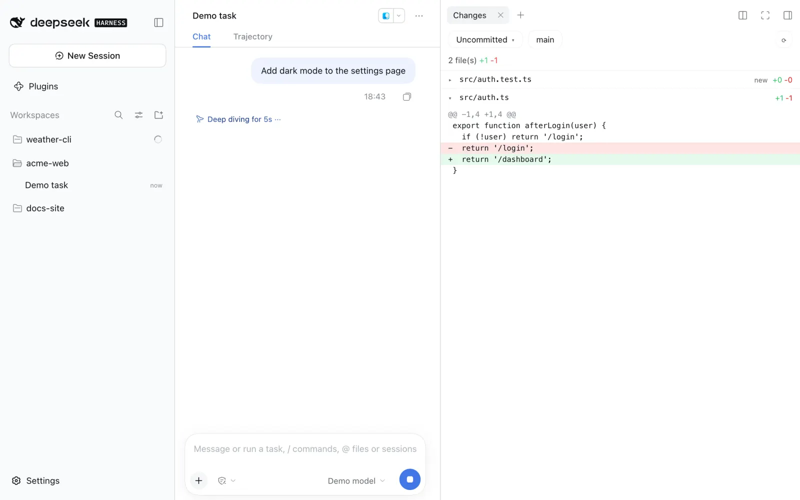</p>

Plugin communautaire non officiel. La recherche de mises à jour fait des appels réseau (versions GitHub et registre npm) ; désactivez **Mises à jour automatiques** pour les arrêter au démarrage. **Pack de skill turc** (activé par défaut) télécharge turkish-anti-ai-skill depuis GitHub et cherche une nouvelle version une fois par jour, uniquement quand **Langue de l’application** est Türkçe ; désactivez-le dans **Réglages → Composer Plus** pour arrêter ces appels. **Idées de fonctionnalités** n’appelle le modèle de votre discussion que lorsque vous cliquez sur **Suggérer des fonctionnalités**. **Prédiction du message suivant** (activée par défaut) appelle le modèle choisi dans les Réglages (celui par défaut de dsh, sauf si vous en choisissez un autre) une fois après chaque tour terminé, sans clic. Désactivez-la dans **Réglages → Composer Plus** pour arrêter ces appels. **Compléter pendant la saisie** (désactivé par défaut) appelle le modèle choisi pour cette fonctionnalité (par défaut, celui de la prédiction) à chaque pause pendant la saisie, une fois que vous l’avez activé. **Améliorer le prompt** n’appelle un modèle que lorsque vous cliquez sur sa baguette magique. **Tableau des tâches** appelle le modèle de la nouvelle discussion une fois pour les étiquettes de chaque tâche que vous lancez depuis le tableau. Avec son réglage **Résumé par IA** (par défaut **Rapide (sans IA)**), il appelle aussi le modèle d’une discussion en cours pour une courte note de progression pendant que vous regardez la progression de cette tâche sur le tableau ou dans Tether. **Vérification de l’objectif** (activée par défaut) appelle un modèle une fois chaque fois que l’agent marque un `/goal` comme terminé lors d’une itération automatique. **Connexion mobile** (désactivée par défaut) accepte les connexions d’iPhone depuis votre réseau local ou votre tailnet, et seulement après que vous l’avez activée.

## Installation

**App de bureau :** Réglages → Plugins → **Ajouter un plugin** → saisissez `dsh-composer-plus` → **Activer maintenant**.
Vous pouvez aussi coller `https://github.com/furkancak1r/dsh-composer-plus` à la place du nom npm.

**Profil web / CLI :**

```sh
dsh plugin --profile web add dsh-composer-plus
```

Redémarrez ensuite dsh. (La CLI ne peut pas installer dans le profil de bureau ; c’est l’app qui le gère.)

> Le pnpm de dsh ignore les versions publiées depuis moins de 24 heures. Juste après une nouvelle version, ajoutez le numéro de version : `dsh-composer-plus@1.27.1`.

## Fonctionnalités

<!-- BEGIN GENERATED FEATURES: edit docs/features.json, then run npm run build:readme -->

| Fonctionnalité | Utilisation | Capture d’écran |
|---|---|---|
| **Panneau des modifications** | <a id="feature-changespanel"></a>Barre latérale droite → `+` → **Modifications**. La page s’ouvre sur **Arbre** : une carte des branches du dépôt de la discussion. Trois tuiles comptent les branches : toutes, les branches fusionnées et celles qui attendent une fusion. Cliquez sur une tuile pour n’afficher que ces branches ; cliquez de nouveau dessus pour toutes les afficher. Chaque branche est une boîte avec son dernier commit : verte quand la branche principale contient son travail, orange sinon, bleue pour la branche principale. Une flèche va de chaque branche vers la branche qui l’a intégrée (✅ **Fusionnée**) ou vers la branche dont elle est partie (⏳ **En attente**, en pointillés). Cliquez sur une boîte pour voir les commits de la branche, puis sur un commit pour voir ses fichiers et leurs diffs. Cliquez sur **Fusionnée** pour voir les fichiers du commit de fusion, ou sur **En attente** pour voir les fichiers que la branche apporte dans sa cible. Une branche distante ne s’affiche que si aucune branche locale n’a le même nom. Dans le menu des modes, choisissez **Non validées**, **Non indexées**, **Indexées** ou **Branche** pour voir les fichiers modifiés avec leurs compteurs `+/-` ; cliquez sur un fichier pour voir son diff. **Dernier tour** ouvre la revue du dernier tour proposée par dsh lui-même. **Cette discussion** liste seulement les fichiers écrits par les outils de fichiers (write, edit) de la discussion ouverte, dans tous ses tours, et leur diff total depuis son premier message. Le bouton **␣** masque les modifications d’espaces (`git diff -w`) : les lignes dont seuls l’indentation ou les fins de ligne ont changé ne s’affichent pas. Le menu **…** d’un fichier → **Discussions qui ont modifié ce fichier** liste les discussions du même dépôt dont les outils d’écriture ou de modification ont modifié ce fichier, de la plus récente à la plus ancienne, avec la demande qui l’a fait ; un clic ouvre cette discussion à cette demande. | <a href="assets/features/changesPanel.webp">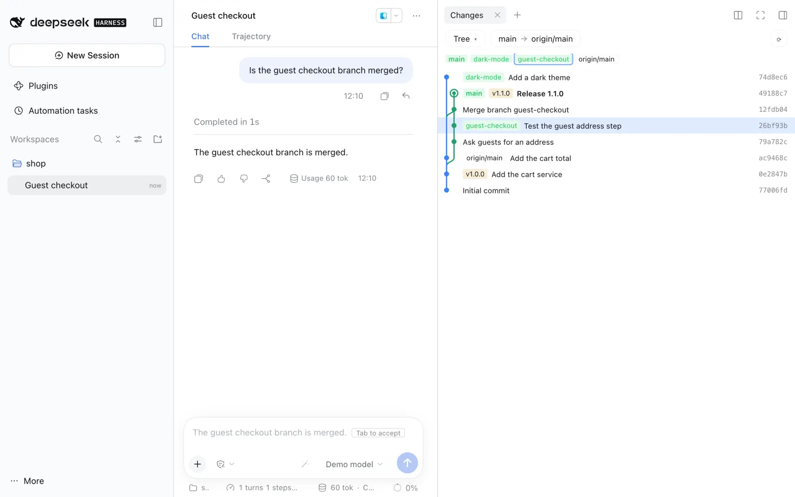</a> |
| **Idées de fonctionnalités** | <a id="feature-featureideas"></a>Barre latérale droite → `+` → **Idées de fonctionnalités** → **Suggérer des fonctionnalités**. Le modèle de la discussion lit un court résumé du projet de la discussion (fichiers de premier niveau, début du README et du manifeste, plan du reste du README, titres des commits récents) et suggère jusqu’à 8 fonctionnalités. Elles s’affichent sous forme de pile de cartes, dans la langue de l’interface de dsh. Balayez une carte vers la droite (ou cliquez sur **✓**, ou appuyez sur `→` ; dans chaque cas, la carte s’envole de son côté) pour lancer une nouvelle discussion dans le même projet : elle démarre en mode plan avec l’idée comme demande, donc rien ne change avant que vous approuviez le plan. Pour passer le plan, cliquez sur **▶ Créer maintenant** (ou appuyez sur `↑` ; la carte s’envole vers le haut) : la nouvelle discussion démarre tout de suite avec l’idée comme demande ordinaire, et le modèle fait la modification puis lance ses vérifications (les approbations s’appliquent comme d’habitude). Balayez vers la gauche (ou **✕**, ou `←`) pour ignorer la carte ; **Annuler** (ou `Z`) ramène une carte ignorée. Cliquez sur **↓** (ou appuyez sur `↓`) pour garder une bonne idée pour plus tard : elle va dans la liste **Plus tard** du projet, que chaque discussion du même dossier de projet affiche (même après un redémarrage). **Plus tard (N)** ouvre la liste ; **Planifier** lance la même discussion en mode plan pour l’idée et **Créer maintenant** la discussion sans plan, et les deux la retirent de la liste ; **Tout planifier (N)** lance une seule discussion en mode plan pour toutes les idées de la liste, donc les parties communes ne sont planifiées qu’une fois ; **Retirer de la liste** la supprime. **Copier en liste de tâches** copie toute la liste dans le presse-papiers sous forme de liste de tâches Markdown (`- [ ] Title — Summary`, une ligne par idée) pour un outil de suivi des tickets ou un fichier TODO ; aucun appel réseau n’est fait. **Ouvrir une issue GitHub** sur une idée ouvre une issue avec son titre et son résumé (et pourquoi elle compte) dans le dépôt GitHub du projet, avec votre propre connexion GitHub CLI (`gh`) ; le lien **Issue #N** s’affiche ensuite à côté de l’idée et ouvre l’issue. **Plus d’idées** ajoute des cartes. Pour obtenir des idées sur un seul domaine, tapez un court **Thème ciblé** dans le champ à côté de **Suggérer des fonctionnalités** (80 caractères au plus ; `Enter` lance aussi la suggestion), ou cliquez sur un des thèmes fixes en dessous : **Performances**, **Accessibilité**, **Tests**, **Sécurité**, **Utilisabilité** ou **Documentation** (cliquez de nouveau pour l’effacer). Le modèle suggère alors seulement des fonctionnalités sur ce thème ; un champ vide signifie n’importe quelle fonctionnalité. Une idée n’est pas suggérée deux fois dans un projet : chaque idée suggérée (ignorée, gardée ou lancée) va dans l’**Historique** du projet, le modèle reçoit la consigne de ne plus les suggérer et un titre répété est écarté. **Historique** les liste avec **Lancée** ou **Proposée** ; **Oublier** (ou **Tout oublier**) permet à une idée de revenir ; une idée encore dans la liste **Plus tard** reste hors des suggestions tant que vous ne l’en retirez pas. Le modèle ne s’exécute que lorsque vous cliquez. | <a href="assets/features/featureIdeas.webp">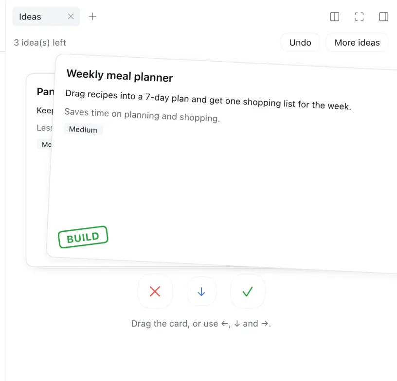</a> |
| **Recherche dans le contenu** | <a id="feature-contentsearch"></a>La recherche de la barre latérale de dsh (la loupe à côté d’**Espaces de travail** ; `Cmd+K` dans l’app de bureau, `Cmd+Alt+K` dans un navigateur) trouve aussi les discussions par les mots de vos messages et des réponses, et pas seulement par leur titre. Elle affiche le texte correspondant sous la discussion. dsh a déjà cette recherche, mais la livre désactivée ; cette fonctionnalité l’active avec un fichier d’index de recherche sur votre ordinateur. L’index est créé à la première recherche après un démarrage (environ 15 s pour 250 discussions, voir Limites) et il est conservé pour les démarrages suivants. Activée par défaut ; un changement s’applique après le redémarrage de dsh. | <a href="assets/features/contentSearch.webp">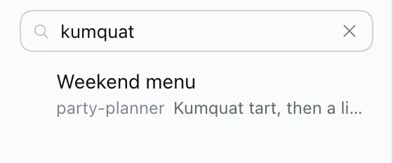</a> |
| **Annulation de tour** | <a id="feature-turnrollback"></a>Survolez un de vos messages et cliquez sur **↶** (à côté de Copier). **Discussion uniquement** retire ce message et tout ce qui suit (réponses, appels d’outils) de la discussion et du contexte du modèle, puis remet le message dans la zone de saisie : modifiez-le et envoyez-le à nouveau. **Discussion et fichiers** liste d’abord les fichiers du projet qui ont changé depuis ce message, puis les remet aussi dans l’état où ils étaient, y compris les modifications faites par des commandes (`bash`), et pas seulement par les outils d’édition de dsh. Un tour en cours s’arrête d’abord. Le journal de la discussion n’est jamais réécrit : un seul marqueur caché masque la partie retirée, de la même façon que la commande `/compact` de dsh masque les anciens messages. Si [dsh-rewind-plugin](https://www.npmjs.com/package/dsh-rewind-plugin) est installé, c’est lui qui fait ce travail et Composer Plus n’affiche pas de second bouton. Après une annulation, une barre **Refaire** s’affiche au-dessus de la zone de saisie : elle lance une nouvelle discussion à partir du moment juste avant l’annulation (mêmes messages et même contexte) et, avec **Discussion et fichiers**, remet aussi les fichiers en place. Un fichier que vous avez modifié après l’annulation est listé et conservé, sauf si vous cochez la case qui l’écrase. | <a href="assets/features/turnRollback.webp">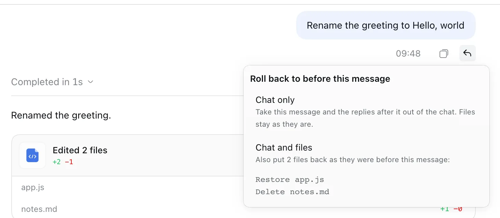</a> |
| **Supprimer la discussion** | <a id="feature-deletechat"></a>Barre latérale → menu **…** d’une discussion (ou clic droit) → **Supprimer…** → **Supprimer**. dsh seul ne peut qu’archiver. La discussion s’arrête (son tour, ses tâches en arrière-plan, ses sous-agents et ses rappels planifiés, comme avec l’archivage de dsh) et son historique enregistré, avec les discussions de ses sous-agents, est déplacé dans la Corbeille de macOS (sur les autres systèmes : `$DSH_HOME/trash`). Pour la récupérer, remettez le dossier à sa place et redémarrez dsh : elle apparaît dans la vue **Archivées uniquement** de la barre latérale. | <a href="assets/features/deleteChat.webp">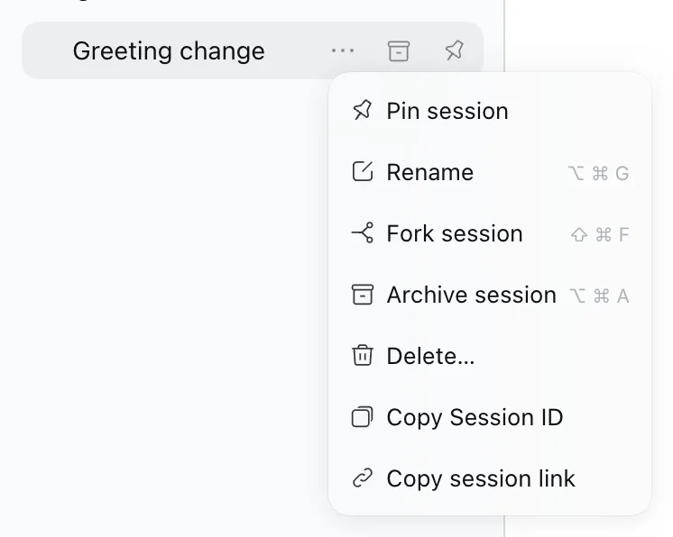</a> |
| **Nom du projet dans la zone de saisie** | <a id="feature-projectname"></a>La ligne sous la zone de saisie (tours, jetons, succès de cache, contexte) commence par le nom du projet de la discussion : vous voyez donc toujours dans quel projet travaille une discussion. C’est le titre du projet dans dsh, ou le nom du dossier si le projet n’a pas de titre. Survolez-le pour voir le chemin complet du dossier. Cliquez dessus pour retrouver la discussion dans la barre latérale, en vue liste ou par projet : la barre latérale et le projet s’ouvrent (y compris un projet replié et son **Afficher N sessions de plus**), la liste défile jusqu’à la discussion et la discussion clignote pendant 5 secondes. | <a href="assets/features/projectName.webp">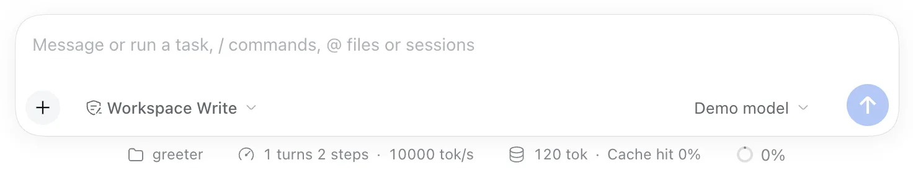</a> |
| **Historique de saisie** | <a id="feature-inputhistory"></a>Dans une zone de saisie vide, appuyez sur `↑` / `↓` pour parcourir les messages envoyés, comme dans un terminal. | <a href="assets/features/inputHistory.webp"></a> |
| **Mode plan avec Shift+Tab** | <a id="feature-plantoggle"></a>`Shift+Tab` ajoute `/plan ` au début du brouillon (appuyez de nouveau pour le retirer). Si la discussion est déjà en mode plan, `Shift+Tab` quitte ce mode. | <a href="assets/features/planToggle.webp"></a> |
| **Garder le focus dans la zone de saisie** | <a id="feature-keepfocus"></a>Après l’envoi d’une commande `/` ou d’une compétence, le curseur reste dans la zone de saisie et vous pouvez taper de nouveau tout de suite. Cela fonctionne aussi pour les macros clavier qui tapent une commande et appuient sur `Enter`. dsh met la zone de saisie en lecture seule pendant qu’il résout la commande, et le navigateur retire alors le focus. Cette fonctionnalité remet le focus, sauf si un menu, une boîte de dialogue ou un autre champ l’a. | <a href="assets/features/keepFocus.webp">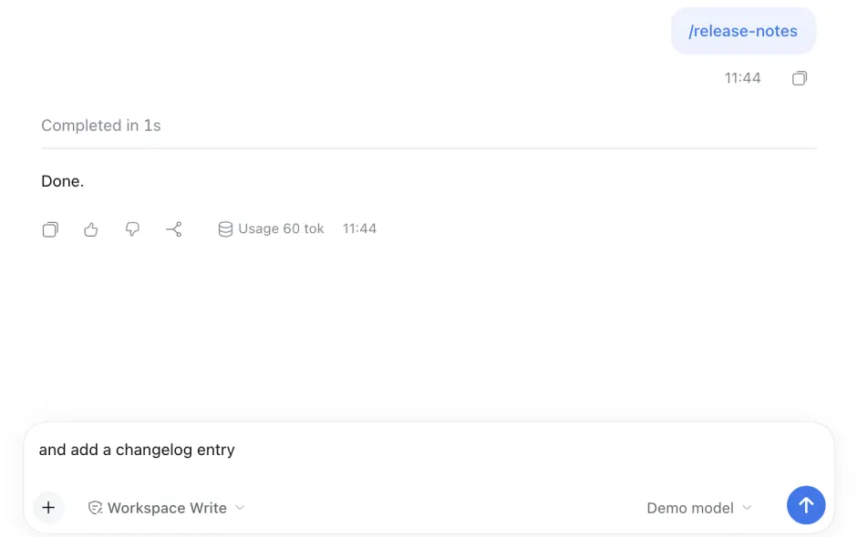</a> |
| **Adapter la carte de question à la fenêtre** | <a id="feature-questionfit"></a>Quand l’agent vous pose une question, la question et ses réponses défilent ensemble dans la carte, et **Ignorer** et **Envoyer** restent visibles en bas. La carte utilise la hauteur de la fenêtre (moins 200 px pour l’en-tête de la conversation et une bande de la conversation) : elle grandit et rétrécit avec la fenêtre. Sans cette fonctionnalité, dsh limite la carte à 60 % de la fenêtre (520 px au plus) et seules les réponses défilent : une longue question peut pousser sa propre fin, les réponses et les boutons hors de la carte. | <a href="assets/features/questionFit.webp">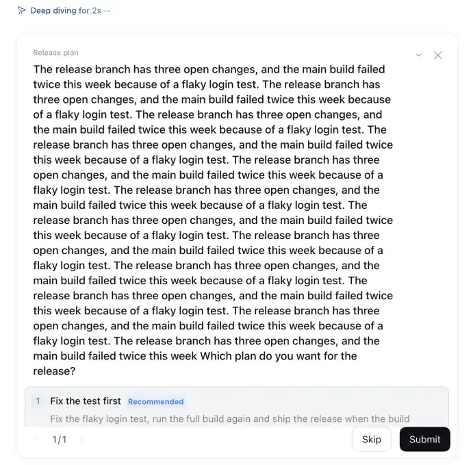</a> |
| **Adapter l’en-tête de la conversation à la fenêtre** | <a id="feature-headerfit"></a>Dans une fenêtre étroite, les boutons de l’en-tête de la conversation de dsh (le mode, les sous-agents, les tâches en arrière-plan, Ouvrir dans, l’étiquette de branche et l’étiquette d’autorisations) ne se chevauchent plus. Le titre garde au moins 120 px ; les boutons qui ne tiennent pas passent sur une deuxième ligne à droite, et chacun reste cliquable. Quand tout tient sur une ligne (fenêtre large), l’en-tête est exactement celui de dsh. Sans cette fonction, dsh ne réduit que le titre : avec un sous-agent et des tâches en arrière-plan, ses boutons se chevauchent dans une colonne de conversation étroite. L’étiquette de branche (**Une branche par discussion**) et celle d’autorisations (**Autoriser pour cette discussion**) s’adaptent aussi à l’en-tête quand cet interrupteur est désactivé. | <a href="assets/features/headerFit.webp">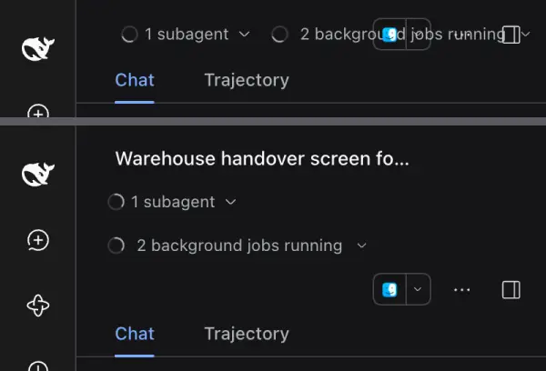</a> |
| **Mémoriser la taille de la fenêtre** | <a id="feature-windowsize"></a>L’application de bureau de dsh ouvre sa fenêtre en 1280 × 820 à chaque démarrage. Avec cette fonction, elle s’ouvre avec la taille et la position de la fenêtre lors de la dernière utilisation. La taille est enregistrée chaque fois que vous redimensionnez ou déplacez la fenêtre, et revient quand le plugin se charge au démarrage suivant. Une fenêtre en plein écran ou réduite n’est pas enregistrée ; une position sur un écran qui n’est plus connecté revient sur l’écran principal. Uniquement dans l’application de bureau : un onglet de navigateur ne peut pas changer la taille de sa fenêtre. | <a href="assets/features/windowSize.webp">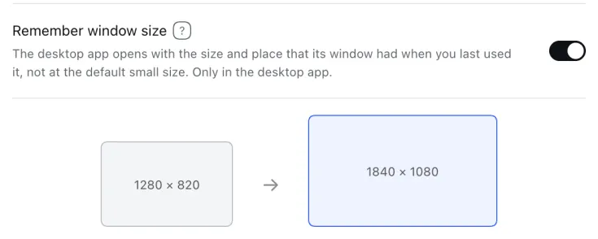</a> |
| **Sous-agents en cours dans l’en-tête de la conversation** | <a id="feature-subagentrunning"></a>Le compteur de sous-agents de l’en-tête de la conversation indique combien de sous-agents sont en cours maintenant. Quand aucun n’est en cours, il indique 0. Cliquez sur le compteur : la liste s’ouvre comme avant, et sa première ligne affiche le total des sous-agents de la conversation (« Sous-agents au total : 37 »). Sans cette fonctionnalité, le compteur de dsh affiche le total, y compris les sous-agents terminés. | <a href="assets/features/subagentRunning.webp">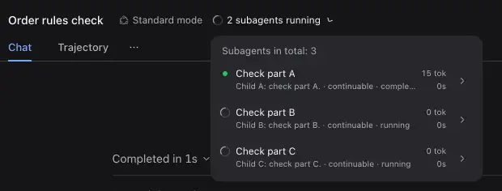</a> |
| **Continuer en un clic** | <a id="feature-continuebutton"></a>Après un tour arrêté, en échec ou interrompu, une zone de saisie vide affiche **▶**. Un clic reprend la conversation existante, sans écrire dans le champ de saisie ni ajouter de message visible à la discussion (le modèle reçoit une courte note cachée « continue là où tu t’es arrêté », car certains fournisseurs, comme Claude, refusent une requête qui se termine par une réponse de l’assistant). Les messages de la file y restent : ▶ reprend seulement la tâche arrêtée, puis la file s’exécute. Un tour terminé garde le bouton Envoyer habituel. | <a href="assets/features/continueButton.webp">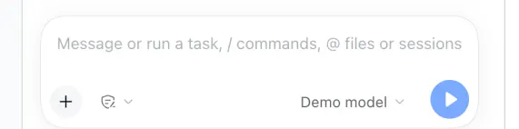</a> |
| **Reprendre après redémarrage** | <a id="feature-resumeafterrestart"></a>Désactivée par défaut : activez-la dans **Réglages → Composer Plus**. Si vous quittez dsh (ou s’il se ferme) pendant qu’une discussion travaille, cette discussion reprend d’elle-même quand vous rouvrez dsh, avec la même note cachée que Continuer en un clic. Si une itération d’objectif (`/goal`) était en cours, l’objectif passe à l’itération suivante (dsh suspend les objectifs à chaque démarrage jusqu’à ce que vous les repreniez). Les discussions que vous avez arrêtées, terminées ou en échec ne reprennent pas. dsh lui-même n’a pas de réglage pour cela : il marque seulement ce tour comme interrompu. | <a href="assets/features/resumeAfterRestart.webp">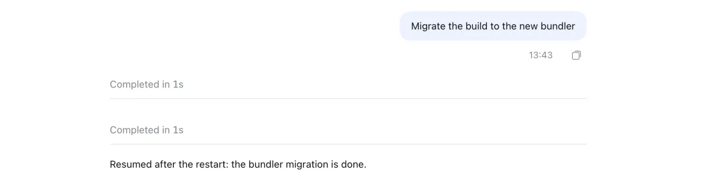</a> |
| **Reprendre après une panne d’AIProxy** | <a id="feature-outageresume"></a>Activée par défaut. Quand AIProxy redémarre ou s’arrête un instant, toutes les discussions en cours échouent en même temps avec `499 request_cancelled` ou `Connection error.`. Composer Plus regroupe ces échecs (les échecs survenus dans un intervalle de 60 s comptent comme une seule panne), interroge l’adresse de vérification d’état d’AIProxy jusqu’à ce qu’il réponde, attend encore 10 s, puis envoie à chaque discussion de premier niveau en échec un message dans la langue de l’interface : « Le tour s’est arrêté à cause d’une panne d’AIProxy. Reprends là où tu t’es arrêté ; ne répète pas les étapes que tu as terminées. » Une discussion reçoit au plus un tel message par panne, et deux par heure. Un tour que vous avez arrêté, une approbation refusée et toute autre erreur ne comptent pas, et une discussion qui a avancé entre-temps (vous avez envoyé un message) ne reçoit rien. Le panneau d’état de la discussion de l’Assistant liste les discussions qui ont repris. Les sous-agents ne peuvent pas recevoir ce message : leur agent parent est informé que l’échec vient de la panne, pour qu’il puisse leur envoyer un message. Désactivez-la dans **Réglages → Composer Plus**. | <a href="assets/features/outageResume.webp">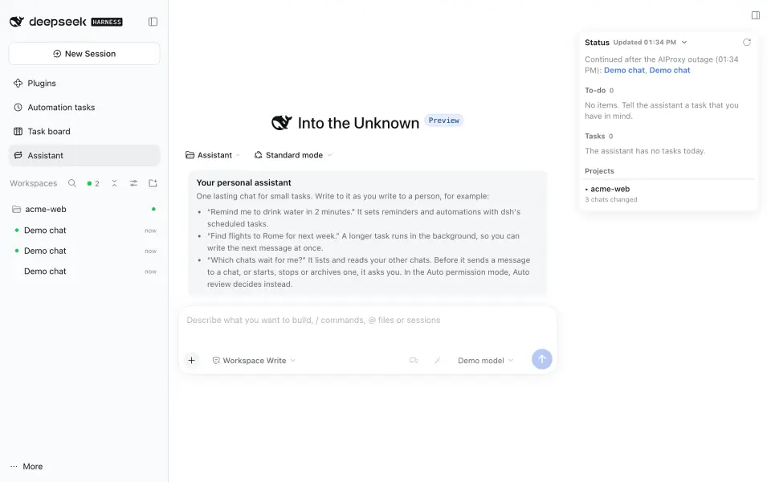</a> |
| **Glisser-déposer dans la file** | <a id="feature-queuereorder"></a>Les messages en file d’attente reçoivent une poignée (⠿). Faites-la glisser pour réordonner, ou placez le focus sur la poignée et appuyez sur `↑` / `↓`. `Esc` annule. | <a href="assets/features/queueReorder.webp">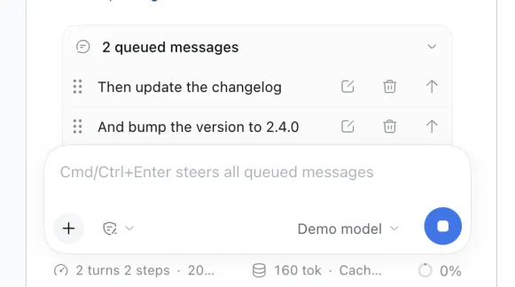</a> |
| **Modifier sur place un message en file d’attente** | <a id="feature-queueedit"></a>Double-cliquez sur un message en file d’attente, ou cliquez sur son bouton Modifier (**Modifier le message en file d’attente**). Un éditeur s’ouvre dans la ligne : modifiez le texte, supprimez une image ou un fichier avec son ✕, ou ajoutez-en de nouveaux avec le trombone (**Ajouter des images ou des fichiers**) ou en collant une image. `Enter` enregistre, `Esc` annule et `Shift+Enter` ajoute une ligne. Le message garde sa place dans la file, et les images et fichiers que vous gardez ne changent pas. Tant que l’éditeur est ouvert, la file ne peut pas être réordonnée. Dans Tether : menu du message en file d’attente → Edit. | <a href="assets/features/queueEdit.webp">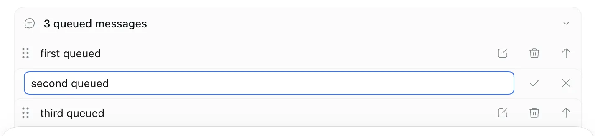</a> |
| **Priorité au message envoyé après Arrêter** | <a id="feature-stopsendfirst"></a>Activée par défaut. Arrêtez une discussion pendant que des messages attendent dans sa file, puis envoyez un nouveau message : il s’exécute tout de suite, seul. Les messages en file gardent leur ordre et s’exécutent après lui, un par tour. Sans cela, dsh ajoute le nouveau message à la fin de la file et exécute à sa place le premier message en file, si bien que le nouveau s’exécute en dernier. Un message envoyé pendant que la discussion travaille attend toujours à la fin de la file. | <a href="assets/features/stopSendFirst.webp">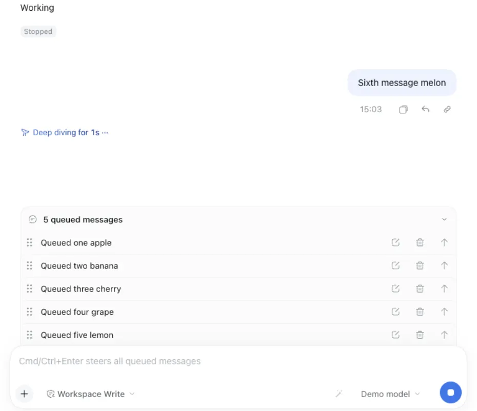</a> |
| **Copier le lien de session** | <a id="feature-copydeeplink"></a>Clic droit sur une discussion dans la barre latérale → **Copier le lien de session**. Collez le lien `dsh-session:…` dans une autre discussion pour y joindre cette discussion comme contexte en lecture seule. dsh 0.2.1 a son propre **Copier l’ID de session**, qui ne copie que l’identifiant brut ; cet élément vient juste après. | <a href="assets/features/copyDeeplink.webp">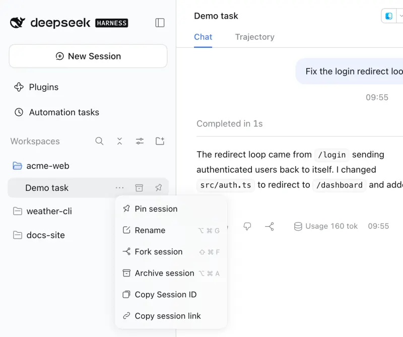</a> |
| **Copier le lien du message** | <a id="feature-copymessagelink"></a>Survolez un message et cliquez sur **🔗** (dans sa ligne d’actions ; pour une réponse, à côté de l’heure). Le lien est le lien de session suivi du numéro du message : `dsh-session:…#42`. Collez-le dans un message et envoyez-le : à partir de dsh 0.2.1, le lien s’affiche comme une pastille. Un clic ouvre cette discussion, fait défiler jusqu’au message et le met en évidence pendant 2 secondes. Comme un lien de session, il joint aussi cette discussion comme contexte en lecture seule. | <a href="assets/features/copyMessageLink.webp">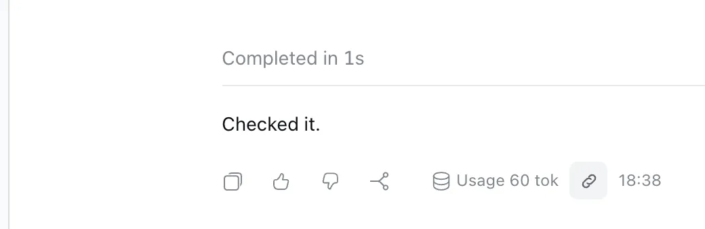</a> |
| **Exporter la discussion en Markdown** | <a id="feature-exportmarkdown"></a>Clic droit sur une discussion dans la barre latérale (ou ouvrez son menu **…**) → **Exporter en Markdown…**. Une boîte de dialogue indique combien de messages la discussion contient ; **Copier dans le presse-papiers** copie la discussion en Markdown, **Enregistrer le fichier .md** l’enregistre sous `<chat title>.md` via le téléchargement du navigateur (dsh de bureau : dans votre dossier Téléchargements ou via une boîte de dialogue d’enregistrement, selon les réglages de votre système). Le fichier contient le titre de la discussion, le nom du projet et la date, puis une section `## Vous` ou `## Assistant` par message. Les blocs de code restent tels quels ; un bloc de code qu’un message laisse ouvert est fermé. | <a href="assets/features/exportMarkdown.webp">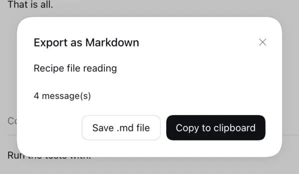</a> |
| **Copier le chemin du projet** | <a id="feature-copyprojectpath"></a>Clic droit sur un projet dans la barre latérale → **Copier le chemin** copie le chemin complet de son dossier. | <a href="assets/features/copyProjectPath.webp">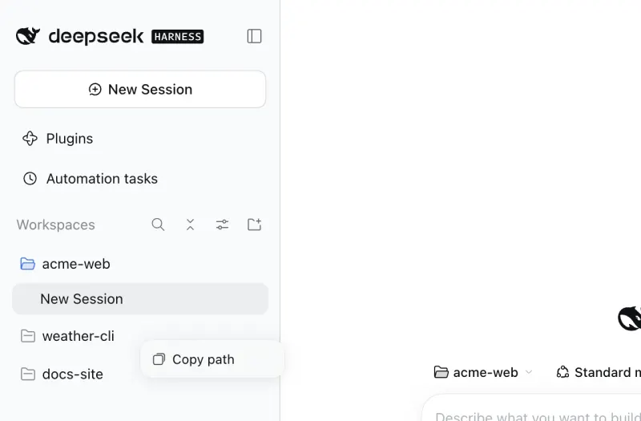</a> |
| **Recherche de projet dans une nouvelle discussion** | <a id="feature-projectpicker"></a>Nouvelle discussion → le bouton de projet au-dessus de la zone de saisie. Les projets s’affichent dans l’ordre A–Z, avec un champ **Rechercher des projets** en haut. Tapez une partie d’un nom (sans tenir compte de la casse ni des accents) et appuyez sur `Enter` pour choisir le premier résultat. Si rien ne correspond, **Aucun projet ne correspond** s’affiche. L’ordre des projets enregistré par dsh dans la barre latérale ne change pas. | <a href="assets/features/projectPicker.webp">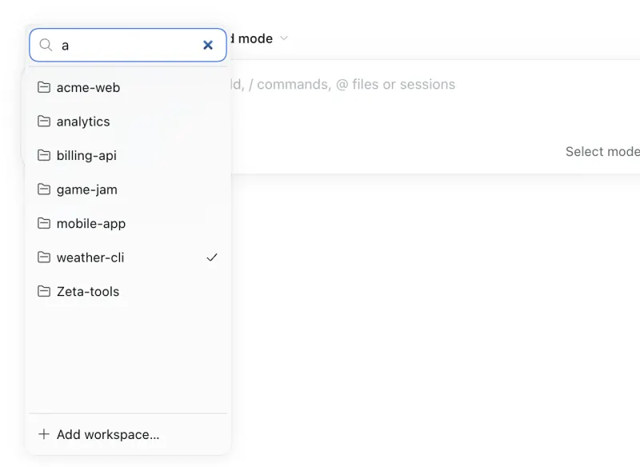</a> |
| **Espace de travail par défaut pour Nouvelle session** | <a id="feature-defaultworkspace"></a>Réglages → Composer Plus → **Espace de travail par défaut pour Nouvelle session** → **Ouvrir Nouvelle session dans** : choisissez un projet ou **Dossier général (default-workspace)** (la valeur par défaut : le dossier de dsh `Documents/deepseek-harness/default-workspace`, créé à la première utilisation). Ensuite, **Nouvelle session** en haut de la barre latérale (et son raccourci) ouvre toujours la nouvelle discussion à cet endroit, même quand une discussion d’un autre projet est ouverte. Le `+` à côté d’un projet ouvre toujours ce projet, et le bouton de projet au-dessus de la zone de saisie de la nouvelle discussion change toujours le projet. | <a href="assets/features/defaultWorkspace.webp">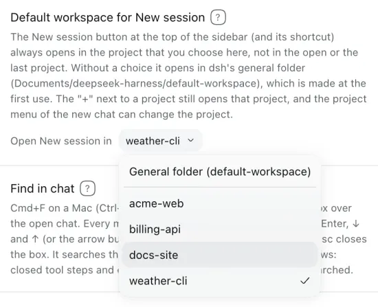</a> |
| **Rechercher dans la discussion** | <a id="feature-findinchat"></a>Appuyez sur `Cmd+F` sur un Mac (`Ctrl+F` sous Windows et Linux) dans une discussion : un champ de recherche s’ouvre au-dessus. Tapez un mot : chaque résultat dans les messages et les réponses à l’écran est surligné, le résultat actuel dans une couleur plus forte, et le champ affiche n / total. `Enter` ou `↓` passe au résultat suivant et `Shift+Enter` ou `↑` au précédent (les boutons fléchés aussi) ; la discussion fait défiler le résultat jusqu’au milieu. Les majuscules, les accents et le ı sans point du turc ne comptent pas. `Esc` ferme le champ et remet le curseur là où il était. La recherche suit la discussion pendant qu’une réponse arrive. | <a href="assets/features/findInChat.webp">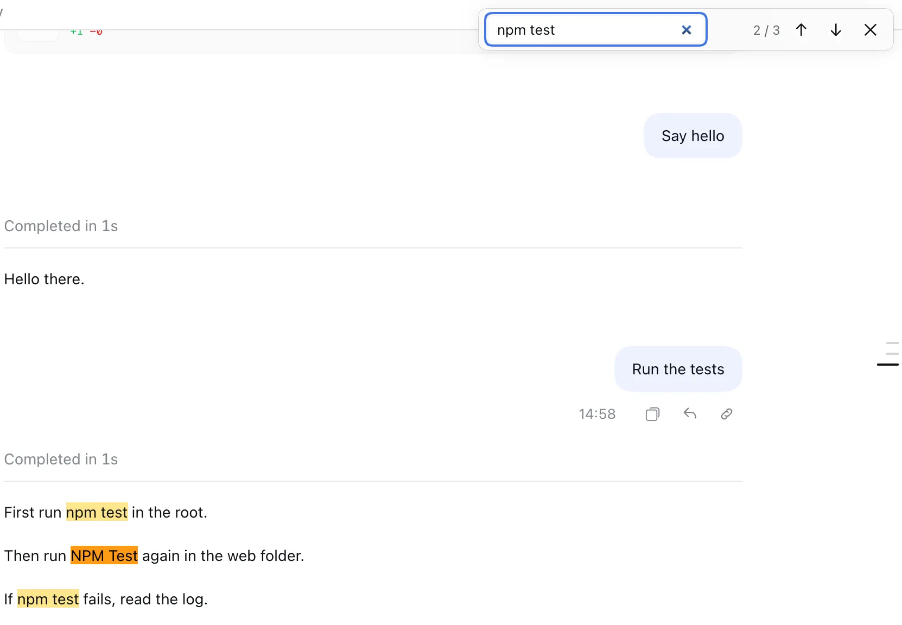</a> |
| **Une branche par discussion** | <a id="feature-worktreechats"></a>Sur l’écran de nouvelle discussion, le bouton de branche (icône de branche) entre le bouton de projet et le bouton de mode affiche **Nouvelle branche** par défaut. Tapez le premier message et envoyez-le. Pour rester sur la branche actuelle, choisissez « Branche actuelle (main) » dans le même bouton. Le premier message peut contenir des images et des fichiers. En mode plan, la nouvelle discussion démarre aussi en mode plan : envoyez le message sous la forme `/plan <message>` (Shift+Tab), ou mettez d’abord Nouvelle discussion en mode plan. L’IA nomme la branche (`feat/…`, `fix/…`) d’après ce message, Composer Plus crée pour elle un worktree git dans `<project>/.worktrees/`, copie les fichiers ignorés que liste `.worktreeinclude` (par exemple `.env` et `node_modules/`) et y ouvre une nouvelle discussion avec votre message. L’en-tête de la discussion ouverte affiche ⑂ branche · N modifications · ↑ ↓ (ou **non poussée**) ; cliquez dessus pour ouvrir **Modifications**. Le même menu liste les worktrees ouverts : choisissez-en un pour y lancer une discussion. Pour voir les dossiers des branches dans leur projet dans la barre latérale, choisissez dans dsh **Options d’affichage** → **Arborescence des espaces de travail**. | <a href="assets/features/worktreeChats.webp">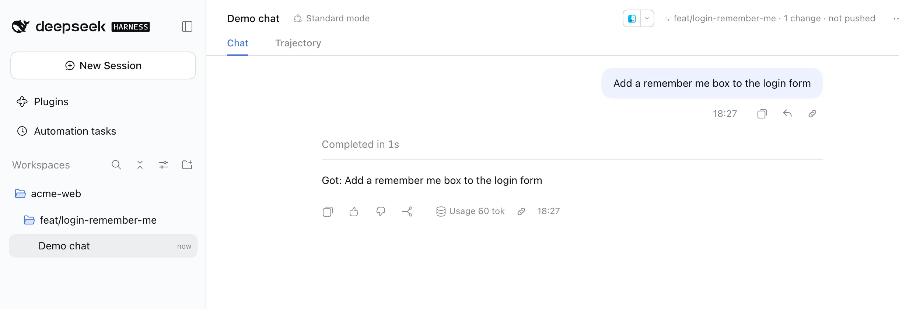</a> |
| **Branches dans l’arborescence des espaces de travail** | <a id="feature-branchtree"></a>Réglages → Composer Plus → **Branches dans l’arborescence des espaces de travail** (désactivé par défaut). Chaque branche qui a un dossier de worktree dans `<project>/.worktrees/` s’affiche alors comme un projet dans son projet ; choisissez **Options d’affichage** → **Arborescence des espaces de travail** de dsh pour la voir imbriquée. Une branche dont le dossier est supprimé quitte la liste, et dsh affiche ses discussions sous **Sans groupe**. Quand l’agent d’une discussion dans le dossier du projet crée une branche et passe dessus (`git switch -c`, `git checkout -b`) sans modification non validée dans le dossier, le dossier du projet revient à sa branche précédente, la branche reçoit son propre dossier et la discussion y va : une copie s’ouvre dans le projet de la branche et continue la tâche, et l’ancienne discussion est archivée. La liste est vérifiée au démarrage, toutes les 30 secondes, après chaque tour et quand vous revenez à la fenêtre. | <a href="assets/features/branchTree.webp">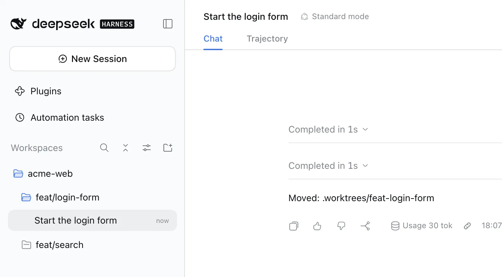</a> |
| **Prédiction du message suivant** | <a id="feature-nextprediction"></a>Activée par défaut ; vous pouvez la désactiver dans **Réglages → Composer Plus**. Quand l’agent termine un tour (pas un tour arrêté ou en échec), la zone de saisie vide affiche en gris une prédiction de votre prochain message, avec l’indication **Tab pour accepter**. `Tab` place le texte dans la zone de saisie, sans l’envoyer. `Esc` la masque pour ce tour. Taper du texte la masque aussi, et un nouveau tour la remplace. Le menu **Modèle**, sous l’interrupteur, liste les modèles de dsh (la même liste que le menu des modèles de dsh). **Défaut de dsh** est sélectionné par défaut et suit le modèle par défaut de dsh. Chaque tour terminé coûte un court appel au modèle. Dans Tether, la prédiction s’affiche au-dessus de la zone de saisie vide : touchez-la pour la placer dans le champ. | <a href="assets/features/nextPrediction.webp">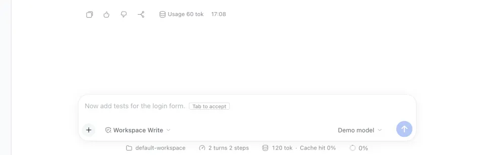</a> |
| **Compléter pendant la saisie** | <a id="feature-typingcompletion"></a>Désactivé par défaut ; vous pouvez l’activer dans **Réglages → Composer Plus**. Pendant que vous tapez, un texte gris juste après le curseur montre comment votre message peut continuer. `Tab` l’ajoute au message, sans l’envoyer. `Esc` le masque. Il ne propose que vos propres mots suivants : jamais une réponse qui vous est adressée, ni des textes d’erreur ou des noms inventés. Si le message semble complet ou si le modèle n’est pas sûr, rien ne s’affiche. Si vous tapez les lettres suivantes du texte gris, il reste affiché, sans nouvel appel au modèle. Cette fonctionnalité a son propre menu **Modèle** sous son interrupteur. Sa première option, **Comme la prédiction du message suivant**, utilise le modèle de **Prédiction du message suivant** (c’est l’option par défaut) ; choisissez un autre modèle pour utiliser un modèle différent pour chaque fonctionnalité, par exemple un modèle plus rapide pour les complétions. Elle fait un appel au modèle à chaque pause pendant la saisie : elle consomme donc beaucoup plus de tokens que la prédiction. Choisissez un modèle rapide et peu coûteux. Elle ne s’exécute pas pour une commande slash, un message avec une pastille de fichier, ou quand le curseur n’est pas à la fin. Dans Tether, la suite s’affiche au-dessus du champ pendant la saisie : touchez-la pour l’ajouter. | <a href="assets/features/typingCompletion.webp">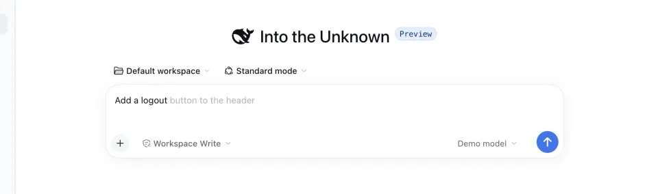</a> |
| **Améliorer le prompt** | <a id="feature-promptimprove"></a>Tapez une demande approximative, puis cliquez sur la baguette magique (**Améliorer le prompt**) à côté du menu des modèles. Un appel au modèle la réécrit en un prompt plus clair : l’objectif d’abord, de courtes étapes numérotées quand il y a plusieurs parties, et la vérification à lancer. Il lit cette discussion (sans les messages retirés par une annulation), le README, AGENTS.md et le manifeste du projet, les fichiers modifiés et les fichiers dont le nom correspond à vos mots, et garde votre langue. Il n’invente jamais de noms de fichiers. Le nouveau texte remplace votre brouillon, mais n’est pas envoyé : lisez-le, modifiez-le, puis appuyez sur `Enter`. `Cmd/Ctrl+Z` rétablit votre texte en une étape, tout comme le bouton (**Annuler l’amélioration**). Si vous tapez pendant qu’il travaille, votre nouveau texte reste. `Esc` ou un second clic annule. Il a son propre menu **Modèle** dans les Réglages (par défaut : **Comme le modèle de la discussion**). Sur un message `/goal <objective>`, il réécrit seulement l’objectif, sous forme d’une condition d’achèvement que la **Vérification de l’objectif** peut vérifier : les résultats attendus, les vérifications qui doivent réussir, la preuve à montrer dans la discussion, une partie impossible à faire marquée comme non résolue, et un arrêt quand le même blocage persiste. La commande `/goal` reste. Pas pour les autres commandes slash, un mot de contrôle de `/goal` (`clear`, `pause`, `resume`) ni un message avec une pastille de fichier. Dans Tether, la baguette est à côté du champ. | <a href="assets/features/promptImprove.webp">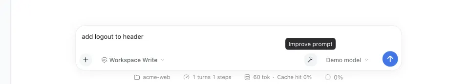</a> |
| **Vérification de l’objectif** | <a id="feature-goalcheck"></a>Lancez un objectif avec `/goal`. Quand l’agent marque l’objectif comme terminé lors d’une itération automatique, l’objectif ne se ferme qu’après deux vérifications. D’abord, la commande de test du projet s’exécute dans le dossier de la discussion, avec le mode sandbox de la discussion. La commande est la vôtre ou celle trouvée dans `package.json`, `Makefile`, `Cargo.toml`, `go.mod` ou pytest. Quand la dernière étape de l’agent lui-même était une exécution réussie de ce test, il n’est pas relancé. Ensuite, un appel indépendant au modèle, sans outils, lit l’objectif, cette discussion, `git status` et le résultat du test. Le modèle répond par un tableau de preuves : chaque partie de l’objectif est vérifiée, incorrecte ou non résolue, avec la preuve et la correction ; l’objectif ne se ferme que lorsque chaque partie est vérifiée. Si une vérification échoue, l’objectif reste actif et l’agent lit chaque partie ouverte avec sa preuve et sa correction, puis l’itération suivante continue. Une ligne sous la barre de l’objectif (**Vérification de l’objectif**) affiche le test, le dernier résultat et le nombre de parties vérifiées (survolez-la pour voir le tableau). **Modifier** définit votre propre commande de test et une limite de temps ou de tokens ; au-delà de la limite, l’objectif devient bloqué. La limite de tokens compte aussi les sous-agents de la discussion. **Lancer maintenant** lance la vérification sans fermer l’objectif. Il a son propre menu **Modèle** dans les Réglages (par défaut : **Comme le modèle de la discussion**). Quand vous terminez l’objectif vous-même, rien n’est vérifié. | <a href="assets/features/goalCheck.webp">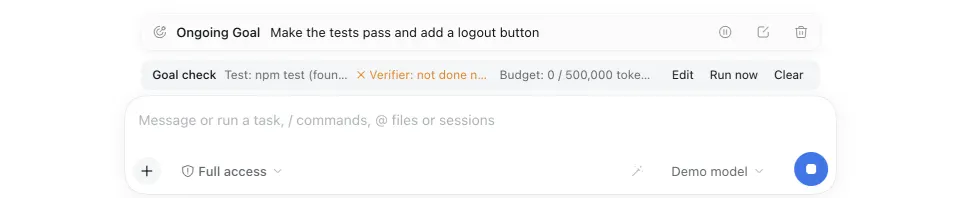</a> |
| **Continuer dans une nouvelle discussion** | <a id="feature-handoffchat"></a>Clic droit sur une discussion dans la barre latérale (ou ouvrez son menu **…**) → **Continuer dans une nouvelle discussion…**. Un seul appel au modèle de la discussion rédige une note de passation à partir de ce que montre la discussion : Tâche, Résultats, Terminé, Décisions, Problèmes ouverts et Prochaine action (les appels d’outils et leurs résultats sont les preuves ; les étapes que vous avez annulées sont exclues). La note s’ouvre dans une boîte de dialogue : lisez-la et modifiez-la. **Rédiger à nouveau** rédige une nouvelle note. **Lancer une nouvelle discussion** (ou `Cmd/Ctrl+Enter`) ouvre une nouvelle discussion dans le même projet, avec la note et un lien vers l’ancienne discussion comme premier message ; l’ancienne discussion reste telle quelle. Utilisez cette fonction quand une longue discussion est pleine ou lente, ou pour continuer demain. Rien n’est écrit dans le projet. | <a href="assets/features/handoffChat.webp">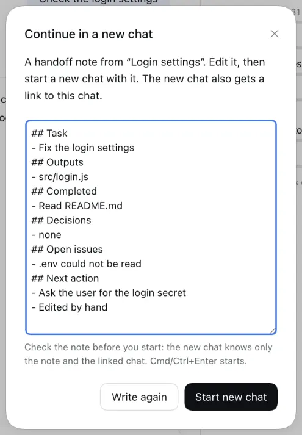</a> |
| **Répartition du contexte** | <a id="feature-contextbreakdown"></a>Barre latérale droite → `+` → **Contexte**. La page montre ce qui remplit maintenant le contexte du modèle de la discussion ouverte et la part de la fenêtre de contexte utilisée : le prompt système, les instructions du projet (AGENTS.md), les compétences, vos messages, les réponses de l’agent et les appels d’outils, les résultats d’outils (par outil), les résultats MCP (par serveur), les définitions des outils, le résumé de compaction et les autres notes de contexte, chacun avec ses tokens et sa part. Cliquez sur une partie pour voir ses outils ou ses serveurs. Elle lit seulement le journal de la discussion, après `/compact` et les annulations, et n’appelle aucun modèle ; elle relit le journal après chaque tour et avec **Actualiser**. Utilisez-la pour voir pourquoi une discussion est lente ou pleine, par exemple à cause d’un gros résultat d’outil MCP ou de nombreuses définitions d’outils. | <a href="assets/features/contextBreakdown.webp">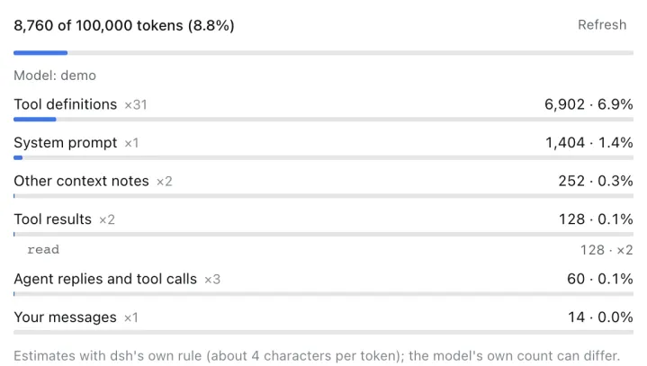</a> |
| **Étapes planifiées** | <a id="feature-plannedsteps"></a>Désactivée par défaut : activez-la dans **Réglages → Composer Plus**. L’agent reçoit l’outil `plan_next_steps` : dans le même message qu’une commande, il peut planifier les commandes suivantes avec leurs arguments exacts et une condition, par exemple « lance `npm test` quand la compilation réussit ». Quand le résultat remplit la condition, Composer Plus exécute lui-même l’étape suivante, sans nouvel appel au modèle, et une longue discussion consomme moins de jetons. L’étape apparaît dans la discussion sous forme d’une courte ligne, « Composer Plus · Planned steps: ran `test` … without a model call », suivie de son appel d’outil et de son résultat. Uniquement des étapes `bash`, `read`, `grep` et `glob` ; les approbations, le sandbox et Fichiers protégés s’appliquent à chaque étape comme d’habitude. Le modèle répond de nouveau quand une condition échoue, quand deux étapes sont prêtes en même temps, après la dernière étape et quand vous envoyez un message. L’idée vient de HarnessMM (arXiv 2610.32813). | <a href="assets/features/plannedSteps.webp">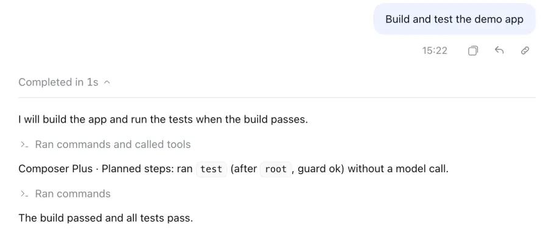</a> |
| **Pack de skill turc** | <a id="feature-turkishskill"></a>Uniquement quand **Langue de l’application** est Türkçe (activé par défaut ; désactivez-le dans **Réglages → Composer Plus**). Composer Plus télécharge depuis GitHub le skill open source [turkish-anti-ai-skill](https://github.com/yucezerey/turkish-anti-ai-skill) (MIT, par Yüce Zerey) et l’ajoute aux skills de dsh. Demandez à l’agent d’humaniser, de réécrire ou d’écrire un texte en turc : dsh charge le skill, et ses règles aident l’agent à écrire un turc naturel, sans tournures d’IA. Seuls les fichiers Markdown du pack sont gardés ; chaque fichier doit correspondre à la liste des fichiers de GitHub, et aucun script du pack ne s’exécute. Une fois par jour, le plugin demande à GitHub s’il existe une nouvelle version et l’installe. La ligne affiche la version installée, ou pourquoi elle n’est pas installée. Dans une autre langue, le skill n’est pas installé ; revenez au Türkçe et il revient. | <a href="assets/features/turkishSkill.webp">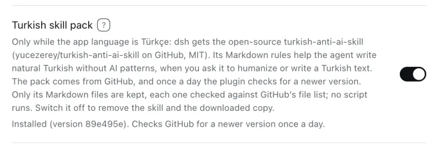</a> |
| **Démêler le code** | <a id="feature-untanglecodebase"></a>Activée par défaut ; désactivez-la dans **Réglages → Composer Plus**. Ajoute la compétence `/untangle-codebase` de [caldoai/skills](https://github.com/caldoai/skills) (MIT, © 2026 Maze) à la liste des compétences de dsh. Dans une discussion, tapez `/untangle-codebase` (elle apparaît dans le menu `/`), si vous voulez suivi d’une partie sur laquelle se concentrer, par exemple `/untangle-codebase src/api`, puis envoyez. L’agent demande d’abord s’il doit aussi supprimer les commentaires qui ne font que répéter le code et les tests qui ne peuvent détecter aucun vrai bug. Ensuite, il liste chaque copie, lien caché, lien inutile, enveloppe qui ne fait que transmettre l’appel, code mort et cas particulier ponctuel, planifie les corrections à partir des principes de base, les applique sous forme d’objectif et vérifie de nouveau avec des sous-agents jusqu’à ce qu’il ne reste rien qui vaille la peine d’être corrigé. Vous seul pouvez la lancer : le modèle ne la voit pas dans sa liste de compétences, elle ne consomme donc aucun jeton dans les autres discussions. Une compétence du même nom dans le projet ou dans `~/.dsh/skills` passe avant. Lancez-la dans une discussion de **Une branche par discussion** et examinez le résultat dans **Panneau des modifications**. Dans Tether : tapez `/untangle-codebase` dans le champ du message. | <a href="assets/features/untangleCodebase.webp">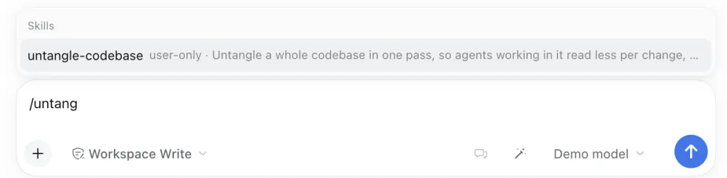</a> |
| **Fichiers protégés** | <a id="feature-protectedfiles"></a>Activée par défaut. Les outils de fichiers propres à l’agent ne peuvent ni lire ni modifier les fichiers qui correspondent à vos motifs : `read`, `read_image` et `grep` sur un fichier sont refusés pour les motifs **lecture et écriture**, et `write`, `edit` et `str_replace_editor` pour les deux types. L’agent lit pourquoi et on lui demande de vous consulter. Les motifs par défaut sont `.env*`, `*.pem` et `*.key`. Réglages → Composer Plus → **Fichiers protégés** : ajoutez un motif (par exemple `published/**` ou `config/*.yml`), cliquez sur son type pour basculer entre **lecture et écriture** et **écriture seule**, supprimez-le avec ✕, ou cliquez sur **Utiliser les valeurs par défaut**. Un motif sans `/` correspond à un nom de fichier dans n’importe quel dossier. C’est un garde-fou, pas un sandbox : une commande shell (`cat .env`), un script ou un outil MCP peut encore atteindre le fichier (voir Limites). | <a href="assets/features/protectedFiles.webp">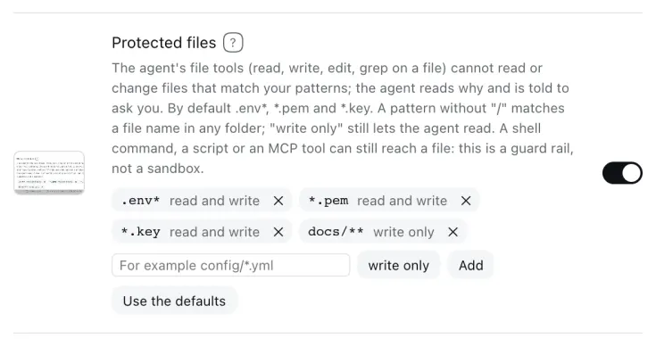</a> |
| **Commandes bloquées** | <a id="feature-blockedcommands"></a>Activée par défaut, avec une liste vide. Les commandes shell de l’agent (`bash`, `pwsh`) ne peuvent pas exécuter une commande qui correspond à vos règles : une règle **bloquer** refuse l’appel (l’agent lit pourquoi et on lui demande de vous consulter), une règle **demander d’abord** affiche la carte d’approbation de dsh, et la commande ne s’exécute que si vous l’autorisez. Réglages → Composer Plus → **Commandes bloquées** : tapez une règle (par exemple `npm publish`, `git push --force` ou `ssh *192.168.2.19`), cliquez sur son type pour basculer entre **bloquer** et **demander d’abord**, puis cliquez sur **Ajouter** ; cliquez sur le type d’une règle pour le changer, supprimez-la avec ✕. Une règle est un nom de commande et des mots qui doivent le suivre dans cet ordre ; `*` correspond à n’importe quel texte. La vérification trouve aussi la commande après `&&`, `;`, `\|`, dans `$(…)`, `bash -c "…"` ou `eval`, et après `sudo` ou `env`. C’est un garde-fou, pas un sandbox : une variable (`$CMD`), un fichier de script ou un autre programme peut encore exécuter la commande (voir Limites). | <a href="assets/features/blockedCommands.webp">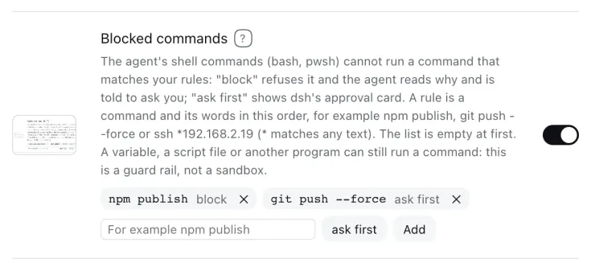</a> |
| **Tableau des tâches** | <a id="feature-taskboard"></a>Barre latérale gauche → **Tableau des tâches**, ou appuyez sur `Cmd+Shift+K` (`Ctrl+Shift+K` sous Windows et Linux) partout dans dsh. Un tableau kanban de vos discussions dsh, avec l’état en direct que montre la barre latérale : une discussion qui attend votre approbation, votre réponse ou la revue d’un plan est dans **En revue** avec un point orange, une discussion en cours d’exécution est dans **En cours**, une discussion terminée que vous n’avez pas encore ouverte est dans **Terminé** (en vert). Quand vous ouvrez une discussion, sa carte quitte **Terminé** d’elle-même ; cliquez sur **Terminées récemment (N)**, sous les cartes vertes, pour voir les discussions terminées que vous avez lues (les 10 plus récentes, puis **Afficher N plus anciennes** ; ouvert ou fermé reste sur cet appareil). Une discussion qui se termine alors qu’elle est ouverte derrière le tableau (une **Nouvelle tâche**) reste verte jusqu’à ce que vous l’ouvriez. Cliquez sur le nom du projet, en haut du tableau, pour ouvrir la liste des projets, puis choisissez un projet ou **Tous les projets** ; le dossier d’une branche par discussion compte comme son projet. La liste se ferme après le choix, avec `Esc` ou avec un clic en dehors. Tapez dans **Rechercher des projets**, en haut de la liste, pour trouver un projet par son nom (la casse et les accents ne comptent pas ; `Esc` vide le champ), appuyez sur `Entrée` pour choisir le premier résultat, et cliquez sur **Actifs au cours des 2 dernières heures** pour n’afficher que les projets avec une discussion qui attend, s’exécute, s’est terminée sans être vue ou a changé au cours des 2 dernières heures (réglage gardé sur cet appareil). **Nouvelle tâche** (ou `n`) ouvre la nouvelle discussion de dsh lui-même dans le projet que montre le tableau (avec **Tous les projets**, le projet que choisit Nouvelle session de dsh) : vous pouvez donc ajouter des fichiers, utiliser des commandes et choisir le modèle comme dans toute discussion. Quand votre premier message part, le tableau revient de lui-même. D’ici là, la discussion attend en haut de **En cours** sous le nom **Nouvelle tâche** : cliquez dessus pour écrire le premier message. Un projet dont une discussion vous attend a un point orange dans la liste des projets (le nom du projet en haut en a un aussi tant qu’une discussion attend). dsh nomme la discussion et le modèle de la discussion écrit jusqu’à 3 étiquettes à partir de ce message. Cliquez sur une carte pour ouvrir sa discussion. Cliquez sur une carte orange (ou sur son **Répondre**) pour y répondre depuis le tableau ; le panneau a **Ouvrir la discussion** pour voir toute la discussion : **Refuser** ou **Autoriser une fois**, **Approuver** ou **Demander des modifications** pour un plan, ou les options et votre propre texte pour une question. Cliquez sur **×** sur une carte terminée pour la retirer du tableau, ou ouvrez **Terminées récemment** et cliquez sur **Tout retirer** en haut de **Terminé** pour retirer ces cartes du tableau : une fenêtre montre d’abord combien de cartes de quel projet partent, et les cartes non lues (vertes) restent. Pendant les 8 secondes qui suivent, **Annuler** remet les cartes ; **Retirées (N)**, sous **Terminé**, liste les cartes qui sont hors du tableau, et **Remettre** affiche de nouveau l’une d’elles dans **Terminé**. Aucune discussion n’est supprimée : les discussions restent dans la barre latérale de dsh, le tableau s’en souvient après un redémarrage (Tether affiche le même tableau), et une discussion qui s’exécute de nouveau revient sur le tableau. Pointez une carte dans **En cours** (ou placez-y le focus du clavier) pour voir sa progression : depuis combien de temps la discussion s’exécute, l’étape de sa liste de tâches, l’outil qui s’exécute en ce moment et la dernière ligne de l’agent. Dans Réglages → Composer Plus → Tableau des tâches, **Progression au survol** choisit **Rapide (sans IA)** (par défaut : lit seulement la discussion) ou **Résumé par IA** (un court appel au modèle de la discussion écrit aussi une ou deux phrases). | <a href="assets/features/taskBoard.webp">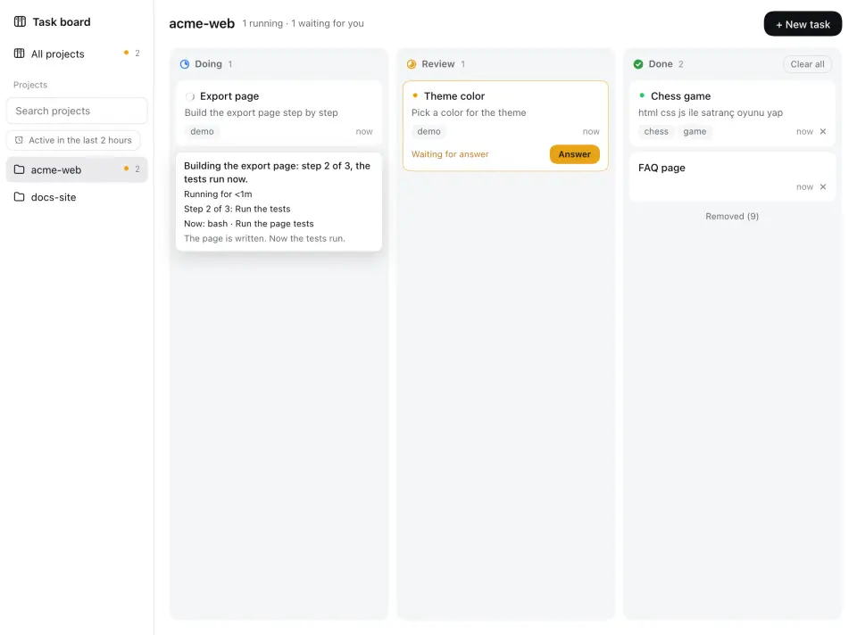</a> |
| **Assistant** | <a id="feature-assistant"></a>Activé par défaut (désactivez-le dans **Réglages → Composer Plus**). Cliquez sur Damon dans la barre latérale gauche (juste sous **Tableau des tâches**) : il ouvre une discussion durable que vous utilisez comme assistant personnel, comme une discussion ChatGPT ou Grok. Le premier clic crée le dossier `~/Assistant`, l’ajoute comme projet Damon et lance la discussion avec le mode d’autorisation workspace-write et le modèle par défaut de dsh ; chaque clic suivant ouvre la même discussion (une discussion archivée revient, une discussion supprimée est recréée). Tant que la discussion n’a pas de message, une courte carte au-dessus de la zone de saisie explique ce que fait l’assistant et montre trois exemples de demandes ; elle disparaît avec votre premier message. Demandez-lui un rappel (« rappelle-moi de boire de l’eau dans 2 minutes ») : il utilise les tâches planifiées de dsh, donc le rappel lance la discussion à cette heure-là, et Tether envoie sa notification "Turn finished" quand Connexion mobile est activée. Parlez-lui comme à un ami qui travaille en arrière-plan : une tâche plus longue (une recherche, plusieurs étapes) est confiée à son propre sous-agent en arrière-plan, la discussion dit en une ligne ce qu’elle a lancé et se libère aussitôt. Ouvrez un deuxième sujet pendant que le premier tourne encore : chaque sujet a son propre sous-agent, et chaque résultat revient dans cette discussion quand il est prêt. Demandez-lui de chercher sur le web, ou interrogez-le sur vos autres discussions : il peut lister les discussions de tous les projets (en cours, en attente de vous ou inactives) et lire les messages les plus récents de l’une d’elles. Il peut aussi envoyer un message à une discussion, lancer une nouvelle discussion dans un projet, arrêter une discussion en cours ou en archiver une : chacune de ces quatre actions affiche d’abord la carte d’approbation de dsh (aussi dans Tether), et rien ne se passe tant que vous ne cliquez pas sur **Autoriser une fois**. Quand il envoie un message à une discussion, il vous donne la réponse de cette discussion à la fin du tour de ce message. Dans le mode d’autorisation Auto de dsh, ces quatre actions n’affichent pas leur propre carte : la revue automatique les vérifie comme tout autre appel d’outil. Il n’a aucun outil de suppression. Seule cette discussion a ces outils et ses courtes consignes ; un texte qu’il lit sur une page web ou dans une autre discussion compte comme une donnée, pas comme un ordre. Gardez votre profil dans la mémoire de ce projet (**Mémoire du projet**, sujet "profil") au lieu de le lui redire à chaque fois. Pour le travail sur un projet (une modification du code ou de la configuration dans un projet git), il n’utilise pas de sous-agent caché : il lance une discussion sur une **Nouvelle branche** de ce projet. La discussion a sa propre branche et son propre dossier worktree (.worktrees), apparaît dans la barre latérale comme un projet au nom de la branche (dans son projet avec **Options d’affichage** → **Arborescence des espaces de travail** de dsh), et vous pouvez l’ouvrir pour suivre son travail. Il faut **Une branche par discussion**. Vous l’autorisez une fois sur la carte d’approbation ; quand cette discussion termine son tour ou vous attend, l’assistant vous donne le résultat, même si **Nouvelles des discussions dans l’Assistant** est désactivé. Son nom est toujours Damon, dans toutes les langues de l’interface : la ligne de la barre latérale, son projet, le titre de la discussion et ses consignes l’utilisent, et aucun réglage ne le change (le dossier garde le nom `~/Assistant`). Un ancien titre de projet ou de discussion "Assistant" (aussi dans la langue de votre interface, ou un nom que vous lui avez donné dans une version plus ancienne) devient Damon. Un titre que vous avez choisi dans dsh reste. | <a href="assets/features/assistant.webp">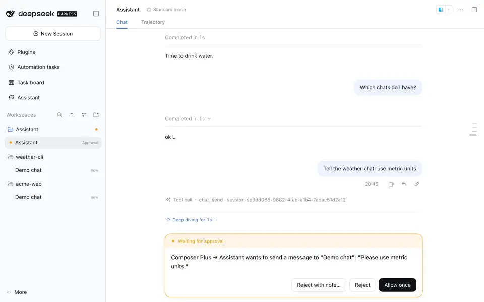</a> |
| **Assistant séparé des discussions** | <a id="feature-assistantapart"></a>Activé par défaut (désactivez-le dans **Réglages → Composer Plus**). La discussion de l’assistant quitte la liste des discussions de la barre latérale gauche, elle n’est donc pas parmi les discussions de vos projets : ouvrez-la avec Damon. Son projet (Damon) disparaît aussi tant qu’il ne contient aucune autre discussion ; la recherche de la barre latérale trouve toujours la discussion. Un point sur la ligne Damon montre l’état de l’assistant : en cours (aussi pendant qu’un sujet tourne en arrière-plan), en attente de vous (orange : une approbation, une question ou une revue de plan) ou nouvelle réponse (vert). Quand la discussion de l’assistant est ouverte, la ligne Damon s’affiche comme ouverte. Quand l’interrupteur est désactivé, la discussion revient dans la liste et la ligne n’a pas de point. | <a href="assets/features/assistantApart.webp">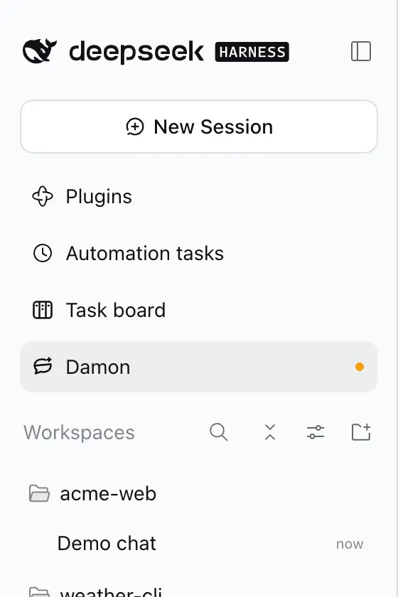</a> |
| **Messages seuls dans l’Assistant** | <a id="feature-assistantchatview"></a>Activé par défaut (désactivez-le dans **Réglages → Composer Plus**). La discussion de l’assistant ressemble à une discussion avec un bot : les appels d’outils, la réflexion, les groupes d’étapes et la ligne "Completed in" sont masqués, et vous voyez vos messages, ses réponses, les erreurs et les cartes d’approbation. Les autres discussions ne changent pas. Désactivez-le pour revoir les étapes de travail de l’assistant. Une longue discussion de l’assistant s’ouvre sur ses 8 tours les plus récents ; **Afficher les messages précédents (tours masqués : {count})** au-dessus affiche le reste. Les lignes d’un sous-agent ("Message de tâche reçu" et "Statut de la sous-tâche mis à jour", avec sa sortie à l’intérieur) sont aussi masquées : un sous-agent terminé ne montre que le résumé de l’assistant lui-même ; l’onglet **Trajectoire** les montre toujours. | <a href="assets/features/assistantChatView.webp">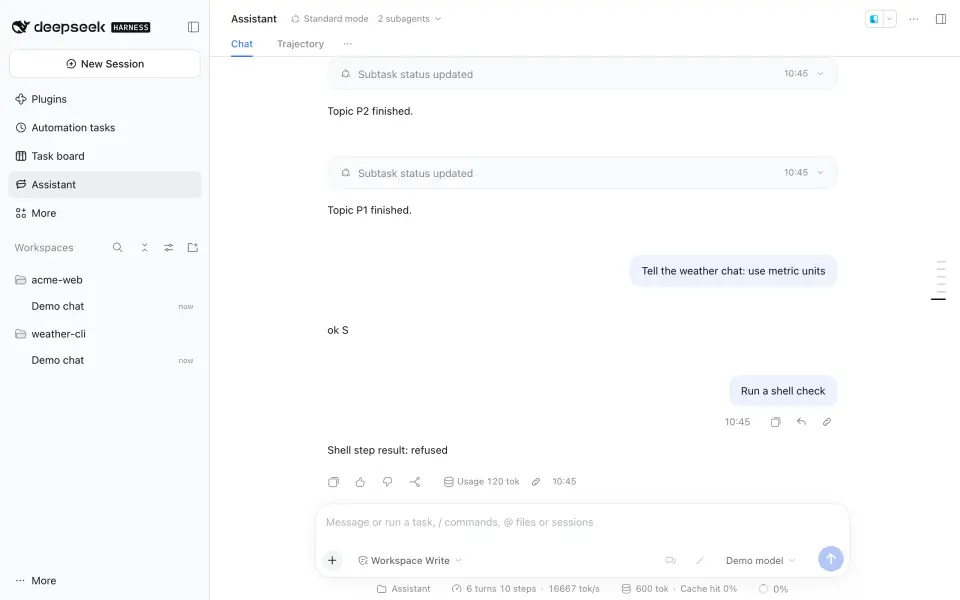</a> |
| **Encadrés de l'assistant** | <a id="feature-assistantcallouts"></a>Activé par défaut (désactivez-le dans **Réglages → Composer Plus**). Dans le chat de l'assistant, l'assistant place l'essentiel dans des encadrés de couleur, chacun avec son libellé : **Problème**, **Approbation requise**, **Questions ouvertes**, **Important**, **En cours** et **Résultat**. Les longs détails (journaux, listes d'étapes, un texte pour une autre IA) vont dans une section **Détails** fermée avec un résumé d'une ligne : cliquez dessus, ou appuyez sur Entrée ou Espace, pour l'ouvrir. Le bouton **Approuver** sous un bloc `onay` fonctionne comme avant. Les autres chats ne changent pas. Désactivé, l'assistant écrit de nouveau des réponses simples. | <a href="assets/features/assistantCallouts.webp">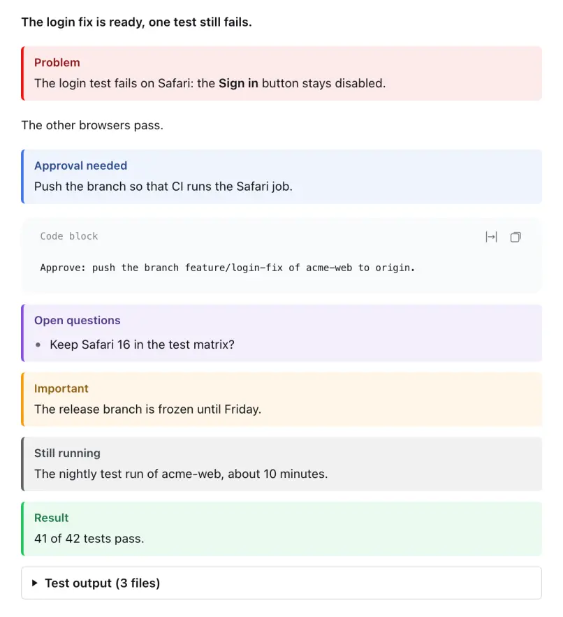</a> |
| **Assistant toujours libre** | <a id="feature-assistantfree"></a>Activé par défaut (désactivez-le dans **Réglages → Composer Plus**). La discussion de l’assistant répond tout de suite et n’est jamais occupée par un long travail : elle n’appelle que ses propres outils courts (vos discussions, rappels, mémoire et sous-agents). Toute autre étape, comme une recherche web, une page web, un fichier ou une commande, va à un sous-agent en arrière-plan ; la discussion dit en une ligne ce qu’elle a lancé et reste libre pour votre prochain message, et le résultat revient dans la discussion quand il est prêt. Ses sous-agents travaillent comme d’habitude. Quand la discussion de l’assistant n’a pas l’outil de sous-agents (à cause de son mode d’autorisation ou de son profil), la règle ne fait rien et **Réglages** l’indique. Un message envoyé pendant que l’assistant travaille entre dans son tour actuel à l’étape suivante, pas dans la file d’attente ; quand une carte de question attend, votre message en est la réponse. Un sous-agent qui vous a déjà envoyé son résultat ne lance pas un second tour en terminant. | <a href="assets/features/assistantFree.webp">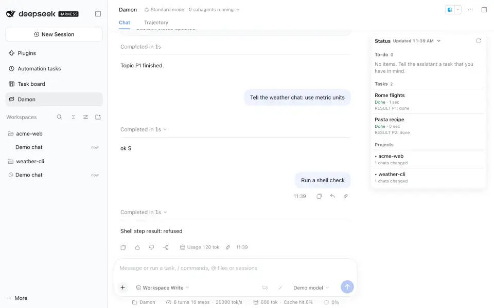</a> |
| **Nouvelles des discussions dans l’Assistant** | <a id="feature-assistantnotify"></a>Désactivé par défaut : chaque nouvelle est un tour du modèle dans la discussion de l’assistant, donc elle consomme des tokens. Activez-le dans **Réglages → Composer Plus**. **Me prévenir pour** choisit les discussions : **Automatisations seulement** (par défaut) prévient pour les tours lancés par une tâche planifiée (même dans une discussion que vous avez commencée) à chaque fin de tour (même court), chaque échec et chaque attente ; **Toutes les discussions** prévient pour toutes les autres discussions comme décrit ci-dessous. L’assistant reçoit alors la nouvelle quand une autre discussion termine un long tour (1 minute ou plus), échoue ou vous attend (une approbation, une question ou une revue de plan) pendant 30 secondes : il met à jour son panneau d’état et sa liste de tâches, et n’écrit dans la discussion que si vous devez agir, si une tâche que vous avez demandée se termine, échoue ou est bloquée, ou si un système en production a une erreur ou un risque (une ligne courte par sujet). Les nouvelles sont regroupées pendant 15 secondes et arrivent au plus toutes les 2 minutes ; pendant que l’assistant travaille, elles attendent la fin de ce tour. Une discussion que vous avez arrêtée, un tour court et la discussion de l’assistant elle-même ne donnent pas de nouvelle. Avec **Connexion mobile (iPhone)** activée, Tether reçoit la notification habituelle "Turn finished" de l’assistant. | <a href="assets/features/assistantNotify.webp">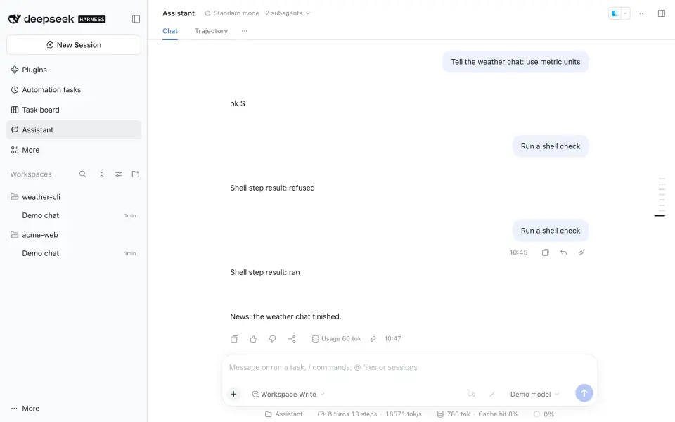</a> |
| **Panneau d’état de l’Assistant** | <a id="feature-assistanttodos"></a>Activé par défaut (désactivez-le dans **Réglages → Composer Plus** ; nécessite **Assistant**). Dans la discussion de l’assistant, une liste de tâches s’affiche à droite de la discussion (pas dans la barre latérale droite de dsh). Dites à l’assistant les tâches que vous avez en tête : il les ajoute à la liste, et vous les faites. Cliquez sur **→** à côté d’un élément pour le confier à l’assistant : « Fais-le toi : … » avec l’élément (dans la langue de votre interface) s’écrit dans le champ du message, après le texte déjà présent, sur sa propre ligne. Rien n’est envoyé : modifiez-le si vous voulez, puis envoyez-le ; l’assistant fait la tâche. Cliquez sur **×** pour retirer un élément tout de suite, sans confirmation. L’assistant vérifie la liste quand il reçoit de nouvelles informations et retire lui-même un élément quand il a la preuve qu’il est fait ; il ne vous pose pas de questions sur vos propres éléments, sauf si vous les mentionnez. Une liste par discussion, enregistrée sur ce Mac : elle reste après un rechargement et un redémarrage de dsh. Cliquez sur le titre de la liste pour la replier. Les éléments sont répartis en deux groupes, les vôtres d’abord, puis ceux de l’assistant ; cliquez sur l’en-tête d’un groupe pour le replier (ce navigateur s’en souvient). Le même panneau montre l’état de l’assistant : il n’affiche aucun résumé tant que vous ne cliquez pas sur **Obtenir le résumé** : l’assistant écrit alors un nouveau résumé (une ou deux phrases par projet ; une demande masquée, sans message dans la discussion ; la carte indique « Préparation du résumé… » jusqu’à son arrivée, 5 minutes au plus ; ensuite, ou si le tour n’en écrit pas, une note et **Réessayer** ; le nom d’un projet ouvre sa ligne ; **Masquer le résumé** ferme la carte jusqu’au prochain clic ; un résumé que vous demandez dans le chat ou qu’une tâche planifiée demande (par exemple un résumé du matin) ouvre la carte de lui-même, un résumé de nouvelles en arrière-plan n’ouvre rien) ; **Tâches** liste les tâches que l’assistant a confiées aujourd’hui à des sous-agents et à d’autres discussions (en cours, vous attend, terminée, échec ou arrêtée, avec la durée et la première ligne du résultat ; cliquez sur l’une d’elles pour ouvrir sa discussion ; un redémarrage de dsh retire les tâches de discussion terminées) ; **Projets** liste les projets dont les discussions ont changé ces dernières 24 heures, repliés, avec une ligne chacun : cliquez sur un projet pour voir ses discussions modifiées (cliquez sur l’une pour l’ouvrir), ses tâches et sa branche git avec les commits les plus récents. Le panneau se met à jour seul quand une tâche commence, se termine ou attend ; **Actualiser** affiche « Actualisation… » tout de suite (le bouton tourne, l’ancien contenu reste estompé), réaffiche les listes en moins d’une seconde et ne demande rien à l’assistant. « Liste » dans le titre est l’heure de lecture des listes ; l’heure de la carte est celle où l’assistant a écrit le résumé. | <a href="assets/features/assistantTodos.webp">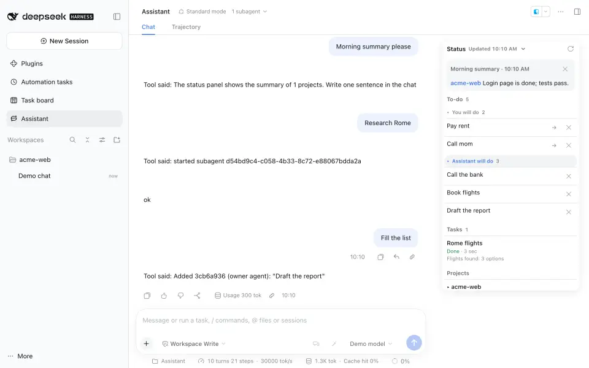</a> |
| **Mémoire du projet** | <a id="feature-projectmemory"></a>Désactivée par défaut : activez-la dans **Réglages → Composer Plus**. Chaque dossier de projet a sa propre mémoire, que les discussions suivantes de ce projet lisent, comme DS Bot en garde une par Bot. Après chaque tour terminé, un appel au modèle de la discussion lit les nouveaux messages (pas ceux annulés), garde vos préférences, décisions et faits durables sous forme de notes courtes, et modifie ou supprime les anciennes. L’agent peut aussi enregistrer, supprimer et chercher des notes lui-même (`memory_remember`, `memory_forget`, `memory_recall`). Une note peut aussi être globale : tous les projets la lisent. Une nouvelle discussion reçoit les notes dans son prompt système ; une note enregistrée plus tard apparaît à partir de la discussion suivante. Les fichiers sont en Markdown dans le dossier personnel de dsh (`storages/dsh-composer-plus/memory/`), jamais dans le dossier du projet. Pour les garder dans un autre dossier (par exemple un coffre Obsidian), écrivez-le dans **Dossier de la mémoire**, sous l’interrupteur, puis redémarrez dsh : les notes y sont copiées une fois et ne sont ensuite plus que là (`Genel/` pour les notes globales, `Projeler/<projet>/` par projet), pour les lire et les modifier dans cette app. **Ouvrir la mémoire**, sur la même ligne, montre toutes les notes enregistrées, groupées par projet (et la mémoire globale), avec un filtre. Écrivez avec vos mots ce qu’il faut changer (par exemple « je suis passé de yarn à pnpm »), puis **Aperçu des modifications** : le modèle par défaut de dsh propose les modifications, et seul **Appliquer** les enregistre. Dans Tether : menu du titre de la discussion → Project memory. | <a href="assets/features/projectMemory.webp">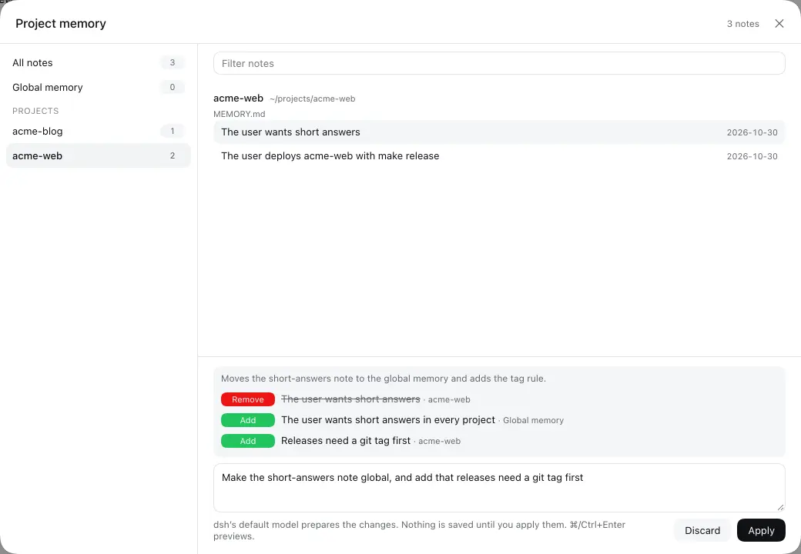</a> |
| **Historique des versions de la mémoire** | <a id="feature-memoryhistory"></a>Activé par défaut tant que **Mémoire du projet** est activée. Avant chaque enregistrement de la mémoire (l’agent, la revue après un tour, **Ouvrir la mémoire**), une copie des notes telles qu’elles étaient est gardée. Dans **Ouvrir la mémoire**, sélectionnez un projet ou **Mémoire globale**, puis **Historique** : les versions par date et qui a modifié la mémoire après chacune. Sélectionnez une version pour voir sous forme de diff ce que change une restauration, puis **Restaurer**. Les notes d’avant une restauration sont aussi gardées : vous pouvez donc l’annuler. Les 50 versions les plus récentes de chaque mémoire restent. Dans Tether : menu du titre de la discussion → Project memory → History. | <a href="assets/features/memoryHistory.webp">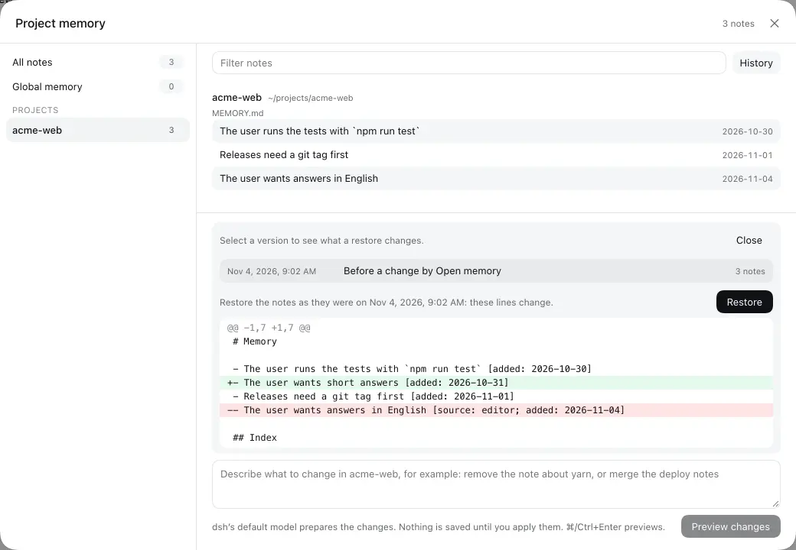</a> |
| **Exporter la mémoire vers AGENTS.md** | <a id="feature-memoryexport"></a>Dans **Ouvrir la mémoire**, sélectionnez un projet, puis **Exporter vers AGENTS.md** : les notes de ce projet vont dans une section balisée de `AGENTS.md` dans son dossier, pour que vous puissiez les committer et les partager avec votre équipe et d’autres outils d’agents. Vous voyez d’abord la modification sous forme de diff ; seul **Écrire AGENTS.md** l’enregistre. L’export suivant remplace seulement cette section. La mémoire globale, les sources et les dates restent dehors. Dans Tether : menu du titre de la discussion → Project memory → Export to AGENTS.md. | <a href="assets/features/memoryExport.webp">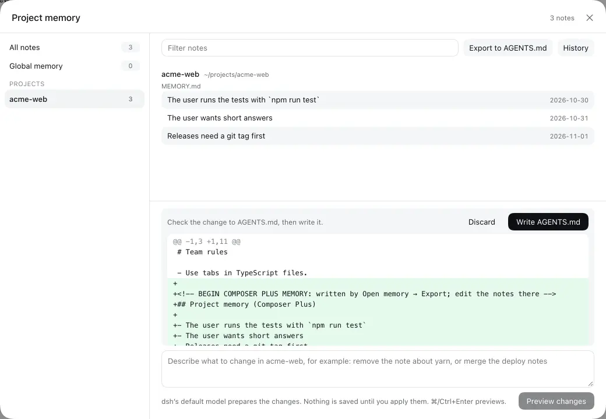</a> |
| **Lien vers l’origine des notes de mémoire** | <a id="feature-memorysource"></a>Dans **Ouvrir la mémoire**, une note venue d’une discussion (l’agent l’a enregistrée, la revue après un tour l’a gardée ou vous avez accepté une suggestion) a **Origine** à côté : un clic ouvre cette discussion sur le message, pour vérifier pourquoi la note est là avant de la modifier ou de la supprimer. Une note d’une version antérieure n’ouvre que sa discussion. Dans Tether : menu du titre de la discussion → Project memory → Source. | <a href="assets/features/memorySource.webp">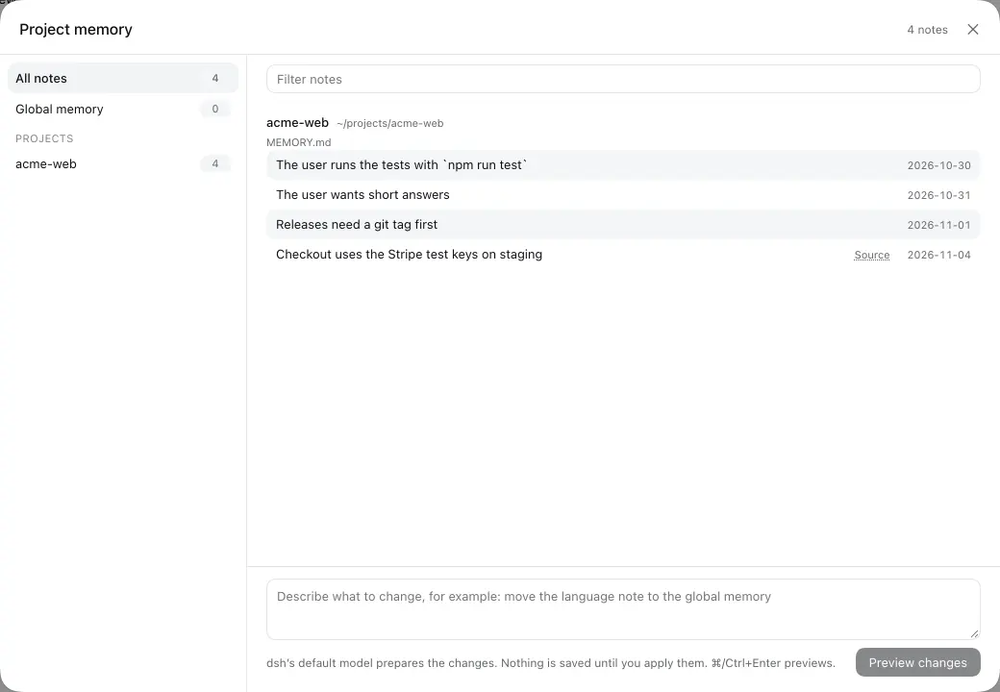</a> |
| **Copier la mémoire vers un autre projet** | <a id="feature-memorycopy"></a>Dans **Ouvrir la mémoire**, sélectionnez un projet ou **Mémoire globale**, puis **Copier vers un projet** : cochez les notes, cherchez parmi les projets de dsh et cliquez sur l’un d’eux. Toutes les notes cochées vont dans la mémoire de ce projet (avec leur sujet et leur origine), ou aucune : si une note ne tient pas, rien n’est copié et la raison s’affiche. Une note que le projet a déjà est ignorée. Dans Tether : menu du titre de la discussion → Project memory → Copy to project. | <a href="assets/features/memoryCopy.webp"></a> |
| **Trouver les notes de mémoire obsolètes** | <a id="feature-memorystale"></a>Quand vous sélectionnez un projet dans **Ouvrir la mémoire**, les chemins de fichier (en `code`), les scripts npm et les noms de branche cités par ses notes sont comparés au projet actuel. Une note qui cite quelque chose que le projet n’a plus affiche ⚠ avec ce qui manque, pour que vous la corrigiez ou la supprimiez avant que le modèle ne s’en serve. Seuls des fichiers normaux du dossier du projet et une liste de branches git sont lus ; rien n’est modifié et aucun modèle n’est appelé. Dans Tether : menu du titre de la discussion → Project memory. | <a href="assets/features/memoryStale.webp"></a> |
| **Ne pas utiliser la mémoire dans cette discussion** | <a id="feature-memoryperchat"></a>Tant que **Mémoire du projet** est activée, l’en-tête de la discussion affiche **Mémoire activée** : cliquez pour désactiver la mémoire dans cette discussion seulement (**Mémoire désactivée**). Le modèle de cette discussion ne reçoit alors ni la section mémoire ni les outils de mémoire, et la revue après chaque tour ne la lit pas. Avec dsh 0.2.1 et suivants, le même bouton est sur l’écran de nouvelle discussion : une discussion de test commence donc sans mémoire. Les autres discussions ne changent pas. Dans Tether : menu du titre de la discussion → Use project memory. | <a href="assets/features/memoryPerChat.webp"></a> |
| **Suggérer des notes de mémoire depuis une discussion** | <a id="feature-memorysuggest"></a>Tant que **Mémoire du projet** est activée, l’en-tête de la discussion a **Suggérer pour la mémoire** : un clic demande au modèle de la discussion quelles règles et décisions de cette discussion valent la peine d’être gardées pour les suivantes. Chaque suggestion indique pourquoi ; **Accepter** l’enregistre avec un lien vers la discussion et le message d’où elle vient, **Refuser** l’écarte. Rien n’est enregistré avant d’accepter, et le modèle n’est appelé que lorsque vous cliquez. Les messages retirés par un retour arrière ne sont pas envoyés. Dans Tether : menu du titre de la discussion → Suggest for memory. | <a href="assets/features/memorySuggest.webp"></a> |
| **Autoriser pour cette discussion** | <a id="feature-allowforchat"></a>Quand la revue automatique vous demande votre avis, la carte d’approbation propose **Autoriser pour cette discussion** : le même outil dans la même discussion est ensuite autorisé, quels que soient les arguments, jusqu’à la fin de la limite de temps (1 heure par défaut ; choisissez-la dans **Réglages → Composer Plus → Autoriser pour cette discussion**). Ensuite, l’agent demande à nouveau. Une pastille dans l’en-tête liste les autorisations avec leur heure de fin et permet de les révoquer. Les autorisations restent valables après un redémarrage. | <a href="assets/features/allowForChat.webp"></a> |
| **Refuser avec une note** | <a id="feature-rejectnote"></a>La carte d’approbation affiche **Refuser avec une note…** à côté de **Refuser**. Cliquez dessus, écrivez la raison ou ce qu’il faut faire à la place, puis cliquez sur **Refuser** (ou appuyez sur `Enter` ; `Shift+Enter` ajoute une ligne, `Esc` ferme le champ). La note part d’abord vers l’agent, comme un message dans le tour en attente, puis la demande est refusée : le modèle lit le refus et votre note dans le même tour, sans message de plus de votre part. Si la note ne peut pas être envoyée, rien n’est refusé et le champ reste ouvert. Dans Tether : feuille d’approbation → Reject with note. | <a href="assets/features/rejectNote.webp"></a> |
| **Saisie secrète** | <a id="feature-secretinput"></a>L’agent reçoit l’outil `request_secret`. Quand il a besoin d’un mot de passe, d’un jeton ou d’une clé d’API, il le demande avec cet outil au lieu de le demander dans la discussion : une carte s’affiche sur la ligne de l’outil avec le nom, la raison, un champ de mot de passe, **Enregistrer** et **Refuser**. **Enregistrer** écrit la valeur dans un fichier de ce Mac que vous seul pouvez lire, et l’agent reçoit seulement le chemin du fichier, qu’il utilise comme entrée d’une commande (par exemple `"$(cat <path>)"`). Si un résultat d’outil ultérieur montre la valeur, `[secret]` la remplace avant que le modèle la voie. Le fichier est supprimé à la fin du tour. **Refuser** indique à l’agent que vous ne l’avez pas donnée. Désactivez-la dans **Réglages → Composer Plus** pour retirer l’outil. Dans Tether : la barre « Secret: … » au-dessus du champ de saisie → Enter. | <a href="assets/features/secretInput.webp"></a> |
| **Citer dans la réponse** | <a id="feature-quotereply"></a>Sélectionnez une partie d’une réponse, puis faites un clic droit sur la sélection : un menu avec **Copier** et **Citer** s’ouvre près du pointeur. **Citer** met cette partie dans le champ de saisie, à la position du curseur, comme citation (`> …`), et le champ de saisie reçoit le focus pour que vous écriviez votre réponse en dessous. **Copier** copie cette partie. Avec dsh 0.2.2 et suivants, vous pouvez aussi citer vos propres messages et un raisonnement ouvert, et le bouton de dsh lui-même pour citer la sélection ne s’affiche pas. Les lignes d’outil ne comptent pas. Une citation fait au plus 2 000 caractères. `Cmd+Z` (`Ctrl+Z`) la retire. Dans Tether : touchez longuement une réponse → Quote (la réponse entière). | <a href="assets/features/quoteReply.webp"></a> |
| **Citer depuis l’aperçu du fichier** | <a id="feature-previewquote"></a>Ouvrez un fichier dans la barre latérale droite (**Fichiers de l’espace de travail**, ou un fichier que la discussion a ouvert) et sélectionnez des lignes : un bouton **Citer** s’affiche au-dessus de la sélection. Cliquez dessus : le chemin du fichier, les numéros de ligne et les lignes vont dans le champ de saisie, à la position du curseur, et le champ de saisie reçoit le focus, pour que l’agent sache de quelle partie vous parlez. Les fichiers de code et de texte donnent `src/login.js:2-3` et les lignes en bloc de code ; les fichiers Markdown et PDF donnent le chemin (un PDF aussi sa page, `docs/spec.pdf#page=3`) et une citation `> …`. Un chemin dans le dossier de la discussion est relatif. Au plus 2 000 caractères. `Cmd+Z` (`Ctrl+Z`) retire le texte inséré. Pas dans Tether. | <a href="assets/features/previewQuote.webp"></a> |
| **Discussion annexe** | <a id="feature-sidechat"></a>Écrivez une question annexe dans le champ de saisie et cliquez sur le bouton bulles (**Demander dans une discussion annexe**) : une copie de la discussion s’ouvre et y répond dans le mode lecture seule de dsh, pendant que la discussion continue. La copie connaît la discussion jusqu’ici, sauf les messages qui attendent encore dans la file, et garde son modèle. Une barre au-dessus de son champ de saisie a **Rapporter** : la discussion s’ouvre et son champ de saisie reçoit vos questions (en citations `> `) et les réponses. **Retour à la discussion** ouvre seulement la discussion. La discussion annexe reste dans la barre latérale sous le nom « ↳ <question> » ; archivez-la là. Dans Tether : menu du titre de la discussion → Side chat…. | <a href="assets/features/sideChat.webp"></a> |
| **Notes de diff** | <a id="feature-diffcomments"></a>Dans **Panneau des modifications**, ouvrez le diff d’un fichier et cliquez sur **+** à une ligne (Maj+clic sur une deuxième ligne du même bloc pour une plage), écrivez une note et cliquez sur **Enregistrer la note**. Les notes de la discussion attendent dans une barre en haut du panneau ; **Envoyer au champ de saisie** les met à la position du curseur en Markdown : `path:12-14`, les lignes en bloc `diff` et votre note. **Effacer** les supprime. Les notes restent dans ce navigateur jusqu’à ce que vous les envoyiez ou les effaciez. Nécessite **Panneau des modifications**. Dans Tether : le diff d’un fichier → appui long sur une ligne → Add note…. | <a href="assets/features/diffComments.webp"></a> |
| **Statut du projet** | <a id="feature-projectstatus"></a>La ligne d’un projet dans la barre latérale affiche le même indicateur en cours / en attente / terminé que ses discussions : même replié, un projet vous indique donc qu’une discussion travaille ou a besoin de vous. Une discussion qui vous attend s’affiche en premier, puis une discussion terminée que vous n’avez pas encore ouverte (le point vert, même pendant qu’une autre discussion est encore en cours), puis l’indicateur en cours. Survolez-le pour voir les détails. Dans **Arborescence des espaces de travail**, la ligne d’un dossier parent affiche aussi les discussions de chaque projet qu’il contient (par exemple chaque dossier de branche dans `.worktrees/`), même quand il est replié. | <a href="assets/features/projectStatus.webp"></a> |
| **Branche Git sur les lignes de discussion** | <a id="feature-sessionbranch"></a>Dans la vue « Dans une seule liste » de la barre latérale, chaque ligne de discussion affiche une petite pastille grise avec la branche git sur laquelle se trouvait le dossier du projet de la discussion lors de son dernier tour (par exemple `main` ou `feature/login` ; un HEAD détaché n’a pas de branche et n’affiche pas de pastille). Deux discussions d’un même projet sur des branches différentes ne se ressemblent plus, et vous voyez tout de suite quand vous allez continuer une discussion sur la mauvaise branche. Survolez la pastille pour voir le nom complet. La partie hôte lit la branche (`git branch --show-current`, en lecture seule) au début et à la fin de chaque tour ; une discussion sans tour depuis que vous avez installé cette fonctionnalité, ou un dossier qui n’est pas un dépôt git, n’affiche pas de pastille. Dans « Espace de travail » et « Arborescence des espaces de travail », aucune ligne de discussion n’affiche la pastille, car la discussion est déjà sous la ligne de son projet. | <a href="assets/features/sessionBranch.webp"></a> |
| **Tout marquer comme lu** | <a id="feature-markprojectread"></a>Dans la barre latérale, cliquez sur le bouton **…** d’un projet → **Tout marquer comme lu**. Le point vert non lu disparaît d’un coup de toutes les discussions de ce projet ; les autres projets gardent le leur. L’élément est grisé (**Aucune discussion non lue**) quand le projet n’en a aucune. | <a href="assets/features/markProjectRead.webp"></a> |
| **Projets actifs en premier** | <a id="feature-activeprojectsfirst"></a>Quand une discussion commence à s’exécuter ou a besoin de vous, son projet monte en haut de la barre latérale avec l’animation de ligne de dsh (le même mouvement que si vous l’y faisiez glisser). Les projets terminés restent à leur place ; faites-les glisser où vous voulez, comme d’habitude. Les déplacements sont enregistrés dans l’ordre des projets de dsh : si vous désactivez cette fonctionnalité, l’ordre actuel reste. | <a href="assets/features/projectStatus.webp"></a> |
| **Filtre des projets récents** | <a id="feature-recentprojects"></a>Barre latérale → options d’affichage (icône de curseurs) → **Actifs au cours des 2 dernières heures**. Tant que cette option est sélectionnée, la barre latérale n’affiche que les projets qui ont une discussion active au cours des 2 dernières heures : une discussion mise à jour pendant ce temps, une discussion en cours ou en attente, la discussion ouverte, ou une discussion terminée que vous n’avez pas encore ouverte (le point vert « terminé » de dsh), même après les 2 heures. Les projets sans une telle discussion sont masqués, y compris les projets nouveaux et vides. Dans **Arborescence des espaces de travail**, un dossier parent reste affiché tant qu’un projet qu’il contient est actif, et les discussions qui n’ont pas été actives au cours des 2 dernières heures sont aussi masquées, si bien que seules les discussions récentes sont affichées. Sélectionnez de nouveau l’option pour afficher tous les projets. Le choix est conservé sur cet appareil. | <a href="assets/features/recentProjects.webp"></a> |
| **Réduire tous les projets** | <a id="feature-collapseprojects"></a>Quand un projet est ouvert dans la barre latérale, un bouton apparaît à côté des options d’affichage (icône de curseurs). Cliquez dessus pour fermer tous les projets ouverts d’un coup, par exemple 3 projets ouverts sur 5. Le bouton disparaît de nouveau quand aucun projet n’est ouvert. | <a href="assets/features/collapseProjects.webp"></a> |
| **Trier par état** | <a id="feature-statusorder"></a>Barre latérale → options d’affichage → **Trier par** → **Par état** (avec **Dans une seule liste**). Les discussions terminées viennent en premier (le point « terminé » de dsh, qu’un tour terminé par une erreur reçoit aussi), puis les discussions en cours ou en attente, puis celles qui ont une automatisation active (Schedule), puis les autres dans l’ordre de dsh. Quand vous ouvrez une discussion terminée, elle descend. Seul l’affichage change : sélectionnez **Ordre manuel** ou **Dernière mise à jour** pour revenir en arrière. | <a href="assets/features/statusOrder.webp"></a> |
| **Notifications en arrière-plan** | <a id="feature-notifications"></a>Quand dsh est en arrière-plan, vous recevez une notification quand un tour se termine (première ligne de la réponse) ou quand une discussion vous attend vraiment : une approbation (nom de l’outil), une réponse (la question) ou une revue de plan. Une demande doit être encore ouverte 1,5 s plus tard : les approbations données automatiquement (autorisations de la revue automatique, autres plugins) restent donc silencieuses, et une notification est retirée dès que sa demande reçoit une réponse. La pastille du Dock / de la barre des tâches compte les discussions en attente. Un clic sur la notification ouvre cette discussion. | <a href="assets/features/notifications.webp"></a> |
| **Ouvrir la discussion en attente en cas d’inactivité** | <a id="feature-idleswitch"></a>Quand une discussion pose une question, attend une approbation ou une revue du plan (le point orange) ou termine un tour que vous n’avez pas encore lu (le point vert), et que vous n’utilisez pas dsh pendant 30 secondes, dsh ouvre cette discussion. Les discussions orange s’ouvrent avant les vertes. Dans chaque groupe, celle qui attend depuis le plus longtemps s’ouvre en premier ; la suivante s’ouvre après 30 autres secondes sans utilisation. Une touche, un clic, un mouvement de souris, la molette ou un toucher relancent les 30 secondes. Du texte dans le champ qui a le focus, du texte sélectionné, ou un menu ou une boîte de dialogue ouverts empêchent aussi le changement. Tant qu’une discussion en attente est à l’écran, rien ne change. Tant que la discussion de l’assistant est ouverte, rien ne change non plus. Si vous quittez une discussion en attente sans répondre, elle peut se rouvrir après les 30 secondes suivantes sans utilisation. Quand une discussion verte s’ouvre, son point disparaît ; la discussion verte suivante ne s’ouvre qu’après que vous avez de nouveau utilisé dsh, puis 30 secondes sans utilisation. Cela fonctionne aussi quand dsh est en arrière-plan, mais dsh ne passe pas au premier plan. | <a href="assets/features/idleSwitch.webp"></a> |
| **Discussion en attente suivante** | <a id="feature-nextwaiting"></a>Un bouton dans l’en-tête de la barre latérale indique combien d’autres discussions vous attendent, avec un point de la couleur de la suivante : orange quand elle pose une question ou attend une approbation ou une revue du plan, vert quand elle a terminé un tour que vous n’avez pas encore lu. Cliquez dessus, ou appuyez sur Cmd+Shift+E (Ctrl+Shift+E sous Windows et Linux), pour ouvrir cette discussion. Un clic sur le bouton retrouve aussi la discussion dans la barre latérale : un projet replié s’ouvre, la liste défile jusqu’à la discussion et la discussion clignote pendant 5 secondes. Les discussions orange passent avant les vertes ; dans chaque groupe, celle qui attend depuis le plus longtemps passe en premier. La discussion à l’écran ne compte pas. Quand aucune autre discussion n’attend, le bouton n’apparaît pas et la touche ne fait rien. Vous pouvez changer la touche dans la page des raccourcis clavier de dsh (Discussion en attente suivante). | <a href="assets/features/nextWaiting.webp"></a> |
| **Boutons d’options** | <a id="feature-optionpicks"></a>Quand une réponse se termine par une liste d’options (une liste numérotée de 1 à 9 éléments sous un titre « Options » ou une ligne en gras « Options », aussi « Prochaines étapes » et les mêmes mots dans les langues de l’application), un bouton apparaît sous la réponse pour chaque option. Un clic envoie « Option N: … » avec toute l’option comme votre message, comme si vous l’aviez tapé. L’option marquée « (recommandée) » est mise en avant. Les boutons n’apparaissent que sous la réponse la plus récente, quand la discussion est inactive et que la zone de message est vide ; une réponse déjà choisie et une réponse retirée par un retour en arrière n’en ont pas. Tant qu’ils sont affichés, la prédiction du message suivant ne propose rien. Sur une carte de question de l’agent, les touches 1 à 9 choisissent cette option, comme un clic (pas dans le champ de réponse, ni pendant les 0,8 premières secondes après l’affichage de la question). | <a href="assets/features/optionPicks.webp"></a> |
| **Bouton Approuver** | <a id="feature-approvebutton"></a>Activé par défaut. Quand l’agent a besoin d’une phrase d’approbation écrite par vous, il l’écrit dans un bloc de code avec la chaîne d’information `onay` (Composer Plus ajoute cette règle à chaque discussion). Sous la réponse la plus récente, un bouton **Approuver** apparaît pour chaque bloc de ce type, avec la phrase à côté. Un clic envoie la phrase exacte comme votre message, par l’envoi normal de dsh, et la Revue automatique la voit venir de vous. Le bouton se désactive après le premier clic : un double clic envoie un seul message. Une phrase qui nomme une cible en production ou publique (production, base de données en production, déploiement, publication, npm publish) a aussi son bouton. Une réponse au milieu d’un tour compte aussi (par exemple quand le résultat d’un sous-agent poursuit le tour) : son bouton apparaît à la fin du tour. Pas de bouton sous vos propres messages ni sous les réponses plus anciennes, ni pendant que la discussion travaille ou que la zone de saisie contient du texte. | <a href="assets/features/approveButton.webp"></a> |
| **Langue de l’application** | <a id="feature-language"></a>Réglages → Composer Plus → **Langue de l’application** passe toute l’interface de dsh en Türkçe, Español, Português (Brasil), Français, Deutsch, Русский, 日本語, 한국어, Bahasa Indonesia, Tiếng Việt ou हिन्दी (voir ci-dessous). | <a href="assets/features/language.webp"></a> |
| **Connexion mobile (iPhone)** | <a id="feature-mobileconnect"></a>Utilisez dsh depuis votre iPhone avec l’app [Tether](tether/), sur le même réseau Wi-Fi ou via [Tailscale](https://tailscale.com). Activez-la dans **Réglages → Composer Plus** (elle est désactivée par défaut, car elle ouvre un port réseau sur ce Mac). Cliquez ensuite sur **Connexion mobile** en bas à gauche de la barre latérale : scannez le code QR avec l’app Appareil photo de l’iPhone (touchez **Open in Tether**) ou avec **Scan code** dans Tether, touchez **Connect** et cliquez sur **Approve**. Installez d’abord Tether : sans elle, l’app Appareil photo ne peut pas ouvrir le code. Le téléphone affiche vos discussions, envoie des messages (avec des photos : le **+** de la zone de saisie → Camera, Photos ou Paste image), répond aux approbations et aux questions, et change de modèle. Appairez autant de Mac que vous voulez : le nom du Mac, en haut à gauche de l’app, permet de passer de l’un à l’autre. Le panneau **Connexion mobile** liste les iPhone appairés avec leur dernière connexion : **Remove** en déconnecte un tout de suite. « Tailscale only » refuse le réseau local (pour un Wi-Fi partagé), et le journal d’accès montre qui a essayé de se connecter. Dans Tether, « Settings → Privacy » verrouille l’app avec Face ID. | <a href="assets/features/mobileConnect.webp"></a> |
| **Ordinateurs distants** | <a id="feature-remotecomputers"></a>Ouvrez le dsh de vos autres Mac via [Tailscale](https://tailscale.com) et utilisez-les dans cette fenêtre de dsh. Activez la fonction dans **Réglages → Composer Plus** sur chaque Mac (elle est désactivée par défaut, car elle ouvre des ports réseau). Sur le Mac que vous voulez ouvrir, activez **Autoriser d’autres ordinateurs à ouvrir ce Mac**, cliquez sur **Créer un lien d’appairage** et copiez le lien. Sur ce Mac, choisissez **Ajouter un ordinateur…** dans le sélecteur d’ordinateurs de la barre latérale gauche (sous le nom de la marque, au-dessus de **Nouvelle session**), collez le lien, saisissez un **Nom** (pas le nom de ce Mac ni celui d’un autre ordinateur) et cliquez sur **Connecter**. Cliquez ensuite sur **Approuver** sur l’autre Mac. Avec un seul ordinateur, le sélecteur a deux parties côte à côte : **Ce Mac** et le nom de cet ordinateur. La partie affichée à l’écran est mise en évidence. Cliquez sur l’autre partie : le dsh de cet ordinateur remplit cette fenêtre, avec ses propres discussions, barre latérale, outils et fichiers, pendant que ce Mac continue de tourner derrière. Les deux parties restent au même endroit : cliquez sur **Ce Mac** pour revenir. Faites un clic droit sur le sélecteur pour ouvrir le menu complet (**Ajouter un ordinateur…**). Avec plus d’un ordinateur, le sélecteur est un seul bouton : cliquez dessus et choisissez **Ce Mac** ou un ordinateur dans le menu. Quand un ordinateur est affiché, le bouton indique **Revenir à ce Mac**. Le panneau des réglages renomme et supprime les ordinateurs, et liste les ordinateurs qui peuvent ouvrir ce Mac (**Supprimer** en déconnecte un tout de suite). | <a href="assets/features/remoteComputers.webp"></a> |
| **Mises à jour automatiques** | <a id="feature-autoupdate"></a>Au démarrage de dsh, le plugin vérifie la [dernière version sur GitHub](https://github.com/furkancak1r/dsh-composer-plus/releases/latest). Si elle est plus récente et déjà sur npm, il installe exactement cette version avec le gestionnaire de plugins de dsh (le même chemin que Réglages → Plugins) et vous avertit. Redémarrez dsh pour la charger. **Réglages → Composer Plus → Mises à jour de Composer Plus** affiche la version et propose **Rechercher des mises à jour** / **Mettre à jour**. Au premier démarrage de dsh avec la nouvelle version, une fenêtre **Nouveautés de Composer Plus N** affiche une fois les notes de cette version dans la langue de **Langue de l’application** (elles arrivent avec la nouvelle version, sans autre appel réseau ; une langue sans notes affiche les notes en anglais) ; **Fermer** ou `Esc` la ferme. Sous les notes, une ligne demande une étoile sur GitHub, au plus une fois tous les 30 jours (sans appel réseau) ; après **Mettre une étoile sur GitHub** ou **Ne plus demander**, elle ne s’affiche plus. La fenêtre s’affiche aussi après une mise à jour par Réglages → Plugins ou par un dossier copié, une fois par nouvelle version ; pas à la première installation. **Nouveautés de cette version** dans la ligne des mises à jour la rouvre. Si le disque contient une version plus récente que celle qui tourne, la ligne demande de redémarrer dsh. | <a href="assets/features/autoUpdate.webp"></a> |
| **Filtre activées/désactivées** | <a id="feature-featurefilter"></a>À côté de **Rechercher des fonctionnalités** dans **Réglages → Composer Plus** : **Toutes** affiche toutes les fonctionnalités, **Activées** seulement celles dont l’interrupteur est activé et **Désactivées** seulement celles dont il est désactivé. C’est l’interrupteur de chaque ligne qui décide, y compris un interrupteur que garde l’hôte de dsh (par exemple **Connexion mobile**). Le filtre fonctionne avec la recherche : tapez un mot et choisissez **Désactivées** pour trouver une fonctionnalité que vous avez désactivée. Une ligne que vous basculez pendant que **Activées** ou **Désactivées** est choisi reste affichée jusqu’à ce que vous choisissiez de nouveau un filtre ; le focus reste donc sur son interrupteur. **Activées** et **Désactivées** masquent les lignes **Langue de l’application** et **Mises à jour de Composer Plus** (elles n’ont pas d’interrupteur). Les réglages s’ouvrent toujours sur **Toutes**. | <a href="assets/features/featureFilter.webp"></a> |
| **Filtre par catégorie** | <a id="feature-categoryfilter"></a>À côté de **Rechercher des fonctionnalités** dans **Réglages → Composer Plus**, ouvrez **Catégorie** et choisissez une partie de dsh : **Barre latérale et liste des discussions**, **Zone de saisie et file**, **Vue de la discussion**, **Approbations et sécurité**, **Compétences de l’agent**, **Assistant et tableau des tâches**, **Mémoire du projet** ou **Application, appareils et sauvegarde**. Seules les fonctionnalités de cette catégorie s’affichent, dans leur ordre habituel. **Toutes** (par défaut) affiche toutes les fonctionnalités. **Langue de l’application** et **Mises à jour de Composer Plus** sont dans **Application, appareils et sauvegarde**. Le filtre fonctionne avec la recherche et avec **Toutes**, **Activées** et **Désactivées**. Il masque seulement des lignes : chaque interrupteur garde sa valeur. Les réglages s’ouvrent toujours sur **Toutes**. | <a href="assets/features/categoryFilter.webp"></a> |
| **Signaler une issue** | <a id="feature-issuereport"></a>Réglages → Composer Plus → **Signaler une issue…** (sous l’introduction), ou clic droit sur une discussion dans la barre latérale (ou ouvrez son menu **…**) → **Signaler une issue Composer Plus…**. Choisissez un type : **Bug**, **Demande de fonctionnalité**, **Amélioration**, **Traduction** ou **Question**. Décrivez-le avec vos propres mots et dans votre langue, puis cliquez sur **Rédiger le brouillon** (ou `Cmd/Ctrl+Enter`). Un seul appel au modèle par défaut de dsh rédige une issue en anglais : un titre avec le préfixe du type (par exemple `[Bug]`) et les sections de ce type (pour un bug : What happened, Steps to reproduce, Expected, Actual), plus une ligne avec les versions de Composer Plus, de dsh et du système. Lisez et modifiez le titre et la description ; **Rédiger à nouveau** rédige un nouveau brouillon. **Ouvrir l’issue** l’ouvre dans le dépôt GitHub de Composer Plus avec votre connexion GitHub CLI (`gh`) et affiche son lien. L’issue est publique : un texte qui ressemble à une clé ou à un mot de passe est refusé. Quand `gh` ne peut pas l’ouvrir, **Ouvrir plutôt sur GitHub** ouvre la page de GitHub lui-même avec le brouillon déjà rempli. | <a href="assets/features/issueReport.webp"></a> |
| **Sauvegarde** | <a id="feature-backup"></a>Réglages → Composer Plus → **Sauvegarde** → **Sauvegarder maintenant** écrit tout votre dossier personnel de dsh (discussions, réglages, plugins, MCP, compétences) dans une seule archive dans `~/Desktop/dsh-backups`, avec une somme de contrôle. Les secrets sont masqués dans l’archive : les fichiers d’identifiants, les fichiers de clés (`.pem`, `.key`) et les valeurs token, secret et password des réglages yml restent uniquement sur cet ordinateur, dans le `vault` du dossier. `cache/`, `dsh-runtimes/` et `node_modules` ne vont pas dans l’archive (dsh les recrée). Chaque sauvegarde de la liste a **Vérifier** (la lit entièrement), **Pour un autre ordinateur** (un dossier à copier sur le nouvel ordinateur, avec la console de secours) et **Supprimer**. Les archives de dsh-backup dans le même dossier s’affichent et fonctionnent aussi. Pour restaurer, quittez dsh et utilisez la console de secours. | <a href="assets/features/backup.webp"></a> |
| **Sauvegarde automatique** | <a id="feature-autobackup"></a>Activez **Sauvegarde automatique** (désactivée par défaut : chaque copie est à peu près aussi grande que votre dossier personnel de dsh sans son cache). Choisissez la fréquence (**Toutes les** : de 6 heures à 7 jours, 24 heures par défaut) et le nombre de sauvegardes conservées (**Conserver** : de 3 à 14, 7 par défaut). L’heure de la prochaine sauvegarde s’affiche sous l’interrupteur ; une sauvegarde qui a échoué s’y affiche aussi et est relancée 30 minutes plus tard. Quand dsh ou Composer Plus démarre avec une nouvelle version, un instantané est pris peu après le démarrage, avant que la nouvelle version ait longtemps utilisé vos données (les deux plus récents restent, marqués **Avant une mise à niveau**). | <a href="assets/features/autoBackup.webp"></a> |
| **Vérification des journaux de session** | <a id="feature-sessiondoctor"></a>**Vérifier les journaux de session** lit le journal de chaque discussion et liste ceux que dsh ne peut pas ouvrir (une trame cassée, un enregistrement coupé, un mauvais numéro de séquence). Une fin incomplète n’est pas listée : dsh la répare lui-même. **Réparer depuis les sauvegardes** remet la copie de la sauvegarde la plus récente qui en contient une saine et garde le fichier endommagé à côté (`.corrupt-<heure>`). Les messages écrits après cette sauvegarde ne sont pas dans la copie. Une discussion ouverte dans ce dsh n’est pas réparée ici : quittez dsh et réparez-la dans la console de secours. | <a href="assets/features/sessionDoctor.webp"></a> |
| **Console de secours** | <a id="feature-rescueconsole"></a>Chaque sauvegarde place aussi une console de secours dans le dossier de sauvegarde. Quand dsh est fermé ou ne démarre pas, ouvrez `Composer Plus Rescue` dans ce dossier (macOS : `Composer Plus Rescue.command`) : un menu dans une fenêtre de terminal liste, vérifie et restaure les sauvegardes, et vérifie et répare les journaux de session. Elle n’ouvre aucun port réseau. Une restauration vous demande de taper `RESTORE`, garde votre dossier personnel de dsh actuel sous le nom `.dsh.pre-restore-<heure>`, remet les secrets masqués depuis le vault et déplace `cache/`, `dsh-runtimes/` et `node_modules` depuis l’ancien dossier. Elle fonctionne sans dsh : elle utilise Node.js, ou l’app DeepSeek Harness elle-même. Sur un nouvel ordinateur, copiez le dossier de **Pour un autre ordinateur** et ouvrez `Composer Plus Rescue` à cet endroit. | <a href="assets/features/rescueConsole.webp"></a> |

<!-- END GENERATED FEATURES -->

Les boutons, info-bulles, messages et notifications suivent la langue choisie dans dsh (voir Langue de l’application ci-dessous).

## Réglages

Chaque fonctionnalité peut être activée ou désactivée séparément : dsh **Réglages → Composer Plus**. Chaque ligne a une petite capture d’écran : survolez-la pour un aperçu plus grand, cliquez dessus pour l’ouvrir en taille réelle (`Esc` la ferme). La zone **Rechercher des fonctionnalités**, en haut, filtre la page par nom ou par description (dans toutes les langues, sans tenir compte de la casse ni des accents) ; `Esc` la vide. À côté, **Toutes**, **Activées** et **Désactivées** affichent toutes les fonctionnalités, seulement celles qui sont activées ou seulement celles qui sont désactivées (désactivez **Filtre activées/désactivées** pour les masquer). Ensuite, le menu **Catégorie** n’affiche que les fonctionnalités d’une partie de dsh, par exemple **Zone de saisie et file** (désactivez **Filtre par catégorie** pour le masquer). Chaque ligne a un interrupteur et une courte description ; les changements s’appliquent tout de suite, sans redémarrage, et sont mémorisés sur cet appareil. Le petit **?** après le nom d’une ligne ouvre la partie de ce README qui décrit cette fonctionnalité, dans le README de la langue de l’interface de dsh. Tout est activé par défaut, sauf **Connexion mobile**, **Reprendre après redémarrage** et **Compléter pendant la saisie**. L’hôte de dsh garde les interrupteurs de ces trois fonctionnalités, ainsi que ceux de **Recherche dans le contenu**, d’**Annulation de tour**, de **Prédiction du message suivant** et de **Vérification de l’objectif** : ils s’appliquent donc à toutes les fenêtres et restent valables après un redémarrage. L’hôte garde aussi le **Modèle** choisi pour **Prédiction du message suivant**, celui de **Compléter pendant la saisie** (par défaut **Comme la prédiction du message suivant**), celui d’**Améliorer le prompt**, celui de **Vérification de l’objectif** (tous deux par défaut **Comme le modèle de la discussion**) et la **Limite de temps** d’**Autoriser pour cette discussion** (1 heure par défaut). **Recherche dans le contenu** ne change qu’après un redémarrage de dsh (dsh lit ce réglage au démarrage) ; d’ici là, sa ligne indique **Redémarrez dsh pour appliquer ce changement.**

<p align="center"></p>

### Langue de l’application

Ouvrez **Réglages → Composer Plus → Langue de l’application** et choisissez **Langue du système** ou l’une des 13 langues :

English · 中文 · Türkçe · Español · Português (Brasil) · Français · Deutsch · Русский · 日本語 · 한국어 · Bahasa Indonesia · Tiếng Việt · हिन्दी

<p align="center"></p>

Toute l’app change de langue immédiatement. Le choix est la préférence enregistrée par dsh lui-même, `locale.preference` (la même que Général → Langue) : il reste donc valable après un redémarrage. **Langue du système** efface ce choix : l’app de bureau suit la langue du système d’exploitation, l’interface web suit celle du navigateur, et une langue non prise en charge revient à l’anglais. L’installation du plugin ne remplace jamais une langue que vous avez déjà choisie.

Chaque pack contient 3 280 textes : tous les textes d’interface de dsh `0.2.0-rc.2` et `0.2.1-rc.2` (discussions, barre latérale, réglages, approbations, tâches d’automatisation, aperçus de fichiers, gestionnaire de plugins, place de marché de plugins), les contrôles du plugin lui-même et le plugin populaire [dsh-rewind](https://github.com/SiriLee/dsh-rewind). Ne sont pas traduits : vos messages, les réponses du modèle, le code, les noms des commandes slash (`/plan`, `/compact`), les libellés propres aux fournisseurs comme l’effort de raisonnement `High`, les textes des autres plugins, ainsi que les menus natifs et les boîtes de dialogue de mise à jour de l’app de bureau (dsh ne les fournit qu’en anglais et en chinois). Les textes ajoutés par une version plus récente de dsh s’affichent en anglais jusqu’à la mise à jour des packs. Si un autre plugin fournit déjà une langue, cette langue reste fournie par cet autre plugin.

## Raccourcis clavier

| Touche | Où | Action |
|---|---|---|
| `↑` / `↓` | zone de saisie vide | message envoyé précédent / suivant |
| `Shift+Tab` | zone de saisie | ajouter/retirer `/plan `, ou quitter le mode plan |
| `↑` / `↓` | poignée de file avec le focus | déplacer le message en file d’attente |
| `Esc` | pendant le glissement | annuler le déplacement |
| `→` / `←` | page Idées de fonctionnalités | créer / ignorer la carte du dessus |
| `↓` | page Idées de fonctionnalités | garder la carte du dessus dans la liste Plus tard du projet |
| `↑` | page Idées de fonctionnalités | créer la carte du dessus maintenant, sans plan |
| `Z` | page Idées de fonctionnalités | ramener la dernière carte ignorée |
| `Enter` | menu des projets d’une nouvelle discussion, champ de recherche | choisir le premier résultat |
| `↑` / `↓` | menu des projets d’une nouvelle discussion | parcourir les projets affichés |
| `Esc` | menu des projets d’une nouvelle discussion, champ de recherche | effacer la recherche (appuyez de nouveau pour fermer le menu) |
| `Tab` | zone de saisie vide avec une prédiction | placer la prédiction dans la zone de saisie |
| `Tab` | complétion grise après le curseur | ajouter la complétion au message |
| `Esc` | zone de saisie vide avec une prédiction | masquer la prédiction |
| `Cmd/Ctrl+Z` | zone de saisie, après **Améliorer le prompt** | rétablir le texte que vous avez tapé |
| `Esc` | zone de saisie, pendant l’exécution d’**Améliorer le prompt** | annuler l’amélioration |
| `Enter` / `Esc` | éditeur du message en file d’attente | enregistrer / annuler la modification |
| `Cmd+F` sur un Mac, `Ctrl+F` sous Windows et Linux | discussion ouverte | ouvrir **Rechercher dans la discussion** |
| `Enter` / `Shift+Enter`, `↓` / `↑` | champ **Rechercher dans la discussion** | résultat suivant / précédent |
| `Esc` | champ **Rechercher dans la discussion** | fermer le champ |
| `Cmd+Shift+E` sur Mac, `Ctrl+Shift+E` sous Windows et Linux | partout dans dsh | ouvrir la **Discussion en attente suivante** (à changer dans la page des raccourcis clavier de dsh) |
| `Cmd+Shift+K` sur Mac, `Ctrl+Shift+K` sous Windows et Linux | partout dans dsh | ouvrir le **Tableau des tâches** (à changer dans la page des raccourcis clavier de dsh) |
| `1`–`9` | carte de question de dsh, hors de son champ de réponse | choisir cette option (**Boutons d’options**) |

Quand un menu `/` ou `@` est ouvert, il garde ces touches pour lui.

## Compatibilité

Testé sur dsh `0.2.0-rc.2` (bureau et web) et `0.2.1-rc.2` (web). La CI exécute les tests à chaque push.

## Confidentialité et sécurité

- **Continuer :** le point de terminaison local authentifié ne reprend que le dernier tour interrompu, refuse les requêtes périmées ou en double et conserve les hooks d’approbation existants. Il n’envoie pas de nouveau message utilisateur.
- **Reprendre après redémarrage :** désactivée tant que vous ne l’activez pas. La partie hôte ne garde que les identifiants des discussions et leurs heures de début dans `$DSH_HOME/storages/dsh-composer-plus/resume.json` (accès réservé au propriétaire), et rien ne quitte votre machine. Elle ne reprend une discussion que si le journal de dsh indique que c’est dsh (et non vous) qui a arrêté son dernier tour. Les approbations et la revue automatique s’appliquent au tour repris comme d’habitude.

- **Panneau des modifications :** git s’exécute en lecture seule sur votre machine, dans le dossier de la discussion, via le canal `/api` authentifié de dsh. Il ne fait jamais de commit, de stage ni de fetch, et n’affiche que les chemins listés par git lui-même. L’arbre liste jusqu’à 1000 branches locales et distantes et montre les 300 commits les plus récents d’une branche : sa ligne de premier parent, donc un commit de merge représente les commits qu’il a apportés. Il ne change jamais de branche (checkout). **Cette discussion** lit le journal de la discussion elle-même pour trouver les fichiers que ses outils de fichiers ont écrits, puis les compare à l’instantané que l’Annulation de tour a pris pour cette discussion, dans un dossier temporaire supprimé aussitôt ; elle n’écrit rien dans votre dépôt ni dans le stockage des instantanés.
- **Idées de fonctionnalités :** rien ne s’exécute tant que vous ne cliquez pas sur **Suggérer des fonctionnalités**. La partie hôte lit alors uniquement le dossier de la discussion (le navigateur n’envoie jamais de chemin) : les noms des entrées de premier niveau, les 6 premiers ko du README, d’AGENTS.md et du manifeste (`package.json`, `pyproject.toml`, `Cargo.toml`, `go.mod`, …), un plan du reste du README (titres, lignes de tableau, éléments de liste ; 6 ko au plus) et les titres des commits les plus récents (`git log --format=%s`, 6 ko au plus), 28 ko au plus au total. Elle ignore `.env*`, les fichiers de clés et les dossiers comme `node_modules`, et elle ne lit que des fichiers ordinaires qui restent dans le dossier : un lien symbolique qui pointe hors du dossier, une FIFO ou un périphérique est ignoré. Ce résumé est envoyé au modèle utilisé par la discussion, via les réglages de fournisseur de dsh, en une seule requête ; il n’est ajouté à aucune discussion. Rien n’est écrit dans le projet. Une idée balayée vers la droite lance une nouvelle discussion en mode plan : les approbations et la revue du plan s’appliquent donc comme d’habitude. **Créer maintenant** lance la discussion sans mode plan : le modèle peut modifier des fichiers tout de suite, avec les approbations habituelles de la discussion et la revue automatique. Les idées gardées pour plus tard (titre, résumé, raison, effort) sont conservées avec le chemin du dossier du projet dans `storages/dsh-composer-plus/later.json`, dans le dossier personnel de dsh (fichier réservé au propriétaire) ; rien ne va dans le projet. L’historique des idées suggérées (titre, résumé, raison, effort, date, lancée ou non) est conservé de la même façon dans `storages/dsh-composer-plus/idea-history.json`, au plus 200 par projet (les plus anciennes partent en premier) ; ses titres vont au modèle avec la prochaine demande **Suggérer des fonctionnalités** de ce projet.
- **Recherche dans le contenu :** aucun nouveau code ne cherche dans vos discussions. Le plugin active seulement l’index des messages de dsh lui-même (SQLite FTS5, `dsh-session-query-sqlite`) et lui donne un fichier, `$DSH_HOME/cache/composer-plus/session-search.db` (fichier et dossier réservés au propriétaire). Ce fichier contient le texte de vos messages et de ceux de l’assistant : il est donc aussi privé que les journaux de discussion dans `$DSH_HOME/sessions`. Rien ne quitte votre machine. C’est une copie que dsh peut recréer : vous pouvez la supprimer quand dsh est fermé. L’interrupteur se trouve dans `$DSH_HOME/storages/dsh-composer-plus/content-search.json`.
- **Annulation de tour :** avant chacun de vos messages, l’hôte prend un instantané git du dossier de la discussion dans son propre stockage, `$DSH_HOME/cache/composer-plus/rollback/<chat>.git` (dossier réservé au propriétaire). Ce stockage contient des copies des fichiers de ce dossier que git voit (pas les fichiers ignorés) : il est donc aussi privé que le projet. Il lit les objets de votre dépôt (sans copier ce que git a déjà) et n’écrit jamais l’index, `HEAD`, les branches, les tags, le stash ni la config de votre dépôt ; le seul changement que git y fait est une date plus récente sur les fichiers d’objets qu’il réutilise (cela retarde leur nettoyage par `git gc`). Une annulation avec fichiers n’écrit que des fichiers ordinaires dans le dossier de la discussion ; elle ignore les liens symboliques, les pipes et tout ce qui est hors du dossier. Rien ne quitte votre machine. Vous pouvez supprimer ce stockage quand dsh est fermé (l’annulation ne fonctionne alors que pour la discussion, jusqu’aux nouveaux messages). **Supprimer la discussion** supprime aussi le stockage d’une discussion. L’interrupteur se trouve dans `$DSH_HOME/storages/dsh-composer-plus/rollback.json`. Une annulation avec fichiers garde aussi les fichiers tels qu’ils étaient juste avant elle (`refs/r/…` dans le même stockage), pour **Refaire** ; les annulations refaites sont listées dans `$DSH_HOME/storages/dsh-composer-plus/redone.json` (réservé au propriétaire).
- **Ouvrir une issue GitHub** (Idées de fonctionnalités → liste **Plus tard**) : ne s’exécute que lorsque vous cliquez dessus. La partie hôte exécute votre propre GitHub CLI (`gh issue create`) dans le dossier de la discussion, avec le titre et le résumé enregistrés de l’idée (et pourquoi elle compte) ; `gh` utilise sa propre connexion et le dépôt distant GitHub du dossier, donc l’issue va dans ce dépôt avec votre compte, et GitHub la montre à tous ceux qui peuvent voir ce dépôt. dsh retire des commandes qu’il lance les variables dont le nom ressemble à un jeton ; si vous avez donné un jeton à `gh` avec `GH_TOKEN` ou `GITHUB_TOKEN`, le plugin ne transmet que celles-ci à `gh`. Le lien de l’issue est conservé avec l’idée dans `later.json`.
- **Signaler une issue** (Réglages → Composer Plus → **Signaler une issue…**, ou menu **…** d’une discussion → **Signaler une issue Composer Plus…**) : rien ne s’exécute tant que vous ne cliquez pas. **Rédiger le brouillon** envoie seulement le type et le texte que vous avez tapé (pas la discussion, pas le projet) au modèle par défaut de dsh, en une seule requête. La partie hôte ajoute une ligne avec les versions de Composer Plus, de dsh et du système d’exploitation, et remplace le chemin de votre dossier personnel par `~`. **Ouvrir l’issue** exécute votre propre GitHub CLI (`gh issue create --repo furkancak1r/dsh-composer-plus`) avec votre connexion `gh` : l’issue est donc publique et affiche votre compte GitHub. Un texte qui ressemble à une clé, à un jeton ou à un mot de passe est refusé et ne quitte pas votre Mac.
- **Discussions qui ont modifié ce fichier** (Modifications, menu « … » d’un fichier) : la partie hôte lit les journaux des discussions dont le dossier se trouve dans le même dépôt, tels que dsh les conserve, et renvoie le titre de chaque discussion, l’heure et la première ligne de la demande ; elle n’ouvre jamais le fichier lui-même.
- **Branche Git sur les lignes de discussion :** la partie hôte exécute `git branch --show-current` (en lecture seule) dans le dossier de la discussion au début et à la fin de chaque tour, et ne conserve que l’identifiant de la discussion, le nom de la branche et l’heure dans `$DSH_HOME/storages/dsh-composer-plus/session-branches.json` (fichier réservé au propriétaire, les 2000 discussions les plus récentes). L’interrupteur se trouve dans `branches.json`, à côté.
- **Rechercher dans la discussion** ne s’exécute que dans la page : la fonctionnalité lit le texte que la page affiche et n’envoie rien.
- **Exporter la discussion en Markdown :** la partie hôte lit seulement le journal de la discussion elle-même (les mêmes messages que dsh affiche) et les donne à la page ; elle ne lit aucun fichier du projet et n’envoie rien sur le réseau. Le Markdown va seulement dans votre presse-papiers ou dans le fichier que vous enregistrez.
- **Supprimer la discussion :** déplace les dossiers de journaux de la discussion elle-même (`$DSH_HOME/sessions/<project>/<chat>`) dans la Corbeille. Le dossier du projet n’est pas touché.
- **Autoriser pour cette discussion :** les autorisations sont enregistrées, avec l’heure à laquelle elles ont été accordées, dans `$DSH_HOME/storages/dsh-composer-plus/chat-grants.json` (accès réservé au propriétaire). Une autorisation couvre un seul outil précis dans une seule discussion, jusqu’à la fin de la limite de temps (1 heure par défaut). Si cet outil peut écrire, l’autorisation couvre aussi toute écriture. Révoquez-la depuis la pastille de l’en-tête.
- La revue automatique s’exécute toujours à chaque appel ; les échecs de revue ne sont jamais autorisés automatiquement.
- **Connexion mobile :** désactivée tant que vous ne l’activez pas. Quand elle est activée, la partie hôte exécute la passerelle Tether : HTTPS sur le port 19390, qui n’accepte que votre sous-réseau Wi-Fi et votre tailnet (100.64.0.0/10), et une page d’appairage sur `127.0.0.1:19391` (ce Mac uniquement). Un téléphone a besoin d’un code à usage unique tiré du code QR (valable 5 minutes) et d’un clic sur **Approve** sur le Mac. Le téléphone épingle le certificat de la passerelle. Le Mac ne garde qu’un hachage du jeton de chaque téléphone (30 jours, renouvelé tant qu’il sert) ; **Remove** ferme tout de suite les connexions de ce téléphone. Les téléphones ne peuvent appeler qu’une liste autorisée de méthodes dsh (discussions, prompts, pièces jointes, commandes slash, approbations, questions, modèles, agents, objectifs), et pas les réglages, les identifiants, l’explorateur de fichiers ni le terminal. « Tailscale only » refuse toute connexion venant du réseau local, y compris celles déjà ouvertes. Le journal d’accès garde les 200 tentatives de connexion les plus récentes (heure, adresse IP, nom de l’appareil, autorisée ou refusée, et pourquoi) dans `access.json` ; il ne contient jamais de jeton ni de code d’appairage. Données : `$DSH_HOME/storages/dsh-composer-plus/mobile/` (fichiers réservés au propriétaire). Détails : [tether/README.md](tether/README.md).
- **Ordinateurs distants :** la fonction est désactivée tant que vous ne l’activez pas, sur chaque Mac. **Autoriser d’autres ordinateurs à ouvrir ce Mac** ouvre un second port HTTPS (19392), seulement sur l’adresse Tailscale de ce Mac (pas sur le Wi-Fi, et sans annonce Bonjour). Un autre Mac a besoin d’un lien d’appairage à usage unique (valable 5 minutes), du certificat correspondant (épinglé) et d’un clic de votre part sur **Approuver**. Ce Mac ne garde qu’un hachage de son jeton. Un ordinateur appairé a le contrôle total de dsh sur ce Mac, comme si vous l’utilisiez ici : ses discussions, modèles, outils, fichiers et terminal. Supprimez-le dans le panneau des réglages, et ses connexions se ferment tout de suite. Le Mac qui en ouvre un autre garde le jeton de cet ordinateur dans `$DSH_HOME/storages/dsh-composer-plus/computers.json` (réservé au propriétaire). Il ouvre un relais sur `127.0.0.1` pour chaque ordinateur que vous choisissez. La page reçoit un lien à usage unique (valable 60 secondes), et le relais n’accepte que sa propre page (son adresse, aucun autre site). La page de l’autre Mac dans cette fenêtre peut lire les noms et les états des ordinateurs de ce Mac (pas leur adresse ni leur jeton) et peut faire passer cette fenêtre de l’un à l’autre. Elle ne peut pas ajouter, renommer ni supprimer un ordinateur, ni modifier les réglages de ce Mac.
- **Mises à jour :** la partie hôte demande la dernière version à `api.github.com`, puis cette version précise à `registry.npmjs.org` ; rien sur vous ni sur vos discussions n’est envoyé. L’installation passe par le gestionnaire de plugins de dsh (`pnpm add dsh-composer-plus@<version>` ; quand dsh 0.2.1 le refuse pour un plugin déjà installé, `pnpm add https://registry.npmjs.org/dsh-composer-plus/-/dsh-composer-plus-<version>.tgz`, et le profil indique ensuite cette URL comme source du plugin) : le registre, les scripts et les vérifications de compatibilité de version de dsh s’appliquent donc. Les tags de préversion et les versions plus anciennes ne sont jamais installés.
- **Pack de skill turc :** activé par défaut, et il ne fonctionne que si la langue de l’application est Türkçe : le navigateur indique à la partie hôte la langue de l’interface de dsh. Ensuite, au plus une fois par jour, la partie hôte demande à `api.github.com` le dernier commit de `yucezerey/turkish-anti-ai-skill` et sa liste de fichiers, puis télécharge depuis `raw.githubusercontent.com` les fichiers Markdown qui ont changé. GitHub voit votre adresse IP, comme à chaque recherche de mises à jour ; rien sur vous ni sur vos discussions n’est envoyé. Seuls les fichiers `.md` ordinaires du dossier `skills/turkish-anti-ai-skill/` sont gardés (au plus 20 fichiers et 1 Mo), et chaque fichier doit correspondre à son identifiant dans la liste de fichiers de GitHub. La copie est dans `$DSH_HOME/cache/composer-plus/turkish-skill/<commit>` (accès réservé au propriétaire) et entre dans la liste des skills de dsh ; aucun script du pack ne s’exécute. L’interrupteur et la dernière langue signalée sont dans `$DSH_HOME/storages/dsh-composer-plus/turkish-skill.json`. Le désactiver retire le skill et supprime la copie.
- **Comptage d’utilisation :** la partie hôte demande à GitHub deux petits fichiers de la version publiée installée (`github.com/furkancak1r/dsh-composer-plus/releases/download/v<version>/<file>`) : `active.txt` une fois par jour, et `installed.txt` une seule fois pour chaque dossier personnel de dsh. GitHub compte ces requêtes par fichier : l’auteur voit donc seulement combien de copies de chaque version ont demandé `active.txt` ce jour-là, et combien de copies ont demandé `installed.txt` au total (le nombre de copies). La requête ne contient aucun identifiant, aucun cookie et aucune donnée sur vous ou vos conversations ; GitHub voit votre adresse IP, comme à chaque vérification des mises à jour. Le jour de la dernière requête de `active.txt` est gardé dans `$DSH_HOME/storages/dsh-composer-plus/active.json`, et la marque indiquant que `installed.txt` a été compté, dans `$DSH_HOME/storages/dsh-composer-plus/installed.json`. Une copie git de ce dépôt et une copie renommée n’envoient rien. Aucun interrupteur ne le désactive.
- **Prédiction du message suivant :** activée par défaut ; désactivez-la dans **Réglages → Composer Plus** pour arrêter ces appels au modèle. Après chaque tour terminé, la partie hôte envoie vos propres messages de la discussion et les réponses texte de l’agent (sans sortie d’outil, sans contexte caché ni raisonnement), environ 6 000 caractères au plus (la partie la plus récente), au modèle choisi (celui par défaut de dsh, sauf si vous en choisissez un autre). L’envoi passe par les réglages de fournisseur de dsh, en une seule requête. Rien n’est enregistré dans la discussion : la prédiction n’est pas ajoutée à l’historique. L’interrupteur et le modèle choisi sont dans `$DSH_HOME/storages/dsh-composer-plus/predict.json` (fichier réservé au propriétaire).
- **Compléter pendant la saisie :** désactivé tant que vous ne l’activez pas. Quand il est activé, à chaque pause pendant la saisie, la partie hôte envoie le texte déjà saisi, ainsi que vos propres messages de la discussion et les réponses texte de l’agent (sans sortie d’outil, sans contexte caché ni raisonnement), environ 3 000 caractères de discussion au plus, au modèle choisi sous **Compléter pendant la saisie** (par défaut, le modèle de **Prédiction du message suivant**). Une pause plus récente arrête la requête précédente. Rien n’est enregistré dans la discussion. L’interrupteur est dans `$DSH_HOME/storages/dsh-composer-plus/complete.json` (fichier réservé au propriétaire).
- **Améliorer le prompt :** rien ne s’exécute tant que vous ne cliquez pas sur la baguette magique. La partie hôte envoie alors votre brouillon, vos propres messages de la discussion et les réponses texte de l’agent (sans sortie d’outil, sans contexte caché, sans raisonnement ni messages retirés par une annulation ; environ 6 000 caractères au plus, la partie la plus récente), le même résumé du projet que pour **Idées de fonctionnalités** (avec les mêmes règles de fichiers : ni `.env*` ni fichiers de clés, aucun lien symbolique hors du dossier, aucune FIFO), les chemins que `git status` liste comme modifiés et jusqu’à 30 chemins suivis ou non suivis (non ignorés) dont le nom partage des mots avec votre brouillon, au modèle choisi sous **Améliorer le prompt** (par défaut, le modèle de la discussion), en une seule requête. Aucun autre contenu de fichier que ce résumé n’est envoyé. Rien n’est écrit dans la discussion ni dans le projet : la réponse remplace seulement votre brouillon dans la zone de saisie, et vous décidez de l’envoyer ou non. Le modèle choisi est dans `$DSH_HOME/storages/dsh-composer-plus/improve.json` (fichier réservé au propriétaire).
- **Vérification de l’objectif :** elle ne s’exécute que quand l’agent marque un `/goal` comme terminé lors d’une itération automatique (ou quand vous cliquez sur **Lancer maintenant**). La partie hôte exécute la commande de test dans le dossier de la discussion avec le mode sandbox de la discussion (comme l’outil `bash` de dsh lui-même : la même politique d’accès aux fichiers ; quand ce sandbox ne peut pas démarrer, le test ne s’exécute pas et la vérification échoue). Pour trouver la commande, elle ne lit que `package.json`, `Makefile`, `Cargo.toml`, `go.mod`, `pyproject.toml` et `pytest.ini`, comme fichiers ordinaires dans le dossier (aucun lien symbolique hors du dossier, aucune FIFO). Elle envoie ensuite l’objectif, la discussion depuis le début de l’objectif (vos messages, les réponses de l’agent, les appels d’outils coupés à 1 000 caractères et les 2 000 derniers caractères de chaque résultat d’outil ; sans raisonnement ni étapes retirées par une annulation ; environ 60 000 caractères au plus, la partie la plus récente), `git status --short` et la fin de la sortie du test au modèle choisi sous **Vérification de l’objectif** (par défaut, le modèle de la discussion), en une seule requête sans outils. La sortie des outils peut contenir ce que l’agent a lu : cette requête peut donc contenir des parties de vos fichiers, comme la discussion elle-même. Rien n’est écrit dans la discussion ni dans le projet. Votre commande de test, les limites, le dernier résultat (avec la fin de sa sortie) et le modèle choisi sont dans `$DSH_HOME/storages/dsh-composer-plus/goal-check.json` (fichier réservé au propriétaire, les 500 discussions les plus récentes).
- **Continuer dans une nouvelle discussion :** rien ne s’exécute tant que vous ne cliquez pas. Ensuite, la partie hôte envoie la discussion (comme la Vérification de l’objectif la lit : sans raisonnement ni étapes retirées par une annulation) au modèle de la discussion elle-même et affiche la note de passation ; seul **Lancer une nouvelle discussion** crée une nouvelle discussion. Rien n’est écrit dans le projet.
- **Répartition du contexte :** la partie hôte lit seulement le journal de la discussion ; aucun appel au modèle, aucun fichier du projet.
- **Tableau des tâches :** le tableau montre les discussions de dsh à partir des listes de dsh dans cette fenêtre ; il n’ajoute aucune donnée de discussion à lui. **Nouvelle tâche** ouvre la nouvelle discussion de dsh lui-même, et vous écrivez le premier message dans la zone de saisie de dsh : les approbations, le sandbox et le modèle de la discussion s’appliquent donc comme d’habitude. La partie hôte garde le premier message de cette discussion comme prompt de la carte et l’envoie (ses 4 000 premiers caractères, rien d’autre) au modèle de cette discussion dans une requête de plus, sans outils, pour obtenir jusqu’à 3 étiquettes. Le prompt, les étiquettes et l’heure de lancement de chaque tâche sont gardés dans `$DSH_HOME/storages/dsh-composer-plus/board-chats.json` (fichier réservé au propriétaire, les 2 000 plus récentes), avec les identifiants des discussions que vous avez retirées du tableau avec **×** ou **Tout retirer** (les 5 000 plus récents) ; l’interrupteur se trouve à côté, dans `board-switch.json`. Rien n’est écrit dans un dossier de projet. **Répondre** envoie votre réponse à la demande en attente de dsh, de la même façon que la carte de la discussion elle-même. L’ancienne liste de tâches des versions précédentes (`board.json`) reste sur le disque telle quelle et n’est pas lue. **Progression au survol** lit le journal de la discussion sur ce Mac. Avec **Rapide (sans IA)** (par défaut), rien n’est envoyé. Avec **Résumé par IA**, tant que la fenêtre de progression d’une carte en cours est affichée (ou tant que le tableau de Tether est ouvert, pour 8 cartes en cours au plus), la partie Host envoie la partie la plus récente de cette discussion (environ 6 000 caractères au plus : vos messages, les réponses texte de l’agent, ses appels d’outils et la fin de leurs résultats ; sans raisonnement ni messages retirés par une annulation) au modèle de la discussion, en une seule requête sans outils. Elle n’envoie à nouveau qu’après une avancée de la discussion, au plus une fois toutes les 20 secondes par discussion. La note reste seulement en mémoire ; le réglage se trouve dans `$DSH_HOME/storages/dsh-composer-plus/board-progress.json` (fichier réservé au propriétaire).
- **Assistant :** la discussion de l’assistant est une discussion dsh ordinaire dans `~/Assistant` ; ses appels au modèle vont au modèle par défaut de dsh, comme dans toute discussion. Ses outils lisent les journaux de vos autres discussions sur ce Mac (titres, projets, état et, avec chat_read, leurs messages les plus récents) et ne les donnent à ce modèle que lorsqu’il appelle un outil. Envoyer, lancer, arrêter et archiver une discussion attendent chacun votre approbation. L’identifiant de la discussion est conservé dans `$DSH_HOME/storages/dsh-composer-plus/assistant.json` et l’interrupteur dans `assistant-switch.json` (fichiers réservés au propriétaire). Les rappels et les automatisations sont les tâches planifiées de dsh lui-même. Rien ne quitte ce Mac, sauf les requêtes au modèle et les recherches web que fait la discussion. Les interrupteurs de l’assistant en mode bot gardent leur état dans `assistant-free.json` et `assistant-notify.json` (fichiers réservés au propriétaire). **Nouvelles des discussions dans l’Assistant** met dans la discussion de l’assistant une ligne courte sur une autre discussion (son titre, son projet et au plus 300 caractères de sa dernière réponse ou erreur) : ce texte va donc aussi au modèle de l’assistant ; les nouvelles attendent uniquement en mémoire.
- **Fichiers protégés :** la liste et l’interrupteur se trouvent dans `$DSH_HOME/storages/dsh-composer-plus/protected-files.json` (fichier réservé au propriétaire). La vérification lit seulement le chemin de chaque appel d’outil de fichiers (et son chemin réel), jamais le fichier.
- **Commandes bloquées :** les règles et l’interrupteur se trouvent dans `$DSH_HOME/storages/dsh-composer-plus/blocked-commands.json` (fichier réservé au propriétaire). La vérification lit seulement le texte de la commande de chaque appel `bash` et `pwsh` ; elle n’exécute rien et n’envoie rien.
- **Saisie secrète :** la valeur va de la carte (ou de Tether, par la passerelle, qui n’enregistre pas le corps des requêtes) au Host uniquement dans la requête de réponse. Le Host l’écrit dans `$DSH_HOME/storages/dsh-composer-plus/secrets/<nom aléatoire>` (dossier 0700, fichier 0600) ; rien ne va dans le projet, le journal de la discussion ou le résultat de l’outil. Le Host garde la valeur en mémoire pour la remplacer par `[secret]` dans les résultats d’outil suivants de cette discussion. Le fichier et cette copie sont supprimés à la fin du tour de la discussion et au démarrage de dsh. L’interrupteur est dans `secrets.json`, à côté. Une commande que l’agent lance avec le fichier peut envoyer la valeur là où cette commande l’envoie : c’est le but.
- **Mémoire du projet :** désactivée tant que vous ne l’activez pas. Quand elle est activée, après chaque tour terminé d’une discussion de premier niveau, la partie Host envoie les nouveaux messages de la discussion depuis la dernière revue (vos messages et les réponses texte de l’agent ; pas de sortie d’outils, pas de raisonnement, pas de contexte caché, pas de messages annulés ; la copie de la discussion parente dans une discussion dérivée est laissée de côté ; au plus environ 16 000 caractères) et les notes enregistrées au modèle de la discussion, en une seule requête sans outils. Les notes sont des fichiers Markdown dans `$DSH_HOME/storages/dsh-composer-plus/memory/` (fichiers réservés au propriétaire) : `projects/<id>/` pour chaque dossier de projet (`<id>` est un hash du chemin réel du dossier ; `project.json` indique le dossier), `global/`, `journal.jsonl` (chaque modification avec la ligne avant et après) et `reviewed.json` (jusqu’où chaque discussion a été lue). Rien n’est écrit dans le dossier du projet. Les notes qui ressemblent à une clé, un jeton, un mot de passe ou un numéro d’identité sont refusées. Les notes d’un projet entrent dans le prompt système de chaque nouvelle discussion de ce dossier : elles vont donc au modèle avec chaque requête de cette discussion. L’interrupteur est dans `memory.json`, au même endroit. **Ouvrir la mémoire** n’envoie rien tant que vous ne cliquez pas sur **Aperçu des modifications** ; ensuite, il envoie les notes affichées et votre texte au modèle par défaut de dsh, en une seule requête sans outils. Les modifications ne sont écrites qu’avec **Appliquer**, avec `editor` dans le journal. Tether lit et modifie les notes par la même route. **Historique des versions de la mémoire** (activé par défaut) garde une copie des fichiers de la mémoire avant chaque enregistrement dans `memory/history/`, à côté d’eux (fichiers réservés au propriétaire, les 50 plus récentes par mémoire) ; il n’envoie rien à aucun modèle. **Exporter la mémoire vers AGENTS.md** n’envoie rien à aucun modèle et n’écrit que lorsque vous cliquez sur **Écrire AGENTS.md** : il lit et écrit `AGENTS.md` dans le dossier du projet de cette mémoire (seulement un fichier normal à l’intérieur, jamais par un lien symbolique qui en sort) et ne change que sa section balisée. **Trouver les notes de mémoire obsolètes** n’envoie rien à aucun modèle et n’écrit rien : il vérifie les chemins dans le dossier du projet avec realpath (aucun fichier n’est lu), lit `package.json` seulement comme fichier normal dans le dossier et y lance un `git for-each-ref`. **Ne pas utiliser la mémoire dans cette discussion** garde chaque discussion que vous désactivez dans `memory-chats.json`, à côté (fichier réservé au propriétaire, les 500 plus récentes) ; une telle discussion n’envoie aucune mémoire à son modèle. **Suggérer des notes de mémoire depuis une discussion** n’envoie rien tant que vous ne cliquez pas sur **Suggérer pour la mémoire** ; il envoie alors les notes enregistrées du projet de la discussion et les notes globales, ainsi que les messages et réponses texte de la discussion elle-même (sans sortie d’outils ni messages annulés ; la copie du parent dans un fork est exclue ; au plus environ 24 000 caractères), au modèle de la discussion, en une requête sans outils. Une suggestion n’est enregistrée qu’avec **Accepter**.
- **Sauvegarde :** rien ne quitte votre machine. Les archives vont dans `~/Desktop/dsh-backups` (fichiers réservés au propriétaire). Les secrets ne sont pas dans une archive : les fichiers d’identifiants (`.credentials.yaml`, `.env`), les fichiers de clés (`.pem`, `.key`, `.p12`, `.pfx`) et les valeurs des réglages token, secret, password et clé d’API des fichiers yml sont masqués ; leurs vraies copies restent dans `composer-plus-vault/<archive>/`, dans le même dossier (réservé au propriétaire), sur cet ordinateur uniquement. **Pour un autre ordinateur** ne copie aucun vault : saisissez de nouveau ces secrets là-bas. Vos journaux de discussion, vos réglages et le reste du dossier personnel de dsh sont dans l’archive tels quels : gardez le dossier privé, comme `$DSH_HOME` lui-même. La sauvegarde lit les fichiers avec `O_NOFOLLOW | O_NONBLOCK` ; un lien symbolique est enregistré comme lien (jamais suivi) et une FIFO ou un périphérique est ignoré. L’interrupteur et les réglages de la sauvegarde automatique sont dans `$DSH_HOME/storages/dsh-composer-plus/auto-backup.json`, l’interrupteur de la console de secours dans `rescue-console.json`, et pendant que dsh tourne, `running/host-<pid>.json` désigne chaque processus dsh (la console de secours les lit pour refuser une restauration).
- **Console de secours :** un menu dans un terminal ; elle n’ouvre aucun port réseau. Une restauration écrit uniquement dans un nouveau dossier à côté du dossier personnel de dsh (fichiers avec `O_EXCL | O_NOFOLLOW`, liens symboliques en dernier et jamais suivis) et refuse une archive qui contient un nom dangereux (`..`, un chemin absolu), un périphérique ou une FIFO, plus d’un dossier de premier niveau ou une entrée sous un lien.

## Dépannage

- **Aucune notification sur macOS :** Réglages Système → Notifications → DeepSeek Harness → autorisez les notifications. Choisissez Alertes pour qu’elles restent à l’écran.
- **▶, les poignées de file, le statut du projet, l’option des projets récents, Réduire tous les projets, Copier le chemin, le champ de recherche de projet, la prédiction du message suivant, la complétion pendant la saisie, Autoriser pour cette discussion ou le clic droit manquent après une mise à jour de dsh :** ces éléments s’attachent au HTML actuel de dsh, car dsh n’a pas encore d’emplacement prévu pour eux. Si dsh change ce balisage, ils se masquent ; rien d’autre ne casse. Merci d’ouvrir une [issue](https://github.com/furkancak1r/dsh-composer-plus/issues).
- **« Échec de la mise à jour » ou « n’a pas été installée depuis npm » :** une copie liée depuis un dossier local ou renommée ne peut pas se mettre à jour elle-même ; réinstallez `dsh-composer-plus` depuis Réglages → Plugins. Sinon, le message affiche la première ligne de l’erreur de pnpm ; **Rechercher des mises à jour** réessaie.
- **Connexion mobile indique que la passerelle ne fonctionne pas :** « no IPv4 address on en0 » signifie que ce Mac n’a pas d’adresse Wi-Fi/Ethernet ; « EADDRINUSE » signifie qu’un autre dsh (ou une autre app) utilise le port 19390 ou 19391. Un seul dsh à la fois peut exécuter Connexion mobile.
- **Connexion mobile, Reprendre après redémarrage ou Recherche dans le contenu indique « Redémarrez dsh » :** le plugin a été mis à jour pendant que dsh tournait (ou, pour Recherche dans le contenu, vous avez changé l’interrupteur) ; le nouvel état se charge après un redémarrage.
- **La recherche ne trouve que les titres :** Recherche dans le contenu est désactivée, dsh n’a pas redémarré depuis que vous l’avez activée ou depuis l’installation du plugin, ou le mot ne se trouve que dans une sortie d’outil (voir Limites).
- **Pas de bouton ↶ sur mes messages :** Annulation de tour est désactivée, la discussion est une discussion de sous-agent, ou dsh-rewind-plugin est installé (utilisez son bouton ↶). Après une mise à jour, redémarrez dsh.
- **Discussion et fichiers est grisé :** le projet n’est pas un dépôt git, il n’y a pas d’instantané d’avant ce message (le message est plus ancien que le plugin, ou l’un des 50 instantanés les plus récents l’a remplacé), ou aucun fichier n’a changé.
- **Supprimer indique qu’un autre dsh a cette discussion ouverte :** un second dsh qui utilise le même dossier personnel de dsh détient le verrou de la discussion. Fermez cette fenêtre ou ce dsh, puis supprimez de nouveau. En attendant, la discussion reste archivée.
- **Mon iPhone ne peut pas se connecter depuis que j’ai activé « Tailscale only » :** Tailscale doit être activé sur le Mac et sur l’iPhone. Le panneau Connexion mobile vous avertit quand il est désactivé sur le Mac. Le journal d’accès montre chaque tentative refusée avec sa raison.
- **Une discussion n’a pas repris après un redémarrage :** Reprendre après redémarrage était désactivée quand dsh s’est fermé, vous avez arrêté ce tour vous-même, le tour était fini (terminé ou en échec), la discussion était archivée, ou plus de 20 discussions étaient en cours (les 20 plus récentes reprennent).
- **La file d’attente est vide après un redémarrage :** dsh vide lui-même la file d’attente quand il se ferme. Reprendre après redémarrage ne la remet que dans une discussion qu’il reprend ; dans les autres, renvoyez les messages. Un message supprimé juste avant la fermeture peut revenir : supprimez-le de nouveau.
- **Ouvrir une issue GitHub indique « gh could not open the issue » :** le message est la première ligne de `gh` lui-même. Exécutez `gh auth status` dans un terminal et connectez-vous avec `gh auth login` ; le dossier de la discussion doit avoir un dépôt distant GitHub (`git remote -v`). « not installed or not on the PATH of dsh » signifie que dsh n’a pas trouvé `gh` : installez-le, ou démarrez dsh depuis un terminal où `gh` fonctionne.
- **Signaler une issue indique « gh could not open the issue » :** le message est la première ligne de `gh` lui-même. Exécutez `gh auth status` dans un terminal et connectez-vous avec `gh auth login`. Ou cliquez sur **Ouvrir plutôt sur GitHub** : la page de nouvelle issue de GitHub lui-même s’ouvre avec le brouillon déjà rempli, et vous l’envoyez depuis cette page.
- **Pas de pastille de branche sur une ligne de discussion :** la barre latérale n’est pas en « Dans une seule liste » (dans « Espace de travail » et « Arborescence des espaces de travail », aucune ligne de discussion n’affiche de pastille), la discussion n’a eu aucun tour depuis que vous avez installé cette version, son dossier n’est pas un dépôt git, ou **Branche Git sur les lignes de discussion** est désactivée. Après une mise à jour, redémarrez dsh (la partie hôte enregistre la branche).
- **Vérification de l’objectif indique que le test s’est terminé avec le code 127 ou « not found » :** dsh démarré depuis le Finder ou le Dock peut avoir un PATH plus court que votre terminal : il ne trouve donc pas `npm`, `pnpm` ou `cargo`. Démarrez dsh depuis un terminal, ou définissez votre propre commande de test avec le chemin complet sous **Vérification de l’objectif** → **Modifier**. **Lancer maintenant** affiche le résultat tout de suite.
- **L’objectif ne se ferme pas et l’agent continue de travailler :** **Vérification de l’objectif** a trouvé un test en échec ou du travail manquant ; la ligne sous l’objectif indique pourquoi (survolez le résultat pour voir les détails). Corrigez la cause ou la commande de test, ou terminez l’objectif vous-même avec `/goal` ou la barre de l’objectif (ce n’est pas vérifié).
- **L’installation échoue juste après une nouvelle version :** ajoutez la version (`dsh-composer-plus@1.27.1`) ; voir la note d’installation plus haut.
- **Sauvegarder maintenant indique « Une autre action de sauvegarde est en cours » :** une action tourne dans une autre fenêtre de dsh ou dans la console de secours (elles partagent un fichier de verrou, `.composer-plus.lock`, dans le dossier de sauvegarde). Attendez qu’elle se termine. Si aucune action ne tourne, le verrou d’un processus fermé est repris au clic suivant.
- **La console de secours indique « dsh is running » :** quittez d’abord dsh. Si dsh est vraiment fermé, le fichier nommé dans le message reste d’un plantage : supprimez-le et réessayez.
- **Après une restauration, dsh ne démarre pas ou un plugin manque :** les paquets de plugins d’un profil doivent être réinstallés. La console de secours le propose après une restauration ; sinon, exécutez `pnpm install` dans chaque dossier sous `$DSH_HOME/profiles/` qu’elle liste. Les secrets qui n’étaient pas dans le vault (autre ordinateur) doivent être saisis de nouveau : la console les liste.

## Limites

- Continuer sans message repose sur le cycle de vie `agent/pre-step` → `agent/request` de dsh. Vérifiez de nouveau la compatibilité quand vous mettez dsh à jour.
- **Idées de fonctionnalités** garde les cartes en mémoire pour chaque discussion jusqu’au rechargement de dsh ou de la page ; ensuite, **Suggérer des fonctionnalités** interroge de nouveau le modèle. Les cartes arrivent dans la langue d’interface de dsh au moment du clic ; si vous changez de langue, les cartes déjà dans la pile gardent la leur et **Plus d’idées** utilise la nouvelle. Le modèle ne voit que le court résumé du projet, pas le code : une idée peut donc répéter une chose que le projet a déjà ; ignorez-la. La nouvelle discussion s’exécute en mode plan seulement si le profil a la commande `/plan` de dsh ; sinon, l’idée part comme un premier message ordinaire. La liste **Plus tard** appartient au chemin du dossier de la discussion : le même dossier ouvert via un lien symbolique a sa propre liste. Elle garde au plus 50 idées par projet (retirez-en une pour en ajouter d’autres) et un même titre une seule fois. Faire glisser une carte décide seulement entre gauche et droite ; utilisez **↓** pour la garder et **▶** pour la créer maintenant. Une répétition est détectée par son titre seulement : le modèle peut encore suggérer une idée déjà vue sous un autre nom ; ignorez-la. Quand le modèle ne répond que par des idées déjà vues, rien de nouveau ne s’affiche : cliquez de nouveau. Un thème ciblé étroit rend cela plus probable ; utilisez un thème plus large ou effacez-le. Le thème ciblé reste dans le champ pour chaque discussion jusqu’au rechargement de dsh ou de la page.
- **Exporter la discussion en Markdown** ne contient que vos propres messages et les réponses texte de l’assistant : les appels d’outils et leur sortie, le raisonnement, les images (une ligne `[image]` les signale), le contexte caché et les messages que l’Annulation de tour ou dsh-rewind-plugin a retirés sont laissés de côté. Les réponses d’un même tour sont réunies en une seule section. Un export contient au plus environ 4 millions de caractères ; une discussion plus longue donne sa première partie et une note.
- **Reprendre après redémarrage** continue le tour ; il ne le rejoue pas. Un appel d’outil en cours au moment de la fermeture se termine avec le résultat « inconnu » de dsh, et le modèle reçoit la consigne de ne pas refaire le travail terminé ; mais une commande qu’il est risqué d’exécuter deux fois peut s’exécuter de nouveau. Les sous-agents, approbations et questions ouverts ne sont pas restaurés : leur discussion parente continue et pose de nouveau la demande. Au plus 20 discussions reprennent à un même démarrage.
- **Reprendre après redémarrage** et la file d’attente : dsh vide la file d’attente d’une discussion quand il se ferme. Le plugin remet vos messages en attente à partir du journal de la discussion, avec leur ordre, leurs modifications, leurs images et leurs fichiers ; ils s’exécutent après le tour repris. Seules les discussions qui reprennent retrouvent leur file (interrupteur activé, fermeture pendant le tour). dsh enregistre de la même façon la suppression par vous des derniers messages en attente : si vous les supprimez et que dsh se ferme avant le début de l’étape suivante, ils reviennent.
- **Reprendre après une panne d’AIProxy** interroge `GET http://127.0.0.1:21028/health` (l’adresse propre à AIProxy ; définissez `COMPOSER_PLUS_HEALTH_URL` pour en utiliser une autre). Il ne reprend une discussion que si cette vérification a échoué au moins une fois après l’échec, ou si l’erreur était `Connection error.` : une requête que vous annulez dans la fenêtre d’AIProxy pendant qu’AIProxy fonctionne ne reprend pas. Comme **Reprendre après redémarrage**, il continue le tour et ne le rejoue pas : une commande qui était en cours peut donc s’exécuter de nouveau. Les limites (un message par panne, deux par heure) et la liste du panneau d’état sont gardées en mémoire et repartent de zéro quand dsh redémarre.

- **Recherche dans le contenu** est la recherche de dsh lui-même : elle a donc les limites de dsh. Elle ne cherche que dans les messages de l’utilisateur et de l’assistant : pas dans la sortie des outils (commandes, contenu des fichiers, résultats), pas dans le raisonnement, et elle n’a pas de filtre par message utilisateur, assistant ou outil. Elle trouve des mots entiers, pas des parties de mot (`deploy` ne trouve pas `deployment`) ; les lettres accentuées correspondent aussi sans accent (`seker` trouve `şeker`). Une ligne par discussion, avec l’extrait de 240 caractères de dsh, 20 lignes au plus.
- **Recherche dans le contenu** : coût mesuré sur une copie de 247 vrais journaux de discussion (159 Mo, dsh 0.2.1-rc.2, Apple Silicon, 32 Go). La première recherche après un démarrage crée l’index en environ 15 s. Pendant ce temps, l’hôte de dsh ne répond plus pendant environ 7 s : les autres discussions arrêtent donc leur flux pendant ce moment (la page elle-même ne se fige pas). La mémoire de l’hôte augmente d’environ 1,1 Go au pic ; une minute plus tard, elle reste encore environ 0,5–0,6 Go au-dessus du niveau de départ, jusqu’à la fermeture de dsh. Le fichier d’index fait environ 165 Mo. Les recherches suivantes prennent environ 0,5 s. Après un redémarrage, la première recherche prend environ 1 s (seules les discussions nouvelles ou modifiées sont ajoutées) et ajoute environ 70 Mo. Désactivez-la si votre ordinateur a peu de mémoire.
- **Recherche dans le contenu** ne s’applique qu’après un redémarrage de dsh, et le fichier d’index est partagé par tous les dsh qui utilisent le même dossier personnel de dsh : n’exécutez qu’un seul de ces dsh à la fois (dsh n’autorise qu’un propriétaire par fichier d’index).
- **Annulation de tour** ne remet les fichiers en place que dans un dépôt git, et seulement dans le dossier de la discussion. Elle garde les 50 instantanés les plus récents par discussion. Les fichiers ignorés (`.gitignore`, `info/exclude`, votre fichier d’exclusion global), les dossiers vides, les liens symboliques et les sous-modules ne sont pas remis en place ; un fichier qui était ignoré lors de la prise de l’instantané n’est jamais supprimé, même si le tour a changé les règles d’exclusion. Un fichier que git ne peut pas lire est exclu de l’instantané. Chacun de vos messages exécute un `git add --all` du dossier de la discussion dans le stockage privé : dans un très grand dossier avec beaucoup de fichiers non suivis, cela peut prendre quelques secondes, et l’appel d’outil suivant l’attend (10 s au plus ; l’instantané se termine ensuite en arrière-plan). Si le `git gc` de votre dépôt supprime un objet dont un ancien instantané a besoin, ce fichier est listé comme non remis en place. Seul le texte du message revient dans la zone de saisie : ajoutez de nouveau ses images ou ses fichiers. Les discussions de sous-agents n’ont pas de ↶ (les modifications de fichiers d’un sous-agent comptent comme des modifications de la discussion qui l’a lancé). La discussion exportée (`/export`) contient toujours les messages retirés. L’idée d’un seul marqueur caché qui retire une partie d’une discussion vient de [dsh-rewind-plugin](https://github.com/SiriLee/dsh-rewind) de SiriLee (MIT) ; Composer Plus n’en utilise aucun code.
- **Supprimer la discussion** a besoin de l’archivage de dsh (dsh 0.2.0 et versions ultérieures). Une discussion (ou une des discussions de ses sous-agents) qui ne s’arrête pas dans les 15 s, ou qu’un autre dsh détient, reste archivée et rien n’est déplacé. Sur les systèmes autres que macOS, le dossier de corbeille doit être sur le même disque que l’historique des discussions. Une discussion ouverte que vous supprimez reste dans la mémoire de dsh, archivée et masquée, jusqu’au redémarrage de dsh. Videz la Corbeille vous-même ; dsh ne le fait pas.
- La file d’attente de dsh n’a pas d’action `move` : la partie hôte du plugin déplace donc le message lui-même dans la file d’attente de dsh (une seule modification, le même message). Les messages avec des images ou des fichiers se déplacent aussi. Seuls vos propres messages se déplacent : une itération d’objectif ou une réponse à une question dans la file reste à sa place. Si l’envoi d’un message commence pendant que vous faites glisser, rien n’est déplacé et un avis le signale.
- dsh 0.2.1 charge une mise à jour immédiatement quand la nouvelle version ne modifie aucun réglage de dsh ; sinon, et sur dsh 0.2.0, redémarrez dsh pour la charger. Le plugin ne redémarre jamais dsh à votre place. Les profils web/CLI sans le gestionnaire de plugins de dsh signalent seulement qu’une nouvelle version existe.
- **Nouveautés de Composer Plus N** affiche les notes dans la langue de **Langue de l’application**. Une langue d’interface avec une autre région reçoit les notes de sa langue de base (`en-GB` reçoit les notes en anglais, `zh-TW` les notes en chinois de `zh`). Une langue sans notes (ajoutée par un autre pack de langue, ou `pt-PT`, qui n’est pas `pt-BR`) affiche les notes en anglais. Les notes arrivent avec la nouvelle version. Si la copie en cours n’a pas de fichier de notes lisible (`release-notes.json`), la fenêtre affiche les notes en anglais de GitHub.
- Une version installée pendant que dsh tourne (une mise à jour par Réglages → Plugins ou par un dossier copié) ne se charge qu’après un redémarrage de dsh : jusque-là, **Mises à jour de Composer Plus** affiche la version en cours et demande un redémarrage. Sa fenêtre **Nouveautés de Composer Plus N** s’affiche une fois au premier démarrage de cette version. Le premier démarrage après l’installation de ce plugin n’affiche aucune fenêtre ; **Nouveautés de cette version** ouvre les notes de la version en cours.
- La ligne de l’étoile GitHub sous les notes ne peut pas savoir si vous avez déjà mis une étoile au dépôt : le plugin ne fait aucun appel réseau pour cela. Chaque navigateur (et l’app de bureau) garde son propre enregistrement, donc la ligne peut s’afficher une fois de plus dans un autre.
- **Refuser avec une note** envoie la note comme un message dans le tour en attente, puis refuse la demande ; dsh affiche la note dans la discussion comme votre message. Tant que le champ de la note est ouvert, la carte n’affiche que **Annuler** et **Refuser** : un clic ne peut donc pas autoriser la demande par erreur ; `Esc` ou **Annuler** fait revenir les boutons de dsh. Une note vide n’envoie rien (utilisez le propre bouton **Refuser** de dsh). Si le refus échoue après l’envoi de la note (par exemple, la demande a reçu une réponse ailleurs entre-temps), la note reste dans la discussion et le modèle la lit à sa prochaine étape. Le bouton va dans le balisage de la carte d’approbation de dsh (`data-approval-key`), car dsh n’a pas d’emplacement pour les actions de la carte ; si une mise à jour de dsh change ce balisage, le bouton ne s’affiche pas et le propre bouton **Refuser** de dsh fonctionne comme avant. Une note peut avoir au plus 4 000 caractères.
- **Saisie secrète** masque seulement le texte exact d’une valeur : `[secret]` la remplace dans les résultats d’outil suivants de la même discussion. L’agent peut quand même lire le fichier avec une commande shell et afficher la valeur sous une autre forme (base64, une partie, avec des espaces), et cette forme atteint le modèle. Les outils de fichiers de l’agent (read, grep, write, edit) ne peuvent pas ouvrir le dossier des secrets. Si la valeur est aussi un mot courant, d’autres résultats de cette discussion affichent aussi `[secret]`. Le fichier reste jusqu’à la fin du tour ; si dsh se ferme pendant le tour, le démarrage suivant le supprime. Une discussion peut avoir une seule demande ouverte à la fois. L’outil ajoute environ 870 caractères (environ 220 jetons, estimation) à chaque requête au modèle : désactivez-le quand vous ne l’utilisez pas.
- **Citer dans la réponse** cite le texte tel que la page l’affiche : un bloc de code, un tableau ou une liste arrivent en lignes simples, sans leurs marques Markdown. Une sélection qui commence dans un message et finit dans un autre, ou qui touche une ligne d’outil (avec dsh 0.2.0 et 0.2.1, aussi le raisonnement ou votre propre message), garde le menu normal du navigateur ou de l’application de bureau, tout comme un clic droit en dehors de la sélection : sélectionnez dans un seul message, puis faites un clic droit sur la sélection. Le menu trouve le message par la structure de discussion de dsh, car dsh n’a pas de slot de menu pour le texte sélectionné d’un message ; si une mise à jour de dsh change cette structure, le menu normal s’affiche. Avec dsh 0.2.2 et suivants, le bouton de dsh lui-même pour citer la sélection ne s’affiche pas tant que cette fonctionnalité est activée. Avec dsh 0.2.0 et 0.2.1, quand la citation termine le champ, une ligne vide de plus suit pour que la ligne suivante commence en dessous ; dsh retire les lignes vides de la fin à l’envoi.
- **Citer depuis l’aperçu du fichier** lit l’aperçu de fichier de dsh lui-même : les numéros de ligne viennent de ses lignes, donc ils sont justes pour les fichiers de code et de texte. Un fichier Markdown s’affiche comme une page mise en forme, donc sa citation contient le texte sans ses marques Markdown et sans numéros de ligne ; une citation de PDF contient la page, pas une ligne. Une sélection dans l’en-tête du chemin, dans une autre visionneuse (une feuille de calcul, un fichier Office, une image) ou sur deux fichiers ouverts n’affiche pas le bouton, pas plus que la barre latérale droite en plein écran (le champ de saisie n’est alors pas à l’écran). Le bouton trouve l’aperçu par la structure de la page de dsh, car dsh n’a pas de slot pour une sélection à cet endroit ; si une mise à jour de dsh change cette structure, le bouton ne s’affiche pas. Seul le texte sélectionné va dans le champ de saisie : si le fichier change ensuite, la citation ne change pas.
- **Discussion annexe** est en lecture seule grâce au mode lecture seule de dsh : les outils de fichiers ne peuvent pas écrire et les commandes shell s’exécutent dans le bac à sable de dsh sans écriture (ou ne s’exécutent pas quand le bac à sable ne peut pas démarrer). L’agent peut quand même demander plus d’accès avec la carte d’approbation de dsh, et un appel réseau (par exemple une requête à une API) peut quand même changer quelque chose hors de l’ordinateur. La copie est faite au moment le plus récent où aucun message n’attendait dans la file : une question posée pendant que des messages attendent ne voit pas ce qui s’est passé après eux. Une étape en cours de la discussion est fermée dans la copie : la discussion annexe connaît le début de cette étape, mais pas son résultat. La discussion annexe est une discussion normale : elle reste dans la barre latérale et compte dans votre utilisation du modèle ; archivez-la là. Rapporter prend seulement les messages propres de la discussion annexe (12 000 caractères au plus) et seulement la dernière réponse de chaque question ; les notes de l’agent entre ses appels d’outil restent dehors. dsh n’offre pas aux plugins d’emplacement pour une discussion dans la barre latérale droite : la discussion annexe s’ouvre donc dans la vue principale.
- **Notes de diff** fonctionne seulement dans le panneau des modifications, pas dans la vue Dernier tour de dsh. Une plage doit rester dans un seul bloc du diff (une partie `@@`). Les notes sont gardées dans le stockage de ce navigateur : un autre navigateur ou dsh sur un autre ordinateur ne les voit pas ; Tether garde ses propres notes en mémoire. Une note garde les lignes telles qu’elles étaient au clic : si l’agent change le fichier ensuite, la note montre encore les anciennes lignes et les anciens numéros. Au plus 50 notes par discussion, 2 000 caractères par note et 40 lignes par note (puis une ligne `…`).
- **Autoriser pour cette discussion** compte la limite de temps à partir du moment de l’autorisation. Une nouvelle limite de temps s’applique tout de suite aux autorisations en cours : une limite plus courte peut donc y mettre fin tout de suite. Les autorisations des versions 1.12 et antérieures n’ont pas d’heure : après la mise à jour, l’agent redemande une fois pour ces outils.
- **Garder le focus dans la zone de saisie** ne rend le focus qu’après une commande `/` ou une compétence. Pendant que dsh résout la commande, la zone de saisie reste en lecture seule pendant quelques millisecondes : les touches tapées pendant ce temps sont perdues. Si le menu `/` de dsh est encore ouvert, `Enter` choisit la ligne en surbrillance et n’envoie pas le message.
- **Adapter la carte de question à la fenêtre** ne modifie que la carte de question de dsh, pas la carte de revue du plan. Elle trouve la carte grâce au balisage de dsh (`data-question-key`, `data-question-scroll`) ; si une mise à jour de dsh change ce balisage, la carte s’affiche comme dsh la dessine. La hauteur de la carte suit la fenêtre, pas la conversation : dans une conversation affichée dans un panneau latéral étroit, une carte haute peut encore dépasser le haut de la conversation.
- **Adapter l’en-tête de la conversation à la fenêtre** trouve l’en-tête de la conversation de dsh par ses noms de classe générés (`_titleRow`, `_titleCluster`, `_crumbs`, `_headerActions`, `_headerUtilities`), car dsh n’offre pas de point d’accroche pour sa mise en page. Si une mise à jour de dsh les renomme, l’en-tête s’affiche comme dsh le dessine. Dans une colonne de conversation très étroite, l’en-tête peut prendre deux ou trois lignes, et la zone au-dessus des messages devient plus basse.
- **Sous-agents en cours dans l’en-tête de la conversation** ne change que le texte du compteur de dsh. Il compte les sous-agents directs de la conversation (le même compte que dsh), pas les sous-agents d’un sous-agent. dsh dessine la liste ouverte sans emplacement pour les plugins : la ligne du total va donc au-dessus de la structure de la liste de dsh (`role="tree"`). Si une mise à jour de dsh change cette structure, la liste n’a plus de ligne du total et l’en-tête affiche toujours les sous-agents en cours.
- **Connexion mobile** ne fonctionne que sur macOS (elle utilise `en0`, `openssl`, `swift` et `dns-sd`). Elle utilise les ports fixes 19390 et 19391 : un seul dsh par Mac peut donc l’exécuter à la fois (chaque Mac est une entrée dans la liste des Mac du téléphone). Avec une clé APNs dans `apns.json` (voir `tether/README.md`), le Mac envoie les notifications par le service push d'Apple : elles arrivent aussi quand Tether est fermé ; le Mac doit être éveillé avec dsh ouvert. Sans la clé, le téléphone ne les reçoit que lorsque Tether est ouvert ou vient de passer en arrière-plan. Tether ne les envoie qu’après que vous avez activé « Settings → Notifications → Send notifications » dans Tether. Tether garde cette option et sa plage horaire séparément pour chaque Mac appairé. Elle est désactivée par défaut sur chaque Mac, et iOS demande l’autorisation quand vous l’activez. L’app iOS n’est pas encore sur l’App Store : compilez-la depuis `tether/ios` avec Xcode. « Tailscale only » demande quand même une adresse Wi-Fi ou Ethernet sur le Mac (la passerelle ne démarre qu’avec une telle adresse). Le journal d’accès est propre à chaque Mac et ne garde que les 200 tentatives les plus récentes ; une tentative répétée en moins d’une minute augmente de un le compteur de la même ligne. Chaque notification indique le Mac et le projet du chat (`Studio Mac · recipe-box`), le titre du chat et le texte : Turn finished affiche la dernière réponse de l’agent. Avec la clé APNs, ce texte passe par le service push d’Apple. Le verrouillage de Tether ne masque pas les aperçus des notifications sur l’écran verrouillé de l’iPhone : désactivez-les dans les Réglages d’iOS. Les points verts de Tether suivent le Mac : une conversation que vous ouvrez dans dsh perd aussi son point sur le téléphone. Une conversation que vous ouvrez dans Tether perd aussi son point dans dsh, en 3 secondes environ tant qu’une fenêtre de dsh est ouverte : le téléphone et dsh affichent donc le même nombre. Pour cela, la fenêtre de dsh modifie la liste des non lus de dsh par la même partie de dsh que **Tout marquer comme lu** (pas une API publique). Une conversation archivée n’a pas de point sur le téléphone, comme dans dsh. Un Mac dont Composer Plus n’a pas cette liste (une version plus ancienne) n’affiche aucun point vert dans Tether.
- **Ordinateurs distants** a besoin de Tailscale sur les deux Mac, et de Composer Plus avec cette fonction activée sur le Mac que vous ouvrez. Ce Mac doit être éveillé, avec dsh en cours d’exécution. Le sélecteur n’apparaît que si la barre latérale gauche est ouverte (pas quand elle n’affiche que des icônes). Si la page de l’autre Mac n’a pas son propre sélecteur (une version de Composer Plus antérieure à 1.23.0 là-bas), le sélecteur de ce Mac s’affiche au même endroit, par-dessus cette page. Avec la version 1.23.0 ou ultérieure là-bas, la page de l’autre Mac affiche le sélecteur de sa propre version de Composer Plus (une version plus ancienne affiche un seul bouton, pas les deux parties). Chaque ordinateur que vous avez ouvert garde sa page en mémoire jusqu’à ce que vous désactiviez la fonction ou redémarriez dsh. Si l’ordinateur n’a pas répondu (il était en veille ou Tailscale était désactivé), sa page n’est pas gardée : choisissez-le de nouveau et elle se recharge. Dans l’app de bureau, la page de l’autre Mac est une page intégrée : les raccourcis clavier de dsh (par exemple une nouvelle discussion) n’y fonctionnent pas, et les téléchargements de fichiers, le microphone et les notifications n’y fonctionnent pas non plus. L’onglet **Navigateur** de dsh dans cette page utilise la version web de dsh (un cadre intégré) : beaucoup de sites (par exemple GitHub ou Google) refusent de s’afficher dans un cadre, et l’onglet reste vide sans erreur. Une adresse `localhost` s’y ouvre sur ce Mac, pas sur l’autre. Utilisez **Ouvrir dans le navigateur du système**, ou cliquez sur **Ce Mac** et ouvrez-y l’onglet **Navigateur**. Sur macOS, cette page remplit toute la fenêtre et dessine sa propre ligne de barre de titre, comme la page de ce Mac ; pour déplacer la fenêtre, faites glisser la zone à côté des boutons de feux tricolores. La fonction utilise le port 19392 (un seul dsh par Mac peut laisser entrer d’autres ordinateurs). Depuis la page d’un autre Mac, le sélecteur ne propose que les ordinateurs de ce Mac : vous ne pouvez pas ouvrir un troisième Mac à travers l’autre Mac. Les deux parties ne comptent que les ordinateurs appairés et joignables (un ordinateur qu’il faut appairer de nouveau ne compte pas) ; avec un seul ordinateur de ce type, **Ajouter un ordinateur…** se trouve dans le menu du clic droit (sur un écran tactile : appui long) ou dans **Réglages → Composer Plus → Ordinateurs distants**.
- Un lien de session fonctionne dans les discussions ; un clic dessus n’ouvre pas la discussion. Un lien créé avec **Copier le lien du message** n’ouvre son message que sur dsh 0.2.1 et versions ultérieures, et seulement depuis un message dans une discussion (dsh 0.2.0 n’a pas de règles de texte utilisateur : le lien y est copié, mais s’affiche comme texte simple). Un message qu’une annulation a retiré, ou que la compaction a enlevé de l’historique que dsh charge, ne peut pas être affiché : le lien le dit alors. Les boutons 🔗 s’attachent aux lignes de message de dsh ; si une mise à jour de dsh change ce balisage, ils ne s’affichent pas.
- **Tout marquer comme lu** change les points non lus de dsh lui-même par une partie de dsh qui n’est pas une API publique (la liste `completionUnread` de l’état des sessions de dsh). Si une mise à jour de dsh la renomme, l’élément ne s’affiche pas. L’élément va dans le menu « … » du projet de dsh, qui n’a pas d’emplacement pour les plugins ; si dsh change ce menu, l’élément ne s’affiche pas non plus.
- **Modifier sur place un message en file d’attente** ne change pas un message dont l’envoi a commencé entre-temps et n’écrase pas un message modifié entre-temps (par exemple dans Tether sur l’iPhone) : un avis le signale. Une nouvelle image demande un modèle qui accepte les images (les limites d’image propres à dsh s’appliquent), et un nouveau fichier doit finir de se téléverser avant que vous puissiez enregistrer. Seuls vos propres messages en file d’attente peuvent être modifiés : pas une itération d’objectif ni une réponse à une question dans la file. Après une mise à jour du plugin, seules les modifications de texte fonctionnent tout de suite : redémarrez dsh avant d’enregistrer un message avec des images ou des fichiers (la partie hôte se charge au démarrage).
- **Refaire** ne change jamais la discussion annulée : il lance une nouvelle discussion à partir du moment juste avant l’annulation (la duplication de session de dsh, le même contexte du modèle), donc la nouvelle discussion a un nouvel id et un nouveau titre. Seule la dernière annulation d’une discussion peut être refaite, une seule fois, et seulement tant que rien n’est venu après (un nouveau message retire l’offre). Un fichier que vous avez modifié après l’annulation est conservé, sauf si vous cochez la case qui l’écrase. Refaire a besoin de l’instantané gardé par l’annulation (la même fenêtre de 50 entrées) ; une annulation faite avant cette version, ou avec **Discussion uniquement**, ne ramène que les messages.
- La carte des branches de la vue **Arbre** devine où va chaque flèche, car git n’enregistre pas la branche dans laquelle une branche est fusionnée. Une branche fusionnée pointe vers la branche dont le commit de fusion l’a intégrée en premier. Une branche en attente pointe vers la branche la plus proche dont elle est partie (la branche principale d’abord) ; quand deux branches sont parties du même commit, la carte peut choisir la mauvaise. Une branche qui a avancé par fast-forward n’a pas de commit de fusion, donc son libellé **Fusionnée** n’ouvre rien. La branche principale est la branche par défaut de `origin`, sinon `main` ou `master`, sinon la branche ouverte. La carte lit les 20 000 commits les plus récents et affiche au plus 60 branches ; dans un historique plus long, elle signale que certaines flèches peuvent être fausses. Une branche fusionnée par squash ou rebase (par exemple sur GitHub) apparaît comme **En attente** : git ne garde aucun lien avec ses commits.
- **Cette discussion** ne compte que les fichiers écrits par les outils de fichiers de dsh (`write`, `edit`, `str_replace_editor`). Les fichiers modifiés par une commande (`bash`) ne sont pas dans cette vue ; ils apparaissent sous **Non validées**. Sans instantané de l’Annulation de tour pour la discussion (Annulation de tour désactivée, dsh-rewind-plugin installé, ou discussion plus ancienne que le plugin), la vue compare avec le dernier commit et l’indique. L’Annulation de tour garde les 50 instantanés les plus récents d’une discussion : dans une discussion plus longue, la vue compare avec le plus ancien gardé, indique à partir de quel message et ne compte pas les modifications antérieures. **Masquer les modifications d’espaces** correspond à `git diff -w` : une ligne qui n’a changé que par des espaces à l’intérieur est aussi masquée.
- **Ouvrir une issue GitHub** a besoin de GitHub CLI (`gh`) dans le PATH de dsh et d’un dépôt distant GitHub dans le dossier de la discussion. L’action dure au plus 60 s ; si `gh` met plus longtemps, l’issue peut exister sur GitHub sans son lien dans la liste (avant de cliquer à nouveau, regardez sur GitHub : la liste ne lit le lien que d’une exécution terminée, donc un nouveau clic peut ouvrir une deuxième issue). Un dossier avec plus d’un dépôt distant GitHub utilise la valeur par défaut de `gh` lui-même (`gh repo set-default`).
- **Signaler une issue** n’ouvre des issues que dans le dépôt de Composer Plus (`furkancak1r/dsh-composer-plus`), pas dans votre projet (pour cela, utilisez **Ouvrir une issue GitHub** dans la liste **Plus tard** des Idées de fonctionnalités). Il faut un modèle par défaut dans dsh pour le brouillon, et GitHub CLI (`gh`) avec une connexion pour ouvrir l’issue. Le brouillon est toujours en anglais. Le modèle peut se tromper sur un détail : lisez le brouillon avant de cliquer sur **Ouvrir l’issue**. L’ouverture dure au plus 60 s ; si le même titre et le même texte reviennent dans l’heure, l’issue précédente s’affiche au lieu d’une copie. **Ouvrir plutôt sur GitHub** coupe une description très longue pour garder le lien court.
- **Discussions qui ont modifié ce fichier** ne connaît que les outils de fichiers de dsh (`write`, `edit`, `str_replace_editor`), comme **Cette discussion** : une modification faite par une commande (`bash`) n’est pas listée. La liste lit les 300 discussions les plus récentes du dépôt (selon leur date de création) et le signale quand il y en a plus ; elle affiche au plus 100 lignes. Un fichier renommé est listé sous le nom que l’outil a écrit. Une discussion dont le dossier est hors du dépôt (y compris par un autre chemin vers les mêmes fichiers) n’est pas comptée. La première ouverture après le démarrage de dsh lit tous les journaux de discussion du dépôt (environ 4 s pour 275 discussions) ; les ouvertures suivantes ne lisent que les discussions modifiées depuis.
- **Branche Git sur les lignes de discussion** affiche la branche du dossier de la discussion au début ou à la fin de son dernier tour, pas la branche actuelle : un changement de branche hors d’un tour s’affiche après le tour suivant. Les discussions antérieures à cette version n’affichent pas de pastille avant leur prochain tour. La pastille se place dans le balisage des lignes de discussion de dsh (dsh n’a pas d’emplacement prévu à cet endroit) ; si une mise à jour de dsh change ce balisage, aucune pastille ne s’affiche. La pastille ne s’affiche que dans « Dans une seule liste ».
- **Une branche par discussion** en mode plan : dsh envoie `/plan <message>` comme une commande, pas comme un message, donc Composer Plus intercepte l’envoi de la commande dans la zone de saisie de dsh (pas une API publique). Si une mise à jour de dsh change cela, `/plan <message>` avec **Nouvelle branche** choisie s’exécute dans la Nouvelle discussion ouverte comme commande propre à dsh. Quand l’hôte ne peut pas activer le mode plan dans la nouvelle discussion, le dossier de la branche reste et le message n’est pas envoyé : la nouvelle discussion ne modifie donc pas de fichiers dans le mode par défaut.
- **Une branche par discussion** : quand le dossier de branche d'une discussion (`<project>/.worktrees/<name>`) est supprimé, par exemple quand l'agent de la discussion retire le worktree et supprime la branche, l'étape suivante de la discussion la sort de ce dossier. Le projet du dossier de branche disparaît de la barre latérale, et la discussion apparaît sous Sans groupe et reste ouverte. Avec dsh 0.2.1 et plus, la discussion continue dans le dossier principal du projet, et le modèle reçoit une note sur le nouveau dossier. Avec dsh 0.2.0, la discussion garde le dossier supprimé : une commande y échoue jusqu'à ce que vous commenciez une nouvelle discussion. Le projet d'une branche supprimée qu'aucune discussion n'utilise disparaît aussi de la barre latérale : Composer Plus vérifie les dossiers de branche au démarrage et toutes les 30 secondes, aussi sans filtre de la barre latérale. Pendant qu'une discussion se déplace, **Nouvelle branche** dans le même dépôt répond « réessayez ». Interrupteur désactivé, l'erreur de dsh revient (« working-directory: directory does not exist »).
- **Branches dans l’arborescence des espaces de travail** écrit dans git sans clic : quand il déplace une discussion, il remet le dossier du projet sur sa branche précédente (`git switch`) et ajoute un worktree (`git worktree add`). Il ne supprime jamais une branche, un worktree ni un fichier. dsh ne peut pas changer le dossier d’une discussion : une discussion déplacée est donc une copie (le fork propre à dsh, avec un nouvel id) et l’ancienne discussion est archivée. La copie reprend la tâche arrêtée ; un appel d’outil en cours quand la branche est apparue se termine par un refus, et l’agent le relance dans le nouveau dossier. Un objectif de l’ancienne discussion ne suit pas. Seule une discussion dont le dossier est le dossier principal du dépôt est déplacée, et seulement pour une branche qu’elle a créée et sur laquelle elle est passée pendant ce tour (`git switch -c`, `git checkout -b`) : une branche créée avec `git branch` seul, un dossier avec des modifications non validées, un worktree lié ou un sous-dossier ne déplacent rien. Seuls les worktrees placés directement dans `<project>/.worktrees/` et liés à une branche apparaissent dans l’arborescence ; un worktree détaché ou placé ailleurs n’apparaît pas. La copie ne s’ouvre d’elle-même que si sa discussion était celle qui était ouverte (le plugin le lit dans la ligne de la barre latérale de dsh) ; sinon, elle est dans le projet de la branche.
- **Rechercher dans la discussion** ne cherche que dans ce que la page affiche : les messages et les réponses chargés (faites défiler vers le haut ou cliquez sur **Charger les précédents** pour les plus anciens), ni dans les étapes d’outil fermées, ni dans le texte replié de la sortie d’un outil. La recherche compte au plus 2 000 résultats (puis « 2000+ »). Elle utilise l’API de surlignage du navigateur (Chromium 105 et plus récent ; l’app de bureau l’a) : dans un navigateur plus ancien, le compteur et les déplacements fonctionnent sans la couleur. `Cmd+F` sur un Mac (`Ctrl+F` sous Windows et Linux) ne l’ouvre que lorsqu’une discussion est à l’écran ; ailleurs, la recherche du navigateur fonctionne comme avant. Sur un Mac, `Ctrl+F` garde son rôle macOS dans les champs de texte (le curseur avance d’un caractère).
- **Ouvrir la discussion en attente en cas d’inactivité** ne connaît que ce que voit la fenêtre de dsh : le travail dans une autre app ne compte pas, donc quand dsh est en arrière-plan, elle peut ouvrir une discussion en attente au bout de 30 secondes. Elle ne fait pas passer dsh au premier plan. Lire sans toucher une touche, cliquer ni bouger la souris compte comme de l’inactivité. Elle ne regarde que les discussions avec le point orange de dsh (une question, une approbation ou une revue du plan) ou avec son point vert (un tour terminé que vous n’avez pas encore ouvert) ; la demande d’un sous-agent s’affiche dans sa discussion parente. Les discussions orange s’ouvrent d’abord. Ouvrir une discussion verte retire son point, donc les 30 secondes de la discussion verte suivante ne commencent qu’après votre prochaine touche, clic, mouvement de souris, molette ou toucher : quand vous revenez, les autres points verts sont toujours là. Tant qu’une discussion en attente est à l’écran, aucune autre ne s’ouvre ; une discussion quittée sans réponse peut se rouvrir après les 30 secondes suivantes sans utilisation. Les 30 secondes ne sont pas modifiables.
- **Discussion en attente suivante** compte les mêmes discussions que **Ouvrir la discussion en attente en cas d’inactivité** : le point orange de dsh (une question, une approbation ou une revue du plan à laquelle vous pouvez répondre ici) et le point vert (un tour terminé que vous n’avez pas encore ouvert) ; la demande d’un sous-agent apparaît dans sa discussion parente. dsh n’enregistre pas le moment où une discussion a commencé à attendre : l’ordre compte donc à partir du moment où cette fenêtre l’a vue. Après un rechargement, les discussions qui attendaient déjà gardent l’ordre de dsh. La touche est un raccourci dsh : dans un navigateur sous Linux, elle n’a pas de touche tant que vous n’en définissez pas une dans la page des raccourcis clavier de dsh, et une extension du navigateur ou une autre application peut prendre `Cmd+Shift+E` avant. dsh n’a pas d’emplacement pour extensions dans l’en-tête de la barre latérale : le bouton va donc dans la structure de cet en-tête. Si une mise à jour de dsh la change, le bouton n’apparaît pas et la touche fonctionne toujours. Le bouton n’est pas dans la barre latérale étroite.
- **Boutons d’options** ne lit que les réponses qui se terminent par une liste d’options : une liste numérotée de 1 à 9 éléments, numérotée à partir de 1, en dernière partie de la réponse, juste sous un titre ou une ligne en gras « Options », « Choix » ou « Prochaines étapes » (ou les mots anglais « Choices » et « Next steps », et les mêmes mots dans les autres langues de l’application). Une liste au milieu d’une réponse, dans un bloc de code ou sous un autre titre n’a pas de boutons. Composer Plus ne demande pas à l’agent d’écrire une telle liste. Les boutons n’apparaissent que sous la réponse la plus récente, quand la discussion est inactive et que la zone de message est vide, et seulement quand Composer Plus sait quelles réponses un retour en arrière a retirées. Sur la carte de question de dsh, les touches 1 à 9 ne font rien pendant les 0,8 premières secondes après l’affichage d’une question : ainsi, une touche destinée à autre chose ne choisit pas une option que vous n’avez pas lue. dsh n’a pas d’API de touches pour sa carte de question : les touches trouvent donc les boutons de la carte dans le balisage de dsh. Si une mise à jour de dsh change ce balisage, les touches ne font rien.
- **Bouton Approuver** ne fonctionne que si le modèle suit la règle et écrit la phrase dans un bloc `onay` ; sinon, copiez et collez la phrase comme avant. La Revue automatique vérifie toujours chaque appel d’outil ; le bouton évite seulement de taper. Seul le tour le plus récent a des boutons, et seulement pour les réponses après votre message le plus récent : une ancienne phrase d’approbation ne peut pas approuver une étape plus tardive. Une phrase avec des lettres hors des alphabets anglais et turc n’a pas de bouton.
- **Encadrés de l'assistant** ne fonctionnent que si le modèle suit la règle. Les autres chats, l'app Tether, un Mac avec un Composer Plus plus ancien et les autres lecteurs Markdown affichent un encadré comme une citation simple qui commence par sa marque (par exemple `[!PROBLEM]`).
- Une notification envoyée avant un redémarrage ne fait que ramener dsh au premier plan quand vous cliquez dessus.
- Les projets actifs sont déplacés avec l’ordre des projets enregistré par dsh : le nouvel ordre est donc conservé après un redémarrage. Les discussions hors de tout projet (« Sans groupe ») ne peuvent pas être déplacées ; dsh les liste toujours en dernier.
- dsh n’a pas de point d’extension dans le menu des options d’affichage de la barre latérale : l’option des projets récents est donc ajoutée au menu de dsh lui-même. Si une mise à jour de dsh change ce menu, l’option n’apparaît pas et tous les projets restent visibles. Le filtre agit sur les lignes de projet : **Dans une seule liste** n’est donc pas filtré. Dans **Arborescence des espaces de travail**, un dossier parent reste affiché tant qu’un projet qu’il contient est actif, et les lignes de discussion qui n’ont pas été actives au cours des 2 dernières heures sont masquées aussi ; dans **Espace de travail**, seules les lignes de projet sont filtrées. Le filtre lit la vue que dsh affiche dans le réglage de vue enregistré par dsh (pas une API publique) ; si une mise à jour de dsh le renomme, **Arborescence des espaces de travail** est filtrée comme **Espace de travail**. La fonction Statut du projet lit le même réglage : dans **Arborescence des espaces de travail**, la ligne d’un dossier parent compte aussi les discussions des projets qu’il contient ; si dsh renomme ce réglage, chaque ligne n’affiche que ses propres discussions. **Par état** a le même type de limite : dsh n’a pas d’emplacement pour l’ordre, donc l’élément de menu et l’ordre des lignes s’attachent au balisage du menu et de la liste de dsh.
- dsh n’a pas non plus de menu de ligne de projet ni d’emplacement dans l’en-tête Espaces de travail. **Copier le chemin** trouve la ligne du projet grâce au balisage des lignes de dsh, et **Réduire tous les projets** se place dans l’en-tête de dsh et ferme chaque projet ouvert avec le même clic que sur la ligne du projet. Si une mise à jour de dsh change ce balisage, le clic droit affiche le menu du navigateur et le bouton n’apparaît pas.
- dsh n’a pas non plus de point d’extension dans le menu des projets d’une nouvelle discussion : le champ **Rechercher des projets** et l’ordre A–Z s’attachent donc au balisage du menu de dsh. Si une mise à jour de dsh change ce balisage, le menu s’affiche comme dsh le dessine : dans l’ordre enregistré, sans le champ. L’ordre A–Z n’est qu’un affichage : il ne change pas l’ordre des projets enregistré par dsh.
- dsh n’a pas non plus de point d’extension qui choisit où s’ouvre **Nouvelle session**. **Espace de travail par défaut pour Nouvelle session** enveloppe une méthode de dsh qui n’est pas une API publique (`startSession` du service d’espaces de travail de dsh). Si une mise à jour de dsh la renomme, **Nouvelle session** s’ouvre là où dsh le choisit (le projet ouvert ou le plus récent). Tout appel qui ne nomme pas de projet utilise la valeur par défaut : le bouton de la barre latérale, son raccourci, le logo et aussi **Nouvelle** sur la page **Tâches d’automatisation**. dsh rouvre toujours la dernière discussion au démarrage. Le dossier général est créé et ajouté à vos projets à la première utilisation ; sous Windows ou Linux avec un dossier Documents déplacé, il peut être différent du dossier de dsh.
- dsh n’a pas non plus de point d’extension pour une indication dans la zone de saisie : le texte de **Prédiction du message suivant** se place donc sur le texte indicatif de dsh (`[data-composer-placeholder]`). Si une mise à jour de dsh change ce balisage, aucune prédiction ne s’affiche. Tant qu’elle est activée, chaque tour terminé coûte un court appel au modèle.
- **Compléter pendant la saisie** affiche son texte au moyen de l’indication de saisie propre à dsh (le style `--dsh-composer-hint` que dsh utilise pour l’indication d’argument d’une commande slash). Cette fonctionnalité ne s’exécute pas pour une commande slash, un message avec une pastille de fichier ou de symbole, ou quand le curseur n’est pas à la fin du message. Si une mise à jour de dsh change ce style, aucune complétion ne s’affiche. Chaque pause pendant la saisie coûte un appel au modèle.
- **Améliorer le prompt** ne voit qu’un court résumé du projet, les chemins modifiés et les chemins dont le nom correspond à vos mots : pas le code lui-même. Il peut donc manquer le bon fichier, et il ne cite que les chemins qu’il a reçus. Relisez le nouveau texte avant de l’envoyer. Il ne s’exécute pas pour une commande slash autre que `/goal <objectif>`, pour un mot de contrôle de `/goal` (`clear`, `pause`, `resume`) ni pour un message avec une pastille de fichier ou de symbole (le nouveau texte est du texte brut : la pastille serait perdue), et un message peut avoir au plus 8 000 caractères. Pour un objectif `/goal`, il n’écrit des conditions qu’à partir du brouillon et du contexte ; une condition trop stricte peut coûter des itérations de l’objectif : relisez-la donc avant de l’envoyer. Les images restent jointes : seul le texte change. Chaque clic coûte un appel au modèle ; un modèle puissant peut prendre une minute (`Esc` annule).
- **Vérification de l’objectif** ne vérifie qu’un achèvement que l’agent fait lors d’une itération automatique de l’objectif : un achèvement que vous demandez dans la discussion, `/goal` et la barre de l’objectif ne sont pas vérifiés. L’agent peut modifier lui-même les tests ou les fichiers de la commande de test ; le vérificateur lit la discussion et peut le voir, mais il peut se tromper dans les deux sens (un « pas terminé » erroné coûte une itération de plus ; un « terminé » erroné ferme l’objectif). Le vérificateur voit la discussion et `git status`, pas le code lui-même. Une exécution de test n’est réutilisée que quand la dernière étape de l’agent capable de modifier des fichiers était sa propre exécution `bash` réussie d’exactement la même commande dans le même dossier ; une commande avec un pipe (`| tail`) ou `&&` n’est pas réutilisée. Le budget est mesuré à la fin d’un tour : un tour peut donc le dépasser. Le budget de tokens compte aussi les appels des discussions de sous-agents de la discussion (lus dans leurs journaux enregistrés à la fin de chaque tour : une discussion avec beaucoup de sous-agents prend donc un peu plus de temps à vérifier). Le tableau des preuves vient de la propre lecture de la discussion par le vérificateur : une partie qu’il dit vérifiée demande encore votre propre regard quand elle compte. `update_goal` attend pendant la vérification (le test 15 minutes au plus, le vérificateur 3 minutes au plus). Une duplication de session reçoit un nouvel id de discussion : elle démarre donc sans la commande de test ni les limites propres de la discussion parente. Chaque achèvement qui atteint le vérificateur coûte un appel au modèle.
- **Fichiers protégés** est un garde-fou, pas un sandbox. Il couvre les outils de fichiers de dsh lui-même (`read`, `read_image`, `grep` sur un fichier, `write`, `edit`, `str_replace_editor`). Une commande shell (`cat .env`), un script que l’agent écrit, le shell d’un sous-agent, un outil MCP, une liste `glob` et un `grep` sur tout un dossier peuvent encore atteindre un fichier protégé. Pour une vraie limite, utilisez les modes sandbox de dsh ou gardez les secrets hors du dossier du projet. Les motifs connaissent `*`, `**` et `?`, pas `{a,b}` ni `[ab]`, et ils ignorent la casse.
- **Commandes bloquées** est un garde-fou, pas un sandbox. Il lit seulement le texte de la commande des outils `bash` et `pwsh` de dsh. Une variable ou un alias qui nomme la commande (`CMD=npm; $CMD publish`), une fonction shell, un fichier de script que l’agent écrit, un autre programme (`python -c`, `node -e`, `make`), un outil MCP et votre propre terminal peuvent encore l’exécuter. Une règle peut correspondre à plus de choses que vous ne le voulez : n’importe quel mot d’une commande peut être le nom de la commande (`echo npm publish` correspond à `npm publish`), et d’autres mots peuvent se placer entre les mots de la règle (`git push --force` correspond aussi à `git push origin main --force`). Allongez une règle quand elle correspond à trop de choses. **demander d’abord** a besoin d’une discussion qui peut demander : dans une discussion dont la politique d’approbation est never (par exemple un sous-agent délégué), dsh ne peut pas afficher la carte, donc l’appel est refusé avec la raison. La carte d’approbation affiche la raison en anglais. **Autoriser pour cette discussion** ne répond pas à une carte **demander d’abord**.
- **Continuer dans une nouvelle discussion** envoie la discussion (messages, appels d’outils et la fin de chaque résultat d’outil, environ 60 000 caractères au plus, la partie la plus récente) au modèle de la discussion elle-même. La note de passation peut manquer une décision ou un fichier : relisez-la avant de lancer. La nouvelle discussion ne connaît que la note et la discussion liée (dsh joint l’ancienne discussion comme contexte en lecture seule) ; son contexte du modèle commence petit, et l’ancienne discussion reste telle quelle. Une seule note ou un seul lancement par discussion à la fois.
- **Répartition du contexte** affiche des estimations avec la règle de dsh lui-même (environ 4 caractères par token), la même règle que l’anneau de contexte de dsh ; le décompte du modèle lui-même peut être différent. Les définitions des outils sont celles de la requête la plus récente. Elle affiche le contexte tel que le journal de la discussion le contient ; un tour en cours apparaît après sa prochaine étape.
- **Étapes planifiées** n’économise des jetons que si le modèle planifie : tant qu’elle est activée, chaque requête porte l’outil `plan_next_steps` et une courte consigne (environ 500 jetons), aussi dans les discussions où le modèle ne planifie jamais. Une condition prouve seulement ce qu’elle dit (par exemple : le code de sortie de la compilation était 0), pas que le travail est juste. `ok` lit les marques de résultat propres à dsh (`[exit code: N]`, délais dépassés, refus du sandbox) ; une commande qui échoue sans code de sortie non nul passe. Les étapes s’exécutent une à la fois ; deux étapes prêtes en même temps reviennent au modèle. Le message de l’étape est enregistré comme un message d’assistant du modèle de la discussion (dsh n’a pas de marque pour un message écrit par un plugin), donc son texte indique que Composer Plus l’a exécutée. Pas dans Tether.
- **Pack de skill turc** installe un skill tiers : ses règles viennent du dépôt GitHub de son auteur, pas de Composer Plus, et une nouvelle version sert dès la vérification quotidienne suivante, sans relecture de notre part. La vérification prouve que les fichiers sont ceux que GitHub liste pour ce commit, pas que les règles sont bonnes. Le modèle décide quand charger le skill (vous pouvez aussi l’appeler par son nom) ; les règles ne s’appliquent qu’aux textes turcs. La partie hôte utilise la langue qu’un navigateur a signalée en dernier : si deux navigateurs utilisent des langues différentes, la plus récente l’emporte. GitHub autorise 60 appels d’API par heure sans connexion ; une vérification refusée garde la copie installée et affiche la raison dans les réglages.
- **Démêler le code** contient une copie fixe de la compétence (caldoai/skills, commit f3cf477) : une modification de l’original n’arrive qu’avec une nouvelle version de Composer Plus. La compétence exécute un long objectif qui peut modifier de nombreux fichiers, et ses sous-agents et vérifications consomment beaucoup de jetons. Là où le projet n’a pas de tests, elle peut changer le comportement sans prévenir : lancez-la sur une branche et lisez le diff avant de fusionner. Une compétence du même nom dans le projet, dans un dossier de compétences personnalisé ou dans `~/.dsh/skills` la remplace. Tant que l’interrupteur est désactivé, `/untangle-codebase` part au modèle comme simple texte.
- **Tableau des tâches** montre les discussions que dsh liste dans cette fenêtre : une discussion hors d’un projet n’apparaît que dans **Tous les projets**, et le dossier d’une branche par discussion (`<project>/.worktrees/<name>`) compte comme son projet. La colonne d’une carte est l’état en direct de la discussion, on ne peut donc pas faire glisser les cartes : une discussion passe dans **Terminé** quand son tour se termine, aussi après une erreur ou un arrêt, et revient dans **En cours** quand elle repart. Le point vert est le point « terminé » de dsh, que dsh ne garde que dans cette fenêtre : après un rechargement, les discussions terminées s’affichent sans lui. **Terminé** montre les 50 discussions les plus récentes (**Afficher N plus anciennes** montre le reste). **Rechercher des projets** trouve un projet par son nom uniquement, pas par le chemin de son dossier. **Actifs au cours des 2 dernières heures** masque un projet quand toutes ses discussions ont plus de 2 heures, sont inactives et lues ; le tableau affiche toujours le projet que vous avez choisi. **Nouvelle tâche** ne retient que la nouvelle discussion la plus récente de cette fenêtre : quand vous ouvrez une autre discussion avant le premier message, cette discussion reste en haut de **En cours** sous le nom **Nouvelle tâche** jusqu’à ce que vous y écriviez, mais le tableau ne revient de lui-même que pour la plus récente. Après un rechargement, une nouvelle discussion sans message n’est pas sur le tableau (dsh la garde comme sa Nouvelle session vide). Les étiquettes viennent d’un appel au modèle par tâche, à partir de son premier message : elles peuvent être fausses, et une discussion que vous n’avez pas lancée depuis le tableau n’en a pas. Le titre est le titre de discussion de dsh (le service de titres de dsh, avec le modèle de la discussion) ; en attendant, la carte affiche la première ligne du premier message. **×** et **Tout retirer** retirent seulement des cartes du tableau : aucune discussion n’est supprimée. **Annuler** ne s’affiche que pendant 8 secondes, dans cette fenêtre ; plus tard, **Retirées (N)** → **Remettre** fait revenir une carte, et une discussion qui s’exécute de nouveau revient d’elle-même. **Tout retirer** demande d’abord et retire les cartes terminées et lues du projet affiché (de tous les projets avec **Tous les projets**), aussi celles derrière **Afficher N plus anciennes** ; une carte non lue (verte) reste. dsh ne garde son point vert que dans cette fenêtre : après un rechargement, Tout retirer peut donc retirer une carte dont vous n’avez pas lu la réponse. La liste est gardée sur ce Mac pour toutes les fenêtres et pour Tether ; quand elle compte 5 000 discussions, les plus anciennes reviennent. **Répondre** ne répond qu’à la demande la plus récente de la discussion : quand la demande a reçu une réponse ailleurs (une autre fenêtre, Tether, la revue automatique) ou que la discussion demande autre chose, le panneau l’indique et n’envoie rien. Les versions précédentes avaient une liste de tâches avec des commentaires et des outils pour les agents ; ils n’existent plus, et l’ancien `board.json` n’est pas affiché. L’idée et l’apparence viennent de [Kanzo](https://github.com/emanuele-em/kanzo) par emanuele-em (AGPL-3.0) ; Composer Plus n’en utilise aucun code. `Cmd+Shift+K` est un raccourci dsh : dans un navigateur sous Linux, il n’a pas de touche par défaut (définissez-en une dans la page des raccourcis clavier de dsh), et une extension du navigateur ou une autre application peut la prendre avant. Une carte quitte **Terminé** quand le point vert de dsh disparaît (vous avez ouvert la discussion) ou, pour une discussion terminée derrière le tableau alors qu’elle était la discussion ouverte, quand cette discussion s’affiche sans panneau par-dessus. Cet état « lu » ne vit que dans cette fenêtre de dsh, comme les points de dsh : après un rechargement ou dans une autre fenêtre, chaque discussion terminée compte comme lue, donc elle est dans **Terminées récemment**.
- **Assistant** a une seule discussion pour toutes les fenêtres de ce Mac. Il s’exécute avec le mode d’autorisation workspace-write : il n’écrit des fichiers que dans `~/Assistant`, et une commande hors de ce dossier demande d’abord. Quand vous passez la discussion à un mode sans approbations (Accès complet), dsh refuse chaque approbation, donc l’assistant ne peut ni envoyer, ni lancer, ni arrêter, ni archiver une discussion. La carte d’approbation ne protège que les six outils : une commande shell de l’assistant peut toujours atteindre le réseau, comme dans toute discussion avec ce mode. Sur dsh 0.2.0 et 0.2.1, les outils de planification de dsh ne voient que les rappels de la discussion de l’assistant elle-même, pas les automatisations des autres discussions ; à partir de dsh 0.2.2, ils listent et modifient toutes les tâches planifiées. chats_list laisse de côté les discussions archivées, vides et de sous-agents, ainsi que la discussion de l’assistant elle-même ; « en attente de vous » signifie une approbation, une question ou une revue de plan ouverte dans une discussion en cours. chat_read donne les messages de l’utilisateur et les réponses de l’agent (sans sortie d’outil), au plus 50 messages et environ 24 000 caractères. chat_archive refuse une discussion qui tourne encore ou qui a des rappels actifs. Un texte que le modèle lit peut quand même le tromper : la carte d’approbation est la dernière vérification, alors lisez-la avant de cliquer sur **Autoriser une fois**. Dans le mode d’autorisation Auto de dsh, la dernière vérification est la revue automatique et non la carte : c’est un modèle de revue qui décide, pas vous. Les sujets en parallèle utilisent l’outil de sous-agents de dsh : un profil ou un mode d’autorisation sans cet outil garde l’ancien fonctionnement (un sujet à la fois ; le message suivant attend dans la file d’attente ou oriente le tour en cours). C’est le modèle qui décide de ce qui compte comme une tâche longue, donc une question courte peut quand même prendre un tour. Le sous-agent de chaque sujet s’exécute avec ses propres tokens ; quand dsh redémarre, un sujet en cours s’arrête (son résultat ne revient pas). Un résultat revient comme un nouveau tour de la discussion de l’assistant : il attend donc pendant que vous écrivez au milieu d’un tour.
- **Assistant séparé des discussions** et **Messages seuls dans l’Assistant** masquent les lignes de dsh lui-même avec une règle de style, qui les trouve par le balisage de la barre latérale et des discussions de dsh (`data-row-key`, `data-chat-flow-kind`) : quand une mise à jour de dsh change ce balisage, la discussion de l’assistant réapparaît dans la liste, ou ses étapes de travail réapparaissent. Les lignes sont masquées, pas supprimées : la navigation au clavier de dsh dans la barre latérale peut encore atteindre une ligne masquée. **Assistant toujours libre** refuse chaque appel d’outil de la discussion de l’assistant qui n’est pas l’un de ses outils courts ; le modèle confie alors l’étape à un sous-agent, mais il peut d’abord essayer l’appel refusé, ce qui coûte une étape du modèle. Pendant qu’une carte d’approbation vous attend, la discussion de l’assistant compte toujours comme occupée. Quand sa requête la plus récente n’a pas l’outil de sous-agents (un mode d’autorisation ou un profil sans cet outil), la règle ne fait rien. Avec **Assistant toujours libre**, un message envoyé pendant qu’il travaille entre dans son tour à l’étape suivante : la file sous le champ de saisie ne l’affiche qu’un instant ; quand une carte de question attend, le même texte répond à chaque question de cette carte. L’avis « terminé » d’un sous-agent ne lance pas de second tour seulement avec dsh 0.2.2 ou plus récent (un dsh plus ancien n’indique pas que le sous-agent vous a déjà envoyé son résultat). **Nouvelles des discussions dans l’Assistant** lance un tour du modèle dans la discussion de l’assistant pour chaque lot de nouvelles, donc elle consomme des tokens ; avec **Connexion mobile (iPhone)** activée, votre téléphone peut recevoir deux notifications pour une discussion terminée (celle de la discussion et celle de l’assistant). Les nouvelles en attente sont perdues quand dsh redémarre. La fonction ne voit que les discussions de ce Mac.
- **Panneau d’état de l’Assistant** affiche son panneau dans le corps de la discussion de dsh, qu’il trouve par le balisage de dsh (`data-conversation-content`) : si une mise à jour de dsh change cette marque, le panneau ne s’affiche pas (la liste et les outils de l’agent fonctionnent toujours). Dans une fenêtre de moins de 1000 px, le panneau couvre le bord droit de la discussion : cliquez sur son titre pour le replier. Le panneau relit la liste toutes les 5 secondes pendant que l’assistant travaille, à la fin de chaque tour et après votre clic : un élément ajouté par l’assistant apparaît donc avec un court délai. Quand la langue de l’interface de dsh n’est pas l’anglais, la ligne de résultat de chaque tâche de sous-agent s’affiche dans cette langue : le modèle par défaut de dsh traduit chaque nouvelle ligne une fois (un appel pour les nouvelles lignes d’une lecture, sans outils), et la même ligne n’est pas renvoyée tant que dsh tourne. Avant l’arrivée de la traduction, et si l’appel échoue, la tâche n’affiche pas de ligne de résultat. Les sous-agents écrivent et lisent toujours en anglais.
- **Priorité au message envoyé après Arrêter** n’agit qu’après l’arrêt de la discussion (ou après un tour qui a échoué, ou à l’ouverture d’une discussion qui a encore une file) : un message envoyé pendant qu’un tour s’exécute attend toujours à la fin de la file. Il ne passe que devant vos propres messages en file : si un tour d’objectif ou une réponse à une question attend dans la file, l’ordre de dsh reste. Il lit une partie de dsh qui n’est pas une API publique (si le tour arrêté est encore en train de se terminer) ; si une mise à jour de dsh la renomme, le message ne passe devant qu’une fois ce tour terminé. Les discussions de sous-agents gardent l’ordre de dsh.
- **Mémoire du projet** appartient au premier dossier de la discussion (le dossier de projet de dsh) : une discussion qui change de dossier avec `cd` garde la mémoire de son premier projet, et le même dossier ouvert par un autre chemin vers les mêmes fichiers la partage. Une discussion fige sa section de mémoire à son début : une note enregistrée plus tard apparaît donc à partir de la discussion suivante (`memory_recall` la trouve tout de suite). La revue garde seulement ce que le modèle décide de garder : elle peut manquer un fait ou en garder un faux ; vérifiez-les dans **Ouvrir la mémoire** et modifiez-les là, ou modifiez les fichiers à la main quand dsh est fermé. **Ouvrir la mémoire** envoie les notes du projet sélectionné et les notes globales (tous les projets quand vous sélectionnez Toutes les notes ; au plus environ 60 000 caractères, le reste est seulement compté et ne peut pas changer dans cette demande) et votre texte au modèle par défaut de dsh, pas au modèle de la discussion. Un aperçu est gardé sur le Mac 30 minutes et jusqu’au redémarrage de dsh ; si une revue ou l’agent modifie les notes entre-temps, **Appliquer** refuse et vous redemandez un aperçu. **Appliquer** enregistre toutes les modifications d’un aperçu ou aucune : si une modification ne peut pas être enregistrée (par exemple, la note qu’elle modifie n’existe plus), les notes restent telles quelles et la raison s’affiche. Chaque tour terminé avec un message de vous coûte un appel au modèle ; un appel en échec relit les mêmes messages après le tour suivant. Les discussions de sous-agents ne sont pas revues, mais elles reçoivent les notes comme contexte. Un sous-agent utilise la mémoire du dossier dans lequel il travaille (le dossier de sa tâche), pas celle du dossier de la discussion qui l'a lancé. La revue lit aussi vos réponses sur les cartes de questions. Une revue en échec ou une note qu’elle ne peut pas enregistrer laisse une ligne avec `"actor":"review-error"` dans `journal.jsonl`. L’idée et le format de fichier viennent de [DS Bot](https://github.com/Fei2411/DS-Bot) (Apache-2.0) ; Composer Plus n’utilise pas son code et ne lit ni n’écrit jamais la mémoire propre de DS Bot.
- **Dossier de la mémoire** prend effet au prochain démarrage de dsh. Le premier démarrage avec un dossier sans `Genel` ni `Projeler` y copie toutes les notes une fois, tout ou rien ; les anciennes notes dans le dossier de dsh restent, et les changements suivants vont seulement dans le dossier. Si la copie échoue, Mémoire du projet reste éteinte jusqu’au prochain démarrage (aucune note ne va au mauvais endroit) et la raison est dans le journal de dsh. Les notes n’ont pas de limite de taille ni de nombre de sujets ; le prompt de chaque discussion reçoit les notes les plus récentes de chaque MEMORY.md, jusqu’à 8 000 caractères, et l’agent trouve les autres avec `memory_recall`. Une note écrite à la main doit être une ligne `- ` hors de `## Index`, et un nom de fichier de sujet doit être en minuscules avec `-` à la place des espaces (`health-records.md`) ; les autres fichiers du dossier ne sont pas lus. Un lien symbolique à la place du dossier, de `Genel` ou de `Projeler` est refusé, et un fichier de note qui est un lien symbolique est lu comme vide. Tout ce qui synchronise ou sauvegarde ce dossier (iCloud, Git, Obsidian Sync) reçoit aussi les notes.
- **Historique des versions de la mémoire** garde les 50 versions les plus récentes de chaque mémoire (chaque projet et la mémoire globale) ; les plus anciennes sont supprimées. Une version contient toute la mémoire de ce projet, pas une seule note. **Restaurer** remet tous les fichiers de cette version (sujets compris) et refuse si la mémoire a changé après l’ouverture de la version ; la mémoire d’avant la restauration devient une nouvelle version : vous pouvez donc l’annuler. Quand l’interrupteur est désactivé, aucune nouvelle version n’est gardée et **Restaurer** refuse ; les versions gardées restent. Aucune version n’existe d’avant cette fonction : l’historique commence au premier enregistrement après son installation.
- **Exporter la mémoire vers AGENTS.md** n’écrit que les notes de la mémoire d’un projet ; les notes globales, les sources et les dates restent dehors. L’export suivant remplace toute la section balisée : une modification faite à la main à l’intérieur est perdue (le diff la montre d’abord) ; le texte hors des balises reste. Si les balises sont cassées (l’une manque ou elles sont là deux fois), l’export refuse tant que vous ne les corrigez pas. Un AGENTS.md de plus de 512 kB, un lien symbolique qui sort du dossier du projet et tout ce qui n’est pas un fichier normal sont refusés. Si AGENTS.md ou les notes changent après l’aperçu, **Écrire AGENTS.md** refuse et vous exportez de nouveau.
- **Lien vers l’origine des notes de mémoire** fonctionne pour les notes enregistrées après l’installation de cette version : une note plus ancienne n’indique que sa discussion (ou rien), donc **Origine** n’ouvre que la discussion ou ne s’affiche pas. Si le message n’existe plus (un retour arrière l’a retiré ou la discussion a été supprimée), la discussion s’ouvre et un avis indique que le message n’y est plus.
- **Copier la mémoire vers un autre projet** copie au plus 100 notes à la fois, et seulement vers un projet que dsh liste (il lit la liste de projets de dsh ; aucun chemin ne vient de la fenêtre). Chaque copie est indépendante : modifier plus tard une note dans un projet ne change pas la copie. Si une note cochée ne peut pas être copiée (elle n’est plus dans la source, ou un fichier ne peut pas être écrit), rien n’est copié. Une note dont le texte et le sujet sont déjà dans la destination est ignorée, et le compte indique combien.
- **Trouver les notes de mémoire obsolètes** ne trouve que ce qu’une note écrit sous une forme qu’il connaît : un chemin dans un bloc de code (`src/cart.ts`), un script npm après `npm run` (ou `npm test`, `pnpm lint`), un nom de branche dans un bloc de code près du mot « branche ». Un chemin qui sort du dossier du projet n’est pas signalé ; un script n’est vérifié que si le projet a un `package.json`, une branche que dans un dépôt git. Au plus 200 éléments sont vérifiés à la fois. Un avertissement veut dire « introuvable maintenant », pas « faux » : un fichier qu’une compilation crée plus tard est aussi signalé.
- **Ne pas utiliser la mémoire dans cette discussion** agit à partir de la prochaine requête au modèle de cette discussion : une requête déjà en cours garde ce qu’elle a. Le changer dans une discussion en cours modifie une fois son prompt système : cette requête ne peut donc pas utiliser le cache du fournisseur du modèle. Un sous-agent suit sa discussion racine. La revue ne lit pas les messages qu’une discussion reçoit pendant que sa mémoire est désactivée, même si vous la réactivez plus tard. Avec dsh 0.2.0, l’écran de nouvelle discussion n’a pas de place pour le bouton : il apparaît dans l’en-tête de la discussion après le premier message.
- **Suggérer des notes de mémoire depuis une discussion** affiche au plus 10 suggestions et les garde 30 minutes et jusqu’au redémarrage de dsh ; ensuite, accepter vous demande de suggérer de nouveau. Une longue discussion envoie ses messages les plus récents : les plus anciennes réponses de l’agent partent en premier. Une suggestion peut être fausse : lisez-la avant de l’accepter, et utilisez **Ouvrir la mémoire** pour modifier une note plus tard. Une suggestion refusée peut revenir au clic suivant.
- **Sauvegarde** utilise un seul dossier fixe, `~/Desktop/dsh-backups` (celui de dsh-backup par défaut, pour que ses archives restent utilisables) ; aucun réglage ne permet un autre dossier. Une archive est à peu près aussi grande que le dossier personnel de dsh sans `cache/` ni `dsh-runtimes/` (mesuré : 1,6 Go de fichiers ont donné une archive de 830 Mo en environ 30 s sur Apple Silicon ; dsh est resté réactif). Un fichier qui change pendant sa lecture est enregistré tel qu’il était quand la sauvegarde l’a ouvert : le journal d’une discussion ouverte peut donc se terminer par un enregistrement coupé, que dsh répare à sa prochaine écriture. Le masquage trouve un secret dans un fichier yml par le nom de sa clé sur une ligne (`token:`, `apiKey:`, …) ; un secret dans une map de flux (`{token: x}`), dans une liste sous une telle clé, dans un fichier JSON (par exemple l’`apiKey` d’un serveur MCP dans un fichier `.json`) ou sous un autre nom reste dans l’archive. Les archives par type de dsh-backup (`dsh-t-…`) ne sont pas listées. **Pour un autre ordinateur** copie l’archive (un clone sur APFS : aucun espace en plus) ; le vault ne la suit pas. **Sauvegarder maintenant** ne supprime aucune sauvegarde. Une sauvegarde automatique conserve les sauvegardes les plus récentes faites par Composer Plus (le réglage **Conserver** de **Sauvegarde automatique**) et supprime ses sauvegardes plus anciennes ; les instantanés d’avant une mise à niveau sont comptés à part (les 2 plus récents restent). Les archives de dsh-backup ne sont jamais supprimées : retirez-les avec **Supprimer**. Tant que dsh-backup est encore installé, il compte les archives de Composer Plus dans son propre nombre de copies conservées et peut les supprimer.
- **Restaurer** ne fonctionne que dans la console de secours, quand dsh est fermé : cela remplace tout le dossier personnel de dsh. L’ancien reste à côté sous le nom `.dsh.pre-restore-<time>` jusqu’à ce que vous le supprimiez : le disque doit donc avoir de la place pour les deux. Les discussions gardent les chemins de leurs projets : sur un autre ordinateur, un projet situé à un autre chemin apparaît comme manquant jusqu’à ce que vous l’ajoutiez de nouveau. Les liens symboliques qui pointent hors du dossier personnel de dsh (par exemple des compétences liées depuis un autre dossier) reviennent comme liens ; leurs cibles doivent exister sur cet ordinateur.
- **Vérification des journaux de session** lit le journal le plus récent de chaque discussion avec les propres règles de dsh sur ce qui s’ouvre : une ligne qui n’est pas du JSON ou qui n’est pas dans l’ordre ne compte comme un dommage que si une fin de tour vient après elle (sinon dsh ouvre la discussion sans les lignes à partir de là, donc elle n’est pas listée). Elle ne vérifie pas les événements d’un journal par rapport aux règles d’événements de dsh lui-même : un journal qu’elle juge sain peut donc quand même ne pas s’ouvrir après une mise à niveau de dsh. Une réparation prend la copie d’une sauvegarde : les messages postérieurs à cette sauvegarde sont perdus pour cette discussion (le fichier endommagé reste à côté). Une discussion ouverte dans ce dsh n’est pas réparée dans les Réglages : dsh la détient.
- **Sauvegarde automatique** ne tourne que pendant que dsh tourne : une sauvegarde prévue pendant que dsh était fermé s’exécute environ 45 s après le démarrage suivant. L’instantané d’une nouvelle version est pris après ce démarrage, pas avant la mise à jour.
- **Mémoriser la taille de la fenêtre** ne fonctionne que dans l’application de bureau. À chaque démarrage, dsh affiche d’abord sa fenêtre en 1280 × 820 ; la fenêtre prend la taille enregistrée quand le plugin se charge. Une page n’a pas d’événement pour le déplacement de la fenêtre, donc le plugin lit la fenêtre une fois par seconde : un changement dans les 2 dernières secondes avant la fermeture de dsh n’est pas enregistré. La taille est gardée par ordinateur, dans le stockage propre de l’application.
- **Comptage d’utilisation :** il compte des copies, pas des personnes : chaque dossier personnel de dsh est une copie. Le comptage des copies uniques (`installed.txt`) ne compte que les copies qui passent à la première version qui a ce fichier ou à une version plus récente ; une copie qui reste sur une version plus ancienne n’est pas comptée. Une copie dont le dossier `storages` est supprimé est comptée de nouveau. GitHub peut compter comme une seule les requêtes venues de la même adresse IP (par exemple plusieurs ordinateurs derrière un même routeur NAT) en 10 minutes environ.
- Une prise en charge intégrée est demandée en amont : `move` pour la file dans [#773](https://github.com/deepseek-ai/deepseek-harness/discussions/773), un état Continuer dans [#9269](https://github.com/deepseek-ai/deepseek-harness/discussions/9269).

## FAQ

**Comment ajouter un panneau Modifications / diff git à DeepSeek Harness ?** Installez `dsh-composer-plus`, puis barre latérale droite → `+` → **Modifications**.

**dsh peut-il suggérer des fonctionnalités pour mon projet, avec des cartes à balayer comme sur Tinder ?** Oui : barre latérale droite → `+` → **Idées de fonctionnalités** → **Suggérer des fonctionnalités**. Balayez vers la droite pour lancer une nouvelle discussion qui planifie la fonctionnalité, cliquez sur **▶ Créer maintenant** pour lancer une discussion qui la crée tout de suite sans plan, balayez vers la gauche pour l’ignorer.

**La recherche de la barre latérale de dsh peut-elle trouver une discussion par un mot de ses messages, et pas seulement par son titre ?** Oui, avec **Recherche dans le contenu** (activée par défaut) : redémarrez dsh une fois après avoir installé le plugin, puis utilisez la loupe à côté d’**Espaces de travail**. Les discussions trouvées affichent le texte autour du mot.

**Puis-je annuler un tour et modifier mon prompt, comme dans OpenCode ou Claude Code ?** Oui, avec **Annulation de tour** : cliquez sur **↶** sur le message, choisissez **Discussion et fichiers**, modifiez le texte qui revient dans la zone de saisie et envoyez-le.

**Puis-je supprimer une discussion au lieu de l’archiver ?** Oui, avec **Supprimer la discussion** : **…** → **Supprimer…**. L’historique va dans la Corbeille : vous pouvez donc revenir sur une erreur.

**Comment voir à quel projet appartient une discussion ?** Regardez la ligne sous la zone de saisie : avec **Nom du projet dans la zone de saisie** (activé par défaut), elle commence par le nom du projet. Survolez-le pour voir le chemin du dossier.

**Comment avoir l’historique des messages avec ↑/↓ dans la zone de saisie de dsh ?** Installez ce plugin ; dans une zone de saisie vide, `↑` / `↓` parcourent les messages envoyés.

**Comment continuer un tour dsh arrêté ou en échec sans taper « continue » ?** Avec ce plugin, le bouton Envoyer devient **▶** après un tour arrêté, en échec ou interrompu ; un clic reprend le tour.

**dsh reprend-il les discussions en cours quand je le quitte puis le rouvre ?** Pas tout seul : dsh marque ce tour comme interrompu et attend (un objectif attend aussi `/goal resume`). Activez **Réglages → Composer Plus → Reprendre après redémarrage** : les discussions qui travaillaient quand dsh s’est fermé reprennent alors d’elles-mêmes au démarrage suivant.

**Quel modèle écrit la prédiction ?** Le modèle que vous choisissez dans **Réglages → Composer Plus → Prédiction du message suivant → Modèle**. La liste est celle des modèles de dsh. **Défaut de dsh** suit le modèle par défaut de dsh. Si dsh ne liste plus le modèle choisi, la prédiction utilise le modèle par défaut. **Compléter pendant la saisie** a son propre menu **Modèle** : **Comme la prédiction du message suivant** (l’option par défaut) suit le modèle de la prédiction ; un autre choix ne sert qu’aux complétions. Si dsh ne liste plus ce modèle, les complétions utilisent le modèle de la prédiction.

**dsh peut-il améliorer mon prompt avant que je l’envoie, comme le bouton Enhance prompt de Roo Code ou d’Augment ?** Oui, avec **Améliorer le prompt** (activé par défaut) : tapez une demande approximative et cliquez sur la baguette magique à côté du menu des modèles. Il réécrit le texte avec cette discussion et le projet comme contexte, dans votre langue, et ne l’envoie pas. `Cmd/Ctrl+Z` ou **Annuler l’amélioration** rétablit votre texte. Choisissez son modèle dans **Réglages → Composer Plus → Améliorer le prompt → Modèle**.

**L’agent peut-il arrêter de marquer son propre travail comme terminé, comme avec les boucles de vérification de la loop engineering ?** Oui, avec **Vérification de l’objectif** (activée par défaut) : lancez un objectif avec `/goal`. Quand l’agent dit que l’objectif est terminé, les tests du projet s’exécutent et un appel indépendant au modèle vérifie l’objectif par rapport à la discussion ; si l’un des deux échoue, l’objectif reste ouvert et l’agent lit pourquoi. Définissez votre propre commande de test, une limite de temps ou une limite de tokens avec **Modifier** dans la ligne **Vérification de l’objectif** sous l’objectif.

**L’agent peut-il retenir mes préférences d’une discussion à l’autre, comme la mémoire de DS Bot ?** Oui, avec **Mémoire du projet** (désactivée par défaut) : activez-la dans **Réglages → Composer Plus**. Après chaque tour, vos préférences et décisions durables sont gardées sous forme de notes courtes pour le projet de la discussion, et chaque nouvelle discussion de ce projet les lit. Demandez à l’agent de retenir quelque chose : il l’enregistre tout de suite. Pour voir ou modifier les notes, cliquez sur **Ouvrir la mémoire** sur la même ligne et écrivez ce qu’il faut changer.

**L’IA ou moi avons fait une mauvaise modification dans la mémoire. Puis-je récupérer les anciennes notes ?** Oui, avec **Historique des versions de la mémoire** (activé par défaut) : dans **Ouvrir la mémoire**, sélectionnez le projet, puis **Historique**. Sélectionnez la version d’avant la modification pour voir ce qui revient, puis **Restaurer**.

**Puis-je partager la mémoire du projet avec mon équipe ou un autre outil d’agents ?** Oui, avec **Exporter la mémoire vers AGENTS.md** (activé par défaut) : dans **Ouvrir la mémoire**, sélectionnez le projet, puis **Exporter vers AGENTS.md**. Vérifiez le diff, puis **Écrire AGENTS.md**, et committez le fichier.

**L’IA peut-elle suggérer quoi garder d’une longue discussion ?** Oui, avec **Suggérer des notes de mémoire depuis une discussion** (activé par défaut tant que **Mémoire du projet** est activée) : cliquez sur **Suggérer pour la mémoire** dans l’en-tête de la discussion, puis **Accepter** les notes qui valent la peine d’être gardées.

**Puis-je voir toutes mes discussions sous forme de tableau kanban et en lancer de nouvelles depuis ce tableau ?** Oui, avec **Tableau des tâches** (activé par défaut) : ouvrez-le dans la barre latérale gauche. Chaque discussion est une carte dans **En cours**, **En revue** (elle vous attend) ou **Terminé**. **Nouvelle tâche** ouvre la nouvelle discussion de dsh dans le projet, et le tableau revient quand votre premier message part ; cliquez sur **Répondre** sur une carte orange pour y répondre sans ouvrir la discussion. **Tout retirer**, dans **Terminé**, demande d’abord et retire du tableau les cartes terminées que vous avez lues ; **Annuler** et **Retirées (N)** les font revenir, et les discussions restent dans dsh.

**Puis-je avoir une discussion d’assistant personnel qui me fait des rappels et gère mes autres discussions ?** Oui, avec **Assistant** (activé par défaut) : cliquez sur Damon dans la barre latérale gauche. Il crée des rappels avec les tâches planifiées de dsh, cherche sur le web, liste et lit vos discussions, et n’envoie un message à une discussion, ou n’en lance, n’en arrête ou n’en archive une, qu’après votre approbation. Gardez votre profil dans la mémoire de son projet, sujet "profil".

**L’assistant peut-il rester hors de ma liste de discussions et fonctionner comme un bot ?** Oui. **Assistant séparé des discussions** retire sa discussion de la liste de la barre latérale et montre son état sur la ligne Damon (orange pendant qu’il vous attend). **Messages seuls dans l’Assistant** masque ses étapes de travail. **Assistant toujours libre** lui fait confier chaque étape plus longue à un sous-agent en arrière-plan, donc il répond tout de suite. **Nouvelles des discussions dans l’Assistant** (désactivé par défaut ; il consomme des tokens) lui fait vous prévenir quand une autre discussion se termine, échoue ou vous attend. Par défaut (**Automatisations seulement**), il ne vous prévient que pour les tours lancés par une tâche planifiée (même dans une discussion que vous avez commencée), après chacun de ces tours, comme un sous-agent rend compte ; choisissez **Toutes les discussions** dans **Me prévenir pour** pour toutes les discussions.

**dsh peut-il sauvegarder mes discussions et mes réglages, comme dsh-backup ?** Oui : **Réglages → Composer Plus → Sauvegarde → Sauvegarder maintenant**. Il écrit le même format d’archive dans le même dossier (`~/Desktop/dsh-backups`) : les archives de dsh-backup s’affichent donc aussi et se restaurent, et vous pouvez supprimer dsh-backup. Activez **Sauvegarde automatique** pour des sauvegardes planifiées.

**dsh ne démarre plus. Comment restaurer une sauvegarde ?** Ouvrez le dossier de sauvegarde (`~/Desktop/dsh-backups`) et double-cliquez sur `Composer Plus Rescue.command` (Linux : `composer-plus-rescue.sh`, Windows : `Composer Plus Rescue.cmd`). Choisissez `3) Restore a backup`, sélectionnez-en une et tapez `RESTORE`. Cela fonctionne sans dsh.

**Comment déplacer dsh vers un nouvel ordinateur ?** Sur l’ancien : **Sauvegarde** → **Pour un autre ordinateur** à côté d’une sauvegarde. Copiez ce dossier sur le nouvel ordinateur, installez-y dsh, quittez-le, ouvrez `Composer Plus Rescue` dans le dossier copié et restaurez. Saisissez de nouveau vos clés d’API (elles restent sur l’ancien ordinateur).

**Une discussion ne s’ouvre plus après un plantage. Puis-je la réparer ?** **Réglages → Composer Plus → Vérification des journaux de session → Vérifier les journaux de session**. Une discussion endommagée revient depuis la sauvegarde la plus récente avec **Réparer depuis les sauvegardes** (les messages postérieurs à cette sauvegarde sont perdus).

**Comment réordonner les messages en file d’attente dans dsh ?** Faites glisser la poignée ⠿ d’un message en file d’attente, ou placez le focus dessus et appuyez sur `↑` / `↓`.

**Comment corriger une faute de frappe dans un message en file d’attente ?** Double-cliquez sur le message dans la file d’attente, modifiez le texte et appuyez sur `Enter` (`Esc` annule). Le message garde sa place dans la file d’attente. Vous pouvez aussi y supprimer ses images et ses fichiers, ou en ajouter de nouveaux.

**Comment effacer d’un coup tous les points non lus d’un projet ?** Barre latérale → bouton **…** du projet → **Tout marquer comme lu**.

**Puis-je faire un lien vers un seul message d’une longue discussion ?** Oui : survolez le message et cliquez sur **🔗**. Envoyez le lien dans une discussion : sur dsh 0.2.1 et versions ultérieures, un clic dessus ouvre la discussion à ce message.

**J’ai annulé un tour par erreur. Puis-je le récupérer ?** Oui, avec **Refaire** au-dessus de la zone de saisie, juste après l’annulation : il lance une nouvelle discussion à partir du moment juste avant l’annulation, avec les mêmes messages, et **Discussion et fichiers** remet aussi les fichiers.

**Quelle discussion a modifié ce fichier ?** Barre latérale droite → **Modifications** → **…** du fichier → **Discussions qui ont modifié ce fichier**. Cliquez sur une ligne pour ouvrir cette discussion à la demande qui a fait la modification.

**Puis-je chercher dans une longue discussion ?** Oui : appuyez sur `Cmd+F` sur un Mac (`Ctrl+F` sous Windows et Linux) dans la discussion. **Rechercher dans la discussion** surligne chaque résultat et passe de l’un à l’autre avec `Enter` et `Shift+Enter`.

**Comment voir seulement les fichiers qu’une discussion a modifiés ?** Barre latérale droite → **Modifications** → **Cette discussion**. Cliquez sur **␣** pour masquer les modifications qui ne portent que sur des espaces.

**Comment empêcher l’agent d’exécuter `npm publish` ou `git push --force` ?** **Réglages → Composer Plus → Commandes bloquées** : tapez `npm publish`, choisissez **bloquer** ou **demander d’abord**, puis cliquez sur **Ajouter**. **bloquer** refuse la commande et l’agent vous consulte ; **demander d’abord** affiche la carte d’approbation à chaque fois. Fichiers protégés couvre les outils de fichiers de l’agent ; Commandes bloquées couvre ses commandes shell.

**Puis-je dire à l’agent pourquoi j’ai refusé un appel d’outil ?** Oui, avec **Refuser avec une note** (activé par défaut) : cliquez sur **Refuser avec une note…** sur la carte d’approbation, écrivez la raison ou ce qu’il faut faire à la place, puis cliquez sur **Refuser**. L’agent lit le refus et votre note dans le même tour.

**Comment donner un mot de passe ou un jeton à l’agent sans l’écrire dans la discussion ?** Avec **Saisie secrète** (activée par défaut) : demandez à l’agent d’utiliser `request_secret`, ou attendez qu’il le demande. Tapez la valeur dans la carte sur la ligne de l’outil et cliquez sur **Enregistrer**. L’agent reçoit seulement le chemin d’un fichier qui contient la valeur, et le fichier est supprimé à la fin du tour.

**Comment répondre à une seule partie d’une longue réponse ?** Sélectionnez cette partie, faites un clic droit dessus et choisissez **Citer** (**Citer dans la réponse**, activée par défaut). La partie va dans le champ de saisie comme citation `> …`, et vous écrivez votre réponse en dessous.

**Comment montrer à l’agent les lignes exactes d’un fichier ?** Ouvrez le fichier dans la barre latérale droite (**Fichiers de l’espace de travail**), sélectionnez les lignes et cliquez sur **Citer** au-dessus de la sélection (**Citer depuis l’aperçu du fichier**, activée par défaut). Le champ de saisie reçoit le chemin et les numéros de ligne (par exemple `src/login.js:2-3`) et les lignes en bloc de code ; écrivez votre question en dessous.

**Puis-je poser une question pendant que l’agent travaille, sans l’arrêter ?** Écrivez la question et cliquez sur **Demander dans une discussion annexe** dans le champ de saisie (**Discussion annexe**, activée par défaut). Une copie en lecture seule de la discussion y répond pendant que la discussion continue. Dans la discussion annexe, **Rapporter** met la réponse dans le champ de saisie de la discussion.

**Comment dire à l’agent quoi changer dans son diff ?** Dans **Panneau des modifications**, ouvrez le diff du fichier, cliquez sur **+** à une ligne et écrivez une note (**Notes de diff**, activé par défaut). Puis cliquez sur **Envoyer au champ de saisie** : les notes vont dans le champ de saisie avec le fichier, les numéros de ligne et les lignes.

**Comment empêcher la revue automatique de redemander pour le même outil dans une discussion ?** Cliquez sur **Autoriser pour cette discussion** sur la carte d’approbation. Cela couvre cet outil précis dans cette discussion seulement, pendant 1 heure par défaut ; révoquez l’autorisation depuis la pastille de l’en-tête. Changez la durée dans **Réglages → Composer Plus → Autoriser pour cette discussion**.

**J’ai perdu mon iPhone. Comment l’empêcher d’accéder à mon Mac ?** Cliquez sur **Connexion mobile** en bas à gauche de la barre latérale, puis sur **Remove** à côté de cet iPhone. Sa clé cesse tout de suite de fonctionner ; il ne peut revenir qu’avec un nouvel appairage que vous approuvez sur le Mac.

**Comment poursuivre une discussion de mon autre Mac depuis celui-ci ?** Sur l’autre Mac, activez **Réglages → Composer Plus → Ordinateurs distants** et **Autoriser d’autres ordinateurs à ouvrir ce Mac**, cliquez sur **Créer un lien d’appairage** et copiez le lien (envoyez-le-vous, par exemple avec AirDrop ou Notes). Sur ce Mac, activez aussi **Ordinateurs distants**, choisissez **Ajouter un ordinateur…** dans le sélecteur de la barre latérale gauche (sous le nom de la marque, au-dessus de **Nouvelle session**), collez le lien, saisissez un **Nom** et cliquez sur **Connecter**. Cliquez ensuite sur **Approuver** sur l’autre Mac. Par la suite, cliquez sur le nom de cet ordinateur dans le sélecteur : il remplit cette fenêtre. Cliquez sur **Ce Mac** au même endroit pour revenir. Pendant ce temps, les discussions de ce Mac continuent de tourner.

**Puis-je verrouiller Tether avec Face ID ?** Oui : dans Tether, activez « Settings → Privacy → Lock with Face ID ». Tether demande alors Face ID (ou le code) à l’ouverture et quand vous y revenez.

**Comment n’afficher que les projets utilisés aujourd’hui dans la barre latérale de dsh ?** Barre latérale → options d’affichage (icône de curseurs) → **Actifs au cours des 2 dernières heures**. Sélectionnez de nouveau l’option pour afficher tous les projets.

**Comment copier le chemin du dossier d’un projet dans dsh ?** Clic droit sur le projet dans la barre latérale → **Copier le chemin**.

**Comment réduire tous les projets d’un coup dans la barre latérale de dsh ?** Cliquez sur le bouton de réduction à côté des options d’affichage (icône de curseurs). Il apparaît tant qu’au moins un projet est ouvert.

**Comment recevoir des notifications macOS / Windows quand une tâche dsh se termine ou a besoin d’une approbation ?** Gardez **Notifications en arrière-plan** activée (c’est le réglage par défaut) et autorisez les notifications pour DeepSeek Harness dans les réglages du système.

**dsh peut-il ouvrir tout seul la discussion qui me pose une question ?** Oui, avec **Ouvrir la discussion en attente en cas d’inactivité** (activé par défaut) : quand une discussion attend une réponse, une approbation ou une revue du plan et que vous n’utilisez pas dsh pendant 30 secondes, dsh l’ouvre. Une discussion qui a terminé un tour que vous n’avez pas encore lu (le point vert) s’ouvre de la même façon, après les orange. Pendant que vous tapez, faites défiler ou bougez la souris, il attend.

**Puis-je aller directement à la prochaine discussion qui m’attend ?** Oui, avec **Discussion en attente suivante** (activée par défaut) : appuyez sur `Cmd+Shift+E` (`Ctrl+Shift+E` sous Windows et Linux) ou cliquez sur le bouton avec le nombre dans l’en-tête de la barre latérale. Les discussions qui posent une question ou attendent une approbation passent d’abord, puis celles qui ont terminé un tour que vous n’avez pas lu.

**Puis-je répondre aux options d’un agent en un clic ?** Oui, avec **Boutons d’options** (activé par défaut) : quand une réponse se termine par une liste « Options », cliquez sur un bouton sous la réponse. Il envoie « Option N: … » comme votre message. Sur une carte de question de l’agent, appuyez sur 1 à 9.

**Puis-je envoyer la phrase d’approbation de l’agent sans la taper ?** Oui, avec **Bouton Approuver** (activé par défaut) : quand l’agent a besoin d’une approbation écrite, il écrit la phrase dans un bloc `onay`. Cliquez sur **Approuver** sous la réponse : la phrase exacte part comme votre message, et la Revue automatique la voit venir de vous.

**Comment passer l’interface de DeepSeek Harness en turc, en espagnol, en japonais… ?** Réglages → Composer Plus → **Langue de l’application**.

**Comment utiliser dsh depuis mon iPhone ?** Compilez l’app Tether depuis `tether/ios` (Xcode), activez **Réglages → Composer Plus → Connexion mobile (iPhone)**, cliquez sur **Connexion mobile** en bas à gauche, scannez le code QR (avec l’app Appareil photo de l’iPhone ou avec **Scan code** dans Tether), touchez **Connect** et cliquez sur **Approve**. Hors de chez vous, utilisez Tailscale sur les deux appareils.

**Comment ouvrir Nouvelle session toujours dans le même projet ?** Réglages → Composer Plus → **Espace de travail par défaut pour Nouvelle session** → **Ouvrir Nouvelle session dans** → choisissez le projet. Le `+` à côté d’un autre projet ouvre toujours ce projet.

**Comment travailler sur plusieurs fonctionnalités d’un même projet en même temps, chacune sur sa propre branche ?** Avec **Une branche par discussion** : sur l’écran de nouvelle discussion, le bouton de branche affiche **Nouvelle branche** par défaut : envoyez le premier message. Chaque discussion a sa propre branche et son propre dossier de worktree, avec votre `.env` et votre `node_modules` quand `.worktreeinclude` les liste. L’en-tête de la discussion indique sur quelle branche vous êtes.

**La barre latérale peut-elle afficher chaque branche d’un projet et déplacer ma discussion quand l’agent crée une branche ?** Oui, avec **Branches dans l’arborescence des espaces de travail** (désactivé par défaut) : activez-le dans Réglages → Composer Plus, puis choisissez **Options d’affichage** → **Arborescence des espaces de travail** dans dsh. Chaque branche qui a un worktree dans `<project>/.worktrees/` s’affiche dans son projet. Quand vous demandez à l’agent du dossier du projet de créer une branche et d’y travailler, et que le dossier n’a pas de modification non validée, la discussion passe d’elle-même dans la branche. Supprimez le dossier de la branche et elle quitte la liste ; ses discussions vont dans **Sans groupe**.

**Puis-je envoyer une photo depuis mon iPhone ?** Oui. Dans une discussion Tether, touchez **+** à côté du champ de message → Camera, Photos (jusqu’à 4) ou Paste image. Les photos arrivent dans la discussion sur le Mac comme pièces jointes de votre message, donc le modèle les voit.

**dsh peut-il lancer la commande suivante sans redemander au modèle ?** Oui, avec **Étapes planifiées** (désactivée par défaut) : activez-la dans Réglages → Composer Plus. Le modèle peut alors planifier ses prochaines commandes avec une condition, par exemple « lance les tests quand la compilation réussit », et Composer Plus exécute une étape sans nouvel appel au modèle quand le résultat remplit la condition. Les approbations et le sandbox ne changent pas.

**D’où vient le skill turc, et puis-je le retirer ?** De [yucezerey/turkish-anti-ai-skill](https://github.com/yucezerey/turkish-anti-ai-skill) sur GitHub (MIT). Composer Plus ne l’installe que si **Langue de l’application** est Türkçe, ne garde que ses fichiers Markdown et n’exécute aucun de ses scripts. Pour le retirer, désactivez **Pack de skill turc** dans Réglages → Composer Plus : le skill et la copie téléchargée sont supprimés aussitôt.

**Comment signaler un bug ou demander une fonctionnalité dans Composer Plus ?** Réglages → Composer Plus → **Signaler une issue…** (ou menu **…** d’une discussion → **Signaler une issue Composer Plus…**). Choisissez un type, décrivez-le dans votre propre langue et cliquez sur **Rédiger le brouillon**. Vérifiez le brouillon en anglais, puis cliquez sur **Ouvrir l’issue**.

**Comment l’agent peut-il remettre de l’ordre dans un code désordonné ?** Tapez `/untangle-codebase` dans une discussion (**Démêler le code**, activée par défaut), si vous voulez avec une partie, par exemple `/untangle-codebase src/api`. L’agent liste d’abord les copies, les liens cachés, les enveloppes inutiles, le code mort et les cas particuliers, puis les corrige sous forme d’objectif et vérifie de nouveau avec des sous-agents. Lancez-la dans une discussion de **Une branche par discussion** pour que le travail reste sur sa propre branche.

**Est-ce que cela fonctionne avec l’app de bureau ?** Oui : Réglages → Plugins → **Ajouter un plugin** → `dsh-composer-plus`. Testé sur dsh 0.2.0-rc.2 (bureau et web) et 0.2.1-rc.2 (web).

## Développement

Les captures d’écran sont recréées à partir d’un dsh jetable, avec un faux modèle et des projets de démonstration inventés (`acme-web`, `weather-cli`, `docs-site`) : elles ne contiennent donc aucune donnée réelle. Les miniatures des fonctionnalités vont dans `assets/features/` (livrées avec le paquet, affichées dans les Réglages) ; les images réservées au README vont dans `docs/images/` (absentes du paquet npm) :

```sh
PLAYWRIGHT=/path/to/playwright node scripts/capture-screenshots.mjs /path/to/dsh/lib/bin.js
# sidebar project features (recent filter, Copy path, Collapse all): real-app test + their thumbnails
SHOT=1 PLAYWRIGHT=/path/to/playwright node test/browser-sidebar-projects.mjs /path/to/dsh/lib/bin.js
# recent filter + a finished chat older than 2 hours (fake model): the project stays until you open the chat
PLAYWRIGHT=/path/to/playwright node test/browser-recent-finished.mjs /path/to/dsh/lib/bin.js
PLAYWRIGHT=/path/to/playwright node test/browser-recent-tree.mjs /path/to/dsh/lib/bin.js
# Order by status (fake model + Schedule): real-app test + its thumbnail
SHOT=1 PLAYWRIGHT=/path/to/playwright node test/browser-status-order.mjs /path/to/dsh/lib/bin.js
# Next waiting chat and Option buttons (fake model): the sidebar button and Cmd+Shift+E open the waiting chats in order, the Keyboard shortcuts row, the option buttons and the question card keys, switch off + their thumbnails
SHOT=1 PLAYWRIGHT=/path/to/playwright node test/browser-agentbox-ideas.mjs /path/to/dsh/lib/bin.js
# Approve button (fake model): the prompt rule in the request, one Approve button under an onay block, a double click sends the exact sentence once, no button for a live sentence or an older answer, switch off + its thumbnail
SHOT=1 PLAYWRIGHT=/path/to/playwright node test/browser-approve-button.mjs /path/to/dsh/lib/bin.js
# Reject with note, Secret input, Quote in reply, Side chat and Diff notes (fake model + a test-only approval gate): the button on dsh's card, the note after the rejection in the next request, Esc; the secret card, Save, the value in no request, file or page, Decline, Stop; a right-click on a selected part of an answer → Quote → the sent message; a side question while the chat waits on a card (read-only, no queued message in it), Bring back; notes on a diff line and range → Send to composer → the sent message; switch off + their thumbnails
SHOT=1 PLAYWRIGHT=/path/to/playwright node test/browser-t3code-ideas.mjs /path/to/dsh/lib/bin.js
# Quote in reply's right-click menu (two throwaway dsh, fake model): no floating button; a right-click on a selected part of a message → Copy, Quote at the pointer; This Mac and the other Mac (Remote computers), light and dark, English and Turkish (Kopyala, Alıntıla); switch off + its thumbnail
SHOT=1 PLAYWRIGHT=/path/to/playwright node test/browser-quote-menu.mjs /path/to/dsh/lib/bin.js
# Quote from file preview (fake model): lines of a code, text, Markdown and PDF file in the right sidebar → Quote → the path, the line numbers and the lines in the sent message; no button for the path header; switch off + its thumbnail
SHOT=1 PLAYWRIGHT=/path/to/playwright node test/browser-preview-quote.mjs /path/to/dsh/lib/bin.js
# every Settings feature row shows a loading screenshot and a ? link to its README row
PLAYWRIGHT=/path/to/playwright node test/browser-settings-shots.mjs /path/to/dsh/lib/bin.js
# What's new after an update: the release notes show once (also after an install through another path), Esc and Close close them; Settings → What’s new in this version opens them again
PLAYWRIGHT=/path/to/playwright node test/browser-whats-new.mjs /path/to/dsh/lib/bin.js
# README feature anchors (the ? links) on github.com, headless: each #feature-… shows the start of its row
PLAYWRIGHT=/path/to/playwright node test/browser-readme-anchors.mjs
# Keep composer focus (fake model + demo skill): typing goes on after a / command + its thumbnail
SHOT=1 PLAYWRIGHT=/path/to/playwright node test/browser-keep-focus.mjs /path/to/dsh/lib/bin.js
# Fit question card to window (fake model asks a long question at 1280 × 820): question, answers, Skip and Submit readable, height follows the window + its thumbnail
SHOT=1 PLAYWRIGHT=/path/to/playwright node test/browser-question-fit.mjs /path/to/dsh/lib/bin.js
# Fit chat header to window (fake model, subagent + background jobs, branch pill, grants chip): no overlap from 1280 to 320 px, wide header unchanged + its thumbnail
SHOT=1 PLAYWRIGHT=/path/to/playwright node test/browser-header-fit.mjs /path/to/dsh/lib/bin.js
# Running subagents in the chat header (fake model, three subagents, one done): the header shows the running count, the open list the total, off gives dsh's counter back + its thumbnail
SHOT=1 PLAYWRIGHT=/path/to/playwright node test/browser-subagent-running.mjs /path/to/dsh/lib/bin.js
# Mobile connect: switch on, QR popover, a fake iPhone pairs and calls dsh through the gateway, switch off + its thumbnail
SHOT=1 PLAYWRIGHT=/path/to/playwright node test/browser-mobile-connect.mjs /path/to/dsh/lib/bin.js
# Resume after restart (fake slow model, real quit and start): a running chat and a goal continue, a stopped chat does not
SHOT=1 PLAYWRIGHT=/path/to/playwright node test/browser-resume-restart.mjs /path/to/dsh/lib/bin.js
# Resume after restart with a queue (fake model, real quit and start): text, image, file, a drag and an edit come back in order
PLAYWRIGHT=/path/to/playwright node test/browser-resume-queue.mjs /path/to/dsh/lib/bin.js
# Feature ideas (fake model, made-up project): suggest, drag left, Undo, ✓ starts a new chat in plan mode, ▶ Build now one without, Plan all one for the Later list, a focus topic chip, Copy as checklist + its thumbnail
SHOT=1 PLAYWRIGHT=/path/to/playwright node test/browser-feature-ideas.mjs /path/to/dsh/lib/bin.js
# Export chat as Markdown (fake model, made-up project): right-click → Export as Markdown…, copy and save keep the code blocks, switch off + its thumbnail
SHOT=1 PLAYWRIGHT=/path/to/playwright node test/browser-export-markdown.mjs /path/to/dsh/lib/bin.js
# Content search (fake model, made-up chats): a message-only word finds its chat with the snippet, switch off + restart = titles only + its thumbnail
SHOT=1 PLAYWRIGHT=/path/to/playwright node test/browser-content-search.mjs /path/to/dsh/lib/bin.js
# Turn rollback + Delete chat (fake model, made-up git project): bash edit → ↶ Chat and files → files back, .git unchanged; Delete… → Trash + its thumbnails
SHOT=1 PLAYWRIGHT=/path/to/playwright node test/browser-turn-rollback.mjs /path/to/dsh/lib/bin.js
# Improve prompt (fake model, made-up git project): the wand sends the draft with the chat and the project, the answer replaces the draft, Cmd+Z and Undo bring it back + its thumbnail
SHOT=1 PLAYWRIGHT=/path/to/playwright node test/browser-prompt-improve.mjs /path/to/dsh/lib/bin.js
# Goal check (fake model, made-up project): a failing test and a verifier "not done" keep the goal open, the agent's own test run is reused, a pass closes it, a token budget blocks it + its thumbnail
SHOT=1 PLAYWRIGHT=/path/to/playwright node test/browser-goal-check.mjs /path/to/dsh/lib/bin.js
# Mark all as read, Copy message link, Edit queued message in place, Redo, Changes → This chat and Hide whitespace (fake model, made-up git projects) + their thumbnails
SHOT=1 PLAYWRIGHT=/path/to/playwright node test/browser-six-features.mjs /path/to/dsh/lib/bin.js
# Changes Tree (fake model, made-up git history): the branch map (counts, colors, arrows), a branch's commits, commit files and diffs, Merged and Waiting files, back marks the box + its thumbnail
SHOT=1 PLAYWRIGHT=/path/to/playwright node test/browser-changes-tree.mjs /path/to/dsh/lib/bin.js
# Branches in the workspace tree (fake model, made-up git project): a worktree becomes a project, the agent's new branch moves the chat, a deleted folder leaves the tree + its thumbnail
SHOT=1 PLAYWRIGHT=/path/to/playwright node test/browser-branch-tree.mjs /path/to/dsh/lib/bin.js
# Allow for this chat with a time limit (fake model that is also the Auto Review reviewer): the grant ends after 1 hour
PLAYWRIGHT=/path/to/playwright node test/browser-grant-ttl.mjs /path/to/dsh/lib/bin.js
# Next message prediction and Complete while typing (fake models): calls, Tab, Esc, model choice + their thumbnails
SHOT=1 PLAYWRIGHT=/path/to/playwright node test/browser-predict.mjs /path/to/dsh/lib/bin.js
SHOT=1 PLAYWRIGHT=/path/to/playwright node test/browser-complete.mjs /path/to/dsh/lib/bin.js
# Project search in a new chat: A–Z order, filter, Enter + its thumbnail
SHOT=1 PLAYWRIGHT=/path/to/playwright node test/browser-project-picker.mjs /path/to/dsh/lib/bin.js
# Queue drag-and-drop and Continue with a queued message (slow fake model)
PLAYWRIGHT=/path/to/playwright node test/browser-queue-drag.mjs /path/to/dsh/lib/bin.js
PLAYWRIGHT=/path/to/playwright node test/browser-continue-queue.mjs /path/to/dsh/lib/bin.js
SHOT=1 PLAYWRIGHT=/path/to/playwright node test/browser-queue-stop-send.mjs /path/to/dsh/lib/bin.js
# Edit queued message in place with images and files (slow fake model) + its thumbnail
SHOT=1 PLAYWRIGHT=/path/to/playwright node test/browser-queue-edit.mjs /path/to/dsh/lib/bin.js
# Task board: New task opens dsh's new chat and comes back after the first message, AI tags, live columns, Answer on the board, × with Undo, Clear all with its question (unread cards stay), Removed and Put back (kept after a restart), the switch
SHOT=1 PLAYWRIGHT=/path/to/playwright node test/browser-task-board.mjs /path/to/dsh/lib/bin.js
# Assistant: on by default, sidebar row under Task board, one chat in ~/Assistant (workspace-write), a reminder that runs the chat, chats_list, chat_send after its approval card, an injected chat_send rejected, no tools in other chats, automations of other chats (dsh 0.2.2+), switch off
SHOT=1 CHECK_DELAY=20 PLAYWRIGHT=/path/to/playwright node test/browser-assistant.mjs /path/to/dsh/lib/bin.js
# Assistant welcome card: shows above the input on the first open of the assistant chat, goes with the switch and with the first message, not in other chats
PLAYWRIGHT=/path/to/playwright node test/browser-assistant-welcome.mjs /path/to/dsh/lib/bin.js
# Assistant to-do list: the agent adds and removes items (todo_list_add, todo_list_remove), the panel at the right of the chat, → writes "Do this for me: …" in the composer (not sent), × removes at once, the list after a reload, no panel or tools in other chats, the switch
SHOT=1 PLAYWRIGHT=/path/to/playwright node test/browser-assistant-todos.mjs /path/to/dsh/lib/bin.js
# Refresh in the Assistant status panel (fake model, Turkish UI): the loading state within 100 ms, the lists in less than a second, "Özet hazırlanıyor…" until the new summary, a turn without a summary, errors with Try again, keyboard, reduced motion, dark theme, the morning summary of a scheduled task opens the card (DSH_NODE runs the DeepSeek Harness app's own dsh)
PLAYWRIGHT=/path/to/playwright node test/browser-status-refresh.mjs /path/to/dsh/lib/bin.js
# Assistant callouts (fake model): the section only in the assistant chat, seven boxes with their labels and colors, the onay button under them, a closed details section (click, Enter, Space), no jump while it streams, light and dark contrast, Turkish labels, plain quotes in another chat, switch off + its thumbnail
SHOT=1 PLAYWRIGHT=/path/to/playwright node test/browser-assistant-callouts.mjs /path/to/dsh/lib/bin.js
```

```sh
npm run build:locales # after editing locales/<id>.json
npm run build:readme  # after editing docs/features.json
npm test
```

**Règle pour les nouvelles fonctionnalités :** chaque ligne de fonctionnalité dans Réglages → Composer Plus affiche une capture d’écran. Ajoutez l’id de la fonctionnalité à `SHOT_OF` dans `client.js` et à `SHOTS` dans `index.js`, et livrez `assets/features/<id>.webp` (pris dans le dsh de démonstration jetable, interface en anglais, environ 60 ko ou moins). Ajoutez la fonctionnalité, avec la même image, à `docs/features.json` et lancez `npm run build:readme` : il écrit le tableau des fonctionnalités de `README.md` et de chaque `README.<id>.md` traduit, ainsi que la liste de `llms.txt`. `test/shots.test.mjs` échoue quand une fonctionnalité n’a pas de capture d’écran, et `test/browser-settings-shots.mjs` vérifie la vraie page des Réglages. La liste de contrôle complète pour chaque changement se trouve dans [AGENTS.md](AGENTS.md).

Les tests exécutent le vrai `client.js` sur un faux React/DOM et le vrai `index.js` (partie hôte) sur un dépôt git temporaire. Les tests de la passerelle Tether (`test/tether-gateway.test.mjs`) utilisent un hôte dsh simulé et une vraie passerelle TLS. L’app iPhone se trouve dans `tether/ios` (voir [tether/README.md](tether/README.md) et [tether/AGENTS.md](tether/AGENTS.md)). Le fichier [docs/ROUTES.md](docs/ROUTES.md) liste chaque route de l’hôte et sa requête, et indique si Tether peut l’appeler. `node test/browser-history.mjs '<dsh web URL with ?token=…>'` vérifie l’historique de saisie dans un vrai navigateur, avec un `dsh web` jetable qui a son propre `DSH_HOME`.

Les packs de langue sont des fichiers JSON qui ne contiennent que des données, dans `locales/<id>.json`. `npm run build:locales` les intègre au point d’entrée client unique (pas de service de traduction ni de téléchargement à l’exécution). `npm test` vérifie pour chaque pack la couverture complète des clés, des espaces réservés et des sauts de ligne identiques, ainsi que le comportement système/remplacement. Pour des vérifications isolées dans l’app réelle avec un Playwright installé localement :

```sh
PLAYWRIGHT=/path/to/playwright node test/browser-language.mjs /path/to/dsh/lib/bin.js
```

## License

MIT

`assets/skills/untangle-codebase/SKILL.md` est la compétence `untangle-codebase` de [caldoai/skills](https://github.com/caldoai/skills), © 2026 Maze, sous licence MIT ([sa licence](assets/skills/untangle-codebase/LICENSE)).
