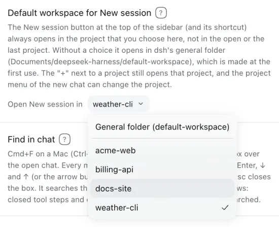
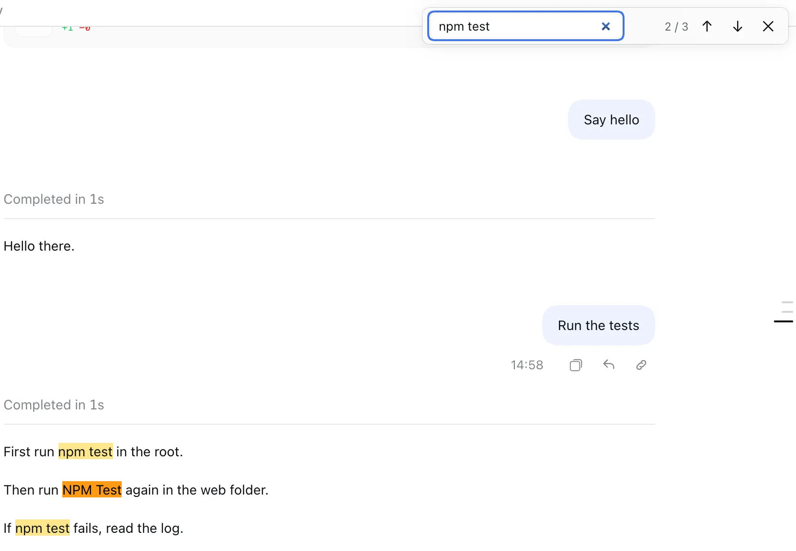
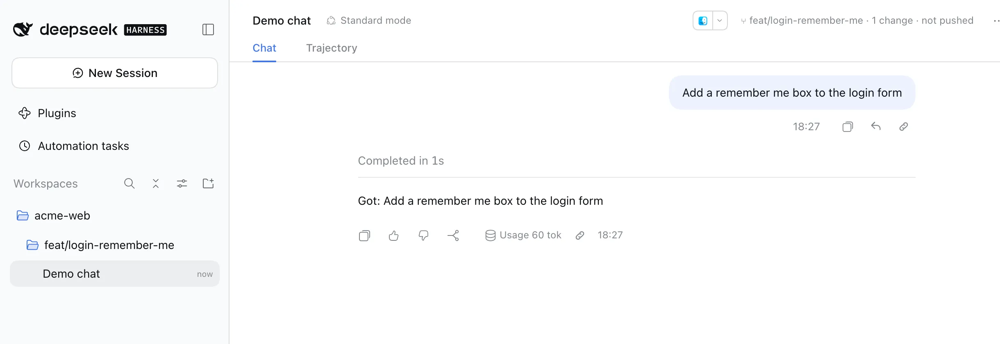
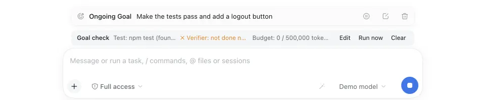
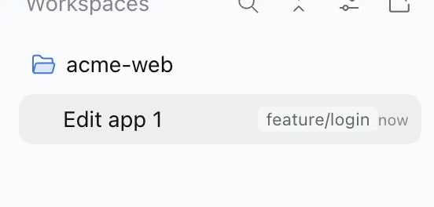

# dsh-composer-plus — DeepSeek Harness के लिए Composer Plus

[](https://www.npmjs.com/package/dsh-composer-plus)
[](https://github.com/furkancak1r/dsh-composer-plus/actions/workflows/test.yml)
[](LICENSE)

[English](README.md) · [中文](README.zh.md) · [Türkçe](README.tr.md) · [Español](README.es.md) · [Português (Brasil)](README.pt-BR.md) · [Français](README.fr.md) · [Deutsch](README.de.md) · [Русский](README.ru.md) · [日本語](README.ja.md) · [한국어](README.ko.md) · [Bahasa Indonesia](README.id.md) · [Tiếng Việt](README.vi.md) · **हिन्दी**

यह एक अनुवाद है। संदर्भ संस्करण अंग्रेज़ी [README.md](README.md) है।

[DeepSeek Harness](https://github.com/deepseek-ai/deepseek-harness) (dsh) के डेस्कटॉप ऐप और वेब UI के लिए Codex जैसी सुविधाएं, जो रोज़ का काम आसान बनाती हैं: बदलाव पैनल, स्वाइप कार्ड वाले सुविधाओं के आइडिया, साइडबार खोज जो संदेशों का टेक्स्ट भी खोजती है, फ़ाइलें वापस लाने वाला टर्न रोलबैक, चैट को ट्रैश में भेजकर हटाना, कंपोज़र के नीचे प्रोजेक्ट का नाम, साइडबार में प्रोजेक्ट की स्थिति, इनपुट इतिहास, प्लान मोड का शॉर्टकट, एक क्लिक में जारी रखना, रीस्टार्ट के बाद चल रही चैट को जारी रखना, कतार में खींचकर छोड़ना, सेशन डीपलिंक, चैट को Markdown के रूप में एक्सपोर्ट करना, हर चैट के लिए अलग ऑटो रिव्यू अनुमतियां, बैकग्राउंड सूचनाएं, Tether ऐप से iPhone पर पहुंच और अपने-आप अपडेट।

**एक लाइन में:** यह DeepSeek Harness का एक ही प्लगइन है (npm `dsh-composer-plus`, सेटिंग → प्लगइन में **Composer Plus** नाम से दिखता है)। यह जोड़ता है: git बदलाव पैनल, Tinder जैसे सुविधाओं के आइडिया वाले कार्ड, साइडबार खोज जो संदेशों के शब्द भी ढूंढती है, ↶ टर्न रोलबैक (सिर्फ़ चैट, या चैट और फ़ाइलें), चैट हटाएं, कंपोज़र के नीचे प्रोजेक्ट का नाम, ↑/↓ इनपुट इतिहास, Shift+Tab से `/plan` चालू/बंद, एक क्लिक में ▶ जारी रखें, रीस्टार्ट के बाद जारी रखें, खींचकर छोड़ने से कतार का क्रम बदलना, सेशन लिंक कॉपी करें, Markdown के रूप में एक्सपोर्ट करें, ऑटो रिव्यू में “इस चैट के लिए अनुमति दें”, बैकग्राउंड सूचनाएं, iPhone से पहुंच (मोबाइल कनेक्ट, Tether ऐप), इंटरफ़ेस की 11 अतिरिक्त भाषाएं और अपने-आप अपडेट।

<p align="center"></p>

यह एक अनौपचारिक कम्युनिटी प्लगइन है। यह सिर्फ़ अपडेट जांचने के लिए नेटवर्क कॉल करता है (GitHub रिलीज़ और npm रजिस्ट्री)। शुरू होते समय ये कॉल रोकने के लिए **अपने-आप अपडेट** बंद करें। **सुविधाओं के आइडिया** आपकी चैट के अपने मॉडल को सिर्फ़ तब कॉल करता है, जब आप **सुविधाएं सुझाएं** पर क्लिक करते हैं। **अगले संदेश का अनुमान** (डिफ़ॉल्ट रूप से चालू) हर पूरे हुए टर्न के बाद सेटिंग में चुने गए मॉडल (जब तक आप कोई दूसरा न चुनें, dsh का डिफ़ॉल्ट मॉडल) को बिना क्लिक के एक बार कॉल करता है। ये कॉल रोकने के लिए इसे **सेटिंग → Composer Plus** में बंद करें। **टाइप करते समय पूरा करें** (डिफ़ॉल्ट रूप से बंद) आपके इसे चालू करने के बाद, टाइप करते समय हर ठहराव पर इसके लिए चुने गए मॉडल (डिफ़ॉल्ट रूप से अनुमान वाला मॉडल) को कॉल करता है। **प्रॉम्प्ट बेहतर करें** किसी मॉडल को सिर्फ़ तब कॉल करता है, जब आप उसकी जादुई छड़ी पर क्लिक करते हैं। **लक्ष्य जांच** (डिफ़ॉल्ट रूप से चालू) जब भी एजेंट किसी अपने-आप चलने वाले राउंड में `/goal` को पूरा मार्क करता है, तब एक मॉडल को एक बार कॉल करती है। **मोबाइल कनेक्ट** (डिफ़ॉल्ट रूप से बंद) आपके लोकल नेटवर्क या tailnet से iPhone के कनेक्शन सिर्फ़ तब स्वीकार करता है, जब आप इसे चालू करते हैं।

## इंस्टॉल करें

**डेस्कटॉप ऐप:** सेटिंग → प्लगइन → **प्लगइन जोड़ें** → `dsh-composer-plus` डालें → **अभी चालू करें**।
npm नाम की जगह आप `https://github.com/furkancak1r/dsh-composer-plus` भी पेस्ट कर सकते हैं।

**वेब / CLI प्रोफ़ाइल:**

```sh
dsh plugin --profile web add dsh-composer-plus
```

फिर dsh रीस्टार्ट करें। (CLI डेस्कटॉप प्रोफ़ाइल में इंस्टॉल नहीं कर सकता; उस प्रोफ़ाइल को ऐप खुद संभालता है।)

> dsh का pnpm 24 घंटे से नए वर्शन छोड़ देता है। रिलीज़ के तुरंत बाद वर्शन भी लिखें: `dsh-composer-plus@1.15.0`।

## सुविधाएं

<!-- BEGIN GENERATED FEATURES: edit docs/features.json, then run npm run build:readme -->

| सुविधा | उपयोग कैसे करें | स्क्रीनशॉट |
|---|---|---|
| **बदलाव पैनल** | <a id="feature-changespanel"></a>दायां साइडबार → `+` → **बदलाव**। बदली हुई फ़ाइलें `+/-` गिनती के साथ देखने के लिए **कमिट नहीं किए गए**, **स्टेज नहीं किए गए**, **स्टेज किए गए** या **ब्रांच** चुनें। किसी फ़ाइल का डिफ़ देखने के लिए उस पर क्लिक करें। **पिछला टर्न** सबसे नए टर्न का dsh का अपना रिव्यू खोलता है। ब्रांच ट्री देखने के लिए ब्रांच के नाम पर क्लिक करें (या **ट्री** चुनें)। ऊपर किसी ब्रांच पर क्लिक करने से ट्री उस ब्रांच पर जाता है, और किसी कमिट पर क्लिक करने से उसकी फ़ाइलें और डिफ़ दिखते हैं। **यह चैट** चुनने पर सिर्फ़ वे फ़ाइलें दिखती हैं, जिन्हें खुली चैट के फ़ाइल टूल (write, edit) ने उसके सभी टर्न में लिखा। साथ में पहले संदेश से अब तक का उनका कुल डिफ़ भी दिखता है। **␣** बटन व्हाइटस्पेस बदलाव छिपाता है (`git diff -w`): जिन पंक्तियों में सिर्फ़ इंडेंटेशन या लाइन के अंत बदले हैं, वे नहीं दिखतीं। किसी फ़ाइल का **…** मेन्यू → **इस फ़ाइल को बदलने वाली चैट** उसी रिपॉज़िटरी की वे चैट दिखाता है, जिनके लिखने या एडिट करने वाले टूल ने वह फ़ाइल बदली, सबसे नई पहले, और साथ में वह अनुरोध भी, जिसने बदलाव किया; क्लिक करने पर वह चैट उसी अनुरोध पर खुलती है। | <a href="assets/features/changesPanel.webp"></a> |
| **सुविधाओं के आइडिया** | <a id="feature-featureideas"></a>दायां साइडबार → `+` → **सुविधाओं के आइडिया** → **सुविधाएं सुझाएं**। चैट का अपना मॉडल चैट के प्रोजेक्ट का छोटा सारांश पढ़ता है (टॉप-लेवल फ़ाइलें, README और मैनिफ़ेस्ट की शुरुआत, README के बाकी हिस्से की रूपरेखा, हाल के कमिट के शीर्षक)। फिर वह ज़्यादा से ज़्यादा 8 सुविधाएं सुझाता है। सुझाव कार्ड के ढेर के रूप में dsh की UI भाषा में दिखते हैं। उसी प्रोजेक्ट में नई चैट शुरू करने के लिए कार्ड को दाएं स्वाइप करें (या **✓** पर क्लिक करें, या `→` दबाएं; हर बार कार्ड अपनी तरफ़ उड़ जाता है)। नई चैट प्लान मोड में शुरू होती है और आइडिया उसका अनुरोध होता है। इसलिए जब तक आप प्लान मंज़ूर नहीं करते, कुछ नहीं बदलता। प्लान छोड़ने के लिए **▶ अभी बनाएं** पर क्लिक करें (या `↑` दबाएं; कार्ड ऊपर उड़ जाता है): नई चैट तुरंत शुरू होती है और आइडिया उसका सामान्य अनुरोध होता है। मॉडल बदलाव करता है और अपनी जांचें चलाता है (मंज़ूरियां हमेशा की तरह लागू होती हैं)। छोड़ने के लिए बाएं स्वाइप करें (या **✕**, या `←`)। **पहले जैसा करें** (या `Z`) छोड़ा गया कार्ड वापस लाता है। किसी अच्छे आइडिया को बाद के लिए रखने के लिए **↓** पर क्लिक करें (या `↓` दबाएं)। वह प्रोजेक्ट की **बाद में** सूची में चला जाता है। उसी प्रोजेक्ट फ़ोल्डर की हर चैट यह सूची दिखाती है (रीस्टार्ट के बाद भी)। **बाद में (N)** सूची खोलता है। **योजना बनाएं** उस आइडिया के लिए वैसी ही प्लान मोड वाली चैट शुरू करता है और **अभी बनाएं** बिना प्लान वाली चैट; दोनों आइडिया को सूची से हटा देते हैं। **सबकी एक योजना बनाएं (N)** सूची के सभी आइडिया के लिए एक ही प्लान मोड वाली चैट शुरू करता है, इसलिए साझा हिस्सों की योजना एक ही बार बनती है। **सूची से हटाएं** आइडिया को मिटा देता है। **चेकलिस्ट के रूप में कॉपी करें** पूरी सूची को Markdown चेकलिस्ट (`- [ ] Title — Summary`, हर आइडिया की एक लाइन) के रूप में क्लिपबोर्ड पर कॉपी करता है, ताकि आप उसे किसी इश्यू ट्रैकर या TODO फ़ाइल में इस्तेमाल कर सकें; यह कोई नेटवर्क कॉल नहीं करता। किसी आइडिया पर **GitHub इश्यू खोलें** आपके अपने GitHub CLI (`gh`) लॉगिन से प्रोजेक्ट की GitHub रिपॉज़िटरी में उस आइडिया के शीर्षक और सारांश (और वह क्यों ज़रूरी है) के साथ एक इश्यू खोलता है; इसके बाद आइडिया के पास **इश्यू #N** लिंक दिखता है, जो इश्यू खोलता है। **और आइडिया** नए कार्ड जोड़ता है। सिर्फ़ एक क्षेत्र के आइडिया पाने के लिए **सुविधाएं सुझाएं** के पास वाले फ़ील्ड में छोटा-सा **फ़ोकस विषय** लिखें (ज़्यादा से ज़्यादा 80 अक्षर; `Enter` से भी सुझाव मिलते हैं), या उसके नीचे के तय विषयों में से किसी एक पर क्लिक करें: **प्रदर्शन**, **सुलभता**, **टेस्ट**, **सुरक्षा**, **उपयोगिता** या **दस्तावेज़ीकरण** (उसे हटाने के लिए फिर से क्लिक करें)। तब मॉडल सिर्फ़ उसी विषय से जुड़ी सुविधाएं सुझाता है; खाली फ़ील्ड का मतलब है कोई भी सुविधा। एक प्रोजेक्ट में कोई आइडिया दो बार नहीं सुझाया जाता: हर सुझाया गया आइडिया (छोड़ा गया, रखा गया या शुरू किया गया) प्रोजेक्ट के **इतिहास** में जाता है, मॉडल से कहा जाता है कि वह इन्हें फिर न सुझाए, और दोहराए गए शीर्षक वाला आइडिया हटा दिया जाता है। **इतिहास** इन्हें **शुरू किया गया** या **सुझाया गया** के साथ दिखाता है; **भूल जाएं** (या **सब भूल जाएं**) से कोई आइडिया फिर आ सकता है; जो आइडिया अभी भी **बाद में** सूची में है, वह तब तक सुझावों में नहीं आता जब तक आप उसे वहां से हटा नहीं देते। मॉडल सिर्फ़ आपके क्लिक करने पर चलता है। | <a href="assets/features/featureIdeas.webp"></a> |
| **कंटेंट में खोज** | <a id="feature-contentsearch"></a>dsh के साइडबार की अपनी खोज (**वर्कस्पेस** के पास का आवर्धक लेंस; डेस्कटॉप ऐप में `Cmd+K`, ब्राउज़र में `Cmd+Alt+K`) अब चैट को सिर्फ़ शीर्षक से नहीं, बल्कि आपके संदेशों और जवाबों के शब्दों से भी ढूंढती है। मिलता-जुलता टेक्स्ट चैट के नीचे दिखता है। dsh में यह खोज पहले से है, लेकिन यह बंद रहती है। यह सुविधा इसे चालू करती है और आपके कंप्यूटर पर एक खोज इंडेक्स फ़ाइल इस्तेमाल करती है। dsh शुरू होने के बाद पहली खोज पर इंडेक्स बनता है (250 चैट के लिए लगभग 15 सेकंड, सीमाएं देखें)। अगली बार शुरू करने पर यही इंडेक्स फिर से काम आता है। यह डिफ़ॉल्ट रूप से चालू है। बदलाव dsh रीस्टार्ट करने के बाद लागू होता है। | <a href="assets/features/contentSearch.webp"></a> |
| **टर्न रोलबैक** | <a id="feature-turnrollback"></a>अपने किसी संदेश पर पॉइंटर ले जाएं और **↶** पर क्लिक करें (कॉपी करें के पास)। **सिर्फ़ चैट** उस संदेश और उसके बाद की हर चीज़ (जवाब, टूल कॉल) को चैट और मॉडल के कॉन्टेक्स्ट से हटा देता है। संदेश कंपोज़र में वापस आ जाता है: उसे बदलें और फिर से भेजें। **चैट और फ़ाइलें** पहले उन प्रोजेक्ट फ़ाइलों की सूची दिखाता है, जो उस संदेश के बाद बदलीं। फिर वह उन्हें भी पहले जैसी स्थिति में वापस लाता है। इसमें कमांड (`bash`) से हुए बदलाव भी शामिल हैं, सिर्फ़ dsh के एडिट टूल से हुए बदलाव नहीं। चल रहा टर्न पहले रुकता है। चैट लॉग कभी दोबारा नहीं लिखा जाता: एक छिपा हुआ मार्कर हटाए गए हिस्से को छिपा देता है, ठीक वैसे ही जैसे dsh का अपना `/compact` पुराने संदेश छिपाता है। अगर [dsh-rewind-plugin](https://www.npmjs.com/package/dsh-rewind-plugin) इंस्टॉल है, तो यह काम वही करता है और Composer Plus दूसरा बटन नहीं दिखाता। रोलबैक के बाद कंपोज़र के ऊपर **फिर से करें** बार दिखता है। यह रोलबैक से ठीक पहले के पल से एक नई चैट शुरू करता है (वही संदेश और कॉन्टेक्स्ट)। **चैट और फ़ाइलें** के साथ यह फ़ाइलें भी वापस लाता है। रोलबैक के बाद आपने जो फ़ाइल बदली, वह सूची में दिखती है और रखी जाती है, जब तक आप उसे ओवरराइट करने वाले बॉक्स पर टिक न करें। | <a href="assets/features/turnRollback.webp"></a> |
| **चैट हटाएं** | <a id="feature-deletechat"></a>साइडबार → चैट का **…** मेन्यू (या राइट-क्लिक) → **हटाएं…** → **हटाएं**। dsh खुद सिर्फ़ आर्काइव कर सकता है। चैट रुक जाती है (उसका टर्न, जॉब, सबएजेंट और शेड्यूल भी, जैसे dsh के अपने आर्काइव में होता है)। उसका सेव किया गया इतिहास, उसकी सबएजेंट चैट के साथ, macOS के ट्रैश में चला जाता है (दूसरे सिस्टम पर: `$DSH_HOME/trash`)। चैट वापस लाने के लिए फ़ोल्डर को उसकी जगह पर वापस रखें और dsh रीस्टार्ट करें: चैट साइडबार के **सिर्फ़ आर्काइव किए गए** व्यू में दिखेगी। | <a href="assets/features/deleteChat.webp"></a> |
| **कंपोज़र में प्रोजेक्ट का नाम** | <a id="feature-projectname"></a>कंपोज़र के नीचे की पंक्ति (टर्न, टोकन, कैश हिट, कॉन्टेक्स्ट) चैट के प्रोजेक्ट के नाम से शुरू होती है। इससे आपको हमेशा पता रहता है कि चैट किस प्रोजेक्ट में काम करती है। यह dsh का अपना प्रोजेक्ट शीर्षक होता है। अगर प्रोजेक्ट का कोई शीर्षक नहीं है, तो फ़ोल्डर का नाम दिखता है। फ़ोल्डर का पूरा पाथ देखने के लिए उस पर पॉइंटर ले जाएं। साइडबार में चैट ढूंढने के लिए उस पर क्लिक करें, यह सूची और प्रोजेक्ट दोनों व्यू में काम करता है: साइडबार और प्रोजेक्ट खुल जाते हैं (बंद प्रोजेक्ट और उसका **N और सेशन दिखाएं** भी), सूची चैट तक स्क्रॉल होती है और चैट 5 सेकंड तक टिमटिमाती है। | <a href="assets/features/projectName.webp"></a> |
| **इनपुट इतिहास** | <a id="feature-inputhistory"></a>खाली कंपोज़र में `↑` / `↓` दबाकर भेजे गए संदेशों में आगे-पीछे जाएं, जैसे टर्मिनल में। | <a href="assets/features/inputHistory.webp"></a> |
| **Shift+Tab प्लान मोड** | <a id="feature-plantoggle"></a>`Shift+Tab` ड्राफ़्ट की शुरुआत में `/plan ` जोड़ता है (हटाने के लिए फिर से दबाएं)। अगर चैट पहले से प्लान मोड में है, तो `Shift+Tab` उससे बाहर निकालता है। | <a href="assets/features/planToggle.webp"></a> |
| **कंपोज़र में फ़ोकस बनाए रखें** | <a id="feature-keepfocus"></a>`/` कमांड या स्किल भेजने के बाद कर्सर कंपोज़र में ही रहता है, और आप तुरंत फिर से टाइप कर सकते हैं। यह उन कीबोर्ड मैक्रो के साथ भी काम करता है, जो कमांड टाइप करके `Enter` दबाते हैं। कमांड प्रोसेस करते समय dsh कंपोज़र को सिर्फ़ पढ़ने लायक (read-only) बना देता है, और तब ब्राउज़र फ़ोकस हटा देता है। यह सुविधा फ़ोकस वापस लाती है, बशर्ते फ़ोकस किसी मेन्यू, डायलॉग या दूसरे फ़ील्ड में न हो। | <a href="assets/features/keepFocus.webp"></a> |
| **एक क्लिक में जारी रखें** | <a id="feature-continuebutton"></a>रुके हुए, विफल या बीच में कटे टर्न के बाद खाली कंपोज़र में **▶** दिखता है। एक क्लिक मौजूदा बातचीत से काम फिर से शुरू करता है। इनपुट में कुछ नहीं लिखा जाता और चैट में कोई दिखने वाला संदेश नहीं जुड़ता (मॉडल को “जहां रुका था, वहीं से जारी रखें” वाला एक छोटा छिपा नोट मिलता है, क्योंकि Claude जैसे कुछ प्रोवाइडर ऐसा अनुरोध अस्वीकार करते हैं, जो असिस्टेंट के जवाब पर खत्म होता है)। कतार में रखे संदेश वहीं रहते हैं: ▶ सिर्फ़ रुके हुए काम को जारी रखता है, उसके बाद कतार चलती है। पूरे हुए टर्न के बाद सामान्य भेजें बटन ही रहता है। | <a href="assets/features/continueButton.webp"></a> |
| **रीस्टार्ट के बाद जारी रखें** | <a id="feature-resumeafterrestart"></a>डिफ़ॉल्ट रूप से बंद: इसे **सेटिंग → Composer Plus** में चालू करें। अगर चैट के काम करते समय आप dsh बंद करते हैं (या वह बंद हो जाता है), तो dsh दोबारा खोलने पर वह चैट अपने आप जारी रहती है। उसे वही छिपा नोट मिलता है, जो एक क्लिक में जारी रखें में मिलता है। अगर कोई लक्ष्य राउंड (`/goal`) चल रहा था, तो लक्ष्य अपने अगले राउंड से जारी रहता है (dsh हर बार शुरू होने पर लक्ष्यों को तब तक रोक देता है, जब तक आप उन्हें फिर से शुरू नहीं करते)। जिन चैट को आपने रोका, जो पूरी हो गईं या विफल हुईं, वे जारी नहीं रहतीं। dsh में इसकी अपनी कोई सेटिंग नहीं है: वह ऐसे टर्न को सिर्फ़ बीच में रुका हुआ मार्क करता है। | <a href="assets/features/resumeAfterRestart.webp"></a> |
| **कतार में खींचकर छोड़ें** | <a id="feature-queuereorder"></a>कतार वाले संदेशों पर एक हैंडल (⠿) दिखता है। क्रम बदलने के लिए उसे खींचें, या हैंडल पर फ़ोकस करके `↑` / `↓` दबाएं। `Esc` रद्द करता है। | <a href="assets/features/queueReorder.webp"></a> |
| **कतार वाले संदेश को उसी जगह एडिट करें** | <a id="feature-queueedit"></a>कतार वाले किसी संदेश पर डबल-क्लिक करें। वह dsh के अपने एडिट बॉक्स में बदल जाता है: टेक्स्ट बदलें, फिर सेव करने के लिए `Enter` या रद्द करने के लिए `Esc` दबाएं। संदेश कतार में अपनी जगह पर रहता है। इमेज या फ़ाइल वाले संदेश इस तरह एडिट नहीं होते (dsh की कतार सिर्फ़ टेक्स्ट एडिट करती है)। | <a href="assets/features/queueEdit.webp"></a> |
| **सेशन लिंक कॉपी करें** | <a id="feature-copydeeplink"></a>साइडबार में किसी चैट पर राइट-क्लिक करें → **सेशन लिंक कॉपी करें**। उस चैट को सिर्फ़ पढ़ने लायक कॉन्टेक्स्ट के रूप में जोड़ने के लिए `dsh-session:…` लिंक किसी दूसरी चैट में पेस्ट करें। dsh 0.2.1 में अपना **सेशन ID कॉपी करें** है, जो सिर्फ़ सादा ID कॉपी करता है; यह आइटम ठीक उसके बाद आता है। | <a href="assets/features/copyDeeplink.webp"></a> |
| **संदेश लिंक कॉपी करें** | <a id="feature-copymessagelink"></a>किसी संदेश पर पॉइंटर ले जाएं और **🔗** पर क्लिक करें (संदेश की एक्शन पंक्ति में; जवाब में समय के पास)। लिंक, सेशन लिंक के साथ संदेश का नंबर है: `dsh-session:…#42`। इसे किसी संदेश में पेस्ट करें और भेजें। dsh 0.2.1 और उसके बाद के वर्शन में लिंक एक चिप के रूप में दिखता है। उस पर क्लिक करने से वह चैट खुलती है, संदेश तक स्क्रॉल होती है और संदेश 2 सेकंड तक हाइलाइट रहता है। सेशन लिंक की तरह, यह उस चैट को सिर्फ़ पढ़ने लायक कॉन्टेक्स्ट के रूप में भी जोड़ता है। | <a href="assets/features/copyMessageLink.webp"></a> |
| **चैट को Markdown के रूप में एक्सपोर्ट करें** | <a id="feature-exportmarkdown"></a>साइडबार में किसी चैट पर राइट-क्लिक करें (या उसका **…** मेन्यू खोलें) → **Markdown के रूप में एक्सपोर्ट करें…**। एक डायलॉग दिखाता है कि चैट में कितने संदेश हैं। **क्लिपबोर्ड पर कॉपी करें** चैट को Markdown के रूप में कॉपी करता है, और **.md फ़ाइल सेव करें** उसे ब्राउज़र के डाउनलोड से `<chat title>.md` के रूप में सेव करता है (dsh डेस्कटॉप: आपके सिस्टम की सेटिंग के हिसाब से डाउनलोड फ़ोल्डर में या सेव डायलॉग से)। फ़ाइल में चैट का शीर्षक, प्रोजेक्ट का नाम और तारीख होती है, फिर हर संदेश के लिए एक `## आप` या `## असिस्टेंट` सेक्शन होता है। कोड ब्लॉक जैसे हैं वैसे ही रहते हैं; जो कोड ब्लॉक किसी संदेश में खुला रह गया हो, उसे बंद कर दिया जाता है। | <a href="assets/features/exportMarkdown.webp"></a> |
| **प्रोजेक्ट का पाथ कॉपी करें** | <a id="feature-copyprojectpath"></a>साइडबार में किसी प्रोजेक्ट पर राइट-क्लिक करें → **पाथ कॉपी करें** उसके फ़ोल्डर का पूरा पाथ कॉपी करता है। | <a href="assets/features/copyProjectPath.webp"></a> |
| **नई चैट में प्रोजेक्ट खोज** | <a id="feature-projectpicker"></a>नई चैट → कंपोज़र के ऊपर वाला प्रोजेक्ट बटन। प्रोजेक्ट A–Z क्रम में दिखते हैं, और सबसे ऊपर **प्रोजेक्ट खोजें** बॉक्स होता है। नाम का कोई हिस्सा लिखें (बड़े-छोटे अक्षरों और एक्सेंट से फ़र्क नहीं पड़ता) और पहला मिलान चुनने के लिए `Enter` दबाएं। कुछ भी न मिले, तो **कोई मिलता-जुलता प्रोजेक्ट नहीं** दिखता है। साइडबार में dsh का सेव किया गया प्रोजेक्ट क्रम नहीं बदलता। | <a href="assets/features/projectPicker.webp"></a> |
| **नया सेशन के लिए डिफ़ॉल्ट वर्कस्पेस** | <a id="feature-defaultworkspace"></a>सेटिंग → Composer Plus → **नया सेशन के लिए डिफ़ॉल्ट वर्कस्पेस** → **नया सेशन यहाँ खोलें**: कोई प्रोजेक्ट चुनें, या **सामान्य फ़ोल्डर (default-workspace)** चुनें (डिफ़ॉल्ट: dsh का अपना फ़ोल्डर `Documents/deepseek-harness/default-workspace`, जो पहली बार इस्तेमाल करने पर बनता है)। इसके बाद साइडबार में सबसे ऊपर वाला **नया सेशन** (और उसका शॉर्टकट) नई चैट हमेशा वहीं खोलता है, तब भी जब किसी दूसरे प्रोजेक्ट की चैट खुली हो। किसी प्रोजेक्ट के पास वाला `+` अब भी वही प्रोजेक्ट खोलता है, और नई चैट में कंपोज़र के ऊपर वाला प्रोजेक्ट बटन अब भी प्रोजेक्ट बदलता है। | <a href="assets/features/defaultWorkspace.webp"></a> |
| **चैट में खोजें** | <a id="feature-findinchat"></a>किसी चैट में Mac पर `Cmd+F` (Windows और Linux पर `Ctrl+F`) दबाएं: उसके ऊपर एक खोज बॉक्स खुलता है। कोई शब्द लिखें: स्क्रीन पर दिख रहे संदेशों और जवाबों में हर मिलान हाइलाइट होता है, मौजूदा मिलान ज़्यादा गहरे रंग में, और बॉक्स n / कुल दिखाता है। `Enter` या `↓` अगले मिलान पर और `Shift+Enter` या `↑` पिछले मिलान पर ले जाता है (तीर वाले बटन भी); चैट मिलान को बीच तक स्क्रॉल करती है। बड़े-छोटे अक्षर, एक्सेंट और तुर्की का बिना बिंदु वाला ı मायने नहीं रखते। `Esc` बॉक्स बंद करता है और कर्सर को उसकी पिछली जगह पर वापस रखता है। जवाब आते समय भी खोज चैट के साथ चलती रहती है। | <a href="assets/features/findInChat.webp"></a> |
| **हर चैट की अपनी ब्रांच** | <a id="feature-worktreechats"></a>नई चैट → प्रोजेक्ट बटन और मोड बटन के बीच वाला main बटन (ब्रांच आइकन) → **नई ब्रांच**, फिर पहला संदेश लिखें और भेजें। पहले संदेश के साथ इमेज और फ़ाइलें भेजी जा सकती हैं। AI उसी संदेश से ब्रांच का नाम रखता है (`feat/…`, `fix/…`), Composer Plus उसके लिए `<project>/.worktrees/` में एक git worktree बनाता है, `.worktreeinclude` में दी गई अनदेखी फ़ाइलें (जैसे `.env` और `node_modules/`) कॉपी करता है और वहां आपके संदेश के साथ नई चैट खोलता है। खुली चैट का हेडर ⑂ ब्रांच · N बदलाव · ↑ ↓ (या **push नहीं हुई**) दिखाता है; **बदलाव** खोलने के लिए उस पर क्लिक करें। उसी मेन्यू में खुले worktree की सूची होती है: उनमें से किसी एक में चैट शुरू करने के लिए उसे चुनें। साइडबार में ब्रांच फ़ोल्डर उनके प्रोजेक्ट के अंदर देखने के लिए dsh के **व्यू के विकल्प** → **वर्कस्पेस ट्री** चुनें। | <a href="assets/features/worktreeChats.webp"></a> |
| **अगले संदेश का अनुमान** | <a id="feature-nextprediction"></a>डिफ़ॉल्ट रूप से चालू: आप इसे **सेटिंग → Composer Plus** में बंद कर सकते हैं। जब एजेंट कोई टर्न पूरा करता है (रुका हुआ या विफल टर्न नहीं), तो खाली कंपोज़र ग्रे टेक्स्ट में आपके अगले संदेश का अनुमान दिखाता है, साथ में **स्वीकार करने के लिए Tab** संकेत होता है। `Tab` टेक्स्ट को कंपोज़र में डालता है, पर भेजता नहीं। `Esc` उस टर्न के लिए अनुमान छिपा देता है। टाइप करना शुरू करने पर भी यह छिप जाता है, और नया टर्न इसे बदल देता है। स्विच के नीचे का **मॉडल** मेन्यू dsh के अपने मॉडल दिखाता है (वही सूची, जो dsh के मॉडल मेन्यू में है)। डिफ़ॉल्ट रूप से **dsh डिफ़ॉल्ट** चुना होता है, जो dsh के डिफ़ॉल्ट मॉडल के अनुसार चलता है। हर पूरे हुए टर्न पर एक छोटी मॉडल कॉल होती है। Tether में अनुमान खाली कंपोज़र के ऊपर दिखता है: उसे फ़ील्ड में डालने के लिए उस पर टैप करें। | <a href="assets/features/nextPrediction.webp"></a> |
| **टाइप करते समय पूरा करें** | <a id="feature-typingcompletion"></a>डिफ़ॉल्ट रूप से बंद: आप इसे **सेटिंग → Composer Plus** में चालू कर सकते हैं। जब आप टाइप करते हैं, कर्सर के ठीक बाद ग्रे टेक्स्ट दिखाता है कि आपका संदेश आगे कैसे बढ़ सकता है। `Tab` इसे संदेश में जोड़ता है, पर भेजता नहीं। `Esc` इसे छिपा देता है। यह केवल आपके अपने अगले शब्द सुझाता है: आपको कभी जवाब नहीं देता, और कोई गढ़ा हुआ त्रुटि संदेश या नाम नहीं जोड़ता। अगर संदेश पूरा लगता है या मॉडल को भरोसा नहीं है, तो कुछ नहीं दिखता। ग्रे टेक्स्ट के अगले अक्षर टाइप करने पर यह बना रहता है, और नई मॉडल कॉल नहीं होती। इसके स्विच के नीचे इसका अपना **मॉडल** मेन्यू है। इसकी पहली एंट्री, **अगले संदेश के अनुमान जैसा**, **अगले संदेश का अनुमान** वाला मॉडल इस्तेमाल करती है (डिफ़ॉल्ट); हर सुविधा के लिए अलग मॉडल इस्तेमाल करने के लिए कोई दूसरा मॉडल चुनें, जैसे पूरा करने के लिए कोई तेज़ मॉडल। टाइप करते समय हर ठहराव पर यह एक मॉडल कॉल करता है, इसलिए यह अनुमान से कहीं ज़्यादा टोकन खर्च करता है: कोई तेज़ और कम लागत वाला मॉडल चुनें। यह स्लैश कमांड पर, फ़ाइल चिप वाले संदेश पर, या कर्सर के आख़िर में न होने पर नहीं चलता। Tether में टाइप करते समय बाकी टेक्स्ट फ़ील्ड के ऊपर दिखता है: उसे जोड़ने के लिए उस पर टैप करें। | <a href="assets/features/typingCompletion.webp"></a> |
| **प्रॉम्प्ट बेहतर करें** | <a id="feature-promptimprove"></a>कोई मोटा-मोटा अनुरोध टाइप करें, फिर मॉडल मेन्यू के पास जादुई छड़ी (**प्रॉम्प्ट बेहतर करें**) पर क्लिक करें। एक मॉडल कॉल उसे ज़्यादा साफ़ प्रॉम्प्ट के रूप में दोबारा लिखती है: पहले लक्ष्य, कई हिस्से हों तो छोटे क्रमांकित चरण, और चलाने वाली जांच। यह इस चैट (रोलबैक किए गए संदेशों को छोड़कर), प्रोजेक्ट की README, AGENTS.md और मैनिफ़ेस्ट, बदली गई फ़ाइलों और उन फ़ाइलों को पढ़ता है जिनके नाम आपके शब्दों से मिलते हैं, और आपकी भाषा बनाए रखता है। यह कभी फ़ाइलों के नाम नहीं गढ़ता। नया टेक्स्ट आपके ड्राफ़्ट की जगह ले लेता है, पर भेजा नहीं जाता: उसे पढ़ें, बदलें, फिर `Enter` दबाएं। `Cmd/Ctrl+Z` आपका टेक्स्ट एक चरण में वापस लाता है, और बटन (**सुधार वापस लें**) भी। अगर इसके काम करते समय आप टाइप करते हैं, तो आपका नया टेक्स्ट बना रहता है। `Esc` या दूसरा क्लिक इसे रद्द करता है। सेटिंग में इसका अपना **मॉडल** मेन्यू है (डिफ़ॉल्ट: **चैट के मॉडल जैसा**)। स्लैश कमांड या फ़ाइल चिप वाले संदेश के लिए नहीं। Tether में छड़ी फ़ील्ड के पास है। | <a href="assets/features/promptImprove.webp"></a> |
| **लक्ष्य जांच** | <a id="feature-goalcheck"></a>`/goal` से एक लक्ष्य शुरू करें। जब एजेंट किसी अपने-आप चलने वाले राउंड में लक्ष्य को पूरा मार्क करता है, तो लक्ष्य दो जांचों के बाद ही बंद होता है। पहले, प्रोजेक्ट की टेस्ट कमांड चैट के फ़ोल्डर में, चैट के सैंडबॉक्स मोड में चलती है। कमांड आपकी अपनी होती है या वह जो `package.json`, `Makefile`, `Cargo.toml`, `go.mod` या pytest में मिली। अगर एजेंट का अपना सबसे नया कदम इसी टेस्ट का सफल रन था, तो यह दोबारा नहीं चलती। फिर एक स्वतंत्र मॉडल कॉल, बिना टूल के, लक्ष्य, यह चैट, `git status` और टेस्ट का नतीजा पढ़ती है। अगर कोई जांच विफल होती है, तो लक्ष्य सक्रिय रहता है, एजेंट वजह पढ़ता है, फिर अगला राउंड चलता है। लक्ष्य बार के नीचे एक पंक्ति (**लक्ष्य जांच**) टेस्ट और पिछला नतीजा दिखाती है। **संपादित करें** से आप अपनी टेस्ट कमांड और समय या टोकन की सीमा तय करते हैं; सीमा पार होने पर लक्ष्य अवरुद्ध हो जाता है। **अभी चलाएं** लक्ष्य को बंद किए बिना जांच चलाता है। सेटिंग में इसका अपना **मॉडल** मेन्यू है (डिफ़ॉल्ट: **चैट के मॉडल जैसा**)। जब आप खुद लक्ष्य पूरा करते हैं, तो कुछ भी नहीं जांचा जाता। | <a href="assets/features/goalCheck.webp"></a> |
| **इस चैट के लिए अनुमति दें** | <a id="feature-allowforchat"></a>जब ऑटो रिव्यू आपसे पूछता है, तो मंज़ूरी कार्ड पर **इस चैट के लिए अनुमति दें** दिखता है। इसके बाद उसी चैट में वही टूल किसी भी आर्ग्युमेंट के साथ बिना पूछे चलता है, जब तक समय सीमा खत्म नहीं होती (डिफ़ॉल्ट रूप से 1 घंटा; इसे **सेटिंग → Composer Plus → इस चैट के लिए अनुमति दें** में चुनें)। फिर एजेंट दोबारा पूछता है। हेडर की एक चिप अनुमतियों की सूची उनके खत्म होने के समय के साथ दिखाती है और उन्हें रद्द करती है। रीस्टार्ट के बाद भी अनुमतियां बनी रहती हैं। | <a href="assets/features/allowForChat.webp"></a> |
| **प्रोजेक्ट की स्थिति** | <a id="feature-projectstatus"></a>साइडबार में प्रोजेक्ट की पंक्ति वही स्पिनर / इंतज़ार / पूरा होने का संकेत दिखाती है, जो उसकी चैट दिखाती हैं। इसलिए बंद (collapsed) प्रोजेक्ट भी बताता है कि अंदर कोई चैट काम कर रही है या उसे आपकी ज़रूरत है। सबसे पहले आपका इंतज़ार कर रही चैट दिखती है, फिर पूरी हुई ऐसी चैट जिसे आपने अभी तक नहीं खोला (हरा बिंदु, तब भी जब कोई दूसरी चैट अभी चल रही हो), फिर स्पिनर। विवरण देखने के लिए उस पर पॉइंटर ले जाएं। | <a href="assets/features/projectStatus.webp"></a> |
| **चैट पंक्तियों पर Git ब्रांच** | <a id="feature-sessionbranch"></a>साइडबार की हर चैट पंक्ति एक छोटे स्लेटी लेबल में वह git ब्रांच दिखाती है, जिस पर चैट के आख़िरी टर्न के समय चैट का प्रोजेक्ट फ़ोल्डर था (जैसे `main` या `feature/login`; detached HEAD होने पर कोष्ठक में छोटा कमिट ID दिखता है)। एक प्रोजेक्ट की अलग-अलग ब्रांच वाली दो चैट अब एक जैसी नहीं दिखतीं, और जब आप किसी चैट को गलत ब्रांच पर जारी रखने वाले हों, तो यह तुरंत दिख जाता है। पूरा नाम देखने के लिए लेबल पर पॉइंटर ले जाएं। Host वाला हिस्सा टर्न शुरू और ख़त्म होने पर ब्रांच पढ़ता है (`git branch --show-current`, सिर्फ़ पढ़ने के लिए); जिस चैट में यह इंस्टॉल करने के बाद से कोई टर्न नहीं हुआ, या जो फ़ोल्डर git रिपॉज़िटरी नहीं है, उसमें लेबल नहीं दिखता। अगर चैट के ऊपर वाली प्रोजेक्ट पंक्ति का नाम ब्रांच के नाम जैसा ही है (जैसे “हर चैट की अपनी ब्रांच” वाला फ़ोल्डर), तो चैट पंक्ति पर लेबल नहीं दिखता, लेकिन “एक ही सूची में” व्यू में लेबल अब भी दिखता है। | <a href="assets/features/sessionBranch.webp"></a> |
| **सभी को पढ़ा हुआ मार्क करें** | <a id="feature-markprojectread"></a>साइडबार में किसी प्रोजेक्ट के **…** बटन पर क्लिक करें → **सभी को पढ़ा हुआ मार्क करें**। उस प्रोजेक्ट की हर चैट से हरा अपठित बिंदु एक साथ हट जाता है; दूसरे प्रोजेक्ट के बिंदु बने रहते हैं। जब प्रोजेक्ट में कोई अपठित चैट नहीं होती, तो यह आइटम ग्रे दिखता है (**कोई अपठित चैट नहीं**)। | <a href="assets/features/markProjectRead.webp"></a> |
| **सक्रिय प्रोजेक्ट पहले** | <a id="feature-activeprojectsfirst"></a>जब कोई चैट चलने लगती है या उसे आपकी ज़रूरत होती है, तो उसका प्रोजेक्ट dsh के अपने पंक्ति एनिमेशन के साथ साइडबार में सबसे ऊपर चला जाता है (वैसे ही जैसे आप उसे खींचकर वहां ले जाते)। पूरे हो चुके प्रोजेक्ट अपनी जगह पर रहते हैं; उन्हें हमेशा की तरह कहीं भी खींचें। बदला गया क्रम dsh के प्रोजेक्ट क्रम में सेव होता है, इसलिए इसे बंद करने पर मौजूदा क्रम बना रहता है। | <a href="assets/features/projectStatus.webp"></a> |
| **हाल के प्रोजेक्ट का फ़िल्टर** | <a id="feature-recentprojects"></a>साइडबार → व्यू के विकल्प (स्लाइडर आइकन) → **पिछले 2 घंटों में सक्रिय**। इसके चुने रहने पर साइडबार सिर्फ़ वे प्रोजेक्ट दिखाता है, जिनमें पिछले 2 घंटों में कोई चैट सक्रिय रही हो। इसमें शामिल हैं: इस समय में अपडेट हुई चैट, चल रही या इंतज़ार कर रही चैट, खुली हुई चैट, या पूरी हुई ऐसी चैट जिसे आपने अभी तक नहीं खोला (dsh का हरा “पूरा हुआ” बिंदु), 2 घंटे बाद भी। जिन प्रोजेक्ट में ऐसी कोई चैट नहीं है, वे छिप जाते हैं, नए और खाली प्रोजेक्ट भी। सभी प्रोजेक्ट दिखाने के लिए इसे फिर से चुनें। यह चुनाव इसी डिवाइस पर याद रहता है। | <a href="assets/features/recentProjects.webp"></a> |
| **सभी प्रोजेक्ट छोटे करें** | <a id="feature-collapseprojects"></a>जब साइडबार में कोई प्रोजेक्ट खुला होता है, तो व्यू के विकल्पों (स्लाइडर आइकन) के पास एक बटन दिखता है। सभी खुले प्रोजेक्ट एक साथ बंद करने के लिए उस पर क्लिक करें, जैसे 5 में से 3 खुले प्रोजेक्ट। जब कोई प्रोजेक्ट खुला नहीं होता, तो बटन फिर से छिप जाता है। | <a href="assets/features/collapseProjects.webp"></a> |
| **स्थिति के अनुसार क्रम** | <a id="feature-statusorder"></a>साइडबार → व्यू के विकल्प → **इसके अनुसार क्रम दें** → **स्थिति के अनुसार** (**एक ही सूची में** के साथ)। सबसे पहले पूरी हुई चैट आती हैं (dsh का “पूरा हुआ” बिंदु, जो गड़बड़ी के साथ खत्म हुए टर्न को भी मिलता है)। फिर चल रही या इंतज़ार कर रही चैट, फिर सक्रिय ऑटोमेशन (शेड्यूल) वाली चैट, और आखिर में बाकी चैट dsh के क्रम में आती हैं। पूरी हुई चैट खोलने पर वह नीचे चली जाती है। सिर्फ़ व्यू बदलता है: वापस जाने के लिए **मैन्युअल** या **पिछला अपडेट** चुनें। | <a href="assets/features/statusOrder.webp"></a> |
| **बैकग्राउंड सूचनाएं** | <a id="feature-notifications"></a>जब dsh बैकग्राउंड में होता है, तो टर्न पूरा होने पर आपको सूचना मिलती है (जवाब की पहली पंक्ति)। जब कोई चैट सच में आपका इंतज़ार करती है, तब भी सूचना मिलती है: मंज़ूरी (टूल का नाम), जवाब (सवाल) या प्लान रिव्यू। अनुरोध 1.5 सेकंड बाद भी खुला होना चाहिए। इसलिए अपने-आप मंज़ूर हुए अनुरोधों (ऑटो रिव्यू अनुमतियां, दूसरे प्लगइन) पर कोई सूचना नहीं आती। अनुरोध का जवाब मिलते ही उसकी सूचना हटा ली जाती है। Dock/टास्कबार का बैज इंतज़ार कर रही चैट की गिनती दिखाता है। सूचना पर क्लिक करने से वह चैट खुलती है। | <a href="assets/features/notifications.webp"></a> |
| **ऐप्लिकेशन की भाषा** | <a id="feature-language"></a>सेटिंग → Composer Plus → **ऐप्लिकेशन की भाषा** पूरे dsh इंटरफ़ेस को Türkçe, Español, Português (Brasil), Français, Deutsch, Русский, 日本語, 한국어, Bahasa Indonesia, Tiếng Việt या हिन्दी में बदल देता है (नीचे देखें)। | <a href="assets/features/language.webp"></a> |
| **मोबाइल कनेक्ट (iPhone)** | <a id="feature-mobileconnect"></a>[Tether](tether/) ऐप से अपने iPhone पर dsh का उपयोग करें, उसी Wi-Fi पर या [Tailscale](https://tailscale.com) के ज़रिए। इसे **सेटिंग → Composer Plus** में चालू करें (यह डिफ़ॉल्ट रूप से बंद रहता है, क्योंकि यह इस Mac पर एक नेटवर्क पोर्ट खोलता है)। फिर साइडबार में नीचे बाईं ओर **मोबाइल कनेक्ट** पर क्लिक करें: iPhone के कैमरा से (**Open in Tether** पर टैप करें) या Tether में **Scan code** से QR कोड स्कैन करें, **Connect** पर टैप करें और **Approve** पर क्लिक करें। पहले Tether इंस्टॉल करें: इसके बिना कैमरा यह कोड नहीं खोल सकता। फ़ोन आपकी चैट दिखाता है, संदेश भेजता है (फ़ोटो के साथ भी: कंपोज़र का **+** → Camera, Photos या Paste image), मंज़ूरियों और सवालों के जवाब देता है, और मॉडल व एजेंट बदलता है। आप जितने चाहें उतने Mac पेयर कर सकते हैं: ऐप में ऊपर बाईं ओर Mac का नाम उनके बीच बदलता है। **मोबाइल कनेक्ट** पैनल पेयर किए गए iPhone उनके पिछले कनेक्शन के समय के साथ दिखाता है: **Remove** किसी एक को तुरंत हटा देता है। “Tailscale only” लोकल नेटवर्क से कनेक्शन मना कर देता है (साझा Wi-Fi के लिए), और एक्सेस लॉग दिखाता है कि किसने कनेक्ट करने की कोशिश की। Tether में “Settings → Privacy” ऐप को Face ID से लॉक करता है। | <a href="assets/features/mobileConnect.webp"></a> |
| **अपने-आप अपडेट** | <a id="feature-autoupdate"></a>dsh शुरू होने पर प्लगइन [GitHub की नवीनतम रिलीज़](https://github.com/furkancak1r/dsh-composer-plus/releases/latest) जांचता है। अगर वह नई है और npm पर पहले से है, तो प्लगइन वही वर्शन dsh के अपने प्लगइन मैनेजर से इंस्टॉल करता है (सेटिंग → प्लगइन वाला ही रास्ता) और आपको सूचित करता है। इसे लोड करने के लिए dsh रीस्टार्ट करें। **सेटिंग → Composer Plus → Composer Plus अपडेट** वर्शन दिखाता है और उसमें **अपडेट जांचें** / **अभी अपडेट करें** बटन हैं। नए वर्शन के साथ dsh पहली बार शुरू होने पर **Composer Plus N में नया क्या है** विंडो उस वर्शन के रिलीज़ नोट्स एक बार दिखाती है (उसी अपडेट जांच से, कोई अतिरिक्त नेटवर्क कॉल नहीं); **बंद करें** या `Esc` से यह बंद होती है। | <a href="assets/features/autoUpdate.webp"></a> |

<!-- END GENERATED FEATURES -->

बटन, टूलटिप, नोटिस और सूचनाएं dsh की चुनी गई भाषा में दिखते हैं (नीचे ऐप्लिकेशन की भाषा देखें)।

## सेटिंग

हर सुविधा को अलग से चालू या बंद किया जा सकता है: dsh **सेटिंग → Composer Plus**। हर पंक्ति में एक छोटा स्क्रीनशॉट है: बड़ा पूर्वावलोकन देखने के लिए उस पर पॉइंटर ले जाएं, पूरे आकार में खोलने के लिए उस पर क्लिक करें (`Esc` बंद करता है)। ऊपर का **सुविधाएं खोजें** बॉक्स पेज को नाम या विवरण से फ़िल्टर करता है (कोई भी भाषा; बड़े-छोटे अक्षरों और एक्सेंट से फ़र्क नहीं पड़ता); `Esc` उसे खाली करता है। हर पंक्ति में एक स्विच और छोटा विवरण है। पंक्ति के नाम के बाद का छोटा **?** README का वह हिस्सा खोलता है जो उस सुविधा के बारे में बताता है, dsh की इंटरफ़ेस भाषा वाली README में। बदलाव बिना रीस्टार्ट के तुरंत लागू होते हैं और उस डिवाइस पर याद रहते हैं। **मोबाइल कनेक्ट**, **रीस्टार्ट के बाद जारी रखें** और **टाइप करते समय पूरा करें** को छोड़कर सब कुछ डिफ़ॉल्ट रूप से चालू है। इन तीनों के और **कंटेंट में खोज**, **टर्न रोलबैक**, **अगले संदेश का अनुमान** व **लक्ष्य जांच** के स्विच dsh का Host रखता है, इसलिए वे हर विंडो पर लागू होते हैं और रीस्टार्ट के बाद भी बने रहते हैं। **अगले संदेश का अनुमान** के लिए चुना गया **मॉडल**, **टाइप करते समय पूरा करें** के लिए चुना गया मॉडल (डिफ़ॉल्ट रूप से **अगले संदेश के अनुमान जैसा**), **प्रॉम्प्ट बेहतर करें** के लिए चुना गया मॉडल, **लक्ष्य जांच** के लिए चुना गया मॉडल (दोनों डिफ़ॉल्ट रूप से **चैट के मॉडल जैसा**) और **इस चैट के लिए अनुमति दें** की **समय सीमा** (डिफ़ॉल्ट रूप से 1 घंटा) भी Host रखता है। **कंटेंट में खोज** सिर्फ़ dsh रीस्टार्ट करने के बाद बदलती है (dsh इसे शुरू होते समय पढ़ता है); तब तक उसकी पंक्ति में लिखा रहता है **यह बदलाव लागू करने के लिए dsh रीस्टार्ट करें।**

<p align="center"></p>

### ऐप्लिकेशन की भाषा

**सेटिंग → Composer Plus → ऐप्लिकेशन की भाषा** खोलें और **सिस्टम की भाषा** या 13 भाषाओं में से कोई एक चुनें:

English · 中文 · Türkçe · Español · Português (Brasil) · Français · Deutsch · Русский · 日本語 · 한국어 · Bahasa Indonesia · Tiếng Việt · हिन्दी

<p align="center"></p>

पूरा ऐप तुरंत बदल जाता है। यह चुनाव dsh की अपनी सेव की गई `locale.preference` है (वही जो सामान्य → भाषा में है), इसलिए यह रीस्टार्ट के बाद भी बना रहता है। **सिस्टम की भाषा** यह चुनाव हटा देता है: डेस्कटॉप ऐप OS की भाषा अपनाता है, वेब UI ब्राउज़र की भाषा, और जो भाषा समर्थित नहीं है, उसकी जगह अंग्रेज़ी दिखती है। प्लगइन इंस्टॉल करने से आपकी पहले से चुनी हुई भाषा कभी नहीं बदलती।

हर पैक में 3,280 टेक्स्ट हैं: dsh `0.2.0-rc.2` और `0.2.1-rc.2` का हर UI टेक्स्ट (चैट, साइडबार, सेटिंग, मंज़ूरियां, शेड्यूल, फ़ाइल पूर्वावलोकन, प्लगइन मैनेजर, प्लगइन मार्केट), प्लगइन के अपने कंट्रोल, और लोकप्रिय [dsh-rewind](https://github.com/SiriLee/dsh-rewind) प्लगइन। इनका अनुवाद नहीं होता: आपके संदेश, मॉडल का आउटपुट, कोड, स्लैश कमांड के नाम (`/plan`, `/compact`), प्रोवाइडर के अपने लेबल जैसे `High` रीज़निंग प्रयास, दूसरे प्लगइन के टेक्स्ट, और डेस्कटॉप ऐप के नेटिव मेन्यू/अपडेट डायलॉग (dsh इन्हें सिर्फ़ अंग्रेज़ी/चीनी में देता है)। नए dsh में जोड़े गए टेक्स्ट तब तक अंग्रेज़ी में दिखते हैं, जब तक पैक अपडेट नहीं होते। अगर कोई दूसरा प्लगइन पहले से कोई भाषा देता है, तो वह भाषा उसी प्लगइन की रहती है।

## कीबोर्ड शॉर्टकट

| कुंजी | कहां | काम |
|---|---|---|
| `↑` / `↓` | खाली कंपोज़र | पिछला / अगला भेजा गया संदेश |
| `Shift+Tab` | कंपोज़र | `/plan ` जोड़ें/हटाएं, या प्लान मोड से बाहर निकलें |
| `↑` / `↓` | फ़ोकस किया गया कतार हैंडल | कतार वाला संदेश खिसकाएं |
| `Esc` | खींचते समय | खिसकाना रद्द करें |
| `→` / `←` | सुविधाओं के आइडिया पेज | सबसे ऊपर का कार्ड बनाएं / छोड़ें |
| `↓` | सुविधाओं के आइडिया पेज | सबसे ऊपर का कार्ड प्रोजेक्ट की बाद में सूची में रखें |
| `↑` | सुविधाओं के आइडिया पेज | सबसे ऊपर का कार्ड बिना प्लान के अभी बनाएं |
| `Z` | सुविधाओं के आइडिया पेज | पिछला छोड़ा गया कार्ड वापस लाएं |
| `Enter` | नई चैट का प्रोजेक्ट मेन्यू, खोज बॉक्स | पहला मिलान चुनें |
| `↑` / `↓` | नई चैट का प्रोजेक्ट मेन्यू | दिखाए गए प्रोजेक्ट के बीच जाएं |
| `Esc` | नई चैट का प्रोजेक्ट मेन्यू, खोज बॉक्स | खोज खाली करें (मेन्यू बंद करने के लिए फिर से दबाएं) |
| `Tab` | अनुमान वाला खाली कंपोज़र | अनुमान को कंपोज़र में डालें |
| `Tab` | कर्सर के बाद ग्रे सुझाव | सुझाव को संदेश में जोड़ें |
| `Esc` | अनुमान वाला खाली कंपोज़र | अनुमान छिपाएं |
| `Cmd/Ctrl+Z` | कंपोज़र, **प्रॉम्प्ट बेहतर करें** के बाद | अपना टाइप किया टेक्स्ट वापस लाएं |
| `Esc` | कंपोज़र, जब **प्रॉम्प्ट बेहतर करें** चल रहा हो | सुधार रद्द करें |
| `Enter` / `Esc` | कतार वाला संदेश, जिस पर आपने डबल-क्लिक किया | एडिट सेव / रद्द करें |
| Mac पर `Cmd+F`, Windows और Linux पर `Ctrl+F` | खुली चैट | **चैट में खोजें** खोलें |
| `Enter` / `Shift+Enter`, `↓` / `↑` | **चैट में खोजें** बॉक्स | अगला / पिछला मिलान |
| `Esc` | **चैट में खोजें** बॉक्स | बॉक्स बंद करें |

खुला `/` या `@` मेन्यू इन कुंजियों को खुद इस्तेमाल करता है।

## संगतता

dsh `0.2.0-rc.2` (डेस्कटॉप और वेब) और `0.2.1-rc.2` (वेब) पर टेस्ट किया गया। CI हर push पर टेस्ट चलाता है।

## गोपनीयता और सुरक्षा

- **जारी रखें:** प्रमाणित लोकल एंडपॉइंट सिर्फ़ आखिरी बीच में रुके टर्न को फिर से शुरू करता है। वह पुराने या दोहराए गए अनुरोध अस्वीकार करता है और मौजूदा मंज़ूरी हुक बनाए रखता है। वह कोई नया यूज़र संदेश नहीं भेजता।
- **रीस्टार्ट के बाद जारी रखें:** जब तक आप इसे चालू नहीं करते, यह बंद रहता है। Host वाला हिस्सा सिर्फ़ चैट ID और शुरू होने का समय `$DSH_HOME/storages/dsh-composer-plus/resume.json` में रखता है (सिर्फ़ मालिक की अनुमति), और कुछ भी आपकी मशीन से बाहर नहीं जाता। यह चैट को सिर्फ़ तब जारी रखता है, जब dsh का अपना लॉग बताता है कि उसका पिछला टर्न dsh ने रोका था (आपने नहीं)। जारी रखे गए टर्न पर मंज़ूरियां और ऑटो रिव्यू हमेशा की तरह लागू होते हैं।

- **बदलाव पैनल:** git आपकी मशीन पर, चैट के अपने फ़ोल्डर में, dsh के प्रमाणित `/api` चैनल से सिर्फ़ पढ़ने के मोड में चलता है। यह कभी commit, stage या fetch नहीं करता, और सिर्फ़ वही पाथ दिखाता है, जो git ने खुद सूची में दिए। ट्री ज़्यादा से ज़्यादा 1000 लोकल और रिमोट ब्रांच की सूची दिखाता है, और किसी एक ब्रांच के नवीनतम 300 कमिट दिखाता है: सिर्फ़ पहले पैरेंट की लाइन, इसलिए एक merge कमिट उन कमिट की जगह लेता है जो वह लाया। यह कभी ब्रांच नहीं बदलता (checkout नहीं करता)। **यह चैट** चैट के अपने लॉग से वे फ़ाइलें पढ़ता है, जो उसके फ़ाइल टूल ने लिखीं, और उन्हें एक अस्थायी फ़ोल्डर में चैट के टर्न रोलबैक स्नैपशॉट से मिलाता है; यह फ़ोल्डर तुरंत हटा दिया जाता है। यह आपकी रिपॉज़िटरी या स्नैपशॉट स्टोर में कुछ नहीं लिखता।
- **सुविधाओं के आइडिया:** जब तक आप **सुविधाएं सुझाएं** पर क्लिक नहीं करते, कुछ नहीं चलता। फिर Host वाला हिस्सा सिर्फ़ चैट का अपना फ़ोल्डर पढ़ता है (ब्राउज़र कभी कोई पाथ नहीं भेजता): टॉप-लेवल एंट्री के नाम, README, AGENTS.md और मैनिफ़ेस्ट (`package.json`, `pyproject.toml`, `Cargo.toml`, `go.mod`, …) के पहले 6 kB, README के बाकी हिस्से की रूपरेखा (शीर्षक, टेबल की पंक्तियां, सूची के आइटम; ज़्यादा से ज़्यादा 6 kB), और हाल के कमिट के शीर्षक (`git log --format=%s`, ज़्यादा से ज़्यादा 6 kB), कुल मिलाकर ज़्यादा से ज़्यादा 28 kB। यह `.env*`, कुंजी (key) फ़ाइलें और `node_modules` जैसे फ़ोल्डर छोड़ देता है। यह सिर्फ़ वे सामान्य फ़ाइलें पढ़ता है, जो फ़ोल्डर के अंदर रहती हैं: फ़ोल्डर से बाहर इशारा करने वाला symlink, FIFO या डिवाइस छोड़ दिया जाता है। यह सारांश dsh की अपनी प्रोवाइडर सेटिंग के ज़रिए, एक अनुरोध के रूप में, उस मॉडल को जाता है जिसे चैट इस्तेमाल करती है; यह किसी चैट में नहीं जुड़ता। प्रोजेक्ट में कुछ नहीं लिखा जाता। दाएं स्वाइप किया गया आइडिया प्लान मोड में नई चैट शुरू करता है, इसलिए मंज़ूरियां और प्लान रिव्यू हमेशा की तरह लागू होते हैं। **अभी बनाएं** प्लान मोड के बिना चैट शुरू करता है: मॉडल तुरंत फ़ाइलें बदल सकता है, चैट की सामान्य मंज़ूरियों और ऑटो रिव्यू के साथ। बाद के लिए रखे गए आइडिया (शीर्षक, सारांश, कारण, मेहनत) प्रोजेक्ट के फ़ोल्डर पाथ के साथ dsh होम के अंदर `storages/dsh-composer-plus/later.json` में रखे जाते हैं (सिर्फ़ मालिक की फ़ाइल); प्रोजेक्ट में कुछ नहीं जाता। सुझाए गए आइडिया का इतिहास (शीर्षक, सारांश, कारण, मेहनत, तारीख, शुरू हुआ या नहीं) इसी तरह `storages/dsh-composer-plus/idea-history.json` में रखा जाता है, हर प्रोजेक्ट में ज़्यादा से ज़्यादा 200 (सबसे पुराने पहले हटते हैं); इसके शीर्षक उस प्रोजेक्ट के अगले **सुविधाएं सुझाएं** के साथ मॉडल को जाते हैं।
- **कंटेंट में खोज:** कोई नया कोड आपकी चैट नहीं खोजता: प्लगइन सिर्फ़ dsh का अपना संदेश इंडेक्स (SQLite FTS5, `dsh-session-query-sqlite`) चालू करता है और उसे एक फ़ाइल देता है: `$DSH_HOME/cache/composer-plus/session-search.db` (फ़ाइल और फ़ोल्डर सिर्फ़ मालिक के)। इस फ़ाइल में आपके यूज़र और असिस्टेंट संदेशों का टेक्स्ट होता है, इसलिए यह उतनी ही निजी है जितने `$DSH_HOME/sessions` में चैट लॉग। कुछ भी आपकी मशीन से बाहर नहीं जाता। यह एक कॉपी है, जिसे dsh फिर से बना सकता है: dsh बंद होने पर आप इसे हटा सकते हैं। स्विच `$DSH_HOME/storages/dsh-composer-plus/content-search.json` में है।
- **टर्न रोलबैक:** आपके हर संदेश से पहले Host चैट के फ़ोल्डर का git स्नैपशॉट अपने अलग स्टोर में लेता है: `$DSH_HOME/cache/composer-plus/rollback/<chat>.git` (सिर्फ़ मालिक का फ़ोल्डर)। इसमें उस फ़ोल्डर की उन फ़ाइलों की कॉपी होती है, जिन्हें git देखता है (ignore की गई फ़ाइलें नहीं), इसलिए यह उतना ही निजी है जितना प्रोजेक्ट। यह आपकी रिपॉज़िटरी के ऑब्जेक्ट पढ़ता है (जो git के पास पहले से है, उसकी कॉपी नहीं बनाता)। यह आपकी रिपॉज़िटरी का index, `HEAD`, ब्रांच, टैग, stash या config कभी नहीं लिखता। git वहां सिर्फ़ एक बदलाव करता है: दोबारा इस्तेमाल की गई ऑब्जेक्ट फ़ाइलों पर नया टाइम स्टैंप (इससे `git gc` उन्हें थोड़ी देर से साफ़ करता है)। फ़ाइलों के साथ रोलबैक सिर्फ़ चैट के फ़ोल्डर के अंदर की सामान्य फ़ाइलें लिखता है; यह symlink, पाइप और फ़ोल्डर के बाहर की हर चीज़ छोड़ देता है। कुछ भी आपकी मशीन से बाहर नहीं जाता। dsh बंद होने पर आप स्टोर हटा सकते हैं (तब नए संदेश आने तक रोलबैक सिर्फ़ चैट के लिए काम करता है)। **चैट हटाएं** चैट का स्टोर भी हटाता है। स्विच `$DSH_HOME/storages/dsh-composer-plus/rollback.json` में है। फ़ाइलों के साथ रोलबैक उससे ठीक पहले की फ़ाइलें भी **फिर से करें** के लिए रखता है (उसी स्टोर में `refs/r/…`); जिन रोलबैक को फिर से किया गया, उनकी सूची `$DSH_HOME/storages/dsh-composer-plus/redone.json` में है (सिर्फ़ मालिक की फ़ाइल)।
- **GitHub इश्यू खोलें** (सुविधाओं के आइडिया → **बाद में** सूची): यह सिर्फ़ तब चलता है, जब आप इस पर क्लिक करते हैं। Host वाला हिस्सा चैट के फ़ोल्डर में आपका अपना GitHub CLI (`gh issue create`) चलाता है, आइडिया के सेव किए गए शीर्षक और सारांश (और वह क्यों ज़रूरी है) के साथ; `gh` अपना लॉगिन और फ़ोल्डर का GitHub रिमोट इस्तेमाल करता है, इसलिए इश्यू आपके खाते से उसी रिपॉज़िटरी में बनता है, और GitHub उसे हर उस व्यक्ति को दिखाता है, जो वह रिपॉज़िटरी देख सकता है। dsh अपने शुरू किए गए कमांड से वे वैरिएबल हटा देता है, जिनका नाम टोकन जैसा हो; अगर आपने `gh` को `GH_TOKEN` या `GITHUB_TOKEN` से टोकन दिया है, तो प्लगइन `gh` को सिर्फ़ ये वैरिएबल देता है। इश्यू का लिंक आइडिया के साथ `later.json` में रखा जाता है।
- **इस फ़ाइल को बदलने वाली चैट** (बदलाव, किसी फ़ाइल का "…" मेन्यू): Host वाला हिस्सा उन चैट के लॉग पढ़ता है, जिनका फ़ोल्डर उसी रिपॉज़िटरी में है, जैसे dsh उन्हें रखता है, और हर चैट का शीर्षक, समय और अनुरोध की पहली पंक्ति लौटाता है; यह फ़ाइल को खुद कभी नहीं खोलता।
- **चैट पंक्तियों पर Git ब्रांच:** Host वाला हिस्सा टर्न शुरू और ख़त्म होने पर चैट के फ़ोल्डर में `git branch --show-current` (सिर्फ़ पढ़ने के लिए) चलाता है, और सिर्फ़ चैट ID, ब्रांच का नाम और समय `$DSH_HOME/storages/dsh-composer-plus/session-branches.json` में रखता है (सिर्फ़ मालिक की फ़ाइल, सबसे नई 2000 चैट)। स्विच उसके पास `branches.json` में है।
- **चैट में खोजें** सिर्फ़ पेज में चलता है: यह पेज पर दिख रहा टेक्स्ट पढ़ता है और कुछ नहीं भेजता।
- **चैट को Markdown के रूप में एक्सपोर्ट करें:** Host हिस्सा सिर्फ़ चैट का अपना लॉग पढ़ता है (वही संदेश जो dsh दिखाता है) और उन्हें पेज को देता है; यह प्रोजेक्ट की कोई फ़ाइल नहीं पढ़ता और नेटवर्क पर कुछ नहीं भेजता। Markdown सिर्फ़ आपके क्लिपबोर्ड में या आपकी सेव की गई फ़ाइल में जाता है।
- **चैट हटाएं:** चैट के अपने लॉग फ़ोल्डर (`$DSH_HOME/sessions/<project>/<chat>`) को ट्रैश में ले जाता है। यह प्रोजेक्ट फ़ोल्डर को नहीं छूता।
- **इस चैट के लिए अनुमति दें:** अनुमतियां, उन्हें देने के समय के साथ, `$DSH_HOME/storages/dsh-composer-plus/chat-grants.json` में रखी जाती हैं (सिर्फ़ मालिक की अनुमति)। एक अनुमति एक चैट में एक तय टूल पर, समय सीमा खत्म होने तक (डिफ़ॉल्ट रूप से 1 घंटा), लागू होती है। अगर वह टूल लिख सकता है, तो अनुमति हर तरह के लिखने पर भी लागू होती है। इसे हेडर की चिप से रद्द करें।
- ऑटो रिव्यू फिर भी हर कॉल पर चलता है; रिव्यू विफल होने पर कभी अपने-आप अनुमति नहीं मिलती।
- **मोबाइल कनेक्ट:** जब तक आप इसे चालू नहीं करते, यह बंद रहता है। चालू रहने पर Host वाला हिस्सा Tether गेटवे चलाता है: पोर्ट 19390 पर HTTPS, जो सिर्फ़ आपके Wi-Fi सबनेट और आपके tailnet (100.64.0.0/10) से कनेक्शन स्वीकार करता है, और `127.0.0.1:19391` पर एक पेयरिंग पेज (सिर्फ़ यह Mac)। फ़ोन को QR कोड से मिला एक बार का कोड (5 मिनट) और Mac पर आपका **Approve** चाहिए। फ़ोन गेटवे का सर्टिफ़िकेट पिन करता है। Mac हर फ़ोन के टोकन का सिर्फ़ हैश रखता है (30 दिन, उपयोग होते रहने पर नवीनीकृत)। **Remove** उस फ़ोन के कनेक्शन तुरंत बंद कर देता है। फ़ोन dsh के सिर्फ़ मंज़ूर सूची वाले मेथड कॉल कर सकते हैं (चैट, प्रॉम्प्ट, अटैचमेंट, स्लैश कमांड, मंज़ूरियां, सवाल, मॉडल, एजेंट, लक्ष्य); सेटिंग, क्रेडेंशियल, फ़ाइल ब्राउज़र या टर्मिनल नहीं। "Tailscale only" लोकल नेटवर्क से आने वाला हर कनेक्शन मना कर देता है, पहले से खुले कनेक्शन भी। एक्सेस लॉग सबसे नई 200 कनेक्शन कोशिशें (समय, IP पता, डिवाइस का नाम, अनुमति मिली या मना हुई, और क्यों) `access.json` में रखता है; इसमें कभी कोई टोकन या पेयरिंग कोड नहीं होता। डेटा: `$DSH_HOME/storages/dsh-composer-plus/mobile/` (सिर्फ़ मालिक की फ़ाइलें)। विवरण: [tether/README.md](tether/README.md)।
- **अपडेट:** Host वाला हिस्सा `api.github.com` से नवीनतम रिलीज़ और `registry.npmjs.org` से वही वर्शन पूछता है; आपके या आपकी चैट के बारे में कुछ नहीं भेजा जाता। इंस्टॉलेशन dsh के प्लगइन मैनेजर (`pnpm add dsh-composer-plus@<version>`; जब dsh 0.2.1 पहले से इंस्टॉल प्लगइन के लिए इसे मना करता है, तो `pnpm add https://registry.npmjs.org/dsh-composer-plus/-/dsh-composer-plus-<version>.tgz`, और फिर प्रोफ़ाइल उस URL को प्लगइन के स्रोत के रूप में सूचीबद्ध करती है) से होता है, इसलिए dsh की अपनी रजिस्ट्री, स्क्रिप्ट और वर्शन-संगतता जांच लागू होती हैं। प्री-रिलीज़ टैग और पुराने वर्शन कभी इंस्टॉल नहीं होते।
- **अगले संदेश का अनुमान:** डिफ़ॉल्ट रूप से चालू है। ये मॉडल कॉल रोकने के लिए इसे **सेटिंग → Composer Plus** में बंद करें। हर पूरे हुए टर्न के बाद Host वाला हिस्सा चैट में आपके अपने संदेश और एजेंट के टेक्स्ट जवाब (टूल आउटपुट, छिपा संदर्भ और रीज़निंग नहीं), ज़्यादा से ज़्यादा लगभग 6,000 अक्षर (सबसे नया हिस्सा), चुने गए मॉडल (जब तक आप कोई दूसरा न चुनें, dsh का डिफ़ॉल्ट मॉडल) को भेजता है। यह dsh की अपनी प्रोवाइडर सेटिंग के ज़रिए एक अनुरोध के रूप में जाता है। चैट में कुछ सेव नहीं होता: अनुमान चैट के इतिहास में नहीं जुड़ता। स्विच और चुना गया मॉडल `$DSH_HOME/storages/dsh-composer-plus/predict.json` में रहते हैं (सिर्फ़ मालिक की फ़ाइल)।
- **टाइप करते समय पूरा करें:** जब तक आप इसे चालू नहीं करते, यह बंद रहता है। चालू रहने पर, टाइप करते समय हर ठहराव पर Host वाला हिस्सा अब तक टाइप किया गया टेक्स्ट, साथ ही चैट में आपके अपने संदेश और एजेंट के टेक्स्ट जवाब (टूल आउटपुट, छिपा संदर्भ और रीज़निंग नहीं), चैट के ज़्यादा से ज़्यादा लगभग 3,000 अक्षर, **टाइप करते समय पूरा करें** में चुने गए मॉडल (डिफ़ॉल्ट रूप से **अगले संदेश का अनुमान** वाला मॉडल) को भेजता है। नया ठहराव पुराने अनुरोध को रोक देता है। चैट में कुछ सेव नहीं होता। स्विच `$DSH_HOME/storages/dsh-composer-plus/complete.json` में रहता है (सिर्फ़ मालिक की फ़ाइल)।
- **प्रॉम्प्ट बेहतर करें:** जब तक आप जादुई छड़ी पर क्लिक नहीं करते, कुछ नहीं चलता। फिर Host वाला हिस्सा आपका ड्राफ़्ट, चैट में आपके अपने संदेश और एजेंट के टेक्स्ट जवाब (टूल आउटपुट, छिपा संदर्भ, रीज़निंग और रोलबैक किए गए संदेश नहीं; ज़्यादा से ज़्यादा लगभग 6,000 अक्षर, सबसे नया हिस्सा), **सुविधाओं के आइडिया** वाला ही प्रोजेक्ट सारांश (फ़ाइलों के वही नियम: `.env*` या कुंजी फ़ाइलें नहीं, फ़ोल्डर से बाहर जाने वाला symlink नहीं, FIFO नहीं), वे पाथ जिन्हें `git status` बदले हुए के रूप में दिखाता है, और ज़्यादा से ज़्यादा 30 ट्रैक किए गए या ट्रैक न किए गए (ignore न किए गए) पाथ जिनके नामों में आपके ड्राफ़्ट वाले शब्द हैं, **प्रॉम्प्ट बेहतर करें** में चुने गए मॉडल (डिफ़ॉल्ट रूप से चैट का अपना मॉडल) को एक अनुरोध के रूप में भेजता है। उस सारांश के अलावा फ़ाइलों का कोई कंटेंट नहीं भेजा जाता। चैट या प्रोजेक्ट में कुछ नहीं लिखा जाता: जवाब सिर्फ़ कंपोज़र में आपके ड्राफ़्ट की जगह लेता है, और उसे भेजना है या नहीं, यह आप तय करते हैं। चुना गया मॉडल `$DSH_HOME/storages/dsh-composer-plus/improve.json` में रहता है (सिर्फ़ मालिक की फ़ाइल)।
- **लक्ष्य जांच:** यह सिर्फ़ तब चलती है, जब एजेंट किसी अपने-आप चलने वाले राउंड में `/goal` को पूरा मार्क करता है (या जब आप **अभी चलाएं** पर क्लिक करते हैं)। Host वाला हिस्सा टेस्ट कमांड को चैट के फ़ोल्डर में, चैट के सैंडबॉक्स मोड में चलाता है (dsh के अपने `bash` टूल की तरह: फ़ाइल एक्सेस की वही नीति; अगर वह सैंडबॉक्स शुरू नहीं हो पाता, तो टेस्ट नहीं चलता और जांच विफल होती है)। कमांड ढूंढने के लिए यह सिर्फ़ `package.json`, `Makefile`, `Cargo.toml`, `go.mod`, `pyproject.toml` और `pytest.ini` पढ़ता है, फ़ोल्डर के अंदर की सामान्य फ़ाइलों के रूप में (फ़ोल्डर से बाहर जाने वाला symlink नहीं, FIFO नहीं)। फिर यह लक्ष्य, लक्ष्य शुरू होने के बाद की चैट (आपके संदेश, एजेंट के जवाब, 1,000 अक्षरों तक काटी गई टूल कॉल और हर टूल नतीजे के आखिरी 2,000 अक्षर; रीज़निंग और रोलबैक किए गए कदम नहीं; ज़्यादा से ज़्यादा लगभग 60,000 अक्षर, सबसे नया हिस्सा), `git status --short` और टेस्ट आउटपुट का आखिरी हिस्सा **लक्ष्य जांच** में चुने गए मॉडल (डिफ़ॉल्ट रूप से चैट का अपना मॉडल) को बिना टूल वाले एक अनुरोध के रूप में भेजता है। टूल आउटपुट में वह हो सकता है जो एजेंट ने पढ़ा, इसलिए इस अनुरोध में, चैट की तरह ही, आपकी फ़ाइलों के हिस्से हो सकते हैं। चैट या प्रोजेक्ट में कुछ नहीं लिखा जाता। आपकी टेस्ट कमांड, सीमाएं, पिछला नतीजा (उसके आउटपुट के आखिरी हिस्से के साथ) और चुना गया मॉडल `$DSH_HOME/storages/dsh-composer-plus/goal-check.json` में रहते हैं (सिर्फ़ मालिक की फ़ाइल, सबसे नई 500 चैट)।

## समस्या निवारण

- **macOS पर सूचनाएं नहीं आतीं:** सिस्टम सेटिंग → सूचनाएं → DeepSeek Harness → अनुमति दें। सूचनाओं को स्क्रीन पर बनाए रखने के लिए अलर्ट चुनें।
- **dsh अपडेट के बाद ▶, कतार हैंडल, प्रोजेक्ट की स्थिति, हाल के प्रोजेक्ट का विकल्प, सभी प्रोजेक्ट छोटे करें, पाथ कॉपी करें, प्रोजेक्ट खोज बॉक्स, अगले संदेश का अनुमान, टाइप करते समय पूरा करने वाला टेक्स्ट, इस चैट के लिए अनुमति दें या राइट-क्लिक गायब है:** ये dsh के मौजूदा HTML से जुड़ते हैं, क्योंकि dsh में अभी इनके लिए कोई जगह (slot) नहीं है। अगर dsh वह मार्कअप बदलता है, तो ये खुद छिप जाते हैं; और कुछ नहीं टूटता। कृपया एक [issue](https://github.com/furkancak1r/dsh-composer-plus/issues) खोलें।
- **"अपडेट विफल रहा" या "npm से इंस्टॉल नहीं की गई थी":** लोकल फ़ोल्डर से लिंक की गई या नाम बदली गई कॉपी खुद को अपडेट नहीं कर सकती; सेटिंग → प्लगइन से `dsh-composer-plus` फिर से इंस्टॉल करें। नहीं तो संदेश में pnpm की गड़बड़ी की पहली पंक्ति दिखती है; **अपडेट जांचें** फिर से कोशिश करता है।
- **मोबाइल कनेक्ट कहता है कि गेटवे नहीं चल रहा है:** "no IPv4 address on en0" का मतलब है कि इस Mac का कोई Wi-Fi/Ethernet पता नहीं है। "EADDRINUSE" का मतलब है कि कोई दूसरा dsh (या ऐप) पोर्ट 19390 या 19391 इस्तेमाल कर रहा है। एक समय में सिर्फ़ एक dsh मोबाइल कनेक्ट चला सकता है।
- **मोबाइल कनेक्ट, रीस्टार्ट के बाद जारी रखें या कंटेंट में खोज "dsh रीस्टार्ट करें" कहता है:** dsh चलते समय प्लगइन अपडेट हुआ (या, कंटेंट में खोज के लिए, आपने स्विच बदला); नई स्थिति रीस्टार्ट के बाद लोड होती है।
- **खोज सिर्फ़ शीर्षक ढूंढती है:** कंटेंट में खोज बंद है, या इसे चालू करने या प्लगइन इंस्टॉल करने के बाद dsh रीस्टार्ट नहीं हुआ, या वह शब्द सिर्फ़ किसी टूल आउटपुट में है (सीमाएं देखें)।
- **मेरे संदेशों पर ↶ बटन नहीं है:** टर्न रोलबैक बंद है, चैट एक सबएजेंट चैट है, या dsh-rewind-plugin इंस्टॉल है (उसका ↶ बटन इस्तेमाल करें)। अपडेट के बाद dsh रीस्टार्ट करें।
- **चैट और फ़ाइलें धूसर (बंद) दिखता है:** प्रोजेक्ट git रिपॉज़िटरी नहीं है, उस संदेश से पहले का कोई स्नैपशॉट नहीं है (संदेश प्लगइन से पुराना है, या 50 सबसे नए स्नैपशॉट ने उसकी जगह ले ली), या कोई फ़ाइल नहीं बदली।
- **हटाएं कहता है कि किसी दूसरे dsh में यह चैट खुली है:** उसी dsh होम पर चल रहा दूसरा dsh चैट का लॉक रखता है। वह विंडो या dsh बंद करें, फिर से हटाएं। तब तक चैट आर्काइव में रहती है।
- **"Tailscale only" चालू करने के बाद मेरा iPhone कनेक्ट नहीं हो पाता:** Mac और iPhone दोनों पर Tailscale चालू होना चाहिए। Mac पर यह बंद हो, तो मोबाइल कनेक्ट पैनल चेतावनी दिखाता है। एक्सेस लॉग मना की गई हर कोशिश उसके कारण के साथ दिखाता है।
- **रीस्टार्ट के बाद कोई चैट जारी नहीं रही:** dsh बंद होते समय रीस्टार्ट के बाद जारी रखें बंद था, आपने वह टर्न खुद रोका था, टर्न खत्म हो चुका था (पूरा या विफल), चैट आर्काइव थी, या 20 से ज़्यादा चैट चल रही थीं (सबसे नई 20 जारी रहती हैं)।
- **GitHub इश्यू खोलें "gh could not open the issue" कहता है:** यह संदेश `gh` की अपनी पहली पंक्ति है। टर्मिनल में `gh auth status` चलाएं और `gh auth login` से लॉग इन करें; चैट के फ़ोल्डर में GitHub रिमोट होना चाहिए (`git remote -v`)। "not installed or not on the PATH of dsh" का मतलब है कि dsh को `gh` नहीं मिला: इसे इंस्टॉल करें, या dsh को ऐसे टर्मिनल से शुरू करें, जिसमें `gh` काम करता हो।
- **चैट पंक्ति पर ब्रांच लेबल नहीं है:** यह वर्शन इंस्टॉल करने के बाद से उस चैट में कोई टर्न नहीं हुआ, उसका फ़ोल्डर git रिपॉज़िटरी नहीं है, या **चैट पंक्तियों पर Git ब्रांच** बंद है। अपडेट के बाद dsh रीस्टार्ट करें (ब्रांच Host वाला हिस्सा दर्ज करता है)।
- **लक्ष्य जांच बताती है कि टेस्ट कोड 127 या "not found" के साथ बंद हुआ:** Finder या Dock से शुरू किए गए dsh का PATH आपके टर्मिनल से छोटा हो सकता है, इसलिए उसे `npm`, `pnpm` या `cargo` नहीं मिलता। dsh को टर्मिनल से शुरू करें, या **लक्ष्य जांच** → **संपादित करें** में पूरे पाथ के साथ अपनी टेस्ट कमांड सेट करें। **अभी चलाएं** नतीजा तुरंत दिखाता है।
- **लक्ष्य बंद नहीं होता और एजेंट काम करता रहता है:** **लक्ष्य जांच** को कोई विफल टेस्ट या अधूरा काम मिला; लक्ष्य के नीचे की पंक्ति वजह दिखाती है (ब्योरा देखने के लिए नतीजे पर पॉइंटर ले जाएं)। वजह या टेस्ट कमांड ठीक करें, या `/goal` या लक्ष्य बार से लक्ष्य खुद पूरा करें (उसकी जांच नहीं होती)।
- **रिलीज़ के तुरंत बाद इंस्टॉल विफल होता है:** वर्शन जोड़ें (`dsh-composer-plus@1.15.0`), ऊपर इंस्टॉल वाला नोट देखें।

## सीमाएं

- संदेश के बिना जारी रखना dsh के `agent/pre-step` → `agent/request` लाइफ़साइकल पर निर्भर है। dsh अपग्रेड करते समय संगतता फिर से जांचें।
- **सुविधाओं के आइडिया** हर चैट के कार्ड तब तक मेमोरी में रखता है, जब तक dsh या पेज फिर से लोड नहीं होता; उसके बाद **सुविधाएं सुझाएं** मॉडल से फिर पूछता है। क्लिक करते समय dsh की जो UI भाषा होती है, कार्ड उसी में आते हैं। भाषा बदलने के बाद ढेर में पहले से मौजूद कार्ड अपनी भाषा रखते हैं, और **और आइडिया** नई भाषा इस्तेमाल करता है। मॉडल सिर्फ़ प्रोजेक्ट का छोटा सारांश देखता है, कोड नहीं, इसलिए कोई आइडिया ऐसी चीज़ दोहरा सकता है जो प्रोजेक्ट में पहले से है: उसे छोड़ दें। नई चैट सिर्फ़ तब प्लान मोड में चलती है, जब प्रोफ़ाइल में dsh का `/plan` कमांड हो; नहीं तो आइडिया एक सामान्य पहले संदेश के रूप में जाता है। **बाद में** सूची चैट के फ़ोल्डर पाथ से जुड़ी है: symlink से खोले गए उसी फ़ोल्डर की अपनी अलग सूची होती है। यह हर प्रोजेक्ट में ज़्यादा से ज़्यादा 50 आइडिया रखती है (और जोड़ने के लिए एक हटाएं), और एक शीर्षक सिर्फ़ एक बार। कार्ड खींचने से सिर्फ़ बाएं या दाएं का फ़ैसला होता है; उसे रखने के लिए **↓** और अभी बनाने के लिए **▶** इस्तेमाल करें। दोहराव सिर्फ़ शीर्षक से पहचाना जाता है: मॉडल किसी पुराने आइडिया को नए नाम से फिर भी सुझा सकता है; उसे छोड़ दें। जब मॉडल सिर्फ़ पुराने आइडिया लौटाता है, तो कुछ नया नहीं दिखता: फिर से क्लिक करें। संकरा फ़ोकस विषय इसकी संभावना बढ़ाता है; ज़्यादा चौड़ा विषय चुनें या उसे हटा दें। फ़ोकस विषय हर चैट के लिए फ़ील्ड में तब तक रहता है जब तक dsh या पेज फिर से लोड नहीं होता।
- **चैट को Markdown के रूप में एक्सपोर्ट करें** में सिर्फ़ आपके अपने संदेश और असिस्टेंट के टेक्स्ट जवाब होते हैं: टूल कॉल और उनका आउटपुट, सोच, इमेज (उन्हें एक `[image]` लाइन दिखाती है), छिपा हुआ संदर्भ और वे संदेश जिन्हें टर्न रोलबैक या dsh-rewind-plugin ने हटा दिया, शामिल नहीं होते। एक टर्न के जवाब मिलकर एक सेक्शन बनते हैं। एक एक्सपोर्ट में ज़्यादा से ज़्यादा लगभग 40 लाख अक्षर जाते हैं; इससे लंबी चैट का पहला हिस्सा और एक नोट एक्सपोर्ट होता है।
- **रीस्टार्ट के बाद जारी रखें** टर्न को जारी रखता है; उसे दोबारा नहीं चलाता। बंद होते समय चल रहा टूल कॉल dsh के “नतीजा अज्ञात” परिणाम के साथ खत्म होता है, और मॉडल को बताया जाता है कि पूरा हो चुका काम न दोहराए। फिर भी, जो कमांड दो बार चलाना सुरक्षित नहीं है, वह फिर से चल सकता है। खुले सबएजेंट, मंज़ूरियां और सवाल वापस नहीं आते: उनकी पैरेंट चैट जारी रहती है और फिर से पूछती है। एक बार शुरू होने पर ज़्यादा से ज़्यादा 20 चैट जारी रहती हैं।

- **कंटेंट में खोज** dsh की अपनी खोज है, इसलिए इसमें dsh की सीमाएं हैं। यह सिर्फ़ यूज़र और असिस्टेंट संदेश खोजती है: टूल आउटपुट (कमांड, फ़ाइल कंटेंट, नतीजे) नहीं, रीज़निंग नहीं, और इसमें यूज़र, असिस्टेंट या टूल संदेशों के लिए कोई फ़िल्टर नहीं है। यह पूरे शब्द मिलाती है, शब्द के हिस्से नहीं (`deploy` से `deployment` नहीं मिलता); एक्सेंट वाले अक्षर बिना एक्सेंट के भी मिलते हैं (`seker` से `şeker` मिलता है)। हर चैट की एक पंक्ति, dsh के 240 अक्षरों वाले अंश के साथ, ज़्यादा से ज़्यादा 20 पंक्तियां।
- **कंटेंट में खोज** की लागत, 247 असली चैट लॉग की कॉपी पर मापी गई (159 MB, dsh 0.2.1-rc.2, Apple Silicon, 32 GB): शुरू होने के बाद पहली खोज लगभग 15 सेकंड में इंडेक्स बनाती है। इस दौरान dsh का Host लगभग 7 सेकंड तक कोई जवाब नहीं देता, इसलिए उस समय दूसरी चैट की स्ट्रीमिंग रुक जाती है (पेज खुद नहीं अटकता)। सबसे ज़्यादा उपयोग के समय Host की मेमोरी लगभग 1.1 GB बढ़ती है। एक मिनट बाद भी यह शुरुआत से लगभग 0.5–0.6 GB ज़्यादा रहती है, जब तक dsh बंद नहीं होता। इंडेक्स फ़ाइल लगभग 165 MB की होती है। बाद की खोजों में लगभग 0.5 सेकंड लगते हैं। रीस्टार्ट के बाद पहली खोज में लगभग 1 सेकंड लगता है (सिर्फ़ नई या बदली हुई चैट जोड़ी जाती हैं) और मेमोरी लगभग 70 MB बढ़ती है। अगर आपके कंप्यूटर में मेमोरी कम है, तो इसे बंद करें।
- **कंटेंट में खोज** सिर्फ़ dsh रीस्टार्ट के बाद लागू होती है, और इंडेक्स फ़ाइल उन सभी dsh के बीच साझा होती है, जो एक ही dsh होम इस्तेमाल करते हैं: एक समय में ऐसा सिर्फ़ एक dsh चलाएं (dsh हर इंडेक्स फ़ाइल का एक ही मालिक होने देता है)।
- **टर्न रोलबैक** फ़ाइलें सिर्फ़ git रिपॉज़िटरी में, और सिर्फ़ चैट के फ़ोल्डर में वापस लाता है। यह हर चैट के 50 सबसे नए स्नैपशॉट रखता है। ignore की गई फ़ाइलें (`.gitignore`, `info/exclude`, आपकी ग्लोबल ignore फ़ाइल), खाली फ़ोल्डर, symlink और submodule वापस नहीं आते। जो फ़ाइल स्नैपशॉट लेते समय ignore थी, वह कभी नहीं हटाई जाती, भले ही टर्न ने ignore नियम बदल दिए हों। जो फ़ाइल git नहीं पढ़ सकता, वह स्नैपशॉट में नहीं आती। आपका हर संदेश चैट के फ़ोल्डर का एक `git add --all` निजी स्टोर में चलाता है: बहुत बड़े फ़ोल्डर में, जहां बहुत सी untracked फ़ाइलें हों, इसमें कुछ सेकंड लग सकते हैं, और अगला टूल कॉल इसका इंतज़ार करता है (ज़्यादा से ज़्यादा 10 सेकंड; उसके बाद स्नैपशॉट बैकग्राउंड में पूरा होता है)। अगर आपकी रिपॉज़िटरी का `git gc` कोई ऐसा ऑब्जेक्ट हटा देता है, जिसकी किसी पुराने स्नैपशॉट को ज़रूरत है, तो वह फ़ाइल "वापस नहीं लाई गई" सूची में दिखती है। कंपोज़र में सिर्फ़ संदेश का टेक्स्ट वापस आता है: उसकी इमेज या फ़ाइलें फिर से जोड़ें। सबएजेंट चैट में ↶ नहीं होता (सबएजेंट के फ़ाइल बदलाव उस चैट के बदलाव माने जाते हैं, जिसने उसे शुरू किया)। एक्सपोर्ट की गई चैट (`/export`) में हटाए गए संदेश फिर भी रहते हैं। चैट का हिस्सा हटाने वाले एक छिपे मार्कर का आइडिया SiriLee के [dsh-rewind-plugin](https://github.com/SiriLee/dsh-rewind) (MIT) से आया है; Composer Plus उसका कोई कोड इस्तेमाल नहीं करता।
- **चैट हटाएं** के लिए dsh का आर्काइव चाहिए (dsh 0.2.0 और बाद के वर्शन)। जो चैट (या उसकी कोई सबएजेंट चैट) 15 सेकंड में नहीं रुकती, या जिसे कोई दूसरा dsh रखता है, वह आर्काइव में रहती है और कुछ नहीं खिसकता। macOS के अलावा दूसरे सिस्टम पर ट्रैश फ़ोल्डर उसी डिस्क पर होना चाहिए, जिस पर चैट इतिहास है। अगर आप कोई खुली चैट हटाते हैं, तो वह dsh रीस्टार्ट होने तक dsh की मेमोरी में आर्काइव और छिपी हुई रहती है। ट्रैश खुद खाली करें; dsh यह नहीं करता।
- dsh की कतार में `move` कार्रवाई नहीं है, इसलिए प्लगइन का Host वाला हिस्सा कतार वाले संदेश को ही dsh की कतार में खिसकाता है (एक बदलाव, वही संदेश)। इमेज या फ़ाइलों वाले संदेश भी खिसकते हैं। सिर्फ़ आपके अपने संदेश खिसकते हैं: कतार में कोई लक्ष्य राउंड या किसी सवाल का जवाब अपनी जगह पर रहता है। अगर आपके खींचते समय कोई संदेश भेजा जाना शुरू हो जाता है, तो कुछ नहीं खिसकता और एक सूचना यह बताती है।
- अगर नया वर्शन dsh की कोई सेटिंग नहीं बदलता, तो dsh 0.2.1 अपडेट तुरंत लोड करता है; बाकी मामलों में, और dsh 0.2.0 पर, इसे लोड करने के लिए dsh रीस्टार्ट करें। प्लगइन आपके लिए dsh कभी रीस्टार्ट नहीं करता। जिन वेब/CLI प्रोफ़ाइल में dsh का प्लगइन मैनेजर नहीं है, वे सिर्फ़ नए वर्शन की जानकारी देती हैं।
- **इस चैट के लिए अनुमति दें** समय सीमा को अनुमति देने के पल से गिनता है। नई समय सीमा चल रही अनुमतियों पर तुरंत लागू होती है, इसलिए छोटी समय सीमा उन्हें तुरंत खत्म कर सकती है। वर्शन 1.12 और उससे पहले की अनुमतियों में कोई समय नहीं है: अपडेट के बाद एजेंट उन टूल के लिए एक बार फिर पूछता है।
- **कंपोज़र में फ़ोकस बनाए रखें** सिर्फ़ `/` कमांड या स्किल के बाद फ़ोकस वापस देता है। जब तक dsh कमांड प्रोसेस करता है, कंपोज़र कुछ मिलीसेकंड तक सिर्फ़ पढ़ने लायक रहता है, इसलिए उस समय दबाई गई कुंजियां खो जाती हैं। अगर dsh का `/` मेन्यू अभी भी खुला है, तो `Enter` हाइलाइट की गई पंक्ति चुनता है और कुछ नहीं भेजता।
- **मोबाइल कनेक्ट** सिर्फ़ macOS पर काम करता है (यह `en0`, `openssl`, `swift` और `dns-sd` इस्तेमाल करता है)। यह तय पोर्ट 19390 और 19391 इस्तेमाल करता है, इसलिए हर Mac पर एक समय में सिर्फ़ एक dsh इसे चला सकता है (फ़ोन की Mac सूची में हर Mac एक एंट्री है)। फ़ोन को सूचनाएं सिर्फ़ तब मिलती हैं, जब Tether खुला हो या अभी-अभी बैकग्राउंड में गया हो (कोई पुश सेवा नहीं)। iOS ऐप अभी App Store पर नहीं है: इसे Xcode से `tether/ios` से बनाएं। "Tailscale only" के लिए भी Mac पर Wi-Fi या Ethernet पता ज़रूरी है (गेटवे सिर्फ़ ऐसे पते के साथ शुरू होता है)। एक्सेस लॉग हर Mac का अलग होता है और सिर्फ़ सबसे नई 200 कोशिशें रखता है; एक मिनट के अंदर दोहराई गई कोशिश उसी पंक्ति की गिनती एक बढ़ाती है। Tether का ऐप लॉक iPhone की लॉक स्क्रीन पर सूचनाओं के प्रीव्यू नहीं छिपाता: उन्हें iOS सेटिंग में बंद करें। Tether के हरे बिंदु Mac के हिसाब से चलते हैं: जिस चैट को आप dsh में खोलते हैं, उसका बिंदु फ़ोन पर भी हट जाता है। जिस चैट को आप Tether में खोलते हैं, उसका बिंदु सिर्फ़ फ़ोन पर हटता है। Mac पर dsh का अपना बिंदु तब तक रहता है, जब तक आप चैट को वहां नहीं खोलते।
- सेशन लिंक चैट के अंदर काम करता है; उस पर क्लिक करने से चैट नहीं खुलती। **संदेश लिंक कॉपी करें** से बना लिंक अपना संदेश सिर्फ़ dsh 0.2.1 और बाद के वर्शन में खोलता है, और सिर्फ़ किसी चैट के संदेश से (dsh 0.2.0 में यूज़र टेक्स्ट के नियम नहीं हैं, इसलिए वहां लिंक कॉपी तो होता है, पर सादे टेक्स्ट की तरह दिखता है)। जो संदेश किसी रोलबैक ने हटाया, या जिसे कॉम्पैक्ट करने से dsh के लोड किए गए इतिहास से हटा दिया गया, वह नहीं दिख सकता: तब लिंक यही बताता है। 🔗 बटन dsh की संदेश पंक्तियों से जुड़ते हैं; अगर dsh का कोई अपडेट वह मार्कअप बदलता है, तो वे नहीं दिखते।
- **सभी को पढ़ा हुआ मार्क करें** dsh के अपने अपठित बिंदुओं को dsh के ऐसे हिस्से से बदलता है, जो सार्वजनिक API नहीं है (dsh के सेशन स्टेटस की `completionUnread` सूची)। अगर dsh का कोई अपडेट इसका नाम बदलता है, तो आइटम नहीं दिखता। आइटम dsh के प्रोजेक्ट वाले "…" मेन्यू में जाता है, जिसमें प्लगइन के लिए कोई slot नहीं है; अगर dsh वह मेन्यू बदलता है, तो भी आइटम नहीं दिखता।
- **कतार वाले संदेश को उसी जगह एडिट करें** dsh का अपना कतार एडिटर खोलता है, इसलिए उसकी सीमाएं भी लागू होती हैं: इमेज या फ़ाइल वाला संदेश एडिट नहीं हो सकता, और जो संदेश इस बीच भेजा जाने लगा, वह नहीं बदलता (dsh अपनी त्रुटि दिखाता है)।
- **फिर से करें** रोलबैक की गई चैट को कभी नहीं बदलता: यह रोलबैक से ठीक पहले के पल से एक नई चैट शुरू करता है (dsh का अपना फ़ोर्क, मॉडल का वही कॉन्टेक्स्ट), इसलिए नई चैट का id और शीर्षक नया होता है। किसी चैट का सिर्फ़ सबसे नया रोलबैक, सिर्फ़ एक बार, और सिर्फ़ तब तक फिर से किया जा सकता है, जब तक उसके बाद कुछ नहीं आया (नया संदेश यह विकल्प खत्म कर देता है)। रोलबैक के बाद आपकी बदली हुई फ़ाइल रखी जाती है, जब तक आप उसे ओवरराइट करने वाला बॉक्स नहीं चुनते। फिर से करने के लिए वह स्नैपशॉट चाहिए, जो रोलबैक ने रखा (वही 50 एंट्री की सीमा); इस वर्शन से पहले का रोलबैक, या **सिर्फ़ चैट** वाला रोलबैक, सिर्फ़ संदेश वापस लाता है।
- **यह चैट** सिर्फ़ वे फ़ाइलें गिनता है, जो dsh के फ़ाइल टूल (`write`, `edit`, `str_replace_editor`) ने लिखीं। जो फ़ाइलें किसी कमांड (`bash`) ने बदलीं, वे इस व्यू में नहीं हैं; वे **कमिट नहीं किए गए** में दिखती हैं। अगर चैट का टर्न रोलबैक स्नैपशॉट नहीं है (टर्न रोलबैक बंद है, dsh-rewind-plugin इंस्टॉल है, या चैट प्लगइन से पुरानी है), तो व्यू आखिरी कमिट से तुलना करता है और यह बताता है। टर्न रोलबैक किसी चैट के 50 नवीनतम स्नैपशॉट रखता है: लंबी चैट में व्यू सबसे पुराने रखे गए स्नैपशॉट से तुलना करता है, बताता है कि किस संदेश से, और पहले के बदलाव नहीं गिनता। **व्हाइटस्पेस बदलाव छिपाएं** का मतलब `git diff -w` है: जिस पंक्ति में सिर्फ़ अंदर की स्पेस बदली, वह भी छिप जाती है।
- **GitHub इश्यू खोलें** के लिए dsh के PATH में GitHub CLI (`gh`) और चैट के फ़ोल्डर में GitHub रिमोट ज़रूरी है। यह ज़्यादा से ज़्यादा 60 सेकंड चलता है; अगर `gh` इससे ज़्यादा समय लेता है, तो इश्यू GitHub पर बन चुका हो सकता है, पर सूची में उसका लिंक नहीं होगा (दोबारा क्लिक करने से पहले GitHub पर देखें: सूची लिंक सिर्फ़ पूरे हुए रन से पढ़ती है, इसलिए नया क्लिक दूसरा इश्यू खोल सकता है)। एक से ज़्यादा GitHub रिमोट वाला फ़ोल्डर `gh` का अपना डिफ़ॉल्ट (`gh repo set-default`) इस्तेमाल करता है।
- **इस फ़ाइल को बदलने वाली चैट**, **यह चैट** की तरह, सिर्फ़ dsh के फ़ाइल टूल (`write`, `edit`, `str_replace_editor`) जानती है: किसी कमांड (`bash`) से हुआ बदलाव सूची में नहीं आता। यह रिपॉज़िटरी की सबसे नई 300 चैट पढ़ती है (बनने के समय के हिसाब से) और ज़्यादा होने पर यह बताती है; यह ज़्यादा से ज़्यादा 100 पंक्तियां दिखाती है। नाम बदली गई फ़ाइल उसी नाम से दिखती है, जो टूल ने लिखा। जिस चैट का फ़ोल्डर रिपॉज़िटरी के बाहर है (उन्हीं फ़ाइलों तक किसी दूसरे पाथ से भी), वह नहीं गिनी जाती। dsh शुरू होने के बाद पहली बार खोलने पर यह रिपॉज़िटरी के सभी चैट लॉग पढ़ती है (275 चैट के लिए लगभग 4 सेकंड); बाद में खोलने पर यह सिर्फ़ वे चैट पढ़ती है, जो तब से बदली हैं।
- **चैट पंक्तियों पर Git ब्रांच** चैट के फ़ोल्डर की वह ब्रांच दिखाता है, जो उसके आख़िरी टर्न के शुरू या ख़त्म होने के समय थी, अभी की ब्रांच नहीं: टर्न के बाहर ब्रांच बदलने पर वह अगले टर्न के बाद दिखती है। इस वर्शन से पहले की चैट में अगले टर्न तक लेबल नहीं दिखता। लेबल dsh की चैट पंक्ति के मार्कअप में बैठता है (dsh में वहां कोई जगह (slot) नहीं है); अगर dsh का कोई अपडेट वह मार्कअप बदलता है, तो लेबल नहीं दिखता। अगर चैट के ऊपर वाली प्रोजेक्ट पंक्ति का नाम ब्रांच के नाम जैसा ही है (जैसे “हर चैट की अपनी ब्रांच” वाला फ़ोल्डर), तो चैट पंक्ति पर लेबल नहीं दिखता, लेकिन “एक ही सूची में” व्यू में लेबल अब भी दिखता है।
- **चैट में खोजें** सिर्फ़ वही खोजता है, जो पेज दिखाता है: लोड हो चुके संदेश और जवाब (पुराने संदेशों के लिए ऊपर स्क्रॉल करें या **पहले के लोड करें** पर क्लिक करें), बंद टूल स्टेप नहीं और किसी टूल के आउटपुट में फ़ोल्ड किया गया टेक्स्ट भी नहीं। यह ज़्यादा से ज़्यादा 2,000 मिलान गिनता है (उसके बाद "2000+")। यह ब्राउज़र का हाइलाइट API इस्तेमाल करता है (Chromium 105 और बाद के वर्शन; डेस्कटॉप ऐप में यह है): पुराने ब्राउज़र में गिनती और एक मिलान से दूसरे पर जाना काम करता है, पर रंग नहीं दिखता। Mac पर `Cmd+F` (Windows और Linux पर `Ctrl+F`) इसे सिर्फ़ तब खोलता है, जब स्क्रीन पर कोई चैट हो; बाकी जगहों पर ब्राउज़र की अपनी खोज पहले की तरह काम करती है। Mac पर `Ctrl+F` टेक्स्ट फ़ील्ड में अपना macOS काम करता रहता है (कर्सर एक अक्षर आगे जाता है)।
- रीस्टार्ट से पहले भेजी गई सूचना पर क्लिक करने से सिर्फ़ dsh सामने आता है।
- सक्रिय प्रोजेक्ट dsh के सेव किए गए प्रोजेक्ट क्रम के ज़रिए खिसकाए जाते हैं, इसलिए नया क्रम रीस्टार्ट के बाद भी बना रहता है। किसी प्रोजेक्ट से बाहर की चैट ("बिना समूह") नहीं खिसकाई जा सकतीं; dsh उन्हें हमेशा आखिर में दिखाता है।
- dsh के साइडबार के व्यू के विकल्प वाले मेन्यू में कोई एक्सटेंशन पॉइंट नहीं है, इसलिए हाल के प्रोजेक्ट का विकल्प dsh के अपने मेन्यू में जोड़ा जाता है। अगर dsh का कोई अपडेट वह मेन्यू बदलता है, तो विकल्प नहीं दिखता और सभी प्रोजेक्ट दिखते रहते हैं। फ़िल्टर प्रोजेक्ट की पंक्तियों पर काम करता है, इसलिए **एक ही सूची में** फ़िल्टर नहीं होता। इसे **वर्कस्पेस** के साथ इस्तेमाल करें: **वर्कस्पेस ट्री** में छिपा हुआ पैरेंट फ़ोल्डर अपने अंदर के सक्रिय प्रोजेक्ट भी छिपा देता है। **स्थिति के अनुसार** की भी ऐसी ही सीमा है: dsh में क्रम के लिए कोई slot नहीं है, इसलिए आइटम और पंक्तियों का क्रम dsh के मेन्यू और सूची के मार्कअप से जुड़ते हैं।
- dsh में प्रोजेक्ट की पंक्ति का मेन्यू या वर्कस्पेस हेडर का slot भी नहीं है। **पाथ कॉपी करें** dsh की पंक्ति के मार्कअप से प्रोजेक्ट की पंक्ति ढूंढता है। **सभी प्रोजेक्ट छोटे करें** dsh के हेडर में जाता है और हर खुले प्रोजेक्ट को उसी क्लिक से बंद करता है, जो प्रोजेक्ट की पंक्ति पर होता है। अगर dsh का कोई अपडेट वह मार्कअप बदलता है, तो राइट-क्लिक पर ब्राउज़र का मेन्यू दिखता है और बटन नहीं दिखता।
- dsh में नई चैट के प्रोजेक्ट मेन्यू में भी कोई एक्सटेंशन पॉइंट नहीं है, इसलिए **प्रोजेक्ट खोजें** बॉक्स और A–Z क्रम dsh के मेन्यू मार्कअप से जुड़ते हैं। अगर dsh का कोई अपडेट वह मार्कअप बदलता है, तो मेन्यू वैसा ही दिखता है जैसा dsh उसे बनाता है: सेव किए गए क्रम में और बिना खोज बॉक्स के। A–Z क्रम सिर्फ़ एक व्यू है: यह dsh का सेव किया गया प्रोजेक्ट क्रम नहीं बदलता।
- dsh में यह चुनने का कोई एक्सटेंशन पॉइंट भी नहीं है कि **नया सेशन** कहाँ खुले। **नया सेशन के लिए डिफ़ॉल्ट वर्कस्पेस** dsh के एक ऐसे मेथड को रैप करता है जो सार्वजनिक API नहीं है (dsh की वर्कस्पेस सेवा का `startSession`)। अगर किसी dsh अपडेट में इसका नाम बदलता है, तो **नया सेशन** वहीं खुलेगा जहाँ dsh चुने (खुला या सबसे हाल का प्रोजेक्ट)। प्रोजेक्ट न बताने वाली हर कॉल डिफ़ॉल्ट का उपयोग करती है: साइडबार बटन, उसका शॉर्टकट, लोगो और **ऑटोमेशन टास्क** पेज पर **नया** भी। dsh शुरू होने पर अब भी पिछली चैट खोलता है। सामान्य फ़ोल्डर पहली बार उपयोग पर बनता है और आपके प्रोजेक्ट में जुड़ता है; Windows या Linux पर Documents फ़ोल्डर हटाया गया हो तो यह dsh के अपने फ़ोल्डर से अलग हो सकता है।
- dsh में कंपोज़र के संकेत के लिए भी कोई एक्सटेंशन पॉइंट नहीं है, इसलिए **अगले संदेश का अनुमान** का टेक्स्ट dsh के अपने प्लेसहोल्डर (`[data-composer-placeholder]`) के ऊपर दिखता है। अगर dsh का कोई अपडेट वह मार्कअप बदलता है, तो कोई अनुमान नहीं दिखता। इसके चालू रहते, हर पूरे हुए टर्न पर एक छोटी मॉडल कॉल होती है।
- **टाइप करते समय पूरा करें** अपना टेक्स्ट dsh के अपने कंपोज़र संकेत से दिखाता है (`--dsh-composer-hint` स्टाइल, जिसे dsh स्लैश कमांड के आर्ग्युमेंट संकेत के लिए इस्तेमाल करता है)। यह स्लैश कमांड पर, फ़ाइल या सिंबल चिप वाले संदेश पर, या कर्सर के संदेश के आख़िर में न होने पर नहीं चलता। अगर dsh का कोई अपडेट वह स्टाइल बदलता है, तो पूरा करने का कोई सुझाव नहीं दिखता। टाइप करते समय हर ठहराव पर एक मॉडल कॉल होती है।
- **प्रॉम्प्ट बेहतर करें** सिर्फ़ प्रोजेक्ट का छोटा सारांश, बदले गए पाथ और वे पाथ देखता है जिनके नाम आपके शब्दों से मिलते हैं: खुद कोड नहीं। इसलिए यह सही फ़ाइल चूक सकता है, और सिर्फ़ वही पाथ बताता है जो उसे दिए गए थे। भेजने से पहले नया टेक्स्ट पढ़ें। यह स्लैश कमांड पर या फ़ाइल या सिंबल चिप वाले संदेश पर नहीं चलता (नया टेक्स्ट सादा टेक्स्ट होता है, इसलिए चिप खो जाती), और एक संदेश में ज़्यादा से ज़्यादा 8,000 अक्षर हो सकते हैं। इमेज जुड़ी रहती हैं: सिर्फ़ टेक्स्ट बदलता है। हर क्लिक पर एक मॉडल कॉल होती है; किसी शक्तिशाली मॉडल को एक मिनट लग सकता है (`Esc` रद्द करता है)।
- **लक्ष्य जांच** सिर्फ़ वह पूरा होना जांचती है, जो एजेंट किसी अपने-आप चलने वाले लक्ष्य राउंड में करता है: चैट में आपके कहने पर किया गया पूरा होना, `/goal` और लक्ष्य बार नहीं जांचे जाते। एजेंट खुद टेस्ट या टेस्ट कमांड की फ़ाइलें बदल सकता है; सत्यापक चैट पढ़ता है और यह देख सकता है, पर वह दोनों तरफ़ गलत हो सकता है (गलत "पूरा नहीं हुआ" एक और राउंड लेता है; गलत "पूरा हुआ" लक्ष्य बंद कर देता है)। सत्यापक चैट और `git status` देखता है, खुद कोड नहीं। टेस्ट रन तभी दोबारा इस्तेमाल होता है, जब फ़ाइलें बदल सकने वाला एजेंट का सबसे नया कदम उसी फ़ोल्डर में बिल्कुल उसी कमांड का एजेंट का अपना सफल `bash` रन था; पाइप (`| tail`) या `&&` वाली कमांड दोबारा इस्तेमाल नहीं होती। बजट टर्न खत्म होने पर मापा जाता है, इसलिए एक टर्न उससे आगे जा सकता है। सिर्फ़ चैट की अपनी मॉडल कॉल गिनी जाती हैं (उसके सबएजेंट की नहीं)। जांच चलते समय `update_goal` इंतज़ार करता है (टेस्ट ज़्यादा से ज़्यादा 15 मिनट, सत्यापक ज़्यादा से ज़्यादा 3 मिनट)। फ़ोर्क को नया चैट id मिलता है, इसलिए वह पैरेंट चैट की अपनी टेस्ट कमांड और सीमाओं के बिना शुरू होता है। सत्यापक तक पहुंचने वाले हर पूरा होने पर एक मॉडल कॉल लगती है।
- बिल्ट-इन सपोर्ट का अनुरोध upstream में किया गया है: कतार के `move` के लिए [#773](https://github.com/deepseek-ai/deepseek-harness/discussions/773), जारी रखें वाली स्थिति के लिए [#9269](https://github.com/deepseek-ai/deepseek-harness/discussions/9269)।

## अक्सर पूछे जाने वाले सवाल

**DeepSeek Harness में बदलाव / git डिफ़ पैनल कैसे जोड़ें?** `dsh-composer-plus` इंस्टॉल करें, फिर दायां साइडबार → `+` → **बदलाव**।

**क्या dsh मेरे प्रोजेक्ट के लिए Tinder कार्ड की तरह स्वाइप करके सुविधाएं सुझा सकता है?** हां: दायां साइडबार → `+` → **सुविधाओं के आइडिया** → **सुविधाएं सुझाएं**। सुविधा की योजना बनाने वाली नई चैट शुरू करने के लिए दाएं स्वाइप करें; बिना प्लान के सुविधा को तुरंत बनाने वाली चैट शुरू करने के लिए **▶ अभी बनाएं** पर क्लिक करें; छोड़ने के लिए बाएं स्वाइप करें।

**क्या dsh की साइडबार खोज किसी चैट को सिर्फ़ शीर्षक से नहीं, बल्कि उसके संदेशों के किसी शब्द से भी ढूंढ सकती है?** हां, **कंटेंट में खोज** के साथ (डिफ़ॉल्ट रूप से चालू): प्लगइन इंस्टॉल करने के बाद dsh एक बार रीस्टार्ट करें, फिर **वर्कस्पेस** के पास का आवर्धक लेंस इस्तेमाल करें। मिलने वाली चैट शब्द के आसपास का टेक्स्ट दिखाती हैं।

**क्या मैं OpenCode या Claude Code की तरह कोई टर्न वापस लेकर अपना प्रॉम्प्ट बदल सकता हूं?** हां, **टर्न रोलबैक** के साथ: संदेश पर **↶** पर क्लिक करें, **चैट और फ़ाइलें** चुनें, कंपोज़र में वापस आया टेक्स्ट बदलें और उसे भेजें।

**क्या मैं चैट को आर्काइव करने की जगह हटा सकता हूं?** हां, **चैट हटाएं** के साथ: **…** → **हटाएं…**। इतिहास ट्रैश में जाता है, इसलिए गलती होने पर उसे वापस लाया जा सकता है।

**मैं कैसे देखूं कि कोई चैट किस प्रोजेक्ट की है?** कंपोज़र के नीचे की पंक्ति देखें: **कंपोज़र में प्रोजेक्ट का नाम** (डिफ़ॉल्ट रूप से चालू) के साथ यह प्रोजेक्ट के नाम से शुरू होती है। फ़ोल्डर का पाथ देखने के लिए उस पर पॉइंटर ले जाएं।

**dsh कंपोज़र में ↑/↓ से संदेश इतिहास कैसे पाएं?** यह प्लगइन इंस्टॉल करें; खाली कंपोज़र में `↑` / `↓` भेजे गए संदेशों में आगे-पीछे जाते हैं।

**"continue" टाइप किए बिना रुका हुआ या विफल dsh टर्न कैसे जारी रखें?** इस प्लगइन के साथ, रुके हुए, विफल या बीच में कटे टर्न के बाद भेजें बटन **▶** बन जाता है; एक क्लिक से टर्न फिर से शुरू होता है।

**क्या dsh बंद करके दोबारा खोलने पर चल रही चैट जारी रहती हैं?** अपने आप नहीं: dsh ऐसे टर्न को बीच में रुका हुआ मार्क करता है और इंतज़ार करता है (लक्ष्य भी `/goal resume` का इंतज़ार करता है)। **सेटिंग → Composer Plus → रीस्टार्ट के बाद जारी रखें** चालू करें: तब dsh बंद होते समय जो चैट काम कर रही थीं, वे अगली बार शुरू होने पर अपने आप जारी रहती हैं।

**अनुमान कौन-सा मॉडल लिखता है?** वह मॉडल, जिसे आप **सेटिंग → Composer Plus → अगले संदेश का अनुमान → मॉडल** में चुनते हैं। यह सूची dsh की अपनी मॉडल सूची है। **dsh डिफ़ॉल्ट** dsh के डिफ़ॉल्ट मॉडल के अनुसार चलता है। अगर dsh चुने गए मॉडल को अब सूची में नहीं दिखाता, तो अनुमान डिफ़ॉल्ट मॉडल इस्तेमाल करता है। **टाइप करते समय पूरा करें** का अपना **मॉडल** मेन्यू है: **अगले संदेश के अनुमान जैसा** (डिफ़ॉल्ट) अनुमान वाले मॉडल के अनुसार चलता है; कोई दूसरा चुनाव सिर्फ़ पूरा करने के सुझावों के लिए इस्तेमाल होता है। अगर dsh वह मॉडल अब सूची में नहीं दिखाता, तो पूरा करने के सुझाव अनुमान वाला मॉडल इस्तेमाल करते हैं।

**क्या dsh मेरा प्रॉम्प्ट भेजने से पहले उसे बेहतर कर सकता है, जैसे Roo Code या Augment का Enhance prompt बटन?** हां, **प्रॉम्प्ट बेहतर करें** के साथ (डिफ़ॉल्ट रूप से चालू): कोई मोटा-मोटा अनुरोध टाइप करें और मॉडल मेन्यू के पास जादुई छड़ी पर क्लिक करें। यह इस चैट और प्रोजेक्ट को संदर्भ के रूप में इस्तेमाल करके, आपकी भाषा में टेक्स्ट दोबारा लिखता है, और उसे भेजता नहीं। `Cmd/Ctrl+Z` या **सुधार वापस लें** आपका टेक्स्ट वापस लाता है। इसका मॉडल **सेटिंग → Composer Plus → प्रॉम्प्ट बेहतर करें → मॉडल** में चुनें।

**क्या एजेंट को अपना काम खुद पूरा मार्क करने से रोका जा सकता है, जैसे loop engineering के सत्यापक लूप में?** हां, **लक्ष्य जांच** के साथ (डिफ़ॉल्ट रूप से चालू): `/goal` से एक लक्ष्य शुरू करें। जब एजेंट कहता है कि लक्ष्य पूरा हो गया, तो प्रोजेक्ट के टेस्ट चलते हैं और एक स्वतंत्र मॉडल कॉल चैट के आधार पर लक्ष्य जांचती है; अगर इनमें से कोई विफल होता है, तो लक्ष्य खुला रहता है और एजेंट वजह पढ़ता है। लक्ष्य के नीचे की **लक्ष्य जांच** पंक्ति में **संपादित करें** से अपनी टेस्ट कमांड, समय सीमा या टोकन सीमा सेट करें।

**dsh में कतार वाले संदेशों का क्रम कैसे बदलें?** कतार वाले संदेश पर ⠿ हैंडल खींचें, या उस पर फ़ोकस करके `↑` / `↓` दबाएं।

**कतार वाले संदेश में टाइपो कैसे ठीक करें?** कतार में संदेश पर डबल-क्लिक करें, टेक्स्ट बदलें और `Enter` दबाएं (`Esc` रद्द करता है)। संदेश कतार में अपनी जगह पर रहता है।

**किसी प्रोजेक्ट के सभी अपठित बिंदु एक साथ कैसे हटाएं?** साइडबार → प्रोजेक्ट का **…** बटन → **सभी को पढ़ा हुआ मार्क करें**।

**क्या मैं लंबी चैट के किसी एक संदेश का लिंक दे सकता हूं?** हां: संदेश पर पॉइंटर ले जाएं और **🔗** पर क्लिक करें। लिंक को किसी चैट में भेजें: dsh 0.2.1 और बाद के वर्शन में उस पर क्लिक करने से चैट उसी संदेश पर खुलती है।

**मैंने गलती से एक टर्न रोलबैक कर दिया। क्या उसे वापस ला सकता हूं?** हां, रोलबैक के ठीक बाद कंपोज़र के ऊपर **फिर से करें** से: यह रोलबैक से ठीक पहले के पल से उन्हीं संदेशों के साथ नई चैट शुरू करता है, और अगर रोलबैक **चैट और फ़ाइलें** से हुआ था, तो फ़ाइलें भी वापस लाता है।

**इस फ़ाइल को किस चैट ने बदला?** दायां साइडबार → **बदलाव** → फ़ाइल का **…** → **इस फ़ाइल को बदलने वाली चैट**। किसी पंक्ति पर क्लिक करें, ताकि वह चैट उसी अनुरोध पर खुले, जिसने बदलाव किया।

**क्या मैं एक लंबी चैट के अंदर खोज सकता हूं?** हां: चैट में Mac पर `Cmd+F` (Windows और Linux पर `Ctrl+F`) दबाएं। **चैट में खोजें** हर मिलान को हाइलाइट करता है और `Enter` और `Shift+Enter` से उनके बीच जाता है।

**सिर्फ़ वे फ़ाइलें कैसे देखें, जो एक चैट ने बदलीं?** दायां साइडबार → **बदलाव** → **यह चैट**। सिर्फ़ व्हाइटस्पेस वाले बदलाव छिपाने के लिए **␣** पर क्लिक करें।

**एक चैट में ऑटो रिव्यू को एक ही टूल के बारे में बार-बार पूछने से कैसे रोकें?** मंज़ूरी कार्ड पर **इस चैट के लिए अनुमति दें** पर क्लिक करें। यह सिर्फ़ उसी चैट में उसी तय टूल पर लागू होता है, डिफ़ॉल्ट रूप से 1 घंटे के लिए; इसे हेडर की चिप से रद्द करें। समय **सेटिंग → Composer Plus → इस चैट के लिए अनुमति दें** में बदलें।

**मेरा iPhone खो गया। उसे मेरे Mac तक पहुंचने से कैसे रोकूं?** साइडबार में नीचे बाईं ओर **मोबाइल कनेक्ट** पर क्लिक करें और उस iPhone के पास **Remove** पर क्लिक करें। उसकी कुंजी तुरंत काम करना बंद कर देती है; वह सिर्फ़ नई पेयरिंग से वापस आ सकता है, जिसे आप Mac पर मंज़ूर करें।

**क्या मैं Tether को Face ID से लॉक कर सकता हूं?** हां: Tether में "Settings → Privacy → Lock with Face ID" चालू करें। इसके बाद Tether खुलते समय और जब आप उस पर वापस आते हैं, तब Face ID (या पासकोड) मांगता है।

**dsh साइडबार में सिर्फ़ आज इस्तेमाल किए गए प्रोजेक्ट कैसे दिखाएं?** साइडबार → व्यू के विकल्प (स्लाइडर आइकन) → **पिछले 2 घंटों में सक्रिय**। सभी प्रोजेक्ट दिखाने के लिए इसे फिर से चुनें।

**dsh में किसी प्रोजेक्ट के फ़ोल्डर का पाथ कैसे कॉपी करें?** साइडबार में प्रोजेक्ट पर राइट-क्लिक करें → **पाथ कॉपी करें**।

**dsh साइडबार में सभी प्रोजेक्ट एक साथ कैसे छोटे करें?** व्यू के विकल्पों (स्लाइडर आइकन) के पास वाले छोटा करने के बटन पर क्लिक करें। यह तब दिखता है, जब कम से कम एक प्रोजेक्ट खुला हो।

**dsh का कोई टास्क पूरा होने या मंज़ूरी मांगने पर macOS / Windows सूचनाएं कैसे पाएं?** **बैकग्राउंड सूचनाएं** चालू रखें (डिफ़ॉल्ट) और OS की सेटिंग में DeepSeek Harness के लिए सूचनाओं की अनुमति दें।

**DeepSeek Harness का इंटरफ़ेस तुर्की, स्पेनिश, जापानी… में कैसे बदलें?** सेटिंग → Composer Plus → **ऐप्लिकेशन की भाषा**।

**अपने iPhone से dsh कैसे इस्तेमाल करें?** `tether/ios` से Tether ऐप बनाएं (Xcode), **सेटिंग → Composer Plus → मोबाइल कनेक्ट (iPhone)** चालू करें, नीचे बाईं ओर **मोबाइल कनेक्ट** पर क्लिक करें, QR कोड स्कैन करें (iPhone के कैमरा से या Tether में **Scan code** से), **Connect** पर टैप करें और **Approve** पर क्लिक करें। घर से दूर होने पर दोनों डिवाइस पर Tailscale इस्तेमाल करें।

**नया सेशन हमेशा एक ही प्रोजेक्ट में कैसे खोलें?** सेटिंग → Composer Plus → **नया सेशन के लिए डिफ़ॉल्ट वर्कस्पेस** → **नया सेशन यहाँ खोलें** → प्रोजेक्ट चुनें। किसी दूसरे प्रोजेक्ट के पास का `+` अब भी उसी प्रोजेक्ट को खोलता है।

**एक ही प्रोजेक्ट की कई सुविधाओं पर एक साथ, हर एक को उसकी अपनी ब्रांच पर, कैसे काम करें?** **हर चैट की अपनी ब्रांच** से: नई चैट → ब्रांच आइकन वाला main बटन → **नई ब्रांच**, फिर पहला संदेश भेजें। हर चैट को अपनी ब्रांच और worktree फ़ोल्डर मिलता है, और अगर `.worktreeinclude` में आपकी `.env` और `node_modules` दी गई हैं, तो वे भी साथ आती हैं। चैट का हेडर बताता है कि आप किस ब्रांच पर हैं।

**क्या मैं अपने iPhone से फ़ोटो भेज सकता हूं?** हां। Tether की किसी चैट में संदेश फ़ील्ड के पास **+** पर टैप करें → Camera, Photos (ज़्यादा से ज़्यादा 4) या Paste image। फ़ोटो आपके संदेश के अटैचमेंट के रूप में Mac की चैट में जाती हैं, इसलिए मॉडल उन्हें देखता है।

**क्या यह डेस्कटॉप ऐप के साथ काम करता है?** हां: सेटिंग → प्लगइन → **प्लगइन जोड़ें** → `dsh-composer-plus`। dsh 0.2.0-rc.2 (डेस्कटॉप और वेब) और 0.2.1-rc.2 (वेब) पर टेस्ट किया गया।

## डेवलपमेंट

स्क्रीनशॉट एक अस्थायी dsh से फिर से बनाए जाते हैं, जिसमें नकली मॉडल और बनाए गए डेमो प्रोजेक्ट (`acme-web`, `weather-cli`, `docs-site`) होते हैं, इसलिए उनमें कोई असली डेटा नहीं होता। सुविधाओं के थंबनेल `assets/features/` में जाते हैं (पैकेज के साथ आते हैं, सेटिंग में दिखते हैं); सिर्फ़ README वाली तस्वीरें `docs/images/` में जाती हैं (npm पैकेज में नहीं):

```sh
PLAYWRIGHT=/path/to/playwright node scripts/capture-screenshots.mjs /path/to/dsh/lib/bin.js
# sidebar project features (recent filter, Copy path, Collapse all): real-app test + their thumbnails
SHOT=1 PLAYWRIGHT=/path/to/playwright node test/browser-sidebar-projects.mjs /path/to/dsh/lib/bin.js
# recent filter + a finished chat older than 2 hours (fake model): the project stays until you open the chat
PLAYWRIGHT=/path/to/playwright node test/browser-recent-finished.mjs /path/to/dsh/lib/bin.js
# Order by status (fake model + Schedule): real-app test + its thumbnail
SHOT=1 PLAYWRIGHT=/path/to/playwright node test/browser-status-order.mjs /path/to/dsh/lib/bin.js
# every Settings feature row shows a loading screenshot and a ? link to its README row
PLAYWRIGHT=/path/to/playwright node test/browser-settings-shots.mjs /path/to/dsh/lib/bin.js
# What's new after an update: the release notes show once, Esc and Close close them
PLAYWRIGHT=/path/to/playwright node test/browser-whats-new.mjs /path/to/dsh/lib/bin.js
# README feature anchors (the ? links) on github.com, headless: each #feature-… shows the start of its row
PLAYWRIGHT=/path/to/playwright node test/browser-readme-anchors.mjs
# Keep composer focus (fake model + demo skill): typing goes on after a / command + its thumbnail
SHOT=1 PLAYWRIGHT=/path/to/playwright node test/browser-keep-focus.mjs /path/to/dsh/lib/bin.js
# Mobile connect: switch on, QR popover, a fake iPhone pairs and calls dsh through the gateway, switch off + its thumbnail
SHOT=1 PLAYWRIGHT=/path/to/playwright node test/browser-mobile-connect.mjs /path/to/dsh/lib/bin.js
# Resume after restart (fake slow model, real quit and start): a running chat and a goal continue, a stopped chat does not
SHOT=1 PLAYWRIGHT=/path/to/playwright node test/browser-resume-restart.mjs /path/to/dsh/lib/bin.js
# Feature ideas (fake model, made-up project): suggest, drag left, Undo, ✓ starts a new chat in plan mode, ▶ Build now one without, Plan all one for the Later list, a focus topic chip, Copy as checklist + its thumbnail
SHOT=1 PLAYWRIGHT=/path/to/playwright node test/browser-feature-ideas.mjs /path/to/dsh/lib/bin.js
# Export chat as Markdown (fake model, made-up project): right-click → Export as Markdown…, copy and save keep the code blocks, switch off + its thumbnail
SHOT=1 PLAYWRIGHT=/path/to/playwright node test/browser-export-markdown.mjs /path/to/dsh/lib/bin.js
# Content search (fake model, made-up chats): a message-only word finds its chat with the snippet, switch off + restart = titles only + its thumbnail
SHOT=1 PLAYWRIGHT=/path/to/playwright node test/browser-content-search.mjs /path/to/dsh/lib/bin.js
# Turn rollback + Delete chat (fake model, made-up git project): bash edit → ↶ Chat and files → files back, .git unchanged; Delete… → Trash + its thumbnails
SHOT=1 PLAYWRIGHT=/path/to/playwright node test/browser-turn-rollback.mjs /path/to/dsh/lib/bin.js
# Improve prompt (fake model, made-up git project): the wand sends the draft with the chat and the project, the answer replaces the draft, Cmd+Z and Undo bring it back + its thumbnail
SHOT=1 PLAYWRIGHT=/path/to/playwright node test/browser-prompt-improve.mjs /path/to/dsh/lib/bin.js
# Goal check (fake model, made-up project): a failing test and a verifier "not done" keep the goal open, the agent's own test run is reused, a pass closes it, a token budget blocks it + its thumbnail
SHOT=1 PLAYWRIGHT=/path/to/playwright node test/browser-goal-check.mjs /path/to/dsh/lib/bin.js
# Mark all as read, Copy message link, Edit queued message in place, Redo, Changes → This chat and Hide whitespace (fake model, made-up git projects) + their thumbnails
SHOT=1 PLAYWRIGHT=/path/to/playwright node test/browser-six-features.mjs /path/to/dsh/lib/bin.js
# Changes Tree (fake model, made-up git history): branch list, a branch's commits, commit files and diffs, back marks the row + its thumbnail
SHOT=1 PLAYWRIGHT=/path/to/playwright node test/browser-changes-tree.mjs /path/to/dsh/lib/bin.js
# Allow for this chat with a time limit (fake model that is also the Auto Review reviewer): the grant ends after 1 hour
PLAYWRIGHT=/path/to/playwright node test/browser-grant-ttl.mjs /path/to/dsh/lib/bin.js
# Next message prediction and Complete while typing (fake models): calls, Tab, Esc, model choice + their thumbnails
SHOT=1 PLAYWRIGHT=/path/to/playwright node test/browser-predict.mjs /path/to/dsh/lib/bin.js
SHOT=1 PLAYWRIGHT=/path/to/playwright node test/browser-complete.mjs /path/to/dsh/lib/bin.js
# Project search in a new chat: A–Z order, filter, Enter + its thumbnail
SHOT=1 PLAYWRIGHT=/path/to/playwright node test/browser-project-picker.mjs /path/to/dsh/lib/bin.js
# Queue drag-and-drop and Continue with a queued message (slow fake model)
PLAYWRIGHT=/path/to/playwright node test/browser-queue-drag.mjs /path/to/dsh/lib/bin.js
PLAYWRIGHT=/path/to/playwright node test/browser-continue-queue.mjs /path/to/dsh/lib/bin.js
```

```sh
npm run build:locales # after editing locales/<id>.json
npm run build:readme  # after editing docs/features.json
npm test
```

**नई सुविधाओं का नियम:** सेटिंग → Composer Plus में हर सुविधा की पंक्ति एक स्क्रीनशॉट दिखाती है। सुविधा का id `client.js` में `SHOT_OF` और `index.js` में `SHOTS` में जोड़ें, और `assets/features/<id>.webp` शिप करें (अस्थायी डेमो dsh से लिया गया, अंग्रेज़ी UI, लगभग 60 kB या कम)। सुविधा को उसी इमेज के साथ `docs/features.json` में जोड़ें और `npm run build:readme` चलाएं: यह `README.md` और हर अनुवादित `README.<id>.md` की सुविधा टेबल और `llms.txt` की सूची लिखता है। जब किसी सुविधा का स्क्रीनशॉट नहीं होता, तो `test/shots.test.mjs` विफल होता है, और `test/browser-settings-shots.mjs` असली सेटिंग पेज जांचता है। हर बदलाव की पूरी चेकलिस्ट [AGENTS.md](AGENTS.md) में है।

टेस्ट असली `client.js` को नकली React/DOM पर और असली `index.js` (Host वाला हिस्सा) को एक अस्थायी git रिपॉज़िटरी पर चलाते हैं। Tether गेटवे के टेस्ट (`test/tether-gateway.test.mjs`) एक मॉक dsh होस्ट और असली TLS गेटवे इस्तेमाल करते हैं। iPhone ऐप `tether/ios` में है (देखें [tether/README.md](tether/README.md) और [tether/AGENTS.md](tether/AGENTS.md))। हर Host रूट, उसका अनुरोध और Tether उसे कॉल कर सकता है या नहीं, यह [docs/ROUTES.md](docs/ROUTES.md) में दिया गया है। `node test/browser-history.mjs '<dsh web URL with ?token=…>'` एक अस्थायी `dsh web` पर, जिसका अपना `DSH_HOME` है, असली ब्राउज़र में इनपुट इतिहास जांचता है।

भाषा पैक सिर्फ़ डेटा वाली JSON फ़ाइलें हैं: `locales/<id>.json`। `npm run build:locales` उन्हें एक ही क्लाइंट एंट्री में जोड़ता है (कोई अनुवाद सेवा या रनटाइम डाउनलोड नहीं)। `npm test` हर पैक में सभी कुंजियां, एक जैसे प्लेसहोल्डर और लाइन ब्रेक, और सिस्टम/ओवरराइड व्यवहार जांचता है। लोकल रूप से इंस्टॉल किए गए Playwright के साथ अलग-थलग असली ऐप की जांच के लिए:

```sh
PLAYWRIGHT=/path/to/playwright node test/browser-language.mjs /path/to/dsh/lib/bin.js
```

## License

MIT
