# dsh-composer-plus — Composer Plus for DeepSeek Harness

[](https://www.npmjs.com/package/dsh-composer-plus)
[](https://github.com/furkancak1r/dsh-composer-plus/actions/workflows/test.yml)
[](LICENSE)

**English** · [中文](README.zh.md) · [Türkçe](README.tr.md) · [Español](README.es.md) · [Português (Brasil)](README.pt-BR.md) · [Français](README.fr.md) · [Deutsch](README.de.md) · [Русский](README.ru.md) · [日本語](README.ja.md) · [한국어](README.ko.md) · [Bahasa Indonesia](README.id.md) · [Tiếng Việt](README.vi.md) · [हिन्दी](README.hi.md)

Codex-style quality-of-life features for the [DeepSeek Harness](https://github.com/deepseek-ai/deepseek-harness) (dsh) desktop and web UI: a Changes panel, swipe-card feature ideas, sidebar search in message text, turn rollback with file restore, chat deletion to the Trash, the project name under the composer, project status in the sidebar, input history, a plan-mode shortcut, one-click Continue, resume running chats after a restart, queue drag-and-drop, session deeplinks, chat export as Markdown, per-chat Auto Review grants, background notifications, iPhone access with the Tether app and automatic updates.

**In one line:** a single DeepSeek Harness plugin (npm `dsh-composer-plus`, shown as **Composer Plus** in Settings → Plugins) that adds a git Changes panel, Tinder-style feature idea cards, sidebar search that also finds words in messages, ↶ turn rollback (chat only, or chat and files), Delete chat, the project name under the composer, ↑/↓ input history, a Shift+Tab `/plan` toggle, one-click ▶ Continue, Resume after restart, drag-and-drop queue reordering, Copy session link, Export as Markdown, Auto Review “Allow for this chat”, background notifications, iPhone access (Mobile connect, Tether app), 11 extra interface languages and automatic updates.

<p align="center"></p>

Unofficial community plugin. The only network calls are the update check (GitHub releases and the npm registry); switch off **Automatic updates** to stop them at startup. **Feature ideas** calls your chat's own model only when you click **Suggest features**. **Next message prediction** (on by default) calls the model chosen in Settings (dsh's default unless you pick another) once after each finished turn, without a click. Switch it off in **Settings → Composer Plus** to stop these calls. **Complete while typing** (off by default) calls its chosen model (by default the prediction's) at each pause while you type, after you switch it on. **Improve prompt** calls a model only when you click its magic wand. **Mobile connect** (off by default) accepts iPhone connections from your local network or tailnet only after you switch it on.

## Install

**Desktop app:** Settings → Plugins → **Add plugin** → enter `dsh-composer-plus` → **Enable now**.
You can also paste `https://github.com/furkancak1r/dsh-composer-plus` instead of the npm name.

**Web / CLI profile:**

```sh
dsh plugin --profile web add dsh-composer-plus
```

Then restart dsh. (The CLI can't install into the desktop profile; the app manages it.)

> dsh's pnpm skips versions younger than 24 hours. Right after a release, add the version: `dsh-composer-plus@1.13.0`.

## Features

<!-- BEGIN GENERATED FEATURES: edit docs/features.json, then run npm run build:readme -->

| Feature | How to use it | Screenshot |
|---|---|---|
| **Changes panel** | <a id="feature-changespanel"></a>Right sidebar → `+` → **Changes**. Pick **Uncommitted**, **Unstaged**, **Staged** or **Branch** to see changed files with `+/-` counts; click a file for its diff. **Last Turn** opens dsh's own review of the latest turn. Click the branch name (or pick **Tree**) to see the branch tree: click a branch above it to go to that branch, click a commit to see its files and their diffs. **This chat** lists only the files that the open chat's file tools (write, edit) wrote, in all its turns, and their total diff since its first message. The **␣** button hides whitespace changes (`git diff -w`): lines that changed only in indentation or line endings do not show. | <a href="assets/features/changesPanel.webp"></a> |
| **Feature ideas** | <a id="feature-featureideas"></a>Right sidebar → `+` → **Feature ideas** → **Suggest features**. The chat's own model reads a short summary of the chat's project (top-level files, the README and manifest heads, the last 15 commits) and suggests up to 8 features, shown as a stack of cards in dsh's UI language. Swipe a card right (or click **✓**, or press `→`; the card flies off to its side in each case) to start a new chat in the same project: it starts in plan mode with the idea as the request, so nothing changes before you approve the plan. To skip the plan, click **▶ Build now** (or press `↑`; the card flies up): the new chat starts at once with the idea as an ordinary request, and the model makes the change and runs its checks (approvals apply as usual). Swipe left (or **✕**, or `←`) to skip; **Undo** (or `Z`) brings a skipped card back. Click **↓** (or press `↓`) to save a good idea for later: it goes to the project's **Later** list, which every chat in the same project folder shows (also after a restart). **Later (N)** opens the list; **Plan** starts the same plan-mode chat for the idea and **Build now** the chat without a plan, both take it off the list; **Plan all (N)** starts one plan-mode chat for every idea in the list, so shared parts are planned once; **Remove from the list** deletes it. **Copy as checklist** copies the whole list to the clipboard as a Markdown checklist (`- [ ] Title — Summary`, one line per idea) for an issue tracker or a TODO file; it makes no network call. **More ideas** adds cards. To get ideas about one area only, type a short **focus topic** in the field next to **Suggest features** (at most 80 characters; `Enter` also suggests), or click one of the fixed topics under it: **Performance**, **Accessibility**, **Tests**, **Security**, **Usability** or **Documentation** (click it again to clear it). The model then suggests only features about that topic; an empty field means any feature. Ideas are not suggested twice in a project: every suggested idea (skipped, saved or started) goes to the project's **History**, the model is told not to suggest those again, and a repeated title is dropped. **History** lists them with **Started** or **Suggested**; **Forget** (or **Forget all**) lets one come again; an idea that is still in the Later list stays out of the suggestions until you remove it there. The model runs only when you click. | <a href="assets/features/featureIdeas.webp"></a> |
| **Content search** | <a id="feature-contentsearch"></a>dsh's own sidebar search (the magnifier next to **Workspaces**; `Cmd+K` in the desktop app, `Cmd+Alt+K` in a browser) also finds chats by the words in your messages and in the replies, not only by title, and shows the matching text under the chat. dsh already has this search, but ships it switched off; this feature switches it on with a search index file on your computer. The index is made at the first search after a start (about 15 s for 250 chats, see Limits) and is kept for the next starts. On by default; a change applies after you restart dsh. | <a href="assets/features/contentSearch.webp"></a> |
| **Turn rollback** | <a id="feature-turnrollback"></a>Hover one of your messages and click **↶** (next to Copy). **Chat only** takes that message and everything after it (replies, tool calls) out of the chat and out of the model's context, and puts the message back in the composer: change it and send it again. **Chat and files** first lists the project files that changed since that message, then also puts them back as they were, including changes made by commands (`bash`), not only by dsh's edit tools. A running turn stops first. The chat log is never rewritten: one hidden marker hides the withdrawn part, the same way dsh's own `/compact` hides old messages. When [dsh-rewind-plugin](https://www.npmjs.com/package/dsh-rewind-plugin) is installed, it does this job and Composer Plus shows no second button. After a rollback, a **Redo** bar shows above the composer: it starts a new chat from just before the rollback (the same messages and context) and, with **Chat and files**, puts the files back; a file that you changed after the rollback is listed and kept, unless you tick the box that overwrites it. | <a href="assets/features/turnRollback.webp">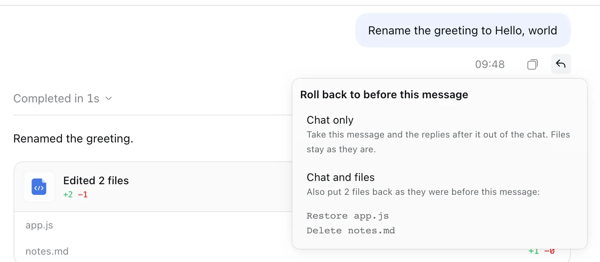</a> |
| **Delete chat** | <a id="feature-deletechat"></a>Sidebar → a chat's **…** menu (or right-click) → **Delete…** → **Delete**. dsh itself can only archive. The chat stops (its turn, jobs, subagents and schedules, like dsh's own archive) and its saved history, with its subagent chats, moves to the macOS Trash (on other systems: `$DSH_HOME/trash`). To get it back, put the folder back and restart dsh: it shows in the sidebar's **Archived only** view. | <a href="assets/features/deleteChat.webp">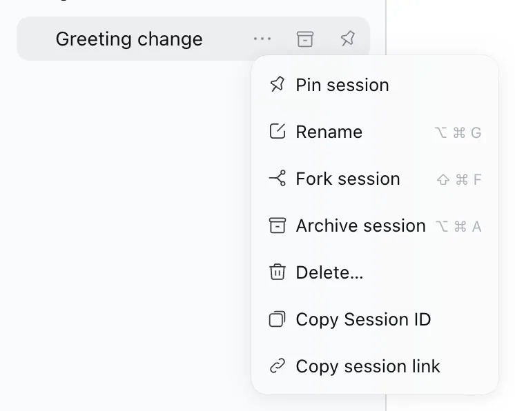</a> |
| **Project name in the composer** | <a id="feature-projectname"></a>The row under the composer (turns, tokens, cache hit, context) starts with the chat's project name, so you always see which project a chat works in. It is dsh's own project title, or the folder name when the project has no title. Hover it to see the full folder path. Click it to find the chat in the sidebar, in the list or project view: the sidebar and the project open (also a collapsed project and its **Show N more sessions**), the list scrolls to the chat and the chat blinks for 5 seconds. | <a href="assets/features/projectName.webp">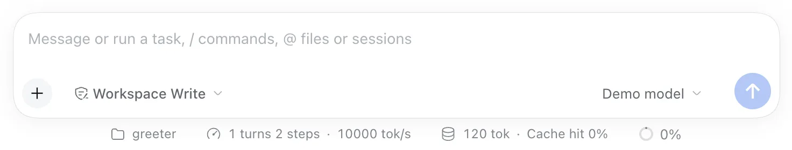</a> |
| **Input history** | <a id="feature-inputhistory"></a>In an empty composer, press `↑` / `↓` to walk through messages you sent, like a terminal. | <a href="assets/features/inputHistory.webp"></a> |
| **Shift+Tab plan mode** | <a id="feature-plantoggle"></a>`Shift+Tab` adds `/plan ` to the start of the draft (press again to remove it). If the chat is already in plan mode, `Shift+Tab` leaves it. | <a href="assets/features/planToggle.webp"></a> |
| **Keep composer focus** | <a id="feature-keepfocus"></a>After you send a `/` command or skill, the cursor stays in the composer, and you can type again at once. This also works for keyboard macros that type a command and press `Enter`. dsh makes the composer read-only while it resolves the command, and the browser then removes the focus. This feature puts the focus back, unless a menu, a dialog or another field has it. | <a href="assets/features/keepFocus.webp"></a> |
| **One-click Continue** | <a id="feature-continuebutton"></a>After a stopped, failed or cut-off turn, an empty composer shows **▶**. One click resumes from the existing conversation without writing in the input or adding a visible chat message (the model receives a short hidden “continue from where it stopped” note, because some providers, such as Claude, reject a request that ends on an assistant reply). Messages that wait in the queue stay there: ▶ continues only the stopped task, then the queue runs. A completed turn keeps the regular Send button. | <a href="assets/features/continueButton.webp"></a> |
| **Resume after restart** | <a id="feature-resumeafterrestart"></a>Off by default: switch it on in **Settings → Composer Plus**. If you quit dsh (or it closes) while a chat is working, that chat continues by itself when you open dsh again, with the same hidden note as One-click Continue. If a goal round (`/goal`) was running, the goal goes on with its next round (dsh pauses goals at every start until you resume them). Chats that you stopped, that finished or that failed do not continue. dsh itself has no setting for this: it only marks such a turn as interrupted. | <a href="assets/features/resumeAfterRestart.webp"></a> |
| **Queue drag-and-drop** | <a id="feature-queuereorder"></a>Queued messages get a grip (⠿). Drag to reorder, or focus the grip and press `↑` / `↓`. `Esc` cancels. | <a href="assets/features/queueReorder.webp"></a> |
| **Edit queued message in place** | <a id="feature-queueedit"></a>Double-click a queued message. It turns into dsh's own edit box: change the text, press `Enter` to save or `Esc` to cancel. The message keeps its place in the queue. Messages with images or files cannot be edited this way (dsh's queue edits text only). | <a href="assets/features/queueEdit.webp">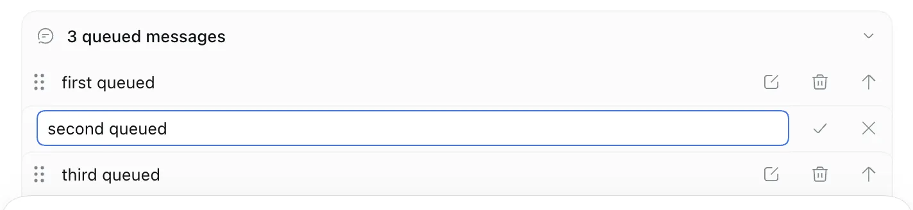</a> |
| **Copy session link** | <a id="feature-copydeeplink"></a>Right-click a chat in the sidebar → **Copy session link**. Paste the `dsh-session:…` link into another chat to attach that chat as read-only context. dsh 0.2.1 has its own **Copy Session ID**, which copies only the plain id; this item comes right after it. | <a href="assets/features/copyDeeplink.webp"></a> |
| **Copy message link** | <a id="feature-copymessagelink"></a>Hover a message and click **🔗** (in its action row; for an answer, next to the time). The link is the session link plus the message number: `dsh-session:…#42`. Paste it in a message and send it: on dsh 0.2.1 and later the link shows as a chip, and a click opens that chat, scrolls to the message and highlights it for 2 seconds. Like a session link, it also attaches that chat as read-only context. | <a href="assets/features/copyMessageLink.webp">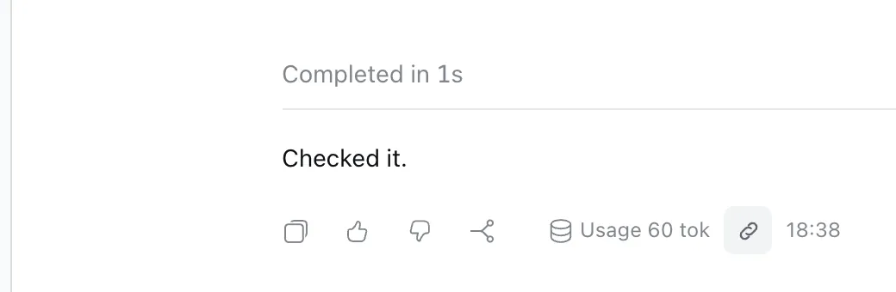</a> |
| **Export chat as Markdown** | <a id="feature-exportmarkdown"></a>Right-click a chat in the sidebar (or open its **…** menu) → **Export as Markdown…**. A dialog shows how many messages the chat has; **Copy to clipboard** copies the chat as Markdown, **Save .md file** saves it as `<chat title>.md` through the browser's download (dsh desktop: your Downloads folder or a save dialog, as your system is set). The file has the chat title, the project name and the date, then one `## You` or `## Assistant` section per message. Code blocks stay as they are; a code block that a message leaves open is closed. | <a href="assets/features/exportMarkdown.webp">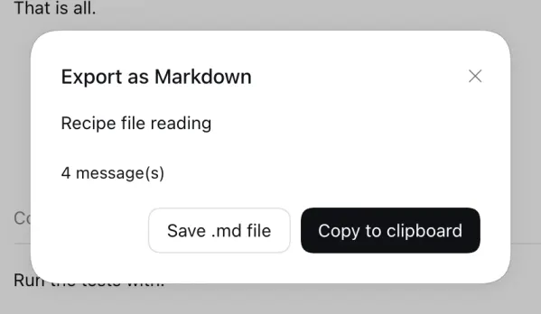</a> |
| **Copy project path** | <a id="feature-copyprojectpath"></a>Right-click a project in the sidebar → **Copy path** copies the full path of its folder. | <a href="assets/features/copyProjectPath.webp"></a> |
| **Project search in a new chat** | <a id="feature-projectpicker"></a>New chat → the project button above the composer. The projects show in A–Z order, with a **Search projects** box on top. Type part of a name (case and accents do not matter) and press `Enter` to pick the first match. **No matching project** shows when nothing matches. dsh's saved project order in the sidebar does not change. | <a href="assets/features/projectPicker.webp">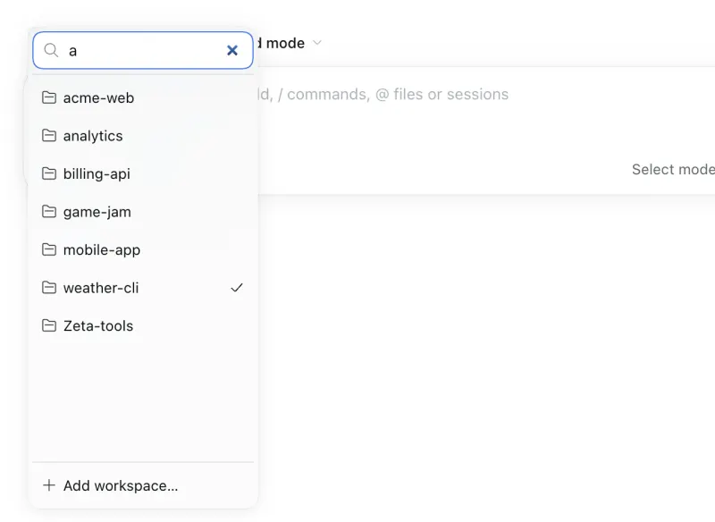</a> |
| **Next message prediction** | <a id="feature-nextprediction"></a>On by default; switch it off in **Settings → Composer Plus**. When the agent finishes a turn (not a stopped or failed one), the empty composer shows a guess of your next message in grey, with a **Tab to accept** hint. `Tab` puts the text in the composer, but does not send it. `Esc` hides it for that turn. Typing also hides it, and a new turn replaces it. The **Model** menu under the switch lists dsh's own models (the same list as dsh's model menu). **dsh default** is selected by default and follows dsh's default model. Each finished turn costs one short model call. In Tether, the guess shows above the empty composer: tap it to put it in the field. | <a href="assets/features/nextPrediction.webp">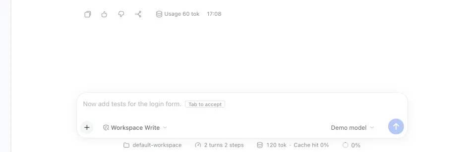</a> |
| **Complete while typing** | <a id="feature-typingcompletion"></a>Off by default; switch it on in **Settings → Composer Plus**. While you type, grey text right after the cursor shows how your message may go on. `Tab` adds it to the message, but does not send it. `Esc` hides it. It suggests only your own next words: never an answer to you, and no made-up error texts or names. When the message looks complete or the model is not sure, nothing shows. Typing the next letters of the grey text keeps it, with no new model call. It has its own **Model** menu under its switch. Its first entry, **Same as Next message prediction**, uses the model of **Next message prediction** (the default); pick another model to use a different one for each feature, for example a faster model for completions. It makes one model call at each pause while you type, so it uses many more tokens than the prediction: pick a fast, low-cost model. It does not run for a slash command, a message with a file chip, or when the cursor is not at the end. In Tether, the rest shows above the field while you type: tap it to add it. | <a href="assets/features/typingCompletion.webp">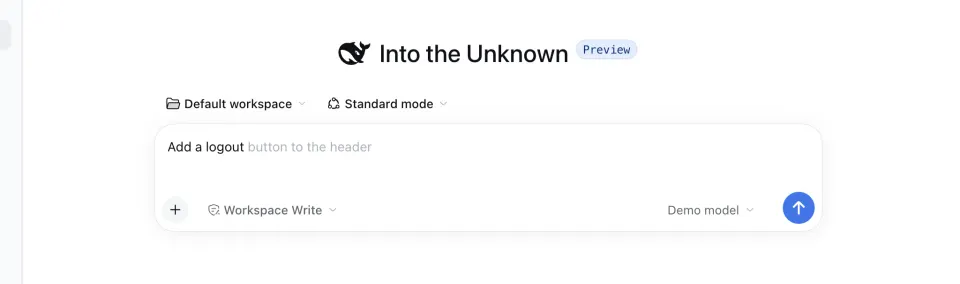</a> |
| **Improve prompt** | <a id="feature-promptimprove"></a>Type a rough request, then click the magic wand (**Improve prompt**) next to the model menu. One model call rewrites it as a clearer prompt: the goal first, short numbered steps when there are several parts, and the check to run. It reads this chat (rolled-back messages left out), the project's README, AGENTS.md and manifest, the changed files and the files whose names match your words, and keeps your language. It never makes up file names. The new text replaces your draft but is not sent: read it, edit it, then press `Enter`. `Cmd/Ctrl+Z` brings your text back in one step, and so does the button (**Undo improvement**). If you type while it works, your new text stays. `Esc` or a second click cancels. It has its own **Model** menu in Settings (default: **Same as the chat's model**). Not for slash commands or a message with a file chip. In Tether, the wand is next to the field. | <a href="assets/features/promptImprove.webp">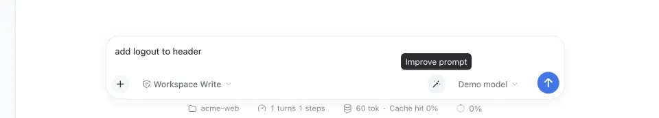</a> |
| **Allow for this chat** | <a id="feature-allowforchat"></a>When Auto Review asks you, the approval card gets **Allow for this chat**: the same tool in the same chat is allowed from then on, with any arguments, until the time limit ends (1 hour by default; choose it under **Settings → Composer Plus → Allow for this chat**). Then the agent asks again. A header chip lists the grants with their end time and revokes them. Grants survive a restart. | <a href="assets/features/allowForChat.webp"></a> |
| **Project status** | <a id="feature-projectstatus"></a>A project row in the sidebar shows the same spinner / waiting / done marker as its chats, so a collapsed project still tells you a chat inside is working or needs you. A chat waiting for you shows first, then a finished chat you have not opened yet (the green dot, also while another chat still runs), then the spinner. Hover it for details. | <a href="assets/features/projectStatus.webp"></a> |
| **Mark all as read** | <a id="feature-markprojectread"></a>In the sidebar, click a project's **…** button → **Mark all as read**. Every chat in that project loses its green unread dot at once; other projects keep theirs. The item is greyed out (**No unread chats**) when the project has none. | <a href="assets/features/markProjectRead.webp">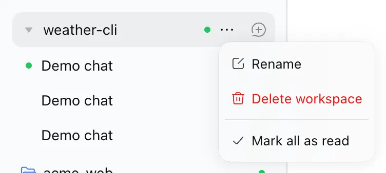</a> |
| **Active projects first** | <a id="feature-activeprojectsfirst"></a>When a chat starts running or needs you, its project moves to the top of the sidebar with dsh's own row animation (the same move as dragging it there). Finished projects stay where they are; drag them anywhere as usual. Moves are saved to dsh's project order, so turning this off keeps the current order. | <a href="assets/features/projectStatus.webp"></a> |
| **Recent projects filter** | <a id="feature-recentprojects"></a>Sidebar → view options (sliders icon) → **Active in the last 2 hours**. While it is selected, the sidebar shows only projects with a chat that was active in the last 2 hours: a chat updated in that time, a running or waiting chat, the open chat, or a finished chat that you did not open yet (dsh's green “done” dot), also after the 2 hours. Projects without such a chat are hidden, also new and empty ones. Select it again to show all projects. The choice is kept on this device. | <a href="assets/features/recentProjects.webp"></a> |
| **Collapse all projects** | <a id="feature-collapseprojects"></a>While a project is open in the sidebar, a button appears next to the view options (sliders icon). Click it to close every open project at once, for example 3 open projects out of 5. The button hides again when no project is open. | <a href="assets/features/collapseProjects.webp"></a> |
| **Order by status** | <a id="feature-statusorder"></a>Sidebar → view options → **Order by** → **By status** (with **In one list**). Finished chats come first (dsh's “done” dot, which a turn that ended with an error also gets), then running or waiting chats, then chats with an active automation (Schedule), then the rest in dsh's order. Opening a finished chat moves it down. Only the view changes: select **Manual** or **Last updated** to go back. | <a href="assets/features/statusOrder.webp"></a> |
| **Background notifications** | <a id="feature-notifications"></a>While dsh is in the background you get a notification when a turn finishes (first line of the reply), or when a chat really waits for you: an approval (tool name), an answer (the question) or a plan review. A request must still be open 1.5 s later, so approvals answered automatically (Auto Review grants, other plugins) stay silent, and a notification is withdrawn as soon as its request is answered. The Dock/taskbar badge counts waiting chats. Clicking opens that chat. | <a href="assets/features/notifications.webp"></a> |
| **Application language** | <a id="feature-language"></a>Settings → Composer Plus → **Application language** switches the whole dsh interface to Türkçe, Español, Português (Brasil), Français, Deutsch, Русский, 日本語, 한국어, Bahasa Indonesia, Tiếng Việt or हिन्दी (see below). | <a href="assets/features/language.webp"></a> |
| **Mobile connect (iPhone)** | <a id="feature-mobileconnect"></a>Use dsh from your iPhone with the [Tether](tether/) app, on the same Wi-Fi or over [Tailscale](https://tailscale.com). Switch it on in **Settings → Composer Plus** (it is off by default, because it opens a network port on this Mac). Then click **Mobile connect** at the bottom left of the sidebar: scan the QR code with the iPhone Camera (tap **Open in Tether**) or with **Scan code** in Tether, tap **Connect** and click **Approve**. Tether must be installed first: without it the Camera cannot open the code. The phone shows your chats, sends messages, answers approvals and questions, and switches models and agents. Pair as many Macs as you like: the Mac name at the top left of the app switches between them. The **Mobile connect** panel lists the paired iPhones with their last connection: **Remove** cuts one off at once. **Tailscale only** refuses the local network (for a shared Wi-Fi), and the access log shows who tried to connect. In Tether, **Settings → Privacy** locks the app with Face ID. | <a href="assets/features/mobileConnect.webp"></a> |
| **Automatic updates** | <a id="feature-autoupdate"></a>When dsh starts, the plugin checks the [latest GitHub release](https://github.com/furkancak1r/dsh-composer-plus/releases/latest). If it is newer and already on npm, it installs that exact version through dsh's own plugin manager (the same path as Settings → Plugins) and notifies you. Restart dsh to load it. **Settings → Composer Plus → Composer Plus updates** shows the version and has **Check for updates** / **Update now**. The first time dsh starts with the new version, a **What’s new in Composer Plus N** window shows the release notes of that version once (taken from the same update check, no extra network call); **Close** or `Esc` closes it. | <a href="assets/features/autoUpdate.webp"></a> |

<!-- END GENERATED FEATURES -->

Buttons, tooltips, notices and notifications follow the selected dsh language (see Application language below).

## Settings

Every feature can be switched on or off on its own: dsh **Settings → Composer Plus**. Each row has a small screenshot: hover it for a larger preview, click it to open it full size (`Esc` closes). The **Search features** box at the top filters the page by name or description (any language, case- and accent-insensitive); `Esc` clears it. Each row has a switch and a short description; changes apply immediately, without a restart, and are remembered on that device. The small **?** after a row's name opens the part of this README that describes that feature, in the README of dsh's interface language. Everything is on by default, except **Mobile connect**, **Resume after restart** and **Complete while typing**. dsh's Host keeps the switches of these three and of **Content search**, **Turn rollback** and **Next message prediction**, so they apply to every window and survive a restart. The Host also keeps the **Model** choice of **Next message prediction**, the one of **Complete while typing** (by default **Same as Next message prediction**) and the one of **Improve prompt** (by default **Same as the chat's model**), and the **Time limit** of **Allow for this chat** (1 hour by default). **Content search** changes only after a dsh restart (dsh reads it at start); until then its row says **Restart dsh to apply this change.**

<p align="center"></p>

### Application language

Open **Settings → Composer Plus → Application language** and choose **System language** or one of 13 languages:

English · 中文 · Türkçe · Español · Português (Brasil) · Français · Deutsch · Русский · 日本語 · 한국어 · Bahasa Indonesia · Tiếng Việt · हिन्दी

<p align="center"></p>

The whole app switches immediately. The choice is dsh’s own saved `locale.preference` (the same one as General → Language), so it survives restarts. **System language** clears that choice: the desktop app follows the OS language, the web UI the browser language, and an unsupported language falls back to English. Installing the plugin never overrides a language you already picked.

Each pack has 3,280 texts: every UI text of dsh `0.2.0-rc.2` and `0.2.1-rc.2` (chats, sidebar, settings, approvals, schedules, file previews, plugin manager, plugin market), the plugin’s own controls, and the popular [dsh-rewind](https://github.com/SiriLee/dsh-rewind) plugin. Not translated: your messages, model output, code, slash-command names (`/plan`, `/compact`), provider-owned labels such as the `High` reasoning effort, other plugins’ texts, and the desktop app’s native menus/update dialogs (dsh ships those in English/Chinese only). Strings added by a newer dsh show in English until the packs are updated. If another plugin already provides a language, that plugin keeps it.

## Keyboard shortcuts

| Key | Where | Action |
|---|---|---|
| `↑` / `↓` | empty composer | previous / next sent message |
| `Shift+Tab` | composer | add/remove `/plan `, or leave plan mode |
| `↑` / `↓` | focused queue grip | move the queued message |
| `Esc` | while dragging | cancel the move |
| `→` / `←` | Feature ideas page | build / skip the top card |
| `↓` | Feature ideas page | save the top card in the project's Later list |
| `↑` | Feature ideas page | build the top card now, without a plan |
| `Z` | Feature ideas page | bring back the last skipped card |
| `Enter` | new chat project menu, search box | pick the first match |
| `↑` / `↓` | new chat project menu | move through the projects that are shown |
| `Esc` | new chat project menu, search box | clear the search (press again to close the menu) |
| `Tab` | empty composer with a prediction | put the prediction in the composer |
| `Tab` | grey completion after the cursor | add the completion to the message |
| `Esc` | empty composer with a prediction | hide the prediction |
| `Cmd/Ctrl+Z` | composer, after **Improve prompt** | bring back the text that you typed |
| `Esc` | composer, while **Improve prompt** runs | cancel the improvement |
| `Enter` / `Esc` | queued message that you double-clicked | save / cancel the edit |

An open `/` or `@` menu keeps these keys for itself.

## Compatibility

Tested on dsh `0.2.0-rc.2` (desktop and web) and `0.2.1-rc.2` (web). CI runs the tests on every push.

## Privacy and security

- **Continue:** the authenticated local endpoint resumes only the last interrupted turn, rejects stale or duplicate requests, and preserves the existing approval hooks. It does not send a new user message.
- **Resume after restart:** off until you switch it on. The Host half keeps only chat ids and start times in `$DSH_HOME/storages/dsh-composer-plus/resume.json` (owner-only permissions), and nothing leaves your machine. It continues a chat only when dsh's own log says that dsh (not you) stopped its last turn. Approvals and Auto Review apply to the continued turn as usual.

- **Changes panel:** git runs read-only on your machine, in the chat's own folder, through dsh's authenticated `/api` channel. It never commits, stages or fetches, and only shows paths git itself listed. The tree shows the newest 300 commits of the local and remote branches; it never checks out a branch. In a very large repository without a commit-graph file, the tree can take some seconds to open. **This chat** reads the chat's own log for the files that its file tools wrote and compares them with the chat's Turn rollback snapshot in a temporary folder that is deleted at once; it writes nothing to your repository or to the snapshot store.
- **Feature ideas:** nothing runs until you click **Suggest features**. Then the Host half reads only the chat's own folder (the browser never sends a path): the names of the top-level entries, the first 6 kB of the README, AGENTS.md and the manifest (`package.json`, `pyproject.toml`, `Cargo.toml`, `go.mod`, …) and `git log --oneline -15`, at most 16 kB in total. It skips `.env*`, key files and folders such as `node_modules`, and it reads only regular files that stay inside the folder: a symlink that points out of the folder, a FIFO or a device is skipped. This summary goes to the model that the chat uses, through dsh's own provider settings, as one request; it is not added to any chat. Nothing in the project is written. A swiped-right idea starts a new chat in plan mode, so approvals and plan review apply as usual. **Build now** starts the chat without plan mode: the model can change files at once, with the chat's usual approvals and Auto Review. Ideas saved for later (title, summary, why, effort) are kept with the project's folder path in `storages/dsh-composer-plus/later.json` under the dsh home (owner-only file); nothing goes into the project. The history of suggested ideas (title, summary, why, effort, date, started) is kept the same way in `storages/dsh-composer-plus/idea-history.json`, at most 200 per project (the oldest leave first); its titles go to the model with the next **Suggest features** of that project.
- **Content search:** no new code searches your chats: the plugin only switches on dsh's own message index (SQLite FTS5, `dsh-session-query-sqlite`) and gives it a file, `$DSH_HOME/cache/composer-plus/session-search.db` (owner-only file and folder). The file holds the text of your user and assistant messages, so it is as private as the chat logs in `$DSH_HOME/sessions`. Nothing leaves your machine. It is a copy that dsh can make again: you can delete it while dsh is closed. The switch is in `$DSH_HOME/storages/dsh-composer-plus/content-search.json`.
- **Turn rollback:** before each of your messages, the Host takes a git snapshot of the chat's folder in its own store, `$DSH_HOME/cache/composer-plus/rollback/<chat>.git` (owner-only folder). It holds copies of the files in that folder that git sees (not ignored files), so it is as private as the project. It reads your repository's objects (no copy of what git already has) and never writes your repository's index, `HEAD`, branches, tags, stash or config; the only change git makes there is a newer time stamp on object files it reuses (this delays their cleanup by `git gc`). A rollback with files writes only regular files inside the chat's folder; it skips symlinks, pipes and anything outside the folder. Nothing leaves your machine. You can delete the store while dsh is closed (rollback then works for the chat only, until new messages). **Delete chat** deletes a chat's store too. The switch is in `$DSH_HOME/storages/dsh-composer-plus/rollback.json`. A rollback with files also keeps the files as they were just before it (`refs/r/…` in the same store), for **Redo**; the rollbacks that were redone are listed in `$DSH_HOME/storages/dsh-composer-plus/redone.json` (owner-only).
- **Export chat as Markdown:** the Host half reads only the chat's own log (the same messages that dsh shows) and gives them to the page; it reads no project file and sends nothing over the network. The Markdown goes only to your clipboard or to the file that you save.
- **Delete chat:** moves the chat's own log folders (`$DSH_HOME/sessions/<project>/<chat>`) to the Trash. It does not touch the project folder.
- **Allow for this chat:** grants are stored with the time they were given in `$DSH_HOME/storages/dsh-composer-plus/chat-grants.json` (owner-only permissions). A grant covers one exact tool in one chat, until the time limit ends (1 hour by default). If that tool can write, the grant covers any write too. Revoke it from the header chip.
- Auto Review still runs on every call; review failures are never auto-allowed.
- **Mobile connect:** off until you switch it on. While it is on, the Host half runs the Tether gateway: HTTPS on port 19390 that accepts only your Wi-Fi subnet and your tailnet (100.64.0.0/10), and a pairing page on `127.0.0.1:19391` (this Mac only). A phone needs a one-time code from the QR code (5 minutes) and your **Approve** on the Mac. The phone pins the gateway's certificate. The Mac keeps only a hash of each phone's token (30 days, renewed while used); **Remove** closes that phone's connections at once. Phones can call only an allowlist of dsh methods (chats, prompts, attachments, slash commands, approvals, questions, models, agents, goals), not settings, credentials, the file browser or the terminal. **Tailscale only** refuses every connection from the local network, also open ones. The access log keeps the newest 200 connection attempts (time, IP address, device name, allowed or refused, and why) in `access.json`; it never holds a token or a pairing code. Data: `$DSH_HOME/storages/dsh-composer-plus/mobile/` (owner-only files). Details: [tether/README.md](tether/README.md).
- **Updates:** the Host half asks `api.github.com` for the latest release and `registry.npmjs.org` for that exact version; nothing about you or your chats is sent. Installation uses dsh's plugin manager (`pnpm add dsh-composer-plus@<version>`; when dsh 0.2.1 refuses that for an installed plugin, `pnpm add https://registry.npmjs.org/dsh-composer-plus/-/dsh-composer-plus-<version>.tgz`, and the profile then lists that URL as the plugin's source), so dsh's own registry, script and version-compatibility checks apply. Pre-release tags and older versions are never installed.
- **Next message prediction:** on by default; switch it off in **Settings → Composer Plus** to stop these model calls. After each finished turn, the Host half sends the chat's own user messages and the agent's text replies (no tool output, no hidden context, no reasoning), at most about 6,000 characters (the newest part), to the chosen model (dsh's default unless you pick another). It goes through dsh's own provider settings, as one request. Nothing is saved in the chat: the guess is not added to the chat history. The switch and the model choice are in `$DSH_HOME/storages/dsh-composer-plus/predict.json` (owner-only file).
- **Complete while typing:** off until you switch it on. While it is on, at each pause while you type, the Host half sends the text that you typed so far and the chat's own user messages and agent text replies (no tool output, no hidden context, no reasoning), at most about 3,000 characters of chat, to the model chosen under **Complete while typing** (by default the model of **Next message prediction**). A newer pause stops the older request. Nothing is saved in the chat. The switch is in `$DSH_HOME/storages/dsh-composer-plus/complete.json` (owner-only file).
- **Improve prompt:** nothing runs until you click the magic wand. Then the Host half sends your draft, the chat's own user messages and agent text replies (no tool output, no hidden context, no reasoning, no rolled-back messages; at most about 6,000 characters, the newest part), the same project summary as **Feature ideas** (with the same file rules: no `.env*` or key files, no symlink out of the folder, no FIFO), the paths that `git status` lists as changed and up to 30 tracked or untracked (not ignored) paths whose names share words with your draft, to the model chosen under **Improve prompt** (by default the chat's own model), as one request. File contents other than that summary are not sent. Nothing is written to the chat or the project: the answer only replaces your draft in the composer, and you decide whether to send it. The model choice is in `$DSH_HOME/storages/dsh-composer-plus/improve.json` (owner-only file).

## Troubleshooting

- **No notifications on macOS:** System Settings → Notifications → DeepSeek Harness → allow. Choose Alerts to keep them on screen.
- **▶, queue grips, project status, the recent projects option, Collapse all projects, Copy path, the project search box, the next message prediction, the completion while typing, Allow for this chat or right-click missing after a dsh update:** these attach to dsh's current HTML because dsh has no slot for them yet. If dsh changes that markup they hide themselves; nothing else breaks. Please open an [issue](https://github.com/furkancak1r/dsh-composer-plus/issues).
- **"Update failed" or "not installed from npm":** a copy linked from a local folder or renamed can't update itself; reinstall `dsh-composer-plus` from Settings → Plugins. Otherwise the message shows the first line of pnpm's error; **Check for updates** retries.
- **Mobile connect says the gateway is not running:** "no IPv4 address on en0" means this Mac has no Wi-Fi/Ethernet address; "EADDRINUSE" means another dsh (or app) uses port 19390 or 19391. Only one dsh can run Mobile connect at a time.
- **Mobile connect, Resume after restart or Content search says "Restart dsh":** the plugin was updated while dsh was running (or, for Content search, you changed the switch); the new state loads after a restart.
- **The search finds only titles:** Content search is off, dsh has not restarted since you switched it on or installed the plugin, or the word is only in a tool output (see Limits).
- **No ↶ button on my messages:** Turn rollback is off, the chat is a subagent chat, or dsh-rewind-plugin is installed (use its ↶ button). After an update, restart dsh.
- **Chat and files is greyed out:** the project is not a git repository, there is no snapshot from before that message (the message is older than the plugin, or one of the 50 newest snapshots replaced it), or no file changed.
- **Delete says another dsh has this chat open:** a second dsh on the same dsh home holds the chat's lock. Close that window or dsh, then delete again. The chat stays archived meanwhile.
- **My iPhone cannot connect after I switched on Tailscale only:** Tailscale must be on in both the Mac and the iPhone. The Mobile connect panel warns when it is off on the Mac. The access log shows each refused attempt with its reason.
- **A chat did not continue after a restart:** Resume after restart was off when dsh quit, you stopped that turn yourself, the turn had ended (done or failed), the chat was archived, or more than 20 chats were running (the newest 20 continue).
- **Install fails right after a release:** add the version (`dsh-composer-plus@1.13.0`), see the install note above.

## Limits

- Message-free Continue relies on dsh’s `agent/pre-step` → `agent/request` lifecycle. Recheck compatibility when upgrading dsh.
- **Feature ideas** keeps the cards in memory for each chat until dsh or the page reloads; then **Suggest features** asks the model again. The cards come in the UI language that dsh has when you click; after you change the language, cards already on the stack keep theirs and **More ideas** uses the new one. The model sees only the short project summary, not the code, so an idea can repeat something the project already has: skip it. The new chat runs in plan mode only when the profile has dsh's `/plan` command; otherwise the idea goes as an ordinary first message. The **Later** list belongs to the chat's folder path: the same folder opened through a symlink has its own list. It keeps at most 50 ideas per project (remove one to add more) and the same title only once. Dragging a card decides left or right only; use **↓** to save it and **▶** to build it now. A repeat is found by its title only: the model can still suggest an earlier idea under a new name; skip it. When the model answers only earlier ideas, nothing new shows: click again. A narrow focus topic makes that more likely; use a wider topic or clear it. The focus topic stays in the field for each chat until dsh or the page reloads.
- **Export chat as Markdown** has only your own messages and the assistant's text replies: tool calls and their output, thinking, images (a `[image]` line marks them), hidden context and messages that Turn rollback or dsh-rewind-plugin took out are left out. Replies of one turn join into one section. At most about 4 million characters go into one export; a longer chat gets its first part and a note.
- **Resume after restart** continues the turn; it does not replay it. A tool call that was running at the quit ends with dsh's “outcome unknown” result, and the model is told not to repeat finished work, but a command that is not safe to run twice can run again. Subagents, approvals and questions that were open are not restored: their parent chat continues and asks again. At most 20 chats continue at one start.

- **Content search** is dsh's own search, so it has dsh's limits. It searches only user and assistant messages: not tool output (commands, file contents, results), not reasoning, and it has no filter for user, assistant or tool messages. It matches whole words, not parts of a word (`deploy` does not find `deployment`); letters with accents match without them (`seker` finds `şeker`). One row per chat, with dsh's 240-character snippet, at most 20 rows.
- **Content search** cost, measured on a copy of 247 real chat logs (159 MB, dsh 0.2.1-rc.2, Apple Silicon, 32 GB): the first search after a start builds the index in about 15 s. During that time dsh's Host answers nothing for about 7 s, so other chats stop streaming for that moment (the page itself does not freeze). The Host's memory grows by about 1.1 GB at the peak; one minute later it is still about 0.5–0.6 GB above the start, until dsh quits. The index file is about 165 MB. Later searches take about 0.5 s. After a restart, the first search takes about 1 s (only new or changed chats are added) and adds about 70 MB. Switch it off if your computer has little memory.
- **Content search** applies only after a dsh restart, and the index file is shared by every dsh that uses the same dsh home: run only one such dsh at a time (dsh allows one owner per index file).
- **Turn rollback** puts files back only in a git repository, and only in the chat's folder. It keeps the 50 newest snapshots per chat. Ignored files (`.gitignore`, `info/exclude`, your global ignore file), empty folders, symlinks and submodules are not put back; a file that was ignored when the snapshot was taken is never deleted, even when the turn changed the ignore rules. A file that git cannot read is left out of the snapshot. Each of your messages runs one `git add --all` of the chat's folder into the private store: in a very large folder with many untracked files this can take a few seconds, and the next tool call waits for it (at most 10 s; the snapshot then finishes in the background). If your repository's `git gc` removes an object that an old snapshot needs, that file is listed as not put back. Only the text of the message comes back into the composer: add its images or files again. Subagent chats have no ↶ (a subagent's file changes count as changes of the chat that started it). The exported chat (`/export`) still has the withdrawn messages. The idea of one hidden marker that withdraws part of a chat comes from [dsh-rewind-plugin](https://github.com/SiriLee/dsh-rewind) by SiriLee (MIT); Composer Plus uses no code from it.
- **Delete chat** needs dsh's archive (dsh 0.2.0 and later). A chat (or one of its subagent chats) that does not stop within 15 s, or that another dsh holds, stays archived and nothing moves. On other systems than macOS the trash folder must be on the same disk as the chat history. An open chat that you delete stays in dsh's memory, archived and hidden, until dsh restarts. Empty the Trash yourself; dsh does not.
- dsh's queue has no `move` action, so the plugin's Host moves the queued message itself in dsh's queue (one change, the same message). Messages with images or files move too. Only your own messages move: a goal round or a question reply in the queue stays where it is. If a message starts to send while you drag, nothing moves and a notice says so.
- dsh 0.2.1 loads an update at once when the new version changes no dsh settings; otherwise, and on dsh 0.2.0, restart dsh to load it. The plugin never restarts dsh for you. Web/CLI profiles without dsh's plugin manager only report a new version.
- **Allow for this chat** counts the time limit from the moment of the grant. A new time limit applies at once to the grants that run, so a shorter one can end them at once. Grants from version 1.12 and earlier have no time: after the update, the agent asks once again for those tools.
- **Keep composer focus** gives the focus back only after a `/` command or skill. While dsh resolves the command, the composer stays read-only for a few milliseconds, so keys pressed in that time are lost. If dsh's `/` menu is still open, `Enter` picks the highlighted row and does not send.
- **Mobile connect** works on macOS only (it uses `en0`, `openssl`, `swift` and `dns-sd`). It uses fixed ports 19390 and 19391, so only one dsh on each Mac can run it at a time (each Mac is one entry in the phone's Mac list). The phone gets notifications only while Tether is open or just went to the background (no push service). The iOS app is not on the App Store yet: build it from `tether/ios` with Xcode. **Tailscale only** still needs a Wi-Fi or Ethernet address on the Mac (the gateway starts only with one). The access log is per Mac and keeps only the newest 200 attempts; a repeated attempt within a minute counts up one row. Tether's app lock does not hide notification previews on the iPhone Lock Screen: turn them off in iOS Settings. Tether's green dots follow the Mac: a chat that you open in dsh loses its dot on the phone too. A chat that you open in Tether loses its dot on the phones only; dsh's own dot on the Mac stays until you open the chat there.
- A session link works inside chats; clicking it does not open the chat. A **Copy message link** link opens its message only on dsh 0.2.1 and later, and only from a message in a chat (dsh 0.2.0 has no user-text rules, so there the link is copied but shows as plain text). A message that a rollback took out, or that compaction removed from the history that dsh loads, cannot be shown: the link then says so. The 🔗 buttons attach to dsh's message rows; if a dsh update changes that markup, they do not show.
- **Mark all as read** changes dsh's own unread dots through a part of dsh that is not a public API (the `completionUnread` list of dsh's session status). If a dsh update renames it, the item does not show. The item goes into dsh's project "…" menu, which has no slot for plugins; if dsh changes that menu, the item does not show either.
- **Edit queued message in place** opens dsh's own queue editor, so it has its limits: a message with images or files cannot be edited, and a message that started to send meanwhile is not changed (dsh shows its own error).
- **Redo** never changes the rolled-back chat: it starts a new chat from just before the rollback (dsh's own fork, the same model context), so the new chat has a new id and title. Only the newest rollback of a chat can be redone, once, and only while nothing came after it (a new message ends the offer). A file that you changed after the rollback is kept unless you tick the box that overwrites it. Redo needs the snapshot that the rollback kept (the same 50-entry window); a rollback made before this version, or with **Chat only**, brings back the messages only.
- **This chat** counts only files that dsh's file tools (`write`, `edit`, `str_replace_editor`) wrote. Files that a command (`bash`) changed are not in this view; they show under **Uncommitted**. Without a Turn rollback snapshot of the chat (Turn rollback off, dsh-rewind-plugin installed, or a chat older than the plugin), the view compares with the last commit and says so. Turn rollback keeps the 50 newest snapshots of a chat: in a longer chat, the view compares with the oldest kept one, says from which message, and does not count earlier changes. **Hide whitespace changes** is `git diff -w`: a line that changed only in spaces inside it is hidden too.
- A notification sent before a restart only brings dsh to the front when clicked.
- Active projects are moved with dsh's saved project order, so the new order is kept after a restart. Chats outside any project ("Ungrouped") can't be moved; dsh always lists them last.
- dsh has no extension point in the sidebar's view options menu, so the recent projects option is added to dsh's own menu. If a dsh update changes that menu, the option is not shown and all projects stay visible. The filter works on project rows, so **In one list** is not filtered. Use it with **WorkSpace**: in **Workspace Tree**, a hidden parent folder also hides the active projects inside it. **By status** has the same kind of limit: dsh has no order slot, so the item and the row order attach to dsh's menu and list markup.
- dsh has no project-row menu or Workspaces header slot either. **Copy path** finds the project row by dsh's row markup, and **Collapse all projects** goes into dsh's header and closes each open project with the same click as the project row. If a dsh update changes that markup, right-click shows the browser's menu and the button is not shown.
- dsh has no extension point in the new chat project menu either, so the **Search projects** box and the A–Z order attach to dsh's menu markup. If a dsh update changes that markup, the menu shows as dsh draws it: in the saved order, without the box. The A–Z order is a view only: it does not change dsh's saved project order.
- dsh has no extension point for a composer hint either, so the **Next message prediction** text sits over dsh's own placeholder (`[data-composer-placeholder]`). If a dsh update changes that markup, no prediction shows. While it is on, each finished turn costs one short model call.
- **Complete while typing** shows its text through dsh's own composer hint (the `--dsh-composer-hint` style that dsh uses for a slash command's argument hint). It does not run for a slash command, a message with a file or symbol chip, or when the cursor is not at the end of the message. If a dsh update changes that style, no completion shows. Each pause while you type costs one model call.
- **Improve prompt** sees only a short project summary, the changed paths and the paths whose names match your words: not the code itself. So it can miss the right file, and it names only paths that it was given. Read the new text before you send it. It does not run for a slash command or a message with a file or symbol chip (the new text is plain text, so it would lose the chip), and a message can have at most 8,000 characters. Images stay attached: only the text changes. Each click costs one model call; a strong model can take a minute (`Esc` cancels).
- Built-in support is requested upstream: queue `move` in [#773](https://github.com/deepseek-ai/deepseek-harness/discussions/773), a Continue state in [#9269](https://github.com/deepseek-ai/deepseek-harness/discussions/9269).

## FAQ

**How do I add a Changes / git diff panel to DeepSeek Harness?** Install `dsh-composer-plus`, then right sidebar → `+` → **Changes**.

**Can dsh suggest features for my project, like swiping Tinder cards?** Yes: right sidebar → `+` → **Feature ideas** → **Suggest features**. Swipe right to start a new chat that plans the feature, click **▶ Build now** to start a chat that builds it at once without a plan, swipe left to skip.

**Can the dsh sidebar search find a chat by a word in its messages, not only its title?** Yes, with **Content search** (on by default): restart dsh once after you install the plugin, then use the magnifier next to **Workspaces**. Matching chats show the text around the word.

**Can I undo a turn and edit my prompt, like in OpenCode or Claude Code?** Yes, with **Turn rollback**: click **↶** on the message, choose **Chat and files**, edit the text that comes back in the composer and send it.

**Can I delete a chat instead of archiving it?** Yes, with **Delete chat**: **…** → **Delete…**. The history goes to the Trash, so a mistake can be undone.

**How do I see which project a chat belongs to?** Look at the row under the composer: with **Project name in the composer** (on by default) it starts with the project name. Hover it for the folder path.

**How do I get ↑/↓ message history in the dsh composer?** Install this plugin; in an empty composer `↑` / `↓` walk through messages you sent.

**How do I continue a stopped or failed dsh turn without typing "continue"?** With this plugin the Send button becomes **▶** after a stopped, failed or cut-off turn; one click resumes it.

**Does dsh continue running chats after I quit and open it again?** Not by itself: dsh marks such a turn as interrupted and waits (a goal also waits for `/goal resume`). Switch on **Settings → Composer Plus → Resume after restart**: the chats that were working when dsh quit then continue by themselves at the next start.

**Which model writes the prediction?** The model that you choose in **Settings → Composer Plus → Next message prediction → Model**. The list is dsh's own model list. **dsh default** follows dsh's default model. When dsh no longer lists the chosen model, the prediction uses the default. **Complete while typing** has its own **Model** menu: **Same as Next message prediction** (the default) follows the prediction's model; another choice is used for completions only. When dsh no longer lists that model, completions use the prediction's model.

**Can dsh improve my prompt before I send it, like the Enhance prompt button in Roo Code or Augment?** Yes, with **Improve prompt** (on by default): type a rough request and click the magic wand next to the model menu. It rewrites the text with this chat and the project as context, in your language, and does not send it. `Cmd/Ctrl+Z` or **Undo improvement** brings your text back. Choose its model in **Settings → Composer Plus → Improve prompt → Model**.

**How do I reorder queued messages in dsh?** Drag the ⠿ grip on a queued message, or focus it and press `↑` / `↓`.

**How do I fix a typo in a queued message?** Double-click the message in the queue, change the text and press `Enter` (`Esc` cancels). It keeps its place in the queue.

**How do I clear all unread dots of a project at once?** Sidebar → the project's **…** button → **Mark all as read**.

**Can I link to one message in a long chat?** Yes: hover the message and click **🔗**. Send the link in a chat: on dsh 0.2.1 and later a click on it opens the chat at that message.

**I rolled back a turn by mistake. Can I get it back?** Yes, with **Redo** above the composer, right after the rollback: it starts a new chat from just before the rollback with the same messages, and **Chat and files** also puts the files back.

**How do I see only the files that one chat changed?** Right sidebar → **Changes** → **This chat**. Click **␣** to hide changes that are only whitespace.

**How do I stop Auto Review asking about the same tool in one chat?** Click **Allow for this chat** on the approval card. It covers that exact tool in that chat only, for 1 hour by default; revoke it from the header chip. Change the time in **Settings → Composer Plus → Allow for this chat**.

**I lost my iPhone. How do I stop it from reaching my Mac?** Click **Mobile connect** at the bottom left of the sidebar and click **Remove** next to that iPhone. Its key stops working at once; it can come back only with a new pairing that you approve on the Mac.

**Can I lock Tether with Face ID?** Yes: in Tether, **Settings → Privacy → Lock with Face ID**. Tether then asks for Face ID (or the passcode) when it opens and when you come back to it.

**How do I show only the projects I used today in the dsh sidebar?** Sidebar → view options (sliders icon) → **Active in the last 2 hours**. Select it again to show all projects.

**How do I copy a project's folder path in dsh?** Right-click the project in the sidebar → **Copy path**.

**How do I collapse all projects in the dsh sidebar at once?** Click the collapse button next to the view options (sliders icon). It shows while at least one project is open.

**How do I get macOS / Windows notifications when a dsh task finishes or needs approval?** Keep **Background notifications** on (default) and allow notifications for DeepSeek Harness in the OS settings.

**How do I switch the DeepSeek Harness interface to Turkish, Spanish, Japanese…?** Settings → Composer Plus → **Application language**.

**How do I use dsh from my iPhone?** Build the Tether app from `tether/ios` (Xcode), switch on **Settings → Composer Plus → Mobile connect (iPhone)**, click **Mobile connect** at the bottom left, scan the QR code (iPhone Camera or **Scan code** in Tether), tap **Connect** and click **Approve**. Away from home, use Tailscale on both devices.

**Does it work with the desktop app?** Yes: Settings → Plugins → **Add plugin** → `dsh-composer-plus`. Tested on dsh 0.2.0-rc.2 (desktop and web) and 0.2.1-rc.2 (web).

## Development

Screenshots are regenerated from a throwaway dsh with a fake model and made-up demo projects (`acme-web`, `weather-cli`, `docs-site`), so they contain no real data. Feature thumbnails go to `assets/features/` (shipped, shown in Settings); README-only pictures go to `docs/images/` (not in the npm package):

```sh
PLAYWRIGHT=/path/to/playwright node scripts/capture-screenshots.mjs /path/to/dsh/lib/bin.js
# sidebar project features (recent filter, Copy path, Collapse all): real-app test + their thumbnails
SHOT=1 PLAYWRIGHT=/path/to/playwright node test/browser-sidebar-projects.mjs /path/to/dsh/lib/bin.js
# recent filter + a finished chat older than 2 hours (fake model): the project stays until you open the chat
PLAYWRIGHT=/path/to/playwright node test/browser-recent-finished.mjs /path/to/dsh/lib/bin.js
# Order by status (fake model + Schedule): real-app test + its thumbnail
SHOT=1 PLAYWRIGHT=/path/to/playwright node test/browser-status-order.mjs /path/to/dsh/lib/bin.js
# every Settings feature row shows a loading screenshot and a ? link to its README row
PLAYWRIGHT=/path/to/playwright node test/browser-settings-shots.mjs /path/to/dsh/lib/bin.js
# What's new after an update: the release notes show once, Esc and Close close them
PLAYWRIGHT=/path/to/playwright node test/browser-whats-new.mjs /path/to/dsh/lib/bin.js
# README feature anchors (the ? links) on github.com, headless: each #feature-… shows the start of its row
PLAYWRIGHT=/path/to/playwright node test/browser-readme-anchors.mjs
# Keep composer focus (fake model + demo skill): typing goes on after a / command + its thumbnail
SHOT=1 PLAYWRIGHT=/path/to/playwright node test/browser-keep-focus.mjs /path/to/dsh/lib/bin.js
# Mobile connect: switch on, QR popover, a fake iPhone pairs and calls dsh through the gateway, switch off + its thumbnail
SHOT=1 PLAYWRIGHT=/path/to/playwright node test/browser-mobile-connect.mjs /path/to/dsh/lib/bin.js
# Resume after restart (fake slow model, real quit and start): a running chat and a goal continue, a stopped chat does not
SHOT=1 PLAYWRIGHT=/path/to/playwright node test/browser-resume-restart.mjs /path/to/dsh/lib/bin.js
# Feature ideas (fake model, made-up project): suggest, drag left, Undo, ✓ starts a new chat in plan mode, ▶ Build now one without, Plan all one for the Later list, a focus topic chip, Copy as checklist + its thumbnail
SHOT=1 PLAYWRIGHT=/path/to/playwright node test/browser-feature-ideas.mjs /path/to/dsh/lib/bin.js
# Export chat as Markdown (fake model, made-up project): right-click → Export as Markdown…, copy and save keep the code blocks, switch off + its thumbnail
SHOT=1 PLAYWRIGHT=/path/to/playwright node test/browser-export-markdown.mjs /path/to/dsh/lib/bin.js
# Content search (fake model, made-up chats): a message-only word finds its chat with the snippet, switch off + restart = titles only + its thumbnail
SHOT=1 PLAYWRIGHT=/path/to/playwright node test/browser-content-search.mjs /path/to/dsh/lib/bin.js
# Turn rollback + Delete chat (fake model, made-up git project): bash edit → ↶ Chat and files → files back, .git unchanged; Delete… → Trash + its thumbnails
SHOT=1 PLAYWRIGHT=/path/to/playwright node test/browser-turn-rollback.mjs /path/to/dsh/lib/bin.js
# Improve prompt (fake model, made-up git project): the wand sends the draft with the chat and the project, the answer replaces the draft, Cmd+Z and Undo bring it back + its thumbnail
SHOT=1 PLAYWRIGHT=/path/to/playwright node test/browser-prompt-improve.mjs /path/to/dsh/lib/bin.js
# Mark all as read, Copy message link, Edit queued message in place, Redo, Changes → This chat and Hide whitespace (fake model, made-up git projects) + their thumbnails
SHOT=1 PLAYWRIGHT=/path/to/playwright node test/browser-six-features.mjs /path/to/dsh/lib/bin.js
# Changes branch tree (fake model, made-up git history): branch chips, commit files and diffs, keyboard focus + its thumbnail
SHOT=1 PLAYWRIGHT=/path/to/playwright node test/browser-changes-tree.mjs /path/to/dsh/lib/bin.js
# Allow for this chat with a time limit (fake model that is also the Auto Review reviewer): the grant ends after 1 hour
PLAYWRIGHT=/path/to/playwright node test/browser-grant-ttl.mjs /path/to/dsh/lib/bin.js
# Next message prediction and Complete while typing (fake models): calls, Tab, Esc, model choice + their thumbnails
SHOT=1 PLAYWRIGHT=/path/to/playwright node test/browser-predict.mjs /path/to/dsh/lib/bin.js
SHOT=1 PLAYWRIGHT=/path/to/playwright node test/browser-complete.mjs /path/to/dsh/lib/bin.js
# Project search in a new chat: A–Z order, filter, Enter + its thumbnail
SHOT=1 PLAYWRIGHT=/path/to/playwright node test/browser-project-picker.mjs /path/to/dsh/lib/bin.js
# Queue drag-and-drop and Continue with a queued message (slow fake model)
PLAYWRIGHT=/path/to/playwright node test/browser-queue-drag.mjs /path/to/dsh/lib/bin.js
PLAYWRIGHT=/path/to/playwright node test/browser-continue-queue.mjs /path/to/dsh/lib/bin.js
```

```sh
npm run build:locales # after editing locales/<id>.json
npm run build:readme  # after editing docs/features.json
npm test
```

**Rule for new features:** every feature row in Settings → Composer Plus shows a screenshot. Add the feature id to `SHOT_OF` in `client.js` and to `SHOTS` in `index.js`, and ship `assets/features/<id>.webp` (taken from the throwaway demo dsh, English UI, about 60 kB or less). Add the feature, with the same image, to `docs/features.json` and run `npm run build:readme`: it writes the feature table of `README.md` and of each translated `README.<id>.md`, and the list in `llms.txt`. `test/shots.test.mjs` fails when a feature has no screenshot, and `test/browser-settings-shots.mjs` checks the real Settings page. The full checklist for every change is in [AGENTS.md](AGENTS.md).

The tests run the real `client.js` against a fake React/DOM and the real `index.js` (Host half) against a temporary git repository. The Tether gateway tests (`test/tether-gateway.test.mjs`) use a mock dsh host and a real TLS gateway. The iPhone app is in `tether/ios` (see [tether/README.md](tether/README.md) and [tether/AGENTS.md](tether/AGENTS.md)). Each Host route, its request and whether Tether can call it is listed in [docs/ROUTES.md](docs/ROUTES.md). `node test/browser-history.mjs '<dsh web URL with ?token=…>'` checks input history in a real browser against a throwaway `dsh web` with its own `DSH_HOME`.

Language packs are data-only JSON in `locales/<id>.json`, embedded into the single client entry by `npm run build:locales` (no translation service or runtime download). `npm test` checks every pack for full key coverage, identical placeholders and line breaks, and the system/override behaviour. For isolated real-app checks with a locally installed Playwright:

```sh
PLAYWRIGHT=/path/to/playwright node test/browser-language.mjs /path/to/dsh/lib/bin.js
```

## License

MIT
