# dsh-composer-plus — Composer Plus for DeepSeek Harness

[](https://www.npmjs.com/package/dsh-composer-plus)
[](https://github.com/furkancak1r/dsh-composer-plus/actions/workflows/test.yml)
[](LICENSE)

Codex-style quality-of-life features for the [DeepSeek Harness](https://github.com/deepseek-ai/deepseek-harness) (dsh) desktop and web UI: a Changes panel, swipe-card feature ideas, sidebar search in message text, project status in the sidebar, input history, a plan-mode shortcut, one-click Continue, resume running chats after a restart, queue drag-and-drop, session deeplinks, per-chat Auto Review grants, background notifications, iPhone access with the Tether app and automatic updates.

**In one line:** a single DeepSeek Harness plugin (npm `dsh-composer-plus`, shown as **Composer Plus** in Settings → Plugins) that adds a git Changes panel, Tinder-style feature idea cards, sidebar search that also finds words in messages, ↑/↓ input history, a Shift+Tab `/plan` toggle, one-click ▶ Continue, Resume after restart, drag-and-drop queue reordering, Copy session link, Auto Review “Allow for this chat”, background notifications, iPhone access (Mobile connect, Tether app), 11 extra interface languages and automatic updates.

<p align="center">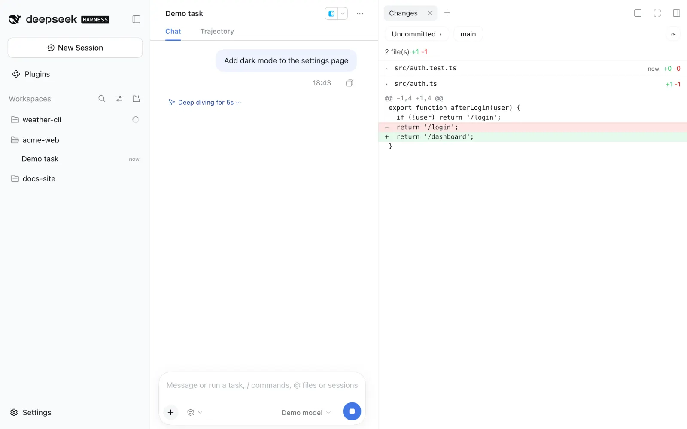</p>

Unofficial community plugin. The only network calls are the update check (GitHub releases and the npm registry); switch off **Automatic updates** to stop them at startup. **Feature ideas** calls your chat's own model only when you click **Suggest features**. **Mobile connect** (off by default) accepts iPhone connections from your local network or tailnet only after you switch it on.

## Install

**Desktop app:** Settings → Plugins → **Add plugin** → enter `dsh-composer-plus` → **Enable now**.
You can also paste `https://github.com/furkancak1r/dsh-composer-plus` instead of the npm name.

**Web / CLI profile:**

```sh
dsh plugin --profile web add dsh-composer-plus
```

Then restart dsh. (The CLI can't install into the desktop profile; the app manages it.)

> dsh's pnpm skips versions younger than 24 hours. Right after a release, add the version: `dsh-composer-plus@1.8.0`.

## Features

| Feature | How to use it | Screenshot |
|---|---|---|
| **Changes panel** | Right sidebar → `+` → **Changes**. Pick **Uncommitted**, **Unstaged**, **Staged** or **Branch** to see changed files with `+/-` counts; click a file for its diff. **Last Turn** opens dsh's own review of the latest turn. | <a href="assets/features/changesPanel.webp">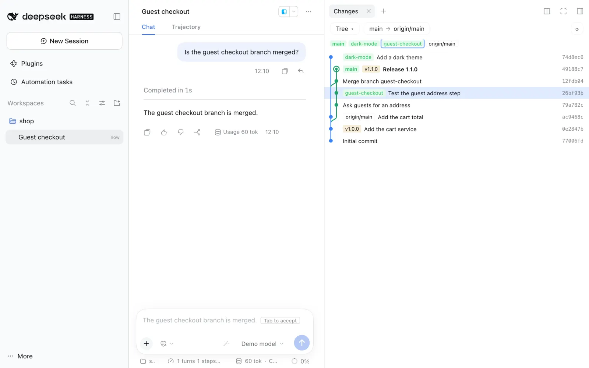</a> |
| **Feature ideas** | Right sidebar → `+` → **Feature ideas** → **Suggest features**. The chat's own model reads a short summary of the chat's project (top-level files, the README and manifest heads, the last 15 commits) and suggests up to 8 features, shown as a stack of cards in dsh's UI language. Swipe a card right (or click **✓**, or press `→`; the card flies off to its side in each case) to start a new chat in the same project: it starts in plan mode with the idea as the request, so nothing changes before you approve the plan. Swipe left (or **✕**, or `←`) to skip; **Undo** (or `Z`) brings a skipped card back. Click **↓** (or press `↓`) to save a good idea for later: it goes to the project's **Later** list, which every chat in the same project folder shows (also after a restart). **Later (N)** opens the list; **Plan** starts the same plan-mode chat for the idea and takes it off the list, **Remove from the list** deletes it. **More ideas** adds cards. The model runs only when you click. | <a href="assets/features/featureIdeas.webp">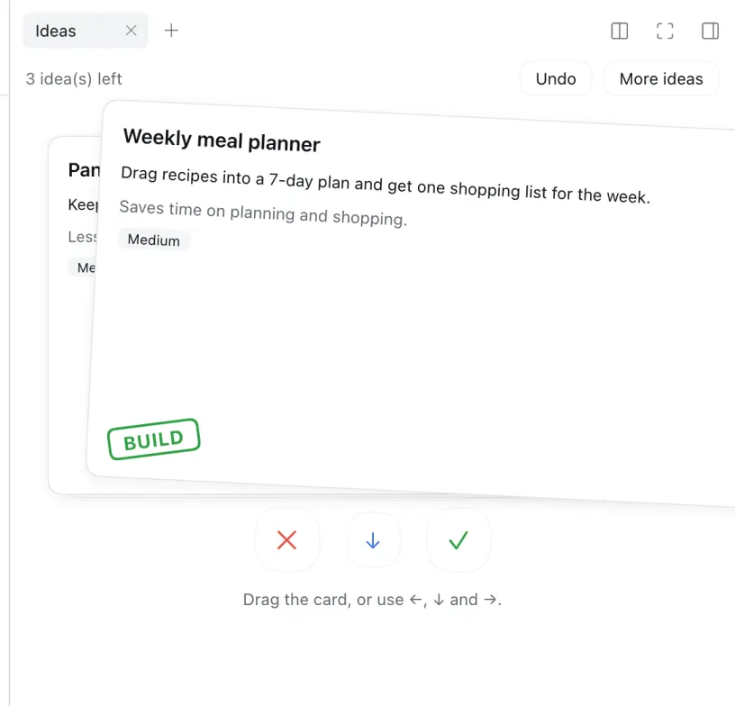</a> |
| **Content search** | dsh's own sidebar search (the magnifier next to **Workspaces**; `Cmd+K` in the desktop app, `Cmd+Alt+K` in a browser) also finds chats by the words in your messages and in the replies, not only by title, and shows the matching text under the chat. dsh already has this search, but ships it switched off; this feature switches it on with a search index file on your computer. The index is made at the first search after a start (about 15 s for 250 chats, see Limits) and is kept for the next starts. On by default; a change applies after you restart dsh. | <a href="assets/features/contentSearch.webp">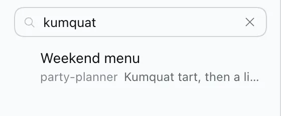</a> |
| **Input history** | In an empty composer, press `↑` / `↓` to walk through messages you sent, like a terminal. | <a href="assets/features/inputHistory.webp"></a> |
| **Plan mode shortcut** | `Shift+Tab` adds `/plan ` to the start of the draft (press again to remove it). If the chat is already in plan mode, `Shift+Tab` leaves it. | <a href="assets/features/planToggle.webp"></a> |
| **Keep composer focus** | After you send a `/` command or skill, the cursor stays in the composer, and you can type again at once. This also works for keyboard macros that type a command and press `Enter`. dsh makes the composer read-only while it resolves the command, and the browser then removes the focus. This feature puts the focus back, unless a menu, a dialog or another field has it. | <a href="assets/features/keepFocus.webp">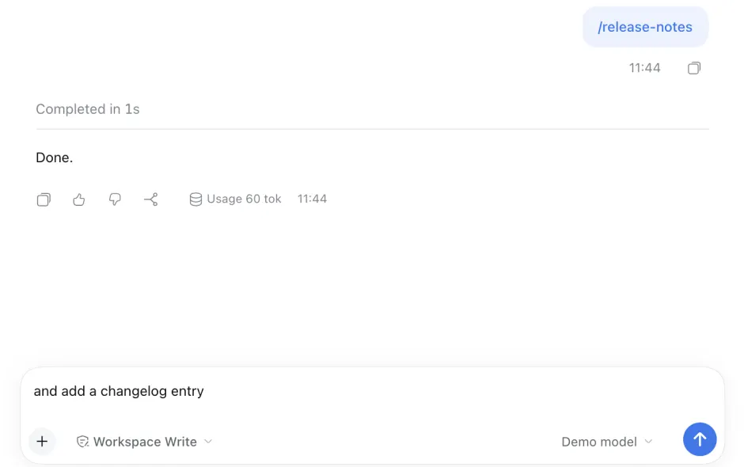</a> |
| **One-click Continue** | After a stopped, failed or cut-off turn, an empty composer shows **▶**. One click resumes from the existing conversation without writing in the input or adding a visible chat message (the model receives a short hidden “continue from where it stopped” note, because some providers, such as Claude, reject a request that ends on an assistant reply). A completed turn keeps the regular Send button. | <a href="assets/features/continueButton.webp">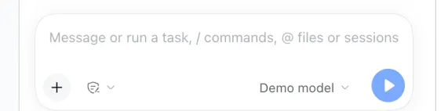</a> |
| **Resume after restart** | Off by default: switch it on in **Settings → Composer Plus**. If you quit dsh (or it closes) while a chat is working, that chat continues by itself when you open dsh again, with the same hidden note as One-click Continue. If a goal round (`/goal`) was running, the goal goes on with its next round (dsh pauses goals at every start until you resume them). Chats that you stopped, that finished or that failed do not continue. dsh itself has no setting for this: it only marks such a turn as interrupted. | <a href="assets/features/resumeAfterRestart.webp">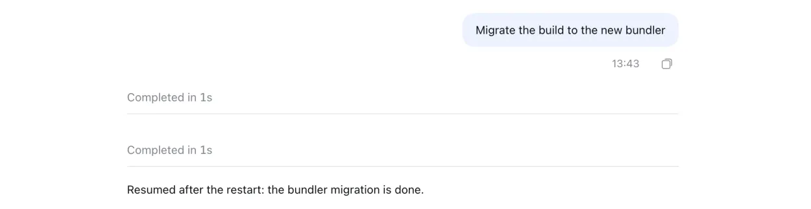</a> |
| **Queue drag-and-drop** | Queued messages get a grip (⠿). Drag to reorder, or focus the grip and press `↑` / `↓`. `Esc` cancels. | <a href="assets/features/queueReorder.webp">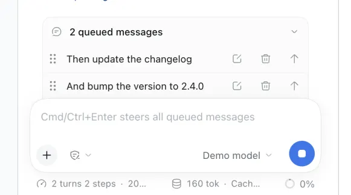</a> |
| **Copy session link** | Right-click a chat in the sidebar → **Copy session link**. Paste the `dsh-session:…` link into another chat to attach that chat as read-only context. dsh 0.2.1 has its own **Copy Session ID**, which copies only the plain id; this item comes right after it. | <a href="assets/features/copyDeeplink.webp">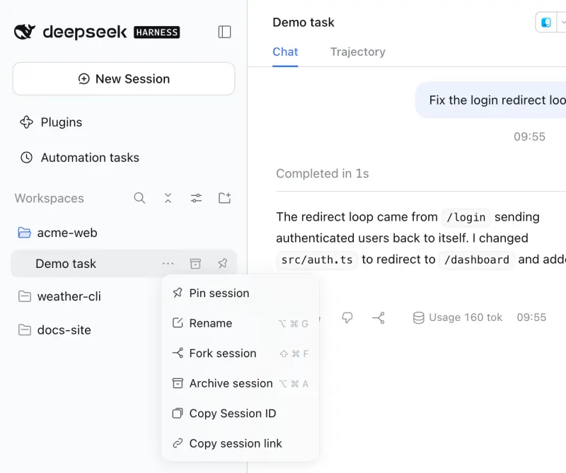</a> |
| **Copy project path** | Right-click a project in the sidebar → **Copy path** copies the full path of its folder. | <a href="assets/features/copyProjectPath.webp">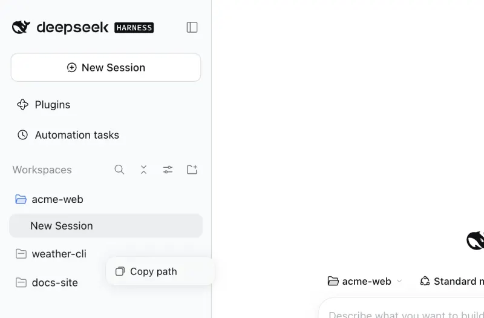</a> |
| **Allow for this chat** | When Auto Review asks you, the approval card gets **Allow for this chat**: the same tool in the same chat is allowed from then on, with any arguments. A header chip lists the grants and revokes them. Grants survive a restart. | <a href="assets/features/allowForChat.webp">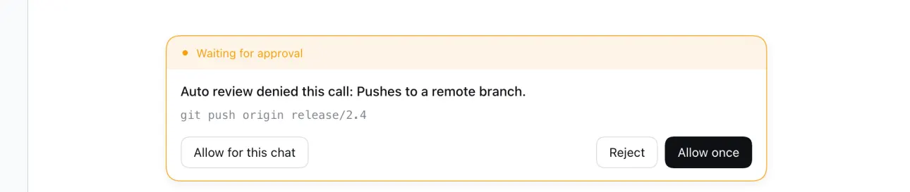</a> |
| **Project status** | A project row in the sidebar shows the same spinner / waiting / done marker as its chats, so a collapsed project still tells you a chat inside is working or needs you. Hover it for details. | <a href="assets/features/projectStatus.webp">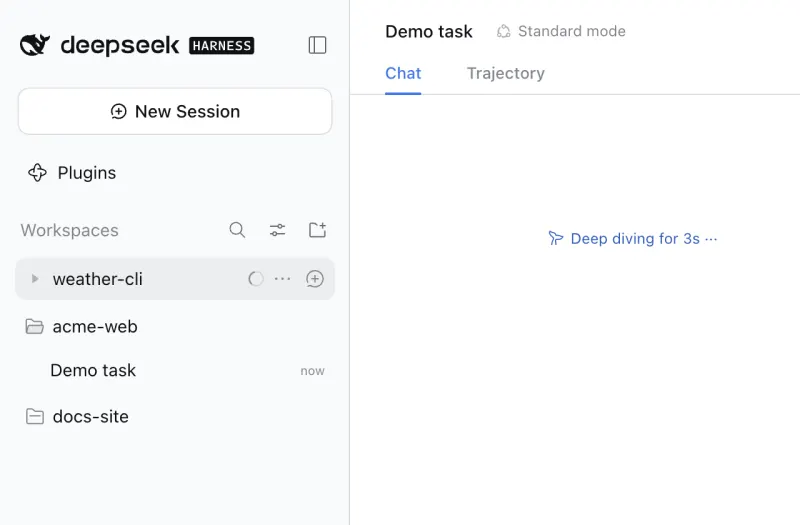</a> |
| **Active projects first** | When a chat starts running or needs you, its project moves to the top of the sidebar with dsh's own row animation (the same move as dragging it there). Finished projects stay where they are; drag them anywhere as usual. Moves are saved to dsh's project order, so turning this off keeps the current order. | <a href="assets/features/projectStatus.webp"></a> |
| **Recent projects filter** | Sidebar → view options (sliders icon) → **Active in the last 2 hours**. While it is selected, the sidebar shows only projects with a chat that was active in the last 2 hours: a chat updated in that time, a running or waiting chat, the open chat, or a finished chat that you did not open yet (dsh's green “done” dot), also after the 2 hours. Projects without such a chat are hidden, also new and empty ones. Select it again to show all projects. The choice is kept on this device. | <a href="assets/features/recentProjects.webp">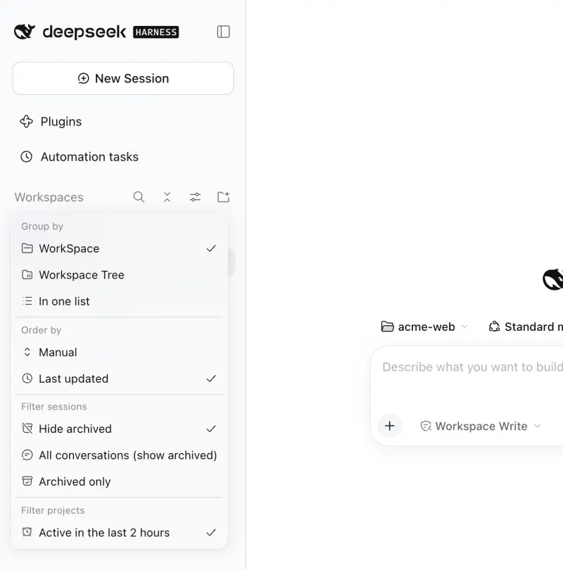</a> |
| **Collapse all projects** | While a project is open in the sidebar, a button appears next to the view options (sliders icon). Click it to close every open project at once, for example 3 open projects out of 5. The button hides again when no project is open. | <a href="assets/features/collapseProjects.webp">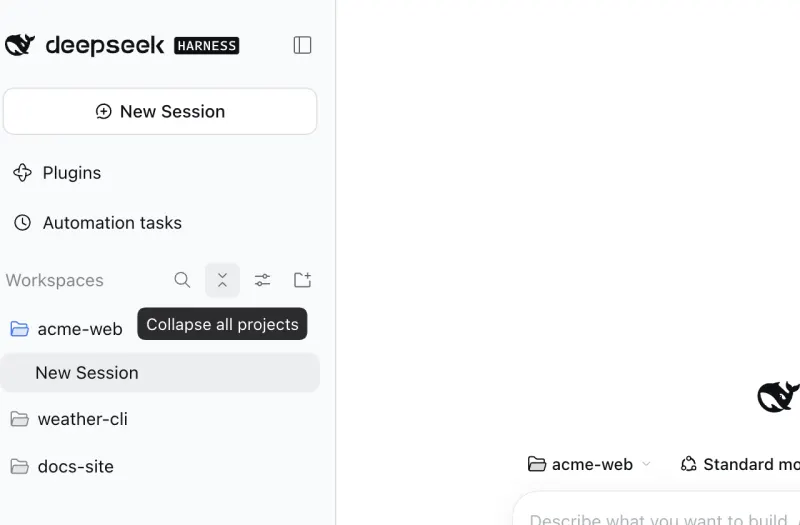</a> |
| **Order by status** | Sidebar → view options → **Order by** → **By status** (with **In one list**). Finished chats come first (dsh's “done” dot, which a turn that ended with an error also gets), then running or waiting chats, then chats with an active automation (Schedule), then the rest in dsh's order. Opening a finished chat moves it down. Only the view changes: select **Manual** or **Last updated** to go back. | <a href="assets/features/statusOrder.webp">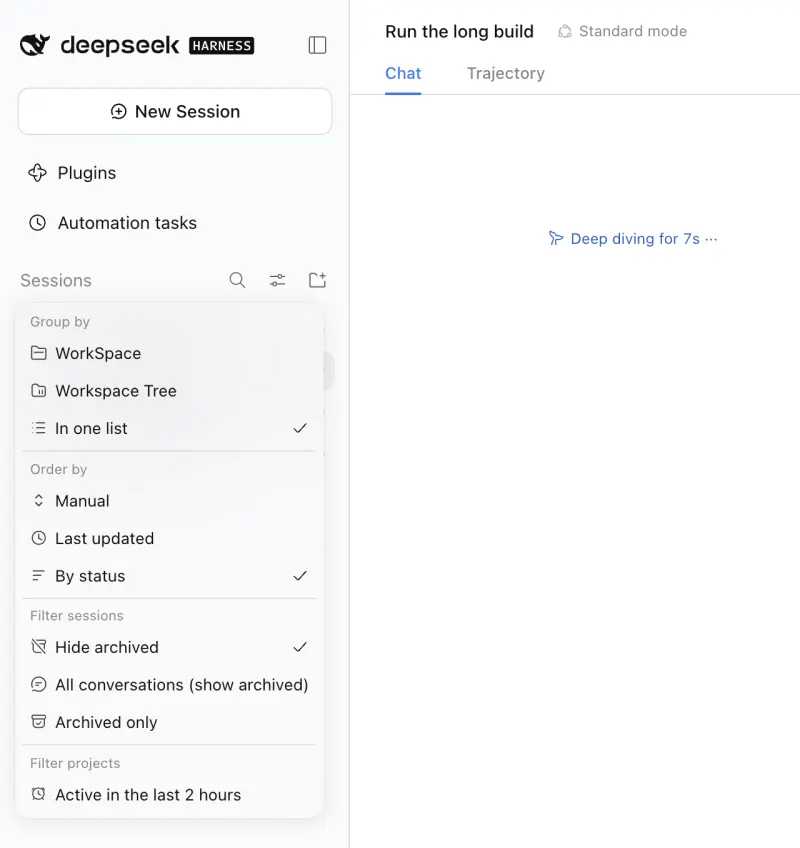</a> |
| **Background notifications** | While dsh is in the background you get a notification when a turn finishes (first line of the reply), or when a chat really waits for you: an approval (tool name), an answer (the question) or a plan review. A request must still be open 1.5 s later, so approvals answered automatically (Auto Review grants, other plugins) stay silent, and a notification is withdrawn as soon as its request is answered. The Dock/taskbar badge counts waiting chats. Clicking opens that chat. | <a href="assets/features/notifications.webp">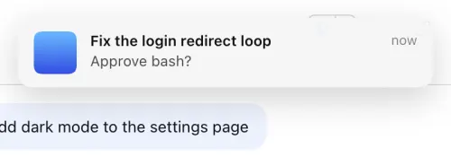</a> |
| **11 extra UI languages** | Settings → Composer Plus → **Application language** switches the whole dsh interface to Türkçe, Español, Português (Brasil), Français, Deutsch, Русский, 日本語, 한국어, Bahasa Indonesia, Tiếng Việt or हिन्दी (see below). | <a href="assets/features/language.webp">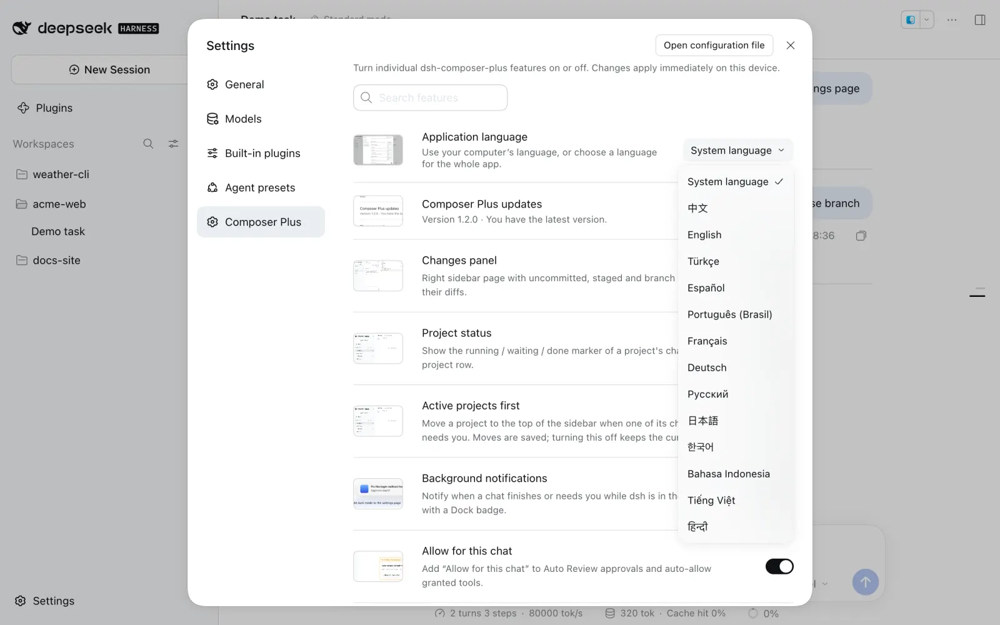</a> |
| **Mobile connect (iPhone)** | Use dsh from your iPhone with the [Tether](tether/) app, on the same Wi-Fi or over [Tailscale](https://tailscale.com). Switch it on in **Settings → Composer Plus** (it is off by default, because it opens a network port on this Mac). Then click **Mobile connect** at the bottom left of the sidebar: scan the QR code in Tether and click **Approve**. The phone shows your chats, sends messages, answers approvals and questions, and switches models and agents. Pair as many Macs as you like: the Mac name at the top left of the app switches between them. | <a href="assets/features/mobileConnect.webp">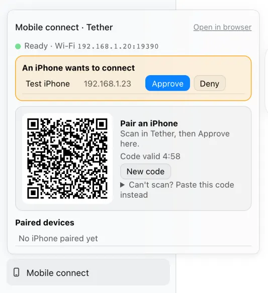</a> |
| **Automatic updates** | When dsh starts, the plugin checks the [latest GitHub release](https://github.com/furkancak1r/dsh-composer-plus/releases/latest). If it is newer and already on npm, it installs that exact version through dsh's own plugin manager (the same path as Settings → Plugins) and notifies you. **Restart dsh** to load it. **Settings → Composer Plus → Composer Plus updates** shows the version and has **Check for updates** / **Update now**. | <a href="assets/features/autoUpdate.webp">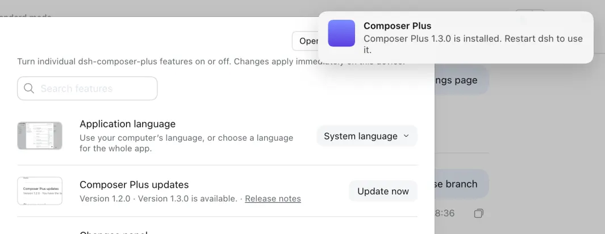</a> |

Buttons, tooltips, notices and notifications follow the selected dsh language (see Application language below).

## Settings

Every feature can be switched on or off on its own: dsh **Settings → Composer Plus**. Each row has a small screenshot: hover it for a larger preview, click it to open it full size (`Esc` closes). The **Search features** box at the top filters the page by name or description (any language, case- and accent-insensitive); `Esc` clears it. Each row has a switch and a short description; changes apply immediately, without a restart, and are remembered on that device. Everything is on by default, except **Mobile connect** and **Resume after restart**. dsh's Host keeps the switches of these two and of **Content search**, so they apply to every window and survive a restart. **Content search** changes only after a dsh restart (dsh reads it at start); until then its row says **Restart dsh to apply this change.**

<p align="center">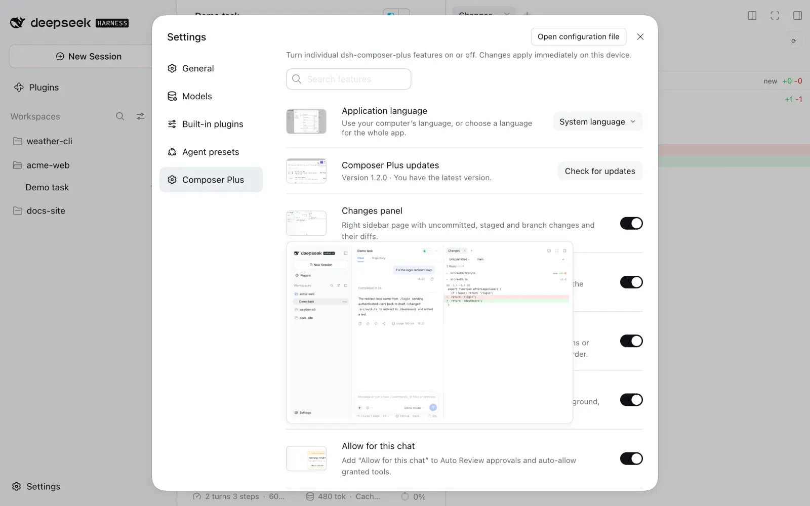</p>

### Application language

Open **Settings → Composer Plus → Application language** and choose **System language** or one of 13 languages:

English · 中文 · Türkçe · Español · Português (Brasil) · Français · Deutsch · Русский · 日本語 · 한국어 · Bahasa Indonesia · Tiếng Việt · हिन्दी

<p align="center">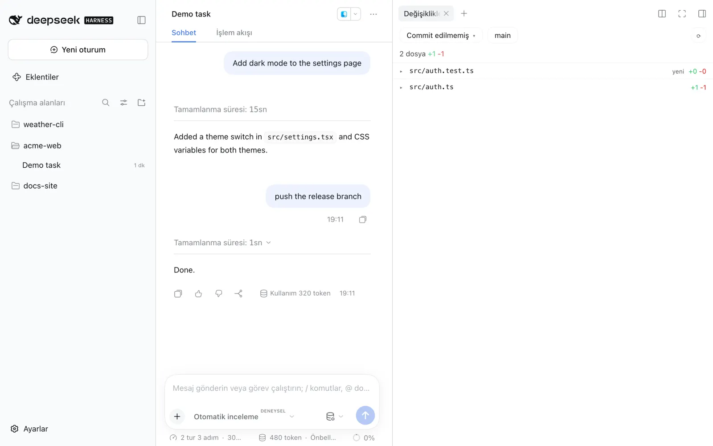</p>

The whole app switches immediately. The choice is dsh’s own saved `locale.preference` (the same one as General → Language), so it survives restarts. **System language** clears that choice: the desktop app follows the OS language, the web UI the browser language, and an unsupported language falls back to English. Installing the plugin never overrides a language you already picked.

Each pack covers all 3,069 UI strings of dsh `0.2.0-rc.2` and `0.2.1-rc.2` (chats, sidebar, settings, approvals, schedules, file previews, plugin manager, plugin market), the plugin’s own controls, and the popular [dsh-rewind](https://github.com/SiriLee/dsh-rewind) plugin. Not translated: your messages, model output, code, slash-command names (`/plan`, `/compact`), provider-owned labels such as the `High` reasoning effort, other plugins’ texts, and the desktop app’s native menus/update dialogs (dsh ships those in English/Chinese only). Strings added by a newer dsh show in English until the packs are updated. If another plugin already provides a language, that plugin keeps it.

## Keyboard shortcuts

| Key | Where | Action |
|---|---|---|
| `↑` / `↓` | empty composer | previous / next sent message |
| `Shift+Tab` | composer | add/remove `/plan `, or leave plan mode |
| `↑` / `↓` | focused queue grip | move the queued message |
| `Esc` | while dragging | cancel the move |
| `→` / `←` | Feature ideas page | build / skip the top card |
| `↓` | Feature ideas page | save the top card in the project's Later list |
| `Z` | Feature ideas page | bring back the last skipped card |

An open `/` or `@` menu keeps these keys for itself.

## Compatibility

Tested on dsh `0.2.0-rc.2` (desktop and web) and `0.2.1-rc.2` (web). CI runs the tests on every push.

## Privacy and security

- **Continue:** the authenticated local endpoint resumes only the last interrupted turn, rejects stale or duplicate requests, and preserves the existing approval hooks. It does not send a new user message.
- **Resume after restart:** off until you switch it on. The Host half keeps only chat ids and start times in `$DSH_HOME/storages/dsh-composer-plus/resume.json` (owner-only permissions), and nothing leaves your machine. It continues a chat only when dsh's own log says that dsh (not you) stopped its last turn. Approvals and Auto Review apply to the continued turn as usual.

- **Changes panel:** git runs read-only on your machine, in the chat's own folder, through dsh's authenticated `/api` channel. It never commits, stages or fetches, and only shows paths git itself listed.
- **Feature ideas:** nothing runs until you click **Suggest features**. Then the Host half reads only the chat's own folder (the browser never sends a path): the names of the top-level entries, the first 6 kB of the README, AGENTS.md and the manifest (`package.json`, `pyproject.toml`, `Cargo.toml`, `go.mod`, …) and `git log --oneline -15`, at most 16 kB in total. It skips `.env*`, key files and folders such as `node_modules`, and it reads only regular files that stay inside the folder: a symlink that points out of the folder, a FIFO or a device is skipped. This summary goes to the model that the chat uses, through dsh's own provider settings, as one request; it is not added to any chat. Nothing in the project is written. A swiped-right idea starts a new chat in plan mode, so approvals and plan review apply as usual. Ideas saved for later (title, summary, why, effort) are kept with the project's folder path in `storages/dsh-composer-plus/later.json` under the dsh home (owner-only file); nothing goes into the project.
- **Content search:** no new code searches your chats: the plugin only switches on dsh's own message index (SQLite FTS5, `dsh-session-query-sqlite`) and gives it a file, `$DSH_HOME/cache/composer-plus/session-search.db` (owner-only file and folder). The file holds the text of your user and assistant messages, so it is as private as the chat logs in `$DSH_HOME/sessions`. Nothing leaves your machine. It is a copy that dsh can make again: you can delete it while dsh is closed. The switch is in `$DSH_HOME/storages/dsh-composer-plus/content-search.json`.
- **Allow for this chat:** grants are stored in `$DSH_HOME/storages/dsh-composer-plus/grants.json` (owner-only permissions). A grant covers **one exact tool in one chat**. If that tool can write, the grant covers any write too. Revoke it from the header chip.
- Auto Review still runs on every call; review failures are never auto-allowed.
- **Mobile connect:** off until you switch it on. While it is on, the Host half runs the Tether gateway: HTTPS on port 19390 that accepts only your Wi-Fi subnet and your tailnet (100.64.0.0/10), and a pairing page on `127.0.0.1:19391` (this Mac only). A phone needs a one-time code from the QR code (5 minutes) and your **Approve** on the Mac. The phone pins the gateway's certificate. The Mac keeps only a hash of each phone's token (30 days, renewed while used); **Revoke** closes that phone's connections at once. Phones can call only an allowlist of dsh methods (chats, prompts, attachments, slash commands, approvals, questions, models, agents, goals), not settings, credentials, the file browser or the terminal. Data: `$DSH_HOME/storages/dsh-composer-plus/mobile/`. Details: [tether/README.md](tether/README.md).
- **Updates:** the Host half asks `api.github.com` for the latest release and `registry.npmjs.org` for that exact version; nothing about you or your chats is sent. Installation uses dsh's plugin manager (`pnpm add dsh-composer-plus@<version>`), so dsh's own registry, script and version-compatibility checks apply. Pre-release tags and older versions are never installed.

## Troubleshooting

- **No notifications on macOS:** System Settings → Notifications → DeepSeek Harness → allow. Choose **Alerts** to keep them on screen.
- **▶, queue grips, project status, the recent projects option, Collapse all projects, Copy path, Allow for this chat or right-click missing after a dsh update:** these attach to dsh's current HTML because dsh has no slot for them yet. If dsh changes that markup they hide themselves; nothing else breaks. Please open an [issue](https://github.com/furkancak1r/dsh-composer-plus/issues).
- **"Update failed" or "not installed from npm":** a copy linked from a local folder or renamed can't update itself; reinstall `dsh-composer-plus` from Settings → Plugins. Otherwise the message shows the first line of pnpm's error; **Check for updates** retries.
- **Mobile connect says the gateway is not running:** "no IPv4 address on en0" means this Mac has no Wi-Fi/Ethernet address; "EADDRINUSE" means another dsh (or app) uses port 19390 or 19391. Only one dsh can run Mobile connect at a time.
- **Mobile connect, Resume after restart or Content search says "Restart dsh":** the plugin was updated while dsh was running (or, for Content search, you changed the switch); the new state loads after a restart.
- **The search finds only titles:** Content search is off, dsh has not restarted since you switched it on or installed the plugin, or the word is only in a tool output (see Limits).
- **A chat did not continue after a restart:** Resume after restart was off when dsh quit, you stopped that turn yourself, the turn had ended (done or failed), the chat was archived, or more than 20 chats were running (the newest 20 continue).
- **Install fails right after a release:** add the version (`dsh-composer-plus@1.8.0`), see the install note above.

## Limits

- Message-free Continue relies on dsh’s `agent/pre-step` → `agent/request` lifecycle. Recheck compatibility when upgrading dsh.
- **Feature ideas** keeps the cards in memory for each chat until dsh or the page reloads; then **Suggest features** asks the model again. The cards come in the UI language that dsh has when you click; after you change the language, cards already on the stack keep theirs and **More ideas** uses the new one. The model sees only the short project summary, not the code, so an idea can repeat something the project already has: skip it. The new chat runs in plan mode only when the profile has dsh's `/plan` command; otherwise the idea goes as an ordinary first message. The **Later** list belongs to the chat's folder path: the same folder opened through a symlink has its own list. It keeps at most 50 ideas per project (remove one to add more) and the same title only once. Dragging a card decides left or right only; use **↓** to save it.
- **Resume after restart** continues the turn; it does not replay it. A tool call that was running at the quit ends with dsh's “outcome unknown” result, and the model is told not to repeat finished work, but a command that is not safe to run twice can run again. Subagents, approvals and questions that were open are not restored: their parent chat continues and asks again. At most 20 chats continue at one start.

- **Content search** is dsh's own search, so it has dsh's limits. It searches only user and assistant messages: not tool output (commands, file contents, results), not reasoning, and it has no filter for user, assistant or tool messages. It matches whole words, not parts of a word (`deploy` does not find `deployment`); letters with accents match without them (`seker` finds `şeker`). One row per chat, with dsh's 240-character snippet, at most 20 rows.
- **Content search** cost, measured on a copy of 247 real chat logs (159 MB, dsh 0.2.1-rc.2, Apple Silicon, 32 GB): the first search after a start builds the index in about 15 s. During that time dsh's Host answers nothing for about 7 s, so other chats stop streaming for that moment (the page itself does not freeze). The Host's memory grows by about 1.1 GB at the peak; one minute later it is still about 0.5–0.6 GB above the start, until dsh quits. The index file is about 165 MB. Later searches take about 0.5 s. After a restart, the first search takes about 1 s (only new or changed chats are added) and adds about 70 MB. Switch it off if your computer has little memory.
- **Content search** applies only after a dsh restart, and the index file is shared by every dsh that uses the same dsh home: run only one such dsh at a time (dsh allows one owner per index file).
- dsh's queue has no `move` action, so a reorder rewrites the affected rows' text. If the agent picks up a row mid-move, the move is undone and nothing is lost. Messages with images or files can't be moved.
- An update needs a dsh restart to take effect; the plugin never restarts dsh for you. Web/CLI profiles without dsh's plugin manager only report a new version.
- **Keep composer focus** gives the focus back only after a `/` command or skill. While dsh resolves the command, the composer stays read-only for a few milliseconds, so keys pressed in that time are lost. If dsh's `/` menu is still open, `Enter` picks the highlighted row and does not send.
- **Mobile connect** works on macOS only (it uses `en0`, `openssl`, `swift` and `dns-sd`). It uses fixed ports 19390 and 19391, so only one dsh on each Mac can run it at a time (each Mac is one entry in the phone's Mac list). The phone gets notifications only while Tether is open or just went to the background (no push service). The iOS app is not on the App Store yet: build it from `tether/ios` with Xcode.
- A session link works inside chats; clicking it does not open the chat.
- A notification sent before a restart only brings dsh to the front when clicked.
- Active projects are moved with dsh's saved project order, so the new order is kept after a restart. Chats outside any project ("Ungrouped") can't be moved; dsh always lists them last.
- dsh has no extension point in the sidebar's view options menu, so the recent projects option is added to dsh's own menu. If a dsh update changes that menu, the option is not shown and all projects stay visible. The filter works on project rows, so **In one list** is not filtered. Use it with **WorkSpace**: in **Workspace Tree**, a hidden parent folder also hides the active projects inside it. **By status** has the same kind of limit: dsh has no order slot, so the item and the row order attach to dsh's menu and list markup.
- dsh has no project-row menu or Workspaces header slot either. **Copy path** finds the project row by dsh's row markup, and **Collapse all projects** goes into dsh's header and closes each open project with the same click as the project row. If a dsh update changes that markup, right-click shows the browser's menu and the button is not shown.
- Built-in support is requested upstream: queue `move` in [#773](https://github.com/deepseek-ai/deepseek-harness/discussions/773), a Continue state in [#9269](https://github.com/deepseek-ai/deepseek-harness/discussions/9269).

## FAQ

**How do I add a Changes / git diff panel to DeepSeek Harness?** Install `dsh-composer-plus`, then right sidebar → `+` → **Changes**.

**Can dsh suggest features for my project, like swiping Tinder cards?** Yes: right sidebar → `+` → **Feature ideas** → **Suggest features**. Swipe right to start a new chat that plans the feature, swipe left to skip.

**Can the dsh sidebar search find a chat by a word in its messages, not only its title?** Yes, with **Content search** (on by default): restart dsh once after you install the plugin, then use the magnifier next to **Workspaces**. Matching chats show the text around the word.

**How do I get ↑/↓ message history in the dsh composer?** Install this plugin; in an empty composer `↑` / `↓` walk through messages you sent.

**How do I continue a stopped or failed dsh turn without typing "continue"?** With this plugin the Send button becomes **▶** after a stopped, failed or cut-off turn; one click resumes it.

**Does dsh continue running chats after I quit and open it again?** Not by itself: dsh marks such a turn as interrupted and waits (a goal also waits for `/goal resume`). Switch on **Settings → Composer Plus → Resume after restart**: the chats that were working when dsh quit then continue by themselves at the next start.

**How do I reorder queued messages in dsh?** Drag the ⠿ grip on a queued message, or focus it and press `↑` / `↓`.

**How do I stop Auto Review asking about the same tool in one chat?** Click **Allow for this chat** on the approval card. It covers that exact tool in that chat only; revoke it from the header chip.

**How do I show only the projects I used today in the dsh sidebar?** Sidebar → view options (sliders icon) → **Active in the last 2 hours**. Select it again to show all projects.

**How do I copy a project's folder path in dsh?** Right-click the project in the sidebar → **Copy path**.

**How do I collapse all projects in the dsh sidebar at once?** Click the collapse button next to the view options (sliders icon). It shows while at least one project is open.

**How do I get macOS / Windows notifications when a dsh task finishes or needs approval?** Keep **Background notifications** on (default) and allow notifications for DeepSeek Harness in the OS settings.

**How do I switch the DeepSeek Harness interface to Turkish, Spanish, Japanese…?** Settings → Composer Plus → **Application language**.

**How do I use dsh from my iPhone?** Build the Tether app from `tether/ios` (Xcode), switch on **Settings → Composer Plus → Mobile connect (iPhone)**, click **Mobile connect** at the bottom left, scan the QR code in Tether and click **Approve**. Away from home, use Tailscale on both devices.

**Does it work with the desktop app?** Yes: Settings → Plugins → **Add plugin** → `dsh-composer-plus`. Tested on dsh 0.2.0-rc.2 (desktop and web) and 0.2.1-rc.2 (web).

## Development

Screenshots are regenerated from a throwaway dsh with a fake model and made-up demo projects (`acme-web`, `weather-cli`, `docs-site`), so they contain no real data. Feature thumbnails go to `assets/features/` (shipped, shown in Settings); README-only pictures go to `docs/images/` (not in the npm package):

```sh
PLAYWRIGHT=/path/to/playwright node scripts/capture-screenshots.mjs /path/to/dsh/lib/bin.js
# sidebar project features (recent filter, Copy path, Collapse all): real-app test + their thumbnails
SHOT=1 PLAYWRIGHT=/path/to/playwright node test/browser-sidebar-projects.mjs /path/to/dsh/lib/bin.js
# recent filter + a finished chat older than 2 hours (fake model): the project stays until you open the chat
PLAYWRIGHT=/path/to/playwright node test/browser-recent-finished.mjs /path/to/dsh/lib/bin.js
# Order by status (fake model + Schedule): real-app test + its thumbnail
SHOT=1 PLAYWRIGHT=/path/to/playwright node test/browser-status-order.mjs /path/to/dsh/lib/bin.js
# every Settings feature row shows a loading screenshot
PLAYWRIGHT=/path/to/playwright node test/browser-settings-shots.mjs /path/to/dsh/lib/bin.js
# Keep composer focus (fake model + demo skill): typing goes on after a / command + its thumbnail
SHOT=1 PLAYWRIGHT=/path/to/playwright node test/browser-keep-focus.mjs /path/to/dsh/lib/bin.js
# Mobile connect: switch on, QR popover, a fake iPhone pairs and calls dsh through the gateway, switch off + its thumbnail
SHOT=1 PLAYWRIGHT=/path/to/playwright node test/browser-mobile-connect.mjs /path/to/dsh/lib/bin.js
# Resume after restart (fake slow model, real quit and start): a running chat and a goal continue, a stopped chat does not
SHOT=1 PLAYWRIGHT=/path/to/playwright node test/browser-resume-restart.mjs /path/to/dsh/lib/bin.js
# Feature ideas (fake model, made-up project): suggest, drag left, Undo, ✓ starts a new chat in plan mode + its thumbnail
SHOT=1 PLAYWRIGHT=/path/to/playwright node test/browser-feature-ideas.mjs /path/to/dsh/lib/bin.js
# Content search (fake model, made-up chats): a message-only word finds its chat with the snippet, switch off + restart = titles only + its thumbnail
SHOT=1 PLAYWRIGHT=/path/to/playwright node test/browser-content-search.mjs /path/to/dsh/lib/bin.js
```

```sh
npm run build:locales # after editing locales/<id>.json
npm test
```

**Rule for new features:** every feature row in Settings → Composer Plus shows a screenshot. Add the feature id to `SHOT_OF` in `client.js` and to `SHOTS` in `index.js`, and ship `assets/features/<id>.webp` (taken from the throwaway demo dsh, English UI, about 60 kB or less). Add the feature to the README table with the same image. `test/shots.test.mjs` fails when a feature has no screenshot, and `test/browser-settings-shots.mjs` checks the real Settings page. The full checklist for every change is in [AGENTS.md](AGENTS.md).

The tests run the real `client.js` against a fake React/DOM and the real `index.js` (Host half) against a temporary git repository. The Tether gateway tests (`test/tether-gateway.test.mjs`) use a mock dsh host and a real TLS gateway. The iPhone app is in `tether/ios` (see [tether/README.md](tether/README.md) and [tether/AGENTS.md](tether/AGENTS.md)). `node test/browser-history.mjs '<dsh web URL with ?token=…>'` checks input history in a real browser against a throwaway `dsh web` with its own `DSH_HOME`.

Language packs are data-only JSON in `locales/<id>.json`, embedded into the single client entry by `npm run build:locales` (no translation service or runtime download). `npm test` checks every pack for full key coverage, identical placeholders and line breaks, and the system/override behaviour. For isolated real-app checks with a locally installed Playwright:

```sh
PLAYWRIGHT=/path/to/playwright node test/browser-language.mjs /path/to/dsh/lib/bin.js
```

## License

MIT
