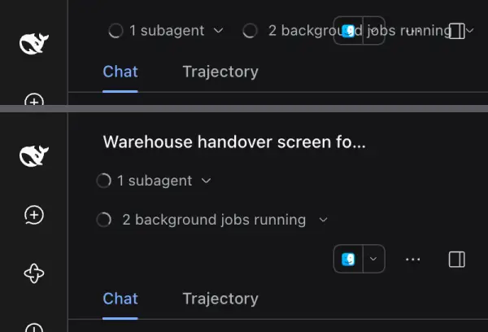
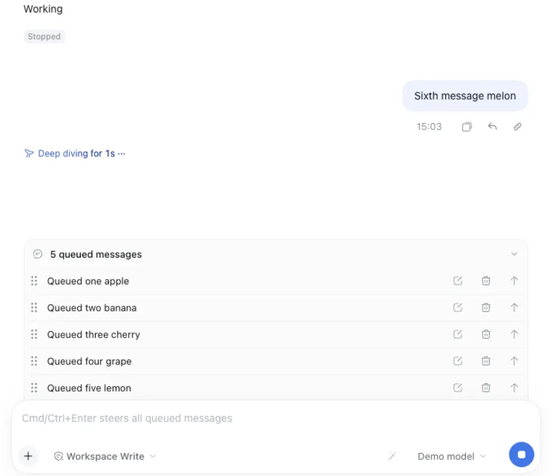
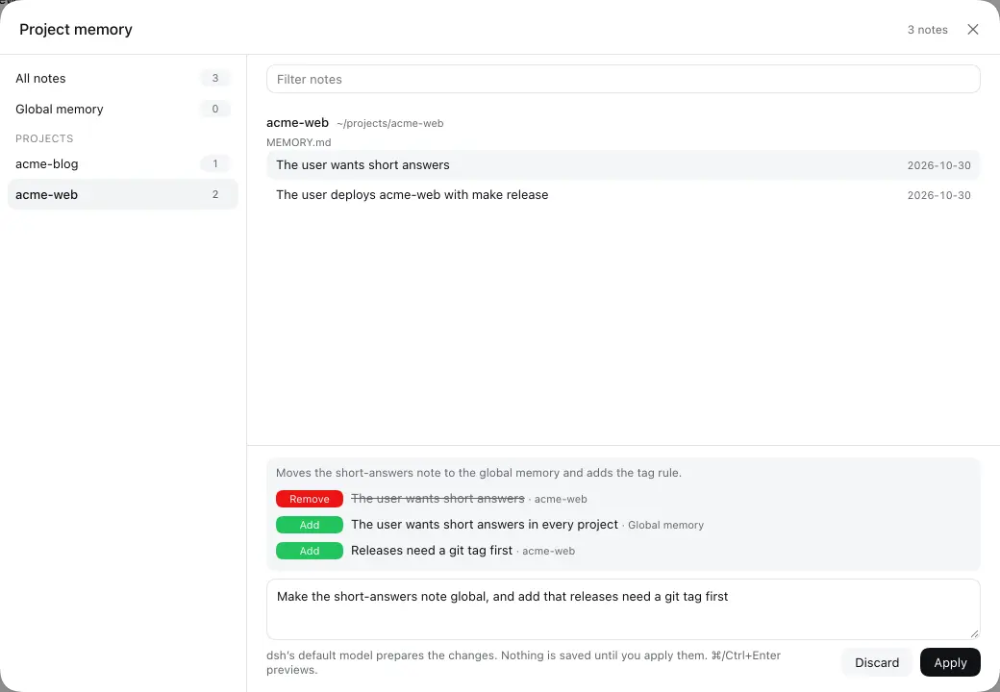
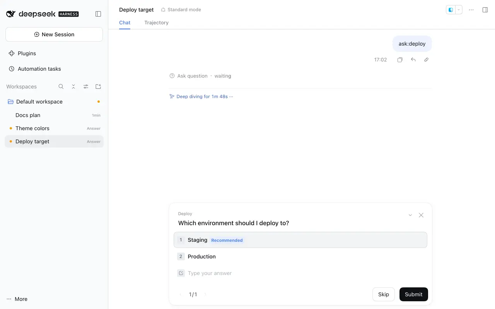
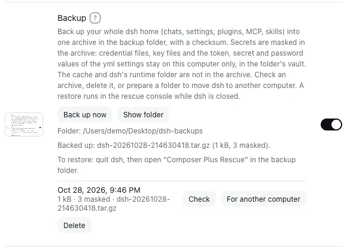
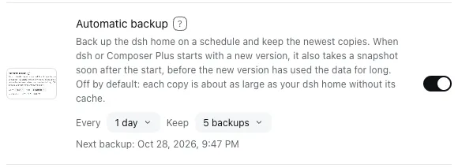
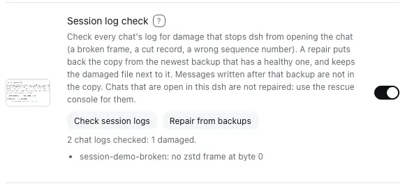
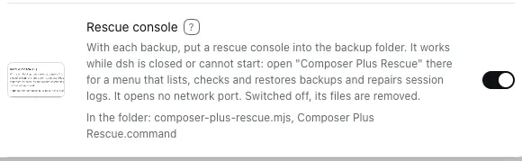

# dsh-composer-plus — Composer Plus para DeepSeek Harness

[](https://www.npmjs.com/package/dsh-composer-plus)
[](https://github.com/furkancak1r/dsh-composer-plus/actions/workflows/test.yml)
[](LICENSE)

[English](README.md) · [中文](README.zh.md) · [Türkçe](README.tr.md) · [Español](README.es.md) · **Português (Brasil)** · [Français](README.fr.md) · [Deutsch](README.de.md) · [Русский](README.ru.md) · [日本語](README.ja.md) · [한국어](README.ko.md) · [Bahasa Indonesia](README.id.md) · [Tiếng Việt](README.vi.md) · [हिन्दी](README.hi.md)

Esta é uma tradução. A versão de referência é o [README.md](README.md) em inglês.

Recursos práticos no estilo do Codex para a interface desktop e web do [DeepSeek Harness](https://github.com/deepseek-ai/deepseek-harness) (dsh): um painel de alterações, ideias de recursos em cartões para deslizar, pesquisa na barra lateral pelo texto das mensagens, reversão de turnos com restauração de arquivos, exclusão de chats para o Lixo, o nome do projeto abaixo do editor de mensagens, status do projeto na barra lateral, histórico de entrada, um atalho para o modo de plano, Continuar com um clique, retomada dos chats em execução depois de reiniciar, arrastar e soltar na fila, deeplinks de sessão, exportação do chat como Markdown, autorizações da Revisão automática por chat, notificações em segundo plano, acesso pelo iPhone com o app Tether e atualizações automáticas.

**Em uma linha:** um único plugin do DeepSeek Harness (npm `dsh-composer-plus`, exibido como **Composer Plus** em Configurações → Plugins) que adiciona um painel de alterações do git, cartões de ideias de recursos no estilo Tinder, pesquisa na barra lateral que também encontra palavras nas mensagens, ↶ Reverter turno (apenas o chat, ou chat e arquivos), Excluir chat, o nome do projeto abaixo do editor de mensagens, histórico de entrada com ↑/↓, alternância de `/plan` com Shift+Tab, ▶ Continuar com um clique, Retomar após reiniciar, reordenação da fila com arrastar e soltar, Copiar link da sessão, Exportar como Markdown, “Permitir neste chat” na Revisão automática, notificações em segundo plano, acesso pelo iPhone (Conexão móvel, app Tether), 11 idiomas extras na interface e atualizações automáticas.

<p align="center"></p>

Plugin não oficial da comunidade. As únicas chamadas de rede são a verificação de atualizações (releases do GitHub e registro do npm); desative **Atualizações automáticas** para que elas não aconteçam ao iniciar. **Ideias de recursos** chama o próprio modelo do seu chat só quando você clica em **Sugerir recursos**. **Previsão da próxima mensagem** (ativada por padrão) chama o modelo escolhido nas Configurações (o padrão do dsh, a menos que você escolha outro) uma vez após cada turno concluído, sem nenhum clique. Desative-a em **Configurações → Composer Plus** para parar essas chamadas. **Completar ao digitar** (desativado por padrão) chama o modelo escolhido para ele (por padrão, o da previsão) a cada pausa enquanto você digita, depois que você o ativa. **Melhorar prompt** só chama um modelo quando você clica na varinha mágica dele. **Verificação da meta** (ativada por padrão) chama um modelo uma vez cada vez que o agente marca uma `/goal` como concluída em uma rodada automática. **Conexão móvel** (desativada por padrão) só aceita conexões do iPhone vindas da sua rede local ou da sua tailnet depois que você a ativa.

## Instalação

**App desktop:** Configurações → Plugins → **Adicionar plugin** → digite `dsh-composer-plus` → **Ativar agora**.
Você também pode colar `https://github.com/furkancak1r/dsh-composer-plus` em vez do nome do npm.

**Perfil web / CLI:**

```sh
dsh plugin --profile web add dsh-composer-plus
```

Depois, reinicie o dsh. (A CLI não consegue instalar no perfil desktop; quem gerencia esse perfil é o app.)

> O pnpm do dsh ignora versões publicadas há menos de 24 horas. Logo depois de uma nova versão, informe a versão: `dsh-composer-plus@1.16.1`.

## Recursos

<!-- BEGIN GENERATED FEATURES: edit docs/features.json, then run npm run build:readme -->

| Recurso | Como usar | Captura de tela |
|---|---|---|
| **Painel de alterações** | <a id="feature-changespanel"></a>Barra lateral direita → `+` → **Alterações**. A página abre em **Árvore**: um mapa de branches do repositório do chat. Três cartões contam os branches: todos, os mesclados e os que aguardam mesclagem. Clique em um cartão para mostrar só esses branches; clique nele de novo para mostrar todos. Cada branch é uma caixa com o último commit dele: verde quando o branch principal tem o trabalho dele, laranja quando não tem, azul para o branch principal. Uma seta vai de cada branch até o branch que o recebeu (✅ **Mesclado**) ou até o branch de onde ele partiu (⏳ **Aguardando**, tracejada). Clique em uma caixa para ver os commits do branch e depois em um commit para ver os arquivos e os diffs dele. Clique em **Mesclado** para ver os arquivos do commit de mesclagem, ou em **Aguardando** para ver os arquivos que o branch traz para o destino dele. Um branch remoto só aparece quando nenhum branch local tem o mesmo nome. No menu de modos, escolha **Não confirmadas**, **Não preparadas**, **Preparadas** ou **Branch** para ver os arquivos alterados com as contagens `+/-`; clique em um arquivo para ver o diff dele. **Último turno** abre a revisão do próprio dsh para o turno mais recente. **Este chat** lista só os arquivos que as ferramentas de arquivo do chat aberto (write, edit) escreveram, em todos os turnos dele, e o diff total desde a primeira mensagem. O botão **␣** oculta as alterações de espaço em branco (`git diff -w`): as linhas que mudaram só na indentação ou nas quebras de linha não aparecem. O menu **…** de um arquivo → **Chats que alteraram este arquivo** lista os chats do mesmo repositório cujas ferramentas de escrita ou edição alteraram esse arquivo, do mais recente ao mais antigo, com o pedido que fez a alteração; um clique abre esse chat nesse pedido. | <a href="assets/features/changesPanel.webp"></a> |
| **Ideias de recursos** | <a id="feature-featureideas"></a>Barra lateral direita → `+` → **Ideias de recursos** → **Sugerir recursos**. O próprio modelo do chat lê um breve resumo do projeto do chat (arquivos do nível superior, o início do README e do manifesto, um esboço do resto do README, os títulos dos commits recentes) e sugere até 8 recursos, exibidos como uma pilha de cartões no idioma da interface do dsh. Deslize um cartão para a direita (ou clique em **✓**, ou pressione `→`; em todos os casos, o cartão sai voando para aquele lado) para iniciar um novo chat no mesmo projeto: ele começa no modo de plano com a ideia como pedido, então nada muda antes de você aprovar o plano. Para pular o plano, clique em **▶ Criar agora** (ou pressione `↑`; o cartão sai voando para cima): o novo chat começa na hora com a ideia como um pedido comum, e o modelo faz a alteração e executa as verificações (as aprovações valem como de costume). Deslize para a esquerda (ou **✕**, ou `←`) para pular; **Desfazer** (ou `Z`) traz de volta um cartão pulado. Clique em **↓** (ou pressione `↓`) para salvar uma boa ideia para depois: ela vai para a lista **Depois** do projeto, que aparece em todos os chats da mesma pasta de projeto (também depois de reiniciar). **Depois (N)** abre a lista; **Planejar** inicia o mesmo chat no modo de plano para a ideia e **Criar agora** inicia o chat sem plano; os dois a tiram da lista. **Planejar tudo (N)** inicia um único chat no modo de plano para todas as ideias da lista, então as partes em comum são planejadas uma só vez. **Remover da lista** a exclui. **Copiar como lista de tarefas** copia a lista inteira para a área de transferência como uma lista de tarefas em Markdown (`- [ ] Title — Summary`, uma linha por ideia) para um rastreador de issues ou um arquivo TODO; ele não faz nenhuma chamada de rede. **Abrir issue no GitHub** em uma ideia abre uma issue com o título e o resumo dela (e por que ela importa) no repositório do GitHub do projeto, com o seu próprio login do GitHub CLI (`gh`); depois, o link **Issue #N** aparece ao lado da ideia e abre a issue. **Mais ideias** adiciona cartões. Para receber ideias sobre uma única área, digite um **Tema de foco** curto no campo ao lado de **Sugerir recursos** (no máximo 80 caracteres; `Enter` também sugere), ou clique em um dos temas fixos abaixo dele: **Desempenho**, **Acessibilidade**, **Testes**, **Segurança**, **Usabilidade** ou **Documentação** (clique de novo para limpá-lo). O modelo então sugere só recursos sobre esse tema; um campo vazio significa qualquer recurso. Uma ideia não é sugerida duas vezes no mesmo projeto: toda ideia sugerida (pulada, salva ou iniciada) vai para o **Histórico** do projeto, o modelo recebe a instrução de não sugeri-las de novo e um título repetido é descartado. **Histórico** lista as ideias como **Iniciada** ou **Sugerida**; **Esquecer** (ou **Esquecer tudo**) deixa uma delas voltar; uma ideia que ainda está na lista **Depois** fica fora das sugestões até você removê-la de lá. O modelo só é executado quando você clica. | <a href="assets/features/featureIdeas.webp"></a> |
| **Pesquisa no conteúdo** | <a id="feature-contentsearch"></a>A pesquisa da própria barra lateral do dsh (a lupa ao lado de **Workspaces**; `Cmd+K` no app desktop, `Cmd+Alt+K` no navegador) também encontra chats pelas palavras das suas mensagens e das respostas, não só pelo título, e mostra o texto correspondente abaixo do chat. O dsh já tem essa pesquisa, mas ela vem desativada; este recurso a ativa com um arquivo de índice de pesquisa no seu computador. O índice é criado na primeira pesquisa depois de iniciar (cerca de 15 s para 250 chats, veja Limites) e fica guardado para as próximas inicializações. Ativado por padrão; uma alteração vale depois que você reinicia o dsh. | <a href="assets/features/contentSearch.webp"></a> |
| **Reverter turno** | <a id="feature-turnrollback"></a>Passe o mouse sobre uma das suas mensagens e clique em **↶** (ao lado de Copiar). **Apenas o chat** remove essa mensagem e tudo o que vem depois dela (respostas, chamadas de ferramentas) do chat e do contexto do modelo, e coloca a mensagem de volta no editor de mensagens: altere-a e envie de novo. **Chat e arquivos** primeiro lista os arquivos do projeto que mudaram desde essa mensagem e depois também os deixa como estavam, incluindo as alterações feitas por comandos (`bash`), não só pelas ferramentas de edição do dsh. Um turno em execução é interrompido primeiro. O log do chat nunca é reescrito: um marcador oculto esconde a parte removida, do mesmo jeito que o `/compact` do próprio dsh esconde mensagens antigas. Quando o [dsh-rewind-plugin](https://www.npmjs.com/package/dsh-rewind-plugin) está instalado, ele faz esse trabalho e o Composer Plus não mostra um segundo botão. Depois de uma reversão, uma barra **Refazer** aparece acima do editor de mensagens: ela inicia um novo chat a partir de logo antes da reversão (as mesmas mensagens e o mesmo contexto) e, com **Chat e arquivos**, traz os arquivos de volta. Um arquivo que você alterou depois da reversão aparece na lista e é mantido, a menos que você marque a caixa que o sobrescreve. | <a href="assets/features/turnRollback.webp"></a> |
| **Excluir chat** | <a id="feature-deletechat"></a>Barra lateral → menu **…** de um chat (ou clique com o botão direito) → **Excluir…** → **Excluir**. O próprio dsh só consegue arquivar. O chat é interrompido (o turno, as tarefas em segundo plano, os subagentes e os lembretes, como no arquivamento do próprio dsh) e o histórico salvo, com os chats dos subagentes, vai para o Lixo do macOS (em outros sistemas: `$DSH_HOME/trash`). Para recuperá-lo, coloque a pasta de volta e reinicie o dsh: ele aparece na exibição **Somente arquivadas** da barra lateral. | <a href="assets/features/deleteChat.webp"></a> |
| **Nome do projeto no compositor** | <a id="feature-projectname"></a>A linha abaixo do editor de mensagens (turnos, tokens, acertos de cache, contexto) começa com o nome do projeto do chat, para você sempre saber em qual projeto um chat trabalha. É o título de projeto do próprio dsh, ou o nome da pasta quando o projeto não tem título. Passe o mouse sobre ele para ver o caminho completo da pasta. Clique nele para encontrar o chat na barra lateral, na visualização em lista ou por projeto: a barra lateral e o projeto se abrem (inclusive um projeto recolhido e o **Mostrar mais N sessões** dele), a lista rola até o chat e o chat pisca por 5 segundos. | <a href="assets/features/projectName.webp"></a> |
| **Histórico de entrada** | <a id="feature-inputhistory"></a>Com o editor de mensagens vazio, pressione `↑` / `↓` para percorrer as mensagens que você enviou, como em um terminal. | <a href="assets/features/inputHistory.webp"></a> |
| **Modo de plano com Shift+Tab** | <a id="feature-plantoggle"></a>`Shift+Tab` adiciona `/plan ` no início do rascunho (pressione de novo para remover). Se o chat já estiver no modo de plano, `Shift+Tab` sai dele. | <a href="assets/features/planToggle.webp"></a> |
| **Manter o foco no editor** | <a id="feature-keepfocus"></a>Depois que você envia um comando `/` ou uma skill, o cursor continua no editor de mensagens e você pode digitar de novo na hora. Isso também funciona com macros de teclado que digitam um comando e pressionam `Enter`. O dsh deixa o editor de mensagens somente leitura enquanto resolve o comando, e o navegador então tira o foco dele. Este recurso devolve o foco, a menos que um menu, uma caixa de diálogo ou outro campo esteja com ele. | <a href="assets/features/keepFocus.webp"></a> |
| **Ajustar o cartão de pergunta à janela** | <a id="feature-questionfit"></a>Quando o agente faz uma pergunta, a pergunta e as respostas rolam juntas no cartão, e **Pular** e **Enviar** continuam visíveis embaixo. O cartão usa a altura da janela (menos 200 px para o cabeçalho do chat e uma faixa do chat), então cresce e diminui com a janela. Sem este recurso, o dsh limita o cartão a 60% da janela (no máximo 520 px) e só as respostas rolam: uma pergunta longa pode empurrar o próprio final, as respostas e os botões para fora do cartão. | <a href="assets/features/questionFit.webp"></a> |
| **Ajustar o cabeçalho do chat à janela** | <a id="feature-headerfit"></a>Em uma janela estreita, os botões do cabeçalho do chat do dsh (o modo, os subagentes, as tarefas em segundo plano, Abrir em, a etiqueta do branch e a etiqueta de permissões) não se cobrem mais. O título do chat mantém pelo menos 120 px; os botões que não cabem vão para uma segunda linha à direita, e cada um continua clicável. Quando tudo cabe em uma linha (janela larga), o cabeçalho é exatamente o do dsh. Sem este recurso, o dsh só encolhe o título: com um subagente e tarefas em segundo plano, os botões se sobrepõem em uma coluna de chat estreita. A etiqueta do branch (**Um branch por chat**) e a de permissões (**Permitir neste chat**) também cabem no cabeçalho com esta chave desligada. | <a href="assets/features/headerFit.webp"></a> |
| **Continuar com um clique** | <a id="feature-continuebutton"></a>Depois de um turno interrompido, com falha ou cortado, o editor de mensagens vazio mostra **▶**. Um clique retoma a partir da conversa existente, sem escrever no campo de entrada e sem adicionar uma mensagem visível ao chat (o modelo recebe uma breve nota oculta “continue de onde parou”, porque alguns provedores, como o Claude, rejeitam uma solicitação que termina com uma resposta do assistente). As mensagens da fila continuam nela: ▶ retoma só a tarefa interrompida e depois a fila é executada. Um turno concluído mantém o botão de enviar normal. | <a href="assets/features/continueButton.webp"></a> |
| **Retomar após reiniciar** | <a id="feature-resumeafterrestart"></a>Desativado por padrão: ative em **Configurações → Composer Plus**. Se você sair do dsh (ou ele fechar) enquanto um chat está trabalhando, esse chat continua sozinho quando você abre o dsh de novo, com a mesma nota oculta do Continuar com um clique. Se uma rodada de meta (`/goal`) estava em execução, a meta segue com a próxima rodada (o dsh pausa as metas a cada inicialização até você retomá-las). Chats que você interrompeu, que terminaram ou que falharam não continuam. O próprio dsh não tem uma configuração para isso: ele só marca esse turno como interrompido. | <a href="assets/features/resumeAfterRestart.webp"></a> |
| **Arrastar e soltar na fila** | <a id="feature-queuereorder"></a>As mensagens na fila ganham uma alça (⠿). Arraste para reordenar, ou coloque o foco na alça e pressione `↑` / `↓`. `Esc` cancela. | <a href="assets/features/queueReorder.webp"></a> |
| **Editar mensagem na fila no lugar** | <a id="feature-queueedit"></a>Clique duas vezes em uma mensagem na fila, ou clique no botão Editar dela (**Editar mensagem na fila**). Um editor abre na linha: altere o texto, remova uma imagem ou um arquivo com o ✕ dele, ou adicione novos com o clipe (**Adicionar imagens ou arquivos**) ou colando uma imagem. `Enter` salva, `Esc` cancela e `Shift+Enter` adiciona uma linha. A mensagem mantém o lugar dela na fila, e as imagens e arquivos que você mantém não mudam. Enquanto o editor está aberto, a fila não pode ser reordenada. No Tether: menu da mensagem na fila → Edit. | <a href="assets/features/queueEdit.webp"></a> |
| **Prioridade à mensagem enviada após Parar** | <a id="feature-stopsendfirst"></a>Ativado por padrão. Interrompa um chat enquanto há mensagens na fila e depois envie uma mensagem nova: ela é executada na hora, sozinha. As mensagens na fila mantêm a ordem e são executadas depois dela, uma por turno. Sem isso, o dsh coloca a mensagem nova no fim da fila e executa a primeira mensagem da fila no lugar dela, então a nova é executada por último. Uma mensagem enviada enquanto o chat trabalha continua esperando no fim da fila. | <a href="assets/features/stopSendFirst.webp"></a> |
| **Copiar link da sessão** | <a id="feature-copydeeplink"></a>Clique com o botão direito em um chat na barra lateral → **Copiar link da sessão**. Cole o link `dsh-session:…` em outro chat para anexar aquele chat como contexto somente leitura. O dsh 0.2.1 tem o próprio **Copiar ID da sessão**, que copia só o ID simples; este item aparece logo depois dele. | <a href="assets/features/copyDeeplink.webp"></a> |
| **Copiar link da mensagem** | <a id="feature-copymessagelink"></a>Passe o mouse sobre uma mensagem e clique em **🔗** (na linha de ações dela; em uma resposta, ao lado do horário). O link é o link da sessão mais o número da mensagem: `dsh-session:…#42`. Cole-o em uma mensagem e envie: no dsh 0.2.1 e posteriores, o link aparece como um chip. Um clique abre aquele chat, rola até a mensagem e a destaca por 2 segundos. Como um link da sessão, ele também anexa aquele chat como contexto somente leitura. | <a href="assets/features/copyMessageLink.webp"></a> |
| **Exportar chat como Markdown** | <a id="feature-exportmarkdown"></a>Clique com o botão direito em um chat na barra lateral (ou abra o menu **…** dele) → **Exportar como Markdown…**. Uma caixa de diálogo mostra quantas mensagens o chat tem; **Copiar para a área de transferência** copia o chat como Markdown, e **Salvar arquivo .md** o salva como `<chat title>.md` pelo download do navegador (no dsh desktop: na sua pasta Downloads ou por uma caixa de diálogo de salvar, conforme a configuração do seu sistema). O arquivo tem o título do chat, o nome do projeto e a data e, depois, uma seção `## Você` ou `## Assistente` para cada mensagem. Os blocos de código ficam como estão; um bloco de código que uma mensagem deixa aberto é fechado. | <a href="assets/features/exportMarkdown.webp"></a> |
| **Copiar caminho do projeto** | <a id="feature-copyprojectpath"></a>Clique com o botão direito em um projeto na barra lateral → **Copiar caminho** copia o caminho completo da pasta dele. | <a href="assets/features/copyProjectPath.webp"></a> |
| **Busca de projetos em um novo chat** | <a id="feature-projectpicker"></a>Novo chat → o botão de projeto acima do editor de mensagens. Os projetos aparecem em ordem A–Z, com uma caixa **Buscar projetos** no topo. Digite parte de um nome (sem diferenciar maiúsculas, minúsculas e acentos) e pressione `Enter` para escolher o primeiro resultado. Quando nada corresponde, aparece **Nenhum projeto corresponde**. A ordem de projetos salva do dsh na barra lateral não muda. | <a href="assets/features/projectPicker.webp"></a> |
| **Espaço de trabalho padrão para Nova sessão** | <a id="feature-defaultworkspace"></a>Configurações → Composer Plus → **Espaço de trabalho padrão para Nova sessão** → **Abrir Nova sessão em**: escolha um projeto ou **Pasta geral (default-workspace)** (o padrão: a própria pasta do dsh `Documents/deepseek-harness/default-workspace`, criada no primeiro uso). Depois disso, **Nova sessão** no topo da barra lateral (e o atalho dela) sempre abre o novo chat ali, também enquanto um chat de outro projeto está aberto. O `+` ao lado de um projeto continua abrindo esse projeto, e o botão de projeto acima do editor de mensagens do novo chat continua mudando o projeto. | <a href="assets/features/defaultWorkspace.webp"></a> |
| **Buscar no chat** | <a id="feature-findinchat"></a>Pressione `Cmd+F` no Mac (`Ctrl+F` no Windows e no Linux) em um chat: uma caixa de busca se abre sobre ele. Digite uma palavra: todas as ocorrências nas mensagens e respostas na tela ficam destacadas, a atual com uma cor mais forte, e a caixa mostra n / total. `Enter` ou `↓` vai para a próxima ocorrência e `Shift+Enter` ou `↑` para a anterior (os botões de seta também); o chat rola a ocorrência até o meio. Maiúsculas, acentos e o ı sem ponto do turco não fazem diferença. `Esc` fecha a caixa e devolve o cursor para onde ele estava. A busca acompanha o chat enquanto uma resposta chega. | <a href="assets/features/findInChat.webp"></a> |
| **Um branch por chat** | <a id="feature-worktreechats"></a>Na tela de novo chat, o botão de branch (ícone de branch) entre o botão de projeto e o botão de modo mostra **Novo branch** por padrão. Digite a primeira mensagem e envie. Para ficar no branch atual, escolha “Branch atual (main)” no mesmo botão. A primeira mensagem pode levar imagens e arquivos. No modo de plano, o novo chat também começa no modo de plano: envie a mensagem como `/plan <mensagem>` (Shift+Tab) ou coloque antes o Novo chat no modo de plano. A IA dá nome ao branch (`feat/…`, `fix/…`) a partir dessa mensagem, o Composer Plus cria um worktree git para ele em `<project>/.worktrees/`, copia os arquivos ignorados que o `.worktreeinclude` lista (por exemplo `.env` e `node_modules/`) e abre ali um novo chat com a sua mensagem. O cabeçalho do chat aberto mostra ⑂ branch · N alterações · ↑ ↓ (ou **não enviado**); clique nele para abrir **Alterações**. O mesmo menu lista os worktrees abertos: escolha um para iniciar um chat nele. Para ver as pastas dos branches dentro do projeto na barra lateral, escolha no dsh **Opções de exibição** → **Árvore de workspaces**. | <a href="assets/features/worktreeChats.webp"></a> |
| **Branches na árvore de workspaces** | <a id="feature-branchtree"></a>Configurações → Composer Plus → **Branches na árvore de workspaces** (desligado por padrão). Cada branch que tem uma pasta de worktree em `<project>/.worktrees/` aparece como um projeto dentro do seu projeto; escolha **Opções de exibição** → **Árvore de workspaces** do dsh para vê-la aninhada. Um branch cuja pasta é apagada sai da lista, e o dsh mostra os chats dele em **Sem grupo**. Quando o agente de um chat na pasta do projeto cria um branch e muda para ele (`git switch -c`, `git checkout -b`) sem alterações não commitadas na pasta, a pasta do projeto volta ao branch anterior, o branch ganha a própria pasta e o chat vai para lá: uma cópia abre no projeto do branch e continua a tarefa, e o chat antigo é arquivado. A lista é verificada ao iniciar, a cada 30 segundos, depois de cada turno e quando você volta à janela. | <a href="assets/features/branchTree.webp"></a> |
| **Previsão da próxima mensagem** | <a id="feature-nextprediction"></a>Ativada por padrão; você pode desativá-la em **Configurações → Composer Plus**. Quando o agente termina um turno (não um turno interrompido ou que falhou), o editor de mensagens vazio mostra em cinza um palpite da sua próxima mensagem, com a dica **Tab para aceitar**. `Tab` coloca o texto no editor, mas não o envia. `Esc` esconde o palpite naquele turno. Começar a digitar também o esconde, e um novo turno o substitui. O menu **Modelo** abaixo da chave lista os próprios modelos do dsh (a mesma lista do menu de modelos do dsh). **Padrão do dsh** vem selecionado por padrão e segue o modelo padrão do dsh. Cada turno concluído custa uma chamada curta ao modelo. No Tether, o palpite aparece acima do editor vazio: toque nele para colocá-lo no campo. | <a href="assets/features/nextPrediction.webp"></a> |
| **Completar ao digitar** | <a id="feature-typingcompletion"></a>Desativado por padrão; você pode ativá-lo em **Configurações → Composer Plus**. Enquanto você digita, um texto cinza logo após o cursor mostra como sua mensagem pode continuar. `Tab` adiciona o texto à mensagem, mas não a envia. `Esc` esconde o texto. Ele sugere só as suas próprias próximas palavras: nunca uma resposta para você, nem textos de erro ou nomes inventados. Se a mensagem parecer completa ou o modelo não tiver certeza, nada aparece. Digitar as próximas letras do texto cinza o mantém, sem nova chamada ao modelo. Tem o próprio menu **Modelo** abaixo da sua chave. A primeira opção, **Igual à previsão da próxima mensagem**, usa o modelo da **Previsão da próxima mensagem** (é o padrão); escolha outro modelo para usar um modelo diferente em cada recurso, por exemplo um modelo mais rápido para os complementos. Faz uma chamada ao modelo a cada pausa enquanto você digita, por isso gasta muito mais tokens que a previsão: escolha um modelo rápido e de baixo custo. Não é executado em um comando de barra, em uma mensagem com um chip de arquivo nem quando o cursor não está no final. No Tether, o restante aparece acima do campo enquanto você digita: toque nele para adicioná-lo. | <a href="assets/features/typingCompletion.webp"></a> |
| **Melhorar prompt** | <a id="feature-promptimprove"></a>Digite um pedido aproximado e clique na varinha mágica (**Melhorar prompt**) ao lado do menu de modelos. Uma chamada ao modelo o reescreve como um prompt mais claro: primeiro o objetivo, passos numerados curtos quando há várias partes e a verificação a executar. Ele lê este chat (sem as mensagens revertidas), o README, o AGENTS.md e o manifesto do projeto, os arquivos alterados e os arquivos cujos nomes combinam com as suas palavras, e mantém o seu idioma. Ele nunca inventa nomes de arquivo. O novo texto substitui o seu rascunho, mas não é enviado: leia, edite e depois pressione `Enter`. `Cmd/Ctrl+Z` traz seu texto de volta em um passo, e o botão (**Desfazer melhoria**) também. Se você digitar enquanto ele trabalha, o seu novo texto fica. `Esc` ou um segundo clique cancela. Tem o próprio menu **Modelo** nas Configurações (padrão: **Igual ao modelo do chat**). Não funciona em comandos de barra nem em uma mensagem com um chip de arquivo. No Tether, a varinha fica ao lado do campo. | <a href="assets/features/promptImprove.webp"></a> |
| **Verificação da meta** | <a id="feature-goalcheck"></a>Comece uma meta com `/goal`. Quando o agente marca a meta como concluída em uma rodada automática, a meta só é fechada depois de duas verificações. Primeiro, o comando de teste do projeto é executado na pasta do chat, no modo sandbox do chat. O comando é o seu próprio ou o encontrado em `package.json`, `Makefile`, `Cargo.toml`, `go.mod` ou pytest. Quando o passo mais recente do próprio agente foi uma execução bem-sucedida desse teste, ele não é executado de novo. Depois, uma chamada independente ao modelo, sem ferramentas, lê a meta, este chat, o `git status` e o resultado do teste. Se uma verificação falhar, a meta continua ativa e o agente lê o motivo; depois, a próxima rodada continua. Uma linha abaixo da barra da meta (**Verificação da meta**) mostra o teste e o último resultado. **Editar** define o seu próprio comando de teste e um limite de tempo ou de tokens; acima do limite, a meta fica bloqueada. **Executar agora** executa a verificação sem fechar a meta. Tem o próprio menu **Modelo** nas Configurações (padrão: **Igual ao modelo do chat**). Quando você mesmo conclui a meta, nada é verificado. | <a href="assets/features/goalCheck.webp"></a> |
| **Memória do projeto** | <a id="feature-projectmemory"></a>Desativado por padrão: ative em **Configurações → Composer Plus**. Cada pasta de projeto tem a própria memória, que os chats seguintes desse projeto leem, como o DS Bot guarda uma por Bot. Depois de cada turno concluído, uma chamada ao modelo do chat lê as mensagens novas (não as revertidas), guarda suas preferências, decisões e fatos duradouros como notas curtas, e muda ou remove as antigas. O agente também pode salvar, remover e buscar notas sozinho (`memory_remember`, `memory_forget`, `memory_recall`). Uma nota também pode ser global: todos os projetos a leem. Um chat novo recebe as notas no prompt de sistema; uma nota salva depois aparece a partir do chat seguinte. Os arquivos são Markdown na pasta inicial do dsh (`storages/dsh-composer-plus/memory/`), nunca na pasta do projeto. **Abrir memória**, na mesma linha, mostra todas as notas salvas agrupadas por projeto (e a memória global), com um filtro. Escreva com suas palavras o que mudar (por exemplo "troquei yarn por pnpm") e toque em **Ver prévia das mudanças**: o modelo padrão do dsh propõe as mudanças e só **Aplicar** as salva. No Tether: menu do título do chat → Project memory. | <a href="assets/features/projectMemory.webp"></a> |
| **Permitir neste chat** | <a id="feature-allowforchat"></a>Quando a Revisão automática pergunta, o cartão de aprovação ganha **Permitir neste chat**: a mesma ferramenta no mesmo chat passa a ser permitida daí em diante, com quaisquer argumentos, até o fim do limite de tempo (1 hora por padrão; escolha em **Configurações → Composer Plus → Permitir neste chat**). Depois, o agente pergunta de novo. Um chip no cabeçalho lista as autorizações com o horário de término e as revoga. As autorizações continuam valendo depois de reiniciar. | <a href="assets/features/allowForChat.webp"></a> |
| **Status do projeto** | <a id="feature-projectstatus"></a>A linha de um projeto na barra lateral mostra o mesmo indicador de em execução / aguardando / concluído dos chats dele, então um projeto recolhido ainda avisa que um chat dentro dele está trabalhando ou precisa de você. Primeiro aparece um chat que está esperando você, depois um chat concluído que você ainda não abriu (o ponto verde, mesmo enquanto outro chat ainda está em execução) e depois o indicador de em execução. Passe o mouse sobre ele para ver os detalhes. Em **Árvore de workspaces**, a linha de uma pasta pai também mostra os chats de cada projeto dentro dela (por exemplo, cada pasta de branch em `.worktrees/`), mesmo quando ela está recolhida. | <a href="assets/features/projectStatus.webp"></a> |
| **Branch do Git nas linhas de chat** | <a id="feature-sessionbranch"></a>Cada linha de chat na barra lateral mostra uma pequena etiqueta cinza com o branch do git em que a pasta do projeto do chat estava no último turno do chat (por exemplo `main` ou `feature/login`; um HEAD destacado não tem branch e não mostra etiqueta). Dois chats de um mesmo projeto em branches diferentes não parecem mais iguais, e você vê na hora quando está prestes a continuar um chat no branch errado. Passe o mouse sobre a etiqueta para ver o nome completo. A parte Host lê o branch (`git branch --show-current`, somente leitura) quando um turno começa e quando termina; um chat sem turno desde que você instalou isto, ou uma pasta que não é um repositório git, não mostra etiqueta. Se a linha de projeto acima do chat tem o mesmo nome do branch (por exemplo, uma pasta de “Um branch por chat”), a linha do chat não mostra a etiqueta, mas “Em uma única lista” ainda a mostra. | <a href="assets/features/sessionBranch.webp"></a> |
| **Marcar tudo como lido** | <a id="feature-markprojectread"></a>Na barra lateral, clique no botão **…** de um projeto → **Marcar tudo como lido**. Todos os chats desse projeto perdem o ponto verde de não lido de uma vez; os outros projetos mantêm os deles. O item fica cinza (**Nenhum chat não lido**) quando o projeto não tem nenhum. | <a href="assets/features/markProjectRead.webp"></a> |
| **Projetos ativos primeiro** | <a id="feature-activeprojectsfirst"></a>Quando um chat começa a ser executado ou precisa de você, o projeto dele vai para o topo da barra lateral com a própria animação de linha do dsh (o mesmo movimento de arrastá-lo até lá). Projetos concluídos ficam onde estão; arraste-os para qualquer lugar, como de costume. As movimentações são salvas na ordem de projetos do dsh, então desativar este recurso mantém a ordem atual. | <a href="assets/features/projectStatus.webp"></a> |
| **Filtro de projetos recentes** | <a id="feature-recentprojects"></a>Barra lateral → opções de exibição (ícone de controles deslizantes) → **Ativos nas últimas 2 horas**. Enquanto essa opção está selecionada, a barra lateral mostra só os projetos com um chat ativo nas últimas 2 horas: um chat atualizado nesse período, um chat em execução ou aguardando, o chat aberto, ou um chat concluído que você ainda não abriu (o ponto verde de “concluído” do dsh), mesmo depois das 2 horas. Projetos sem um chat assim ficam ocultos, inclusive os novos e vazios. Em **Árvore de workspaces**, uma pasta pai continua visível enquanto um projeto dentro dela estiver ativo, e os chats que não ficaram ativos nas últimas 2 horas também ficam ocultos, então só aparecem os chats recentes. Selecione a opção de novo para mostrar todos os projetos. A escolha fica salva neste dispositivo. | <a href="assets/features/recentProjects.webp"></a> |
| **Recolher todos os projetos** | <a id="feature-collapseprojects"></a>Enquanto um projeto estiver aberto na barra lateral, aparece um botão ao lado das opções de exibição (ícone de controles deslizantes). Clique nele para fechar todos os projetos abertos de uma vez, por exemplo 3 projetos abertos de 5. O botão some de novo quando nenhum projeto está aberto. | <a href="assets/features/collapseProjects.webp"></a> |
| **Ordenar por status** | <a id="feature-statusorder"></a>Barra lateral → opções de exibição → **Ordenar por** → **Por status** (com **Em uma única lista**). Os chats concluídos vêm primeiro (o ponto de “concluído” do dsh, que um turno que terminou com erro também recebe), depois os chats em execução ou aguardando, depois os chats com uma automação ativa (Tarefas de automação) e, por fim, os demais na ordem do dsh. Abrir um chat concluído o move para baixo. Só a exibição muda: selecione **Manual** ou **Última atualização** para voltar. | <a href="assets/features/statusOrder.webp"></a> |
| **Notificações em segundo plano** | <a id="feature-notifications"></a>Enquanto o dsh está em segundo plano, você recebe uma notificação quando um turno termina (a primeira linha da resposta) ou quando um chat realmente espera por você: uma aprovação (o nome da ferramenta), uma resposta (a pergunta) ou uma revisão de plano. Um pedido precisa continuar aberto 1,5 s depois, então as aprovações respondidas automaticamente (autorizações da Revisão automática, outros plugins) não geram aviso, e uma notificação é retirada assim que o pedido dela é respondido. O indicador no Dock/barra de tarefas conta os chats que estão aguardando. Clicar na notificação abre esse chat. | <a href="assets/features/notifications.webp"></a> |
| **Abrir o chat em espera quando ocioso** | <a id="feature-idleswitch"></a>Quando um chat faz uma pergunta, aguarda uma aprovação ou uma revisão do plano (o ponto laranja) ou termina um turno que você ainda não leu (o ponto verde), e você não usa o dsh por 30 segundos, o dsh abre esse chat. Os chats laranja abrem antes dos verdes. Em cada grupo, o que espera há mais tempo abre primeiro; o próximo abre depois de mais 30 segundos sem uso. Uma tecla, um clique, um movimento do mouse, a roda de rolagem ou um toque reiniciam os 30 segundos. Texto no campo com o foco, texto selecionado ou um menu ou caixa de diálogo aberta também impedem a troca. Enquanto um chat em espera está na tela, nada muda. Se você sair de um chat em espera sem responder, ele pode abrir de novo depois dos próximos 30 segundos sem uso. Quando um chat verde abre, o ponto dele some; o próximo chat verde só abre depois que você usar o dsh de novo e então ficar 30 segundos sem usá-lo. Também funciona com o dsh em segundo plano, mas o dsh não vem para a frente. | <a href="assets/features/idleSwitch.webp"></a> |
| **Idioma do aplicativo** | <a id="feature-language"></a>Configurações → Composer Plus → **Idioma do aplicativo** muda toda a interface do dsh para Türkçe, Español, Português (Brasil), Français, Deutsch, Русский, 日本語, 한국어, Bahasa Indonesia, Tiếng Việt ou हिन्दी (veja abaixo). | <a href="assets/features/language.webp"></a> |
| **Conexão móvel (iPhone)** | <a id="feature-mobileconnect"></a>Use o dsh no seu iPhone com o app [Tether](tether/), na mesma rede Wi-Fi ou pelo [Tailscale](https://tailscale.com). Ative em **Configurações → Composer Plus** (o recurso vem desativado por padrão, porque abre uma porta de rede neste Mac). Depois, clique em **Conexão móvel** no canto inferior esquerdo da barra lateral: leia o código QR com a Câmera do iPhone (toque em **Open in Tether**) ou com **Scan code** no Tether, toque em **Connect** e clique em **Approve**. Instale o Tether antes: sem ele, a Câmera não consegue abrir o código. O celular mostra seus chats, envia mensagens (com fotos: o **+** do editor de mensagens → Camera, Photos ou Paste image), responde a aprovações e perguntas, e troca de modelo e de agente. Pareie quantos Macs quiser: o nome do Mac no canto superior esquerdo do app alterna entre eles. O painel **Conexão móvel** lista os iPhones pareados com a última conexão de cada um: **Remove** desconecta um deles na hora. “Tailscale only” recusa a rede local (para um Wi-Fi compartilhado), e o registro de acesso mostra quem tentou se conectar. No Tether, “Settings → Privacy” bloqueia o app com o Face ID. | <a href="assets/features/mobileConnect.webp"></a> |
| **Atualizações automáticas** | <a id="feature-autoupdate"></a>Quando o dsh inicia, o plugin verifica a [versão mais recente no GitHub](https://github.com/furkancak1r/dsh-composer-plus/releases/latest). Se ela for mais nova e já estiver no npm, o plugin instala exatamente essa versão pelo próprio gerenciador de plugins do dsh (o mesmo caminho de Configurações → Plugins) e avisa você. Reinicie o dsh para carregá-la. **Configurações → Composer Plus → Atualizações do Composer Plus** mostra a versão e tem **Verificar atualizações** / **Atualizar agora**. Na primeira vez que o dsh abre com a nova versão, uma janela **Novidades do Composer Plus N** mostra uma vez as notas dessa versão (da mesma verificação de atualizações, sem outra chamada de rede); **Fechar** ou `Esc` a fecha. | <a href="assets/features/autoUpdate.webp"></a> |
| **Backup** | <a id="feature-backup"></a>Configurações → Composer Plus → **Backup** → **Fazer backup agora** grava toda a sua pasta home do dsh (chats, configurações, plugins, MCP, skills) em um único arquivo compactado em `~/Desktop/dsh-backups`, com checksum. Os segredos ficam mascarados no arquivo compactado: arquivos de credenciais, arquivos de chave (`.pem`, `.key`) e os valores token, secret e password das configurações yml ficam só neste computador, no `vault` da pasta. `cache/`, `dsh-runtimes/` e `node_modules` não entram no arquivo compactado (o dsh os cria de novo). Cada backup da lista tem **Verificar** (lê o backup inteiro), **Para outro computador** (uma pasta para copiar para o novo computador, com o console de resgate) e **Excluir**. Os arquivos compactados do dsh-backup na mesma pasta também aparecem e funcionam. Para restaurar, saia do dsh e use o console de resgate. | <a href="assets/features/backup.webp"></a> |
| **Backup automático** | <a id="feature-autobackup"></a>Ative **Backup automático** (desativado por padrão: cada cópia tem mais ou menos o tamanho da sua pasta home do dsh sem o cache). Escolha a frequência (**A cada**: de 6 horas a 7 dias, 24 horas por padrão) e quantos backups ficam guardados (**Manter**: de 3 a 14, 7 por padrão). O horário do próximo backup aparece abaixo da chave; um backup que falhou também aparece ali e é tentado de novo 30 minutos depois. Quando o dsh ou o Composer Plus inicia com uma nova versão, um snapshot é feito logo após o início, antes que a nova versão use seus dados por muito tempo (os dois mais recentes ficam guardados, marcados como **Antes de uma atualização**). | <a href="assets/features/autoBackup.webp"></a> |
| **Verificação de logs de sessão** | <a id="feature-sessiondoctor"></a>**Verificar logs de sessão** lê o log de cada chat e lista os que o dsh não consegue abrir (um frame quebrado, um registro cortado, um número de sequência errado). Um final incompleto não entra na lista: o próprio dsh o repara. **Reparar a partir dos backups** coloca de volta a cópia do backup mais recente que tenha uma cópia íntegra e mantém o arquivo danificado ao lado dela (`.corrupt-<hora>`). As mensagens escritas depois desse backup não estão na cópia. Um chat aberto neste dsh não é reparado aqui: saia do dsh e repare-o no console de resgate. | <a href="assets/features/sessionDoctor.webp"></a> |
| **Console de resgate** | <a id="feature-rescueconsole"></a>Cada backup também coloca um console de resgate na pasta de backups. Quando o dsh está fechado ou não inicia, abra `Composer Plus Rescue` nessa pasta (macOS: `Composer Plus Rescue.command`): um menu em uma janela de terminal lista, verifica e restaura backups, e verifica e repara logs de sessão. Ele não abre nenhuma porta de rede. Uma restauração pede que você digite `RESTORE`, mantém sua pasta home do dsh atual como `.dsh.pre-restore-<hora>`, coloca de volta os segredos mascarados a partir do vault e traz `cache/`, `dsh-runtimes/` e `node_modules` da pasta antiga. Ele funciona sem o dsh: usa o Node.js ou o próprio app DeepSeek Harness. Em um computador novo, copie a pasta de **Para outro computador** e abra `Composer Plus Rescue` lá. | <a href="assets/features/rescueConsole.webp"></a> |

<!-- END GENERATED FEATURES -->

Botões, dicas, avisos e notificações seguem o idioma selecionado no dsh (veja Idioma do aplicativo abaixo).

## Configurações

Cada recurso pode ser ativado ou desativado separadamente em **Configurações → Composer Plus** do dsh. Cada linha tem uma pequena captura de tela: passe o mouse sobre ela para ver uma prévia maior e clique para abri-la em tamanho real (`Esc` fecha). A caixa **Pesquisar recursos** no topo filtra a página por nome ou descrição (em qualquer idioma, sem diferenciar maiúsculas, minúsculas e acentos); `Esc` limpa a caixa. Cada linha tem uma chave e uma breve descrição; as alterações valem na hora, sem reiniciar, e ficam salvas naquele dispositivo. O pequeno **?** ao lado do nome de uma linha abre a parte deste README que descreve esse recurso, no README do idioma da interface do dsh. Tudo vem ativado por padrão, exceto **Conexão móvel**, **Retomar após reiniciar** e **Completar ao digitar**. O Host do dsh guarda as chaves desses três recursos e também de **Pesquisa no conteúdo**, **Reverter turno**, **Previsão da próxima mensagem** e **Verificação da meta**, então elas valem para todas as janelas e continuam depois de reiniciar. O Host também guarda o **Modelo** escolhido para a **Previsão da próxima mensagem**, o de **Completar ao digitar** (por padrão **Igual à previsão da próxima mensagem**), o de **Melhorar prompt**, o de **Verificação da meta** (ambos por padrão **Igual ao modelo do chat**) e o **Limite de tempo** de **Permitir neste chat** (1 hora por padrão). **Pesquisa no conteúdo** só muda depois de reiniciar o dsh (o dsh lê essa chave ao iniciar); até lá, a linha dela diz **Reinicie o dsh para aplicar esta alteração.**

<p align="center"></p>

### Idioma do aplicativo

Abra **Configurações → Composer Plus → Idioma do aplicativo** e escolha **Idioma do sistema** ou um dos 13 idiomas:

English · 中文 · Türkçe · Español · Português (Brasil) · Français · Deutsch · Русский · 日本語 · 한국어 · Bahasa Indonesia · Tiếng Việt · हिन्दी

<p align="center"></p>

O app inteiro muda na hora. A escolha é a própria `locale.preference` salva do dsh (a mesma de Geral → Idioma), então ela continua depois de reiniciar. **Idioma do sistema** limpa essa escolha: o app desktop segue o idioma do sistema operacional, a interface web segue o idioma do navegador, e um idioma sem suporte volta para o inglês. Instalar o plugin nunca substitui um idioma que você já escolheu.

Cada pacote tem 3.280 textos: todos os textos da interface do dsh `0.2.0-rc.2` e `0.2.1-rc.2` (chats, barra lateral, configurações, aprovações, agendamentos, prévias de arquivos, gerenciador de plugins, mercado de plugins), os controles do próprio plugin e o popular plugin [dsh-rewind](https://github.com/SiriLee/dsh-rewind). Não são traduzidos: suas mensagens, a saída do modelo, o código, os nomes dos comandos de barra (`/plan`, `/compact`), rótulos definidos pelo provedor, como o esforço de raciocínio `High`, os textos de outros plugins e os menus nativos e caixas de diálogo de atualização do app desktop (o dsh só os oferece em inglês e chinês). Textos adicionados por uma versão mais nova do dsh aparecem em inglês até que os pacotes sejam atualizados. Se outro plugin já fornece um idioma, esse plugin continua com ele.

## Atalhos de teclado

| Tecla | Onde | Ação |
|---|---|---|
| `↑` / `↓` | editor de mensagens vazio | mensagem enviada anterior / seguinte |
| `Shift+Tab` | editor de mensagens | adicionar/remover `/plan `, ou sair do modo de plano |
| `↑` / `↓` | alça da fila com foco | mover a mensagem na fila |
| `Esc` | ao arrastar | cancelar a movimentação |
| `→` / `←` | página Ideias de recursos | criar / pular o cartão do topo |
| `↓` | página Ideias de recursos | salvar o cartão do topo na lista Depois do projeto |
| `↑` | página Ideias de recursos | criar agora o cartão do topo, sem plano |
| `Z` | página Ideias de recursos | trazer de volta o último cartão pulado |
| `Enter` | menu de projetos de um novo chat, caixa de busca | escolher o primeiro resultado |
| `↑` / `↓` | menu de projetos de um novo chat | passar pelos projetos exibidos |
| `Esc` | menu de projetos de um novo chat, caixa de busca | limpar a busca (pressione de novo para fechar o menu) |
| `Tab` | editor de mensagens vazio com uma previsão | colocar a previsão no editor |
| `Tab` | complemento cinza após o cursor | adicionar o complemento à mensagem |
| `Esc` | editor de mensagens vazio com uma previsão | esconder a previsão |
| `Cmd/Ctrl+Z` | editor de mensagens, depois de **Melhorar prompt** | trazer de volta o texto que você digitou |
| `Esc` | editor de mensagens, enquanto **Melhorar prompt** trabalha | cancelar a melhoria |
| `Enter` / `Esc` | editor da mensagem na fila | salvar / cancelar a edição |
| `Cmd+F` no Mac, `Ctrl+F` no Windows e no Linux | chat aberto | abrir **Buscar no chat** |
| `Enter` / `Shift+Enter`, `↓` / `↑` | caixa do **Buscar no chat** | próxima / anterior ocorrência |
| `Esc` | caixa do **Buscar no chat** | fechar a caixa |

Um menu `/` ou `@` aberto fica com essas teclas para ele.

## Compatibilidade

Testado no dsh `0.2.0-rc.2` (desktop e web) e `0.2.1-rc.2` (web). A CI executa os testes a cada push.

## Privacidade e segurança

- **Continuar:** o endpoint local autenticado só retoma o último turno interrompido, rejeita pedidos antigos ou duplicados e mantém os hooks de aprovação existentes. Ele não envia uma nova mensagem do usuário.
- **Retomar após reiniciar:** fica desativado até você ativar. A parte Host guarda só os IDs dos chats e os horários de início em `$DSH_HOME/storages/dsh-composer-plus/resume.json` (acesso só para o dono), e nada sai do seu computador. Ela só continua um chat quando o próprio log do dsh indica que foi o dsh (e não você) que interrompeu o último turno. As aprovações e a Revisão automática valem para o turno retomado, como de costume.

- **Painel de alterações:** o git roda somente leitura no seu computador, na própria pasta do chat, pelo canal `/api` autenticado do dsh. Ele nunca faz commit, stage ou fetch, e só mostra caminhos que o próprio git listou. A árvore lista até 1000 branches locais e remotos e mostra os 300 commits mais recentes de um branch: a linha do primeiro pai, então um commit de merge representa os commits que ele trouxe. Ela nunca troca de branch (checkout). **Este chat** lê o log do próprio chat para achar os arquivos que as ferramentas de arquivo dele gravaram e os compara com o snapshot de Reverter turno do chat em uma pasta temporária que é excluída na hora; ele não grava nada no seu repositório nem no armazenamento de snapshots.
- **Ideias de recursos:** nada é executado até você clicar em **Sugerir recursos**. Então a parte Host lê só a própria pasta do chat (o navegador nunca envia um caminho): os nomes das entradas do nível superior, os primeiros 6 kB do README, do AGENTS.md e do manifesto (`package.json`, `pyproject.toml`, `Cargo.toml`, `go.mod`, …), um esboço do resto do README (títulos, linhas de tabela, itens de lista; no máximo 6 kB) e os títulos dos commits mais recentes (`git log --format=%s`, no máximo 6 kB), no máximo 28 kB no total. Ela ignora `.env*`, arquivos de chave e pastas como `node_modules`, e só lê arquivos comuns que ficam dentro da pasta: um symlink que aponta para fora da pasta, um FIFO ou um dispositivo é ignorado. Esse resumo vai para o modelo que o chat usa, pelas próprias configurações de provedor do dsh, como uma única solicitação; ele não é adicionado a nenhum chat. Nada no projeto é gravado. Uma ideia deslizada para a direita inicia um novo chat no modo de plano, então as aprovações e a revisão do plano valem como de costume. **Criar agora** inicia o chat sem o modo de plano: o modelo pode alterar arquivos na hora, com as aprovações de costume do chat e a Revisão automática. As ideias salvas para depois (título, resumo, motivo, esforço) ficam guardadas com o caminho da pasta do projeto em `storages/dsh-composer-plus/later.json`, dentro da pasta home do dsh (arquivo só para o dono); nada vai para o projeto. O histórico de ideias sugeridas (título, resumo, motivo, esforço, data, se foi iniciada) fica guardado da mesma forma em `storages/dsh-composer-plus/idea-history.json`, no máximo 200 por projeto (as mais antigas saem primeiro); os títulos dele vão para o modelo no próximo **Sugerir recursos** desse projeto.
- **Pesquisa no conteúdo:** nenhum código novo pesquisa seus chats: o plugin só ativa o índice de mensagens do próprio dsh (SQLite FTS5, `dsh-session-query-sqlite`) e dá a ele um arquivo, `$DSH_HOME/cache/composer-plus/session-search.db` (arquivo e pasta só para o dono). O arquivo guarda o texto das suas mensagens e das mensagens do assistente, então é tão privado quanto os logs de chat em `$DSH_HOME/sessions`. Nada sai do seu computador. Ele é uma cópia que o dsh consegue refazer: você pode excluí-lo enquanto o dsh estiver fechado. A chave fica em `$DSH_HOME/storages/dsh-composer-plus/content-search.json`.
- **Reverter turno:** antes de cada mensagem sua, o Host tira um snapshot git da pasta do chat em um armazenamento próprio, `$DSH_HOME/cache/composer-plus/rollback/<chat>.git` (pasta só para o dono). Ele guarda cópias dos arquivos dessa pasta que o git enxerga (não os arquivos ignorados), então é tão privado quanto o projeto. Ele lê os objetos do seu repositório (sem copiar o que o git já tem) e nunca grava no index, no `HEAD`, nos branches, nas tags, no stash ou na configuração do seu repositório; a única mudança que o git faz ali é atualizar a data e hora dos arquivos de objeto que ele reaproveita (isso adia a limpeza deles pelo `git gc`). Uma reversão com arquivos só grava arquivos comuns dentro da pasta do chat; ela ignora symlinks, pipes e qualquer coisa fora da pasta. Nada sai do seu computador. Você pode excluir o armazenamento enquanto o dsh estiver fechado (aí a reversão só funciona para o chat, até haver novas mensagens). **Excluir chat** também exclui o armazenamento de um chat. A chave fica em `$DSH_HOME/storages/dsh-composer-plus/rollback.json`. Uma reversão com arquivos também guarda os arquivos como estavam logo antes dela (`refs/r/…` no mesmo armazenamento), para **Refazer**; as reversões refeitas ficam listadas em `$DSH_HOME/storages/dsh-composer-plus/redone.json` (acesso só para o dono).
- **Abrir issue no GitHub** (Ideias de recursos → lista **Depois**): só é executado quando você clica. A parte Host executa o seu próprio GitHub CLI (`gh issue create`) na pasta do chat, com o título e o resumo salvos da ideia (e por que ela importa); o `gh` usa o próprio login e o remoto do GitHub da pasta, então a issue vai para esse repositório com a sua conta, e o GitHub a mostra para todos que podem ver esse repositório. O dsh remove dos comandos que inicia as variáveis com nome de token; se você deu um token ao `gh` por `GH_TOKEN` ou `GITHUB_TOKEN`, o plugin passa só essas variáveis ao `gh`. O link da issue fica guardado com a ideia em `later.json`.
- **Chats que alteraram este arquivo** (Alterações, menu "…" de um arquivo): a parte Host lê os registros dos chats cuja pasta está no mesmo repositório, do jeito que o dsh os guarda, e responde com o título de cada chat, o horário e a primeira linha do pedido; ela nunca abre o arquivo em si.
- **Branch do Git nas linhas de chat:** a parte Host executa `git branch --show-current` (somente leitura) na pasta do chat quando um turno começa e quando termina, e guarda só o ID do chat, o nome do branch e o horário em `$DSH_HOME/storages/dsh-composer-plus/session-branches.json` (arquivo só para o dono, os 2000 chats mais recentes). A chave fica em `branches.json`, ao lado dele.
- **Buscar no chat** roda só na página: ele lê o texto que a página mostra e não envia nada.
- **Exportar chat como Markdown:** a parte Host lê só o próprio log do chat (as mesmas mensagens que o dsh mostra) e as entrega à página; ela não lê nenhum arquivo do projeto e não envia nada pela rede. O Markdown vai só para a sua área de transferência ou para o arquivo que você salva.
- **Excluir chat:** move as pastas de log do próprio chat (`$DSH_HOME/sessions/<project>/<chat>`) para o Lixo. A pasta do projeto não é tocada.
- **Permitir neste chat:** as autorizações ficam guardadas, com o horário em que foram dadas, em `$DSH_HOME/storages/dsh-composer-plus/chat-grants.json` (acesso só para o dono). Uma autorização cobre uma ferramenta exata em um chat, até o fim do limite de tempo (1 hora por padrão). Se essa ferramenta pode gravar, a autorização também cobre qualquer gravação. Revogue-a pelo chip no cabeçalho.
- A Revisão automática continua sendo executada em toda chamada; falhas de revisão nunca são permitidas automaticamente.
- **Conexão móvel:** fica desativada até você ativar. Enquanto está ativada, a parte Host executa o gateway do Tether: HTTPS na porta 19390, que só aceita a sua sub-rede Wi-Fi e a sua tailnet (100.64.0.0/10), e uma página de pareamento em `127.0.0.1:19391` (só neste Mac). Um celular precisa de um código de uso único do código QR (válido por 5 minutos) e de você clicar em **Approve** no Mac. O celular fixa o certificado do gateway. O Mac guarda só um hash do token de cada celular (30 dias, renovado enquanto estiver em uso); **Remove** fecha na hora as conexões daquele celular. Os celulares só podem chamar uma lista permitida de métodos do dsh (chats, prompts, anexos, comandos de barra, aprovações, perguntas, modelos, agentes, metas), não configurações, credenciais, o navegador de arquivos ou o terminal. "Tailscale only" recusa toda conexão vinda da rede local, inclusive as que já estão abertas. O registro de acesso guarda as 200 tentativas de conexão mais recentes (horário, endereço IP, nome do aparelho, permitida ou recusada, e o motivo) em `access.json`; ele nunca guarda um token nem um código de pareamento. Dados: `$DSH_HOME/storages/dsh-composer-plus/mobile/` (arquivos só para o dono). Detalhes: [tether/README.md](tether/README.md).
- **Atualizações:** a parte Host pede a `api.github.com` a versão mais recente e a `registry.npmjs.org` exatamente essa versão; nada sobre você ou seus chats é enviado. A instalação usa o gerenciador de plugins do dsh (`pnpm add dsh-composer-plus@<version>`; quando o dsh 0.2.1 recusa isso para um plugin já instalado, `pnpm add https://registry.npmjs.org/dsh-composer-plus/-/dsh-composer-plus-<version>.tgz`, e o perfil passa a listar essa URL como a origem do plugin), então valem as verificações de registro, de scripts e de compatibilidade de versão do próprio dsh. Tags de pré-lançamento e versões mais antigas nunca são instaladas.
- **Previsão da próxima mensagem:** vem ativada por padrão; desative-a em **Configurações → Composer Plus** para parar essas chamadas ao modelo. Após cada turno concluído, a parte Host envia as suas próprias mensagens do chat e as respostas em texto do agente (sem saída de ferramentas, sem contexto oculto e sem raciocínio), no máximo cerca de 6.000 caracteres (a parte mais recente), para o modelo escolhido (o padrão do dsh, a menos que você escolha outro). O envio usa as próprias configurações de provedor do dsh, como uma única solicitação. Nada é salvo no chat: o palpite não entra no histórico do chat. A chave e o modelo escolhido ficam em `$DSH_HOME/storages/dsh-composer-plus/predict.json` (arquivo só para o dono).
- **Completar ao digitar:** fica desativado até você ativar. Enquanto está ativado, a cada pausa enquanto você digita, a parte Host envia o texto que você digitou até ali e as suas próprias mensagens do chat e as respostas em texto do agente (sem saída de ferramentas, sem contexto oculto e sem raciocínio), no máximo cerca de 3.000 caracteres do chat, para o modelo escolhido em **Completar ao digitar** (por padrão, o modelo da **Previsão da próxima mensagem**). Uma pausa mais nova interrompe a solicitação anterior. Nada é salvo no chat. A chave fica em `$DSH_HOME/storages/dsh-composer-plus/complete.json` (arquivo só para o dono).
- **Melhorar prompt:** nada é executado até você clicar na varinha mágica. Então a parte Host envia o seu rascunho, as suas próprias mensagens do chat e as respostas em texto do agente (sem saída de ferramentas, sem contexto oculto, sem raciocínio e sem mensagens revertidas; no máximo cerca de 6.000 caracteres, a parte mais recente), o mesmo resumo do projeto usado em **Ideias de recursos** (com as mesmas regras de arquivos: sem `.env*` nem arquivos de chave, sem symlink para fora da pasta, sem FIFO), os caminhos que o `git status` lista como alterados e até 30 caminhos rastreados ou não rastreados (não ignorados) cujos nomes têm palavras em comum com o seu rascunho, para o modelo escolhido em **Melhorar prompt** (por padrão, o próprio modelo do chat), como uma única solicitação. Nenhum outro conteúdo de arquivo além desse resumo é enviado. Nada é gravado no chat nem no projeto: a resposta só substitui o seu rascunho no editor de mensagens, e você decide se vai enviá-lo. O modelo escolhido fica em `$DSH_HOME/storages/dsh-composer-plus/improve.json` (arquivo só para o dono).
- **Verificação da meta:** só é executada quando o agente marca uma `/goal` como concluída em uma rodada automática (ou quando você clica em **Executar agora**). A parte Host executa o comando de teste na pasta do chat, no modo sandbox do chat (como a própria ferramenta `bash` do dsh: a mesma política de acesso a arquivos; quando esse sandbox não consegue iniciar, o teste não é executado e a verificação falha). Para encontrar o comando, ela lê só `package.json`, `Makefile`, `Cargo.toml`, `go.mod`, `pyproject.toml` e `pytest.ini`, como arquivos comuns dentro da pasta (sem symlink para fora dela, sem FIFO). Depois envia a meta, o chat desde o início da meta (as suas mensagens, as respostas do agente, as chamadas de ferramentas cortadas em 1.000 caracteres e os últimos 2.000 caracteres de cada resultado de ferramenta; sem raciocínio e sem passos revertidos; no máximo cerca de 60.000 caracteres, a parte mais recente), o `git status --short` e o fim da saída do teste para o modelo escolhido em **Verificação da meta** (por padrão, o próprio modelo do chat), como uma única solicitação sem ferramentas. A saída das ferramentas pode conter o que o agente leu, então essa solicitação pode ter partes dos seus arquivos, como o próprio chat. Nada é gravado no chat nem no projeto. O seu comando de teste, os limites, o último resultado (com o fim da saída) e o modelo escolhido ficam em `$DSH_HOME/storages/dsh-composer-plus/goal-check.json` (arquivo só para o dono, os 500 chats mais recentes).
- **Memória do projeto:** desativada até você ativar. Enquanto está ativada, depois de cada turno concluído de um chat de nível superior, a parte Host envia as mensagens novas do próprio chat desde a última revisão (suas mensagens e as respostas de texto do agente; sem saída de ferramentas, sem raciocínio, sem contexto oculto, sem mensagens revertidas; a cópia do chat pai num chat ramificado fica de fora; no máximo cerca de 16.000 caracteres) e as notas salvas para o modelo do próprio chat, como uma única solicitação sem ferramentas. As notas são arquivos Markdown em `$DSH_HOME/storages/dsh-composer-plus/memory/` (arquivos só do proprietário): `projects/<id>/` para cada pasta de projeto (`<id>` é um hash do caminho real da pasta; `project.json` nomeia a pasta), `global/`, `journal.jsonl` (cada mudança com a linha antes e depois) e `reviewed.json` (até onde cada chat foi lido). Nada é escrito na pasta do projeto. Notas que parecem uma chave, um token, uma senha ou um número de documento são recusadas. As notas de um projeto entram no prompt de sistema de cada chat novo nessa pasta, então chegam ao modelo com cada solicitação desse chat. A chave fica em `memory.json`, na mesma pasta. **Abrir memória** não envia nada até você tocar em **Ver prévia das mudanças**; então envia as notas que mostra e o seu texto ao modelo padrão do dsh, em uma única solicitação sem ferramentas. As mudanças só são gravadas em **Aplicar**, com `editor` no registro. O Tether lê e muda as notas pela mesma rota.
- **Backup:** nada sai do seu computador. Os arquivos compactados vão para `~/Desktop/dsh-backups` (arquivos só para o dono). Os segredos não ficam no arquivo compactado: arquivos de credenciais (`.credentials.yaml`, `.env`), arquivos de chave (`.pem`, `.key`, `.p12`, `.pfx`) e os valores das configurações token, secret, password e API key nos arquivos yml são mascarados; as cópias reais ficam em `composer-plus-vault/<archive>/`, na mesma pasta (só para o dono), só neste computador. **Para outro computador** não copia nenhum vault: informe esses segredos de novo lá. Os seus logs de chat, as suas configurações e o resto do dsh home ficam no arquivo compactado como estão: mantenha a pasta privada, como o próprio `$DSH_HOME`. O backup lê os arquivos com `O_NOFOLLOW | O_NONBLOCK`; um symlink é guardado como link (nunca é seguido) e um FIFO ou dispositivo é ignorado. A chave e as opções do backup automático ficam em `$DSH_HOME/storages/dsh-composer-plus/auto-backup.json`, a chave do console de resgate em `rescue-console.json` e, enquanto o dsh está em execução, `running/host-<pid>.json` identifica cada processo do dsh (o console de resgate os lê para recusar uma restauração).
- **Console de resgate:** um menu de terminal; ele não abre nenhuma porta de rede. Uma restauração grava só em uma pasta nova ao lado do dsh home (arquivos com `O_EXCL | O_NOFOLLOW`, symlinks por último e nunca seguidos) e recusa um arquivo compactado com um nome inseguro (`..`, um caminho absoluto), um dispositivo ou FIFO, mais de uma pasta de nível superior ou uma entrada abaixo de um link.

## Solução de problemas

- **Sem notificações no macOS:** Ajustes do Sistema → Notificações → DeepSeek Harness → permita. Escolha Alertas para que elas fiquem na tela.
- **▶, as alças da fila, o status do projeto, a opção de projetos recentes, Recolher todos os projetos, Copiar caminho, a caixa de busca de projetos, a previsão da próxima mensagem, o complemento ao digitar, Permitir neste chat ou o clique com o botão direito sumiram depois de uma atualização do dsh:** esses recursos se prendem ao HTML atual do dsh, porque o dsh ainda não tem um espaço para eles. Se o dsh mudar essa marcação, eles se escondem sozinhos; nada mais quebra. Abra uma [issue](https://github.com/furkancak1r/dsh-composer-plus/issues).
- **"Falha na atualização" ou "não foi instalada pelo npm":** uma cópia vinculada a partir de uma pasta local ou renomeada não consegue se atualizar sozinha; reinstale `dsh-composer-plus` em Configurações → Plugins. Nos outros casos, a mensagem mostra a primeira linha do erro do pnpm; **Verificar atualizações** tenta de novo.
- **A Conexão móvel diz que o gateway não está em execução:** "no IPv4 address on en0" significa que este Mac não tem endereço de Wi-Fi/Ethernet; "EADDRINUSE" significa que outro dsh (ou outro app) usa a porta 19390 ou 19391. Só um dsh pode executar a Conexão móvel por vez.
- **Conexão móvel, Retomar após reiniciar ou Pesquisa no conteúdo diz "Reinicie o dsh":** o plugin foi atualizado enquanto o dsh estava em execução (ou, no caso da Pesquisa no conteúdo, você mudou a chave); o novo estado é carregado depois de reiniciar.
- **A pesquisa só encontra títulos:** a Pesquisa no conteúdo está desativada, o dsh não foi reiniciado desde que você a ativou ou instalou o plugin, ou a palavra só aparece na saída de uma ferramenta (veja Limites).
- **Não há botão ↶ nas minhas mensagens:** Reverter turno está desativado, o chat é um chat de subagente, ou o dsh-rewind-plugin está instalado (use o botão ↶ dele). Depois de uma atualização, reinicie o dsh.
- **Chat e arquivos está acinzentado:** o projeto não é um repositório git, não há snapshot de antes daquela mensagem (a mensagem é mais antiga que o plugin, ou um dos 50 snapshots mais novos a substituiu), ou nenhum arquivo mudou.
- **Excluir diz que outro dsh está com este chat aberto:** um segundo dsh no mesmo dsh home está com o bloqueio do chat. Feche essa janela ou esse dsh e exclua de novo. Enquanto isso, o chat continua arquivado.
- **Meu iPhone não consegue se conectar depois que ativei "Tailscale only":** o Tailscale precisa estar ativado no Mac e no iPhone. O painel da Conexão móvel avisa quando ele está desativado no Mac. O registro de acesso mostra cada tentativa recusada com o motivo.
- **Um chat não continuou depois de reiniciar:** Retomar após reiniciar estava desativado quando o dsh fechou, você mesmo interrompeu aquele turno, o turno já tinha terminado (concluído ou com falha), o chat foi arquivado, ou mais de 20 chats estavam em execução (os 20 mais novos continuam).
- **A fila está vazia depois de reiniciar:** o próprio dsh esvazia a fila quando fecha. Retomar após reiniciar só a devolve em um chat que continua; nos outros chats, envie as mensagens de novo. Uma mensagem que você removeu logo antes do fechamento pode voltar: remova-a de novo.
- **Abrir issue no GitHub diz "gh could not open the issue":** a mensagem é a primeira linha do próprio `gh`. Execute `gh auth status` em um terminal e faça login com `gh auth login`; a pasta do chat precisa ter um remoto do GitHub (`git remote -v`). "not installed or not on the PATH of dsh" significa que o dsh não encontrou o `gh`: instale-o ou inicie o dsh a partir de um terminal em que o `gh` funcione.
- **Nenhuma etiqueta de branch em uma linha de chat:** o chat não teve nenhum turno desde que você instalou esta versão, a pasta dele não é um repositório git, ou **Branch do Git nas linhas de chat** está desativado. Depois de uma atualização, reinicie o dsh (a parte Host registra o branch).
- **Verificação da meta diz que o teste saiu com o código 127 ou "not found":** o dsh iniciado pelo Finder ou pelo Dock pode ter um PATH mais curto que o do seu terminal, então ele não encontra `npm`, `pnpm` ou `cargo`. Inicie o dsh a partir de um terminal ou defina o seu próprio comando de teste com o caminho completo em **Verificação da meta** → **Editar**. **Executar agora** mostra o resultado na hora.
- **A meta não fecha e o agente continua trabalhando:** **Verificação da meta** encontrou um teste com falha ou trabalho faltando; a linha abaixo da meta mostra o motivo (passe o mouse sobre o resultado para ver os detalhes). Corrija a causa ou o comando de teste, ou conclua a meta você mesmo com `/goal` ou com a barra da meta (isso não é verificado).
- **A instalação falha logo depois de uma nova versão:** informe a versão (`dsh-composer-plus@1.16.1`); veja a nota de instalação acima.
- **Fazer backup agora diz "Outra ação de backup está em andamento":** uma ação está em execução em outra janela do dsh ou no console de resgate (eles compartilham um arquivo de bloqueio, `.composer-plus.lock`, na pasta de backups). Aguarde até ela terminar. Se nenhuma ação estiver em execução, o próximo clique assume o bloqueio de um processo encerrado.
- **O console de resgate diz "dsh is running":** feche o dsh primeiro. Se o dsh estiver mesmo fechado, o arquivo citado na mensagem sobrou de uma falha: remova-o e tente de novo.
- **Depois de uma restauração, o dsh não inicia ou falta um plugin:** os pacotes de plugin de um perfil precisam ser instalados de novo. O console de resgate oferece isso depois de uma restauração; ou execute `pnpm install` em cada pasta de `$DSH_HOME/profiles/` que ele listar. Os segredos que não estavam no vault (outro computador) precisam ser informados de novo: o console os lista.

## Limites

- O Continuar sem mensagem depende do ciclo de vida `agent/pre-step` → `agent/request` do dsh. Verifique de novo a compatibilidade ao atualizar o dsh.
- **Ideias de recursos** guarda os cartões na memória para cada chat até o dsh ou a página recarregar; depois disso, **Sugerir recursos** pergunta ao modelo de novo. Os cartões vêm no idioma que a interface do dsh tem quando você clica; depois que você muda o idioma, os cartões que já estão na pilha mantêm o idioma deles e **Mais ideias** usa o novo. O modelo vê só o breve resumo do projeto, não o código, então uma ideia pode repetir algo que o projeto já tem: pule essa ideia. O novo chat só roda no modo de plano quando o perfil tem o comando `/plan` do dsh; caso contrário, a ideia vai como uma primeira mensagem comum. A lista **Depois** pertence ao caminho da pasta do chat: a mesma pasta aberta por um symlink tem sua própria lista. Ela guarda no máximo 50 ideias por projeto (remova uma para adicionar mais) e cada título só uma vez. Arrastar um cartão só decide entre esquerda e direita; use **↓** para salvá-lo e **▶** para criá-lo agora. Uma repetição é reconhecida só pelo título: o modelo ainda pode sugerir uma ideia anterior com outro nome; pule essa ideia. Quando o modelo responde só com ideias anteriores, nada novo aparece: clique de novo. Um tema de foco estreito torna isso mais provável; use um tema mais amplo ou limpe o tema. O tema de foco fica no campo para cada chat até o dsh ou a página recarregar.
- **Exportar chat como Markdown** tem só as suas próprias mensagens e as respostas em texto do assistente: chamadas de ferramentas e a saída delas, raciocínio, imagens (uma linha `[image]` as marca), contexto oculto e mensagens que o Reverter turno ou o dsh-rewind-plugin removeu ficam de fora. As respostas de um turno se juntam em uma única seção. No máximo cerca de 4 milhões de caracteres entram em uma exportação; um chat mais longo recebe a primeira parte e uma nota.
- **Retomar após reiniciar** continua o turno; ele não o repete. Uma chamada de ferramenta que estava em execução no momento do fechamento termina com o resultado “desfecho desconhecido” do dsh, e o modelo é instruído a não repetir trabalho já feito, mas um comando que não é seguro executar duas vezes pode ser executado de novo. Subagentes, aprovações e perguntas que estavam abertos não são restaurados: o chat pai continua e pergunta de novo. No máximo 20 chats continuam em uma inicialização.
- **Retomar após reiniciar** e a fila: o dsh esvazia a fila de um chat quando fecha. O plugin devolve suas mensagens da fila a partir do registro do chat, com a ordem, as edições, as imagens e os arquivos; elas rodam depois do turno retomado. Só os chats que continuam recebem a fila de volta (chave ligada e fechamento durante o turno). O dsh registra do mesmo jeito quando você mesmo remove as últimas mensagens da fila: se você as remover e o dsh fechar antes de o próximo passo começar, elas voltam.

- **Pesquisa no conteúdo** é a pesquisa do próprio dsh, então tem os limites do dsh. Ela só pesquisa mensagens do usuário e do assistente: não a saída das ferramentas (comandos, conteúdo de arquivos, resultados), não o raciocínio, e não tem filtro para mensagens do usuário, do assistente ou de ferramentas. Ela encontra palavras inteiras, não partes de uma palavra (`deploy` não encontra `deployment`); letras com acento correspondem às mesmas letras sem acento (`seker` encontra `şeker`). Uma linha por chat, com o trecho de 240 caracteres do dsh, no máximo 20 linhas.
- Custo da **Pesquisa no conteúdo**, medido em uma cópia de 247 logs de chat reais (159 MB, dsh 0.2.1-rc.2, Apple Silicon, 32 GB): a primeira pesquisa depois de iniciar cria o índice em cerca de 15 s. Durante esse tempo, o Host do dsh não responde a nada por cerca de 7 s, então os outros chats param de transmitir nesse momento (a página em si não trava). A memória do Host cresce cerca de 1,1 GB no pico; um minuto depois, ela ainda fica cerca de 0,5–0,6 GB acima do início, até o dsh fechar. O arquivo de índice tem cerca de 165 MB. As pesquisas seguintes levam cerca de 0,5 s. Depois de reiniciar, a primeira pesquisa leva cerca de 1 s (só os chats novos ou alterados são adicionados) e adiciona cerca de 70 MB. Desative o recurso se o seu computador tiver pouca memória.
- **Pesquisa no conteúdo** só vale depois de reiniciar o dsh, e o arquivo de índice é compartilhado por todo dsh que usa o mesmo dsh home: execute só um desses dsh por vez (o dsh permite um único dono por arquivo de índice).
- **Reverter turno** só restaura arquivos em um repositório git, e só na pasta do chat. Ele guarda os 50 snapshots mais novos por chat. Arquivos ignorados (`.gitignore`, `info/exclude`, seu arquivo global de ignore), pastas vazias, symlinks e submódulos não são restaurados; um arquivo que estava ignorado quando o snapshot foi feito nunca é excluído, mesmo quando o turno mudou as regras de ignore. Um arquivo que o git não consegue ler fica fora do snapshot. Cada mensagem sua executa um `git add --all` da pasta do chat no armazenamento privado: em uma pasta muito grande, com muitos arquivos não rastreados, isso pode levar alguns segundos, e a próxima chamada de ferramenta espera por ele (no máximo 10 s; depois disso, o snapshot termina em segundo plano). Se o `git gc` do seu repositório remover um objeto de que um snapshot antigo precisa, esse arquivo aparece na lista como não restaurado. Só o texto da mensagem volta para o editor de mensagens: adicione de novo as imagens ou os arquivos dela. Chats de subagente não têm ↶ (as alterações de arquivos de um subagente contam como alterações do chat que o iniciou). O chat exportado (`/export`) ainda contém as mensagens removidas. A ideia de um marcador oculto que remove parte de um chat vem do [dsh-rewind-plugin](https://github.com/SiriLee/dsh-rewind), de SiriLee (MIT); o Composer Plus não usa nenhum código dele.
- **Excluir chat** precisa do arquivamento do dsh (dsh 0.2.0 ou mais recente). Um chat (ou um dos chats de subagente dele) que não para em 15 s, ou que outro dsh está usando, continua arquivado, e nada é movido. Em sistemas que não são o macOS, a pasta de lixo precisa estar no mesmo disco que o histórico de chats. Um chat aberto que você exclui fica na memória do dsh, arquivado e oculto, até o dsh reiniciar. Esvazie o Lixo você mesmo; o dsh não faz isso.
- A fila do dsh não tem uma ação `move`, então a parte Host do plugin move a própria mensagem na fila do dsh (uma única alteração, a mesma mensagem). Mensagens com imagens ou arquivos também são movidas. Só as suas próprias mensagens são movidas: uma rodada de meta ou uma resposta a uma pergunta na fila fica onde está. Se uma mensagem começar a ser enviada enquanto você arrasta, nada é movido e um aviso informa isso.
- O dsh 0.2.1 carrega uma atualização imediatamente quando a nova versão não muda nenhuma configuração do dsh; caso contrário, e no dsh 0.2.0, reinicie o dsh para carregá-la. O plugin nunca reinicia o dsh por você. Perfis web/CLI sem o gerenciador de plugins do dsh só avisam que há uma nova versão.
- **Permitir neste chat** conta o limite de tempo a partir do momento da autorização. Um novo limite de tempo vale na hora para as autorizações em vigor, então um limite menor pode encerrá-las na hora. As autorizações da versão 1.12 e anteriores não têm horário: depois da atualização, o agente pergunta mais uma vez sobre essas ferramentas.
- **Manter o foco no editor** só devolve o foco depois de um comando `/` ou de uma skill. Enquanto o dsh resolve o comando, o editor de mensagens fica somente leitura por alguns milissegundos, então as teclas pressionadas nesse tempo se perdem. Se o menu `/` do dsh ainda estiver aberto, `Enter` escolhe a linha destacada e não envia.
- **Ajustar o cartão de pergunta à janela** muda só o cartão de pergunta do dsh, não o cartão de revisão do plano. Ele encontra o cartão pela marcação do dsh (`data-question-key`, `data-question-scroll`); se uma atualização do dsh mudar essa marcação, o cartão aparece como o dsh o desenha. A altura do cartão segue a janela, não o chat: em um chat dentro de um painel lateral estreito, um cartão alto ainda pode passar do topo do chat.
- **Ajustar o cabeçalho do chat à janela** encontra o cabeçalho do chat do dsh pelos nomes de classe gerados (`_titleRow`, `_titleCluster`, `_crumbs`, `_headerActions`, `_headerUtilities`), porque o dsh não oferece um ponto de extensão para o layout dele. Se uma atualização do dsh mudar esses nomes, o cabeçalho aparece como o dsh o desenha. Em uma coluna de chat muito estreita o cabeçalho pode ocupar duas ou três linhas, então sobra menos espaço acima das mensagens.
- **Conexão móvel** só funciona no macOS (ela usa `en0`, `openssl`, `swift` e `dns-sd`). Ela usa as portas fixas 19390 e 19391, então só um dsh em cada Mac pode executá-la por vez (cada Mac é uma entrada na lista de Macs do celular). O celular só recebe notificações enquanto o Tether está aberto ou acabou de ir para segundo plano (não há serviço de push). O Tether só as envia depois que você ativa "Settings → Notifications → Send notifications" no Tether. Essa opção vem desativada por padrão, e o iOS pede a permissão quando você a ativa. O app iOS ainda não está na App Store: compile-o a partir de `tether/ios` com o Xcode. "Tailscale only" ainda precisa de um endereço de Wi-Fi ou Ethernet no Mac (o gateway só inicia com um). O registro de acesso é de cada Mac e guarda só as 200 tentativas mais recentes; uma tentativa repetida em até um minuto soma um na mesma linha. O bloqueio do app Tether não oculta as prévias das notificações na Tela Bloqueada do iPhone: desative-as nos Ajustes do iOS. Os pontos verdes do Tether seguem o Mac: um chat que você abre no dsh também perde o ponto no celular. Um chat que você abre no Tether perde o ponto só nos celulares. O ponto do próprio dsh no Mac fica até você abrir o chat no Mac.
- Um link de sessão funciona dentro dos chats; clicar nele não abre o chat. Um link criado com **Copiar link da mensagem** só abre a mensagem no dsh 0.2.1 ou mais recente, e só a partir de uma mensagem em um chat (o dsh 0.2.0 não tem regras de texto do usuário, então ali o link é copiado, mas aparece como texto simples). Uma mensagem que uma reversão removeu, ou que a compactação tirou do histórico que o dsh carrega, não pode ser mostrada: o link avisa isso. Os botões 🔗 se prendem às linhas de mensagem do dsh; se uma atualização do dsh mudar essa marcação, eles não aparecem.
- **Marcar tudo como lido** muda os pontos de não lido do próprio dsh por uma parte do dsh que não é uma API pública (a lista `completionUnread` do status de sessão do dsh). Se uma atualização do dsh mudar esse nome, o item não aparece. O item fica no menu "…" do projeto no dsh, que não tem espaço para plugins; se o dsh mudar esse menu, o item também não aparece.
- **Editar mensagem na fila no lugar** não altera uma mensagem que começou a ser enviada nesse meio-tempo nem sobrescreve uma mensagem que mudou nesse meio-tempo (por exemplo, no Tether do iPhone): um aviso informa isso. Uma imagem nova precisa de um modelo que aceite imagens (valem os limites de imagem do próprio dsh), e um arquivo novo precisa terminar o upload antes que você possa salvar. Só as suas próprias mensagens na fila podem ser editadas: uma rodada de meta ou uma resposta a uma pergunta na fila, não. Depois de uma atualização do plugin, só as edições de texto funcionam na hora: reinicie o dsh antes de salvar uma mensagem com imagens ou arquivos (a parte Host carrega na inicialização).
- **Refazer** nunca altera o chat revertido: ele inicia um novo chat a partir de logo antes da reversão (a bifurcação do próprio dsh, o mesmo contexto do modelo), então o novo chat tem outro id e outro título. Só a reversão mais recente de um chat pode ser refeita, uma vez, e só enquanto nada veio depois dela (uma nova mensagem encerra a oferta). Um arquivo que você alterou depois da reversão é mantido, a menos que você marque a caixa que o sobrescreve. Refazer precisa do snapshot que a reversão guardou (a mesma janela de 50 entradas); uma reversão feita antes desta versão, ou com **Apenas o chat**, só traz de volta as mensagens.
- O mapa de branches de **Árvore** adivinha para onde vai cada seta, porque o git não guarda em qual branch um branch é mesclado. Um branch mesclado aponta para o branch cujo commit de mesclagem o recebeu primeiro. Um branch que aguarda aponta para o branch mais próximo de onde ele partiu (o branch principal primeiro); quando dois branches partiram do mesmo commit, o mapa pode escolher o errado. Um branch que avançou com um fast-forward não tem commit de mesclagem, então o rótulo **Mesclado** dele não abre nada. O branch principal é o branch padrão de `origin`; se não houver, `main` ou `master`; se também não houver, o branch aberto. O mapa lê os 20.000 commits mais recentes e mostra no máximo 60 branches; em um histórico mais longo, ele avisa que algumas setas podem estar erradas. Um branch mesclado com squash ou rebase (por exemplo, no GitHub) aparece como **Aguardando**: o git não guarda nenhum vínculo com os commits dele.
- **Este chat** conta só os arquivos que as ferramentas de arquivo do dsh (`write`, `edit`, `str_replace_editor`) gravaram. Arquivos que um comando (`bash`) alterou não estão nesta visão; eles aparecem em **Não confirmadas**. Sem um snapshot de Reverter turno do chat (Reverter turno desativado, dsh-rewind-plugin instalado ou um chat mais antigo que o plugin), a visão compara com o último commit e avisa isso. Reverter turno guarda os 50 snapshots mais recentes de um chat: num chat mais longo, a visão compara com o mais antigo guardado, informa a partir de qual mensagem e não conta as alterações anteriores. **Ocultar alterações de espaço em branco** é `git diff -w`: uma linha que mudou só nos espaços dentro dela também fica oculta.
- **Abrir issue no GitHub** precisa do GitHub CLI (`gh`) no PATH do dsh e de um remoto do GitHub na pasta do chat. Ele roda no máximo 60 s; se o `gh` demorar mais, a issue pode existir no GitHub sem o link dela na lista (antes de clicar de novo, olhe no GitHub: a lista só lê o link de uma execução concluída, então um novo clique pode abrir uma segunda issue). Uma pasta com mais de um remoto do GitHub usa o padrão do próprio `gh` (`gh repo set-default`).
- **Chats que alteraram este arquivo** só conhece as ferramentas de arquivo do dsh (`write`, `edit`, `str_replace_editor`), como **Este chat**: uma alteração feita por um comando (`bash`) não aparece na lista. Ele lê os 300 chats mais recentes do repositório (pela data de criação) e avisa quando há mais; mostra no máximo 100 linhas. Um arquivo renomeado aparece com o nome que a ferramenta escreveu. Um chat cuja pasta fica fora do repositório (também por outro caminho para os mesmos arquivos) não é contado. A primeira abertura depois de iniciar o dsh lê todos os registros de chat do repositório (cerca de 4 s para 275 chats); as aberturas seguintes leem só os chats que mudaram desde então.
- **Branch do Git nas linhas de chat** mostra o branch da pasta do chat quando o último turno dele começou ou terminou, não o branch atual: uma troca de branch fora de um turno aparece depois do próximo turno. Chats de antes desta versão não mostram etiqueta até o próximo turno. A etiqueta fica na marcação das linhas de chat do dsh (o dsh não tem um espaço ali); se uma atualização do dsh mudar essa marcação, nenhuma etiqueta aparece. Se a linha de projeto acima do chat tem o mesmo nome do branch (por exemplo, uma pasta de “Um branch por chat”), a linha do chat não mostra a etiqueta, mas “Em uma única lista” ainda a mostra.
- **Um branch por chat** no modo de plano: o dsh envia `/plan <mensagem>` como comando, não como mensagem, então o Composer Plus intercepta o envio do comando no editor de mensagens do dsh (não é uma API pública). Se uma atualização do dsh mudar isso, `/plan <mensagem>` com **Novo branch** escolhido roda no Novo chat aberto como comando do próprio dsh. Quando o Host não consegue ativar o modo de plano no novo chat, a pasta do branch fica e a mensagem não é enviada, então o novo chat não altera arquivos no modo padrão.
- **Um branch por chat**: quando a pasta do branch de um chat (`<project>/.worktrees/<name>`) é excluída, por exemplo quando o próprio agente do chat remove o worktree e exclui o branch, o próximo passo do chat tira o chat dessa pasta. O projeto da pasta do branch sai da barra lateral, e o chat aparece em Sem grupo e continua aberto. No dsh 0.2.1 e posteriores, o chat continua na pasta principal do projeto, e o modelo recebe uma nota sobre a nova pasta. No dsh 0.2.0, o chat mantém a pasta excluída: um comando nela falha até você começar um novo chat. O projeto de um branch excluído que nenhum chat usa também sai da barra lateral: o Composer Plus verifica as pastas de branch ao iniciar e a cada 30 segundos, também sem filtro da barra lateral. Enquanto um chat é movido, **Novo branch** no mesmo repositório responde "tente de novo". Com a chave desligada, o erro do próprio dsh volta a aparecer ("working-directory: directory does not exist").
- **Branches na árvore de workspaces** escreve no git sem um clique: quando move um chat, volta a pasta do projeto para o branch anterior (`git switch`) e adiciona um worktree (`git worktree add`). Nunca apaga um branch, um worktree ou um arquivo. O dsh não pode mudar a pasta de um chat, então um chat movido é uma cópia (o fork do próprio dsh, com um id novo) e o chat antigo é arquivado. A cópia continua a tarefa parada; uma chamada de ferramenta que rodava quando o branch apareceu termina com uma recusa, e o agente a roda de novo na pasta nova. Um objetivo do chat antigo não vai junto. Só se move um chat cuja pasta é a pasta principal do repositório, e só por um branch que ele criou e para o qual mudou naquele turno (`git switch -c`, `git checkout -b`): um branch feito só com `git branch`, uma pasta com alterações não commitadas, um worktree vinculado ou uma subpasta não movem nada. Na árvore só aparecem worktrees diretamente em `<project>/.worktrees/` com um branch; um worktree desanexado (detached) ou em outro lugar não aparece. A cópia abre sozinha só quando o chat dela era o aberto (o plugin lê isso da linha da barra lateral do dsh); senão, ela está no projeto do branch.
- **Buscar no chat** busca só no que a página mostra: as mensagens e respostas carregadas (role para cima ou clique em **Carregar anteriores** para ver as mais antigas), não as etapas de ferramenta fechadas nem o texto recolhido dentro da saída de uma ferramenta. Ele conta no máximo 2.000 ocorrências (depois, "2000+"). Ele usa a API de destaque do navegador (Chromium 105 ou mais recente; o app para desktop tem): em um navegador mais antigo, a contagem e os saltos funcionam sem a cor. `Cmd+F` no Mac (`Ctrl+F` no Windows e no Linux) só o abre enquanto há um chat na tela; em outros lugares, a busca do próprio navegador funciona como antes. No Mac, `Ctrl+F` mantém seu uso do macOS nos campos de texto (o cursor avança um caractere).
- **Abrir o chat em espera quando ocioso** conhece só o que a janela do dsh vê: o trabalho em outro app não conta, então, com o dsh em segundo plano, ele pode abrir um chat em espera após 30 segundos. Ele não traz o dsh para a frente. Ler sem tocar em uma tecla, clicar ou mover o mouse conta como ocioso. Ele olha só os chats com o ponto laranja do dsh (uma pergunta, uma aprovação ou uma revisão do plano) ou com o ponto verde (um turno concluído que você ainda não abriu); o pedido de um subagente aparece no chat principal dele. Os chats laranja abrem primeiro. Abrir um chat verde remove o ponto dele, então os 30 segundos do próximo chat verde só começam depois da sua próxima tecla, clique, movimento do mouse, roda de rolagem ou toque: quando você volta, os outros pontos verdes continuam lá. Enquanto um chat em espera está na tela, nenhum outro abre; um chat que você deixou sem responder pode abrir de novo depois dos próximos 30 segundos sem uso. Os 30 segundos não podem ser alterados.
- Uma notificação enviada antes de reiniciar só traz o dsh para a frente quando você clica nela.
- Os projetos ativos são movidos com a ordem de projetos salva do dsh, então a nova ordem continua depois de reiniciar. Chats fora de qualquer projeto ("Sem grupo") não podem ser movidos; o dsh sempre os lista por último.
- O dsh não tem um ponto de extensão no menu de opções de exibição da barra lateral, então a opção de projetos recentes é adicionada ao próprio menu do dsh. Se uma atualização do dsh mudar esse menu, a opção não aparece e todos os projetos continuam visíveis. O filtro funciona nas linhas de projeto, então **Em uma única lista** não é filtrada. Em **Árvore de workspaces**, uma pasta pai continua visível enquanto um projeto dentro dela está ativo, e as linhas de chat que não estiveram ativas nas últimas 2 horas também ficam ocultas; em **Workspace**, só as linhas de projeto são filtradas. O filtro lê qual visualização o dsh mostra a partir da configuração de visualização que o dsh salva (não é uma API pública); se uma atualização do dsh mudar esse nome, **Árvore de workspaces** é filtrada como **Workspace**. O recurso Status do projeto lê a mesma configuração: em **Árvore de workspaces**, a linha de uma pasta pai também conta os chats dos projetos dentro dela; se o dsh mudar o nome da configuração, cada linha mostra só os próprios chats. **Por status** tem o mesmo tipo de limite: o dsh não tem um espaço para ordenação, então o item e a ordem das linhas se prendem à marcação do menu e da lista do dsh.
- O dsh também não tem um menu de linha de projeto nem um espaço no cabeçalho de Workspaces. **Copiar caminho** encontra a linha do projeto pela marcação de linha do dsh, e **Recolher todos os projetos** entra no cabeçalho do dsh e fecha cada projeto aberto com o mesmo clique da linha do projeto. Se uma atualização do dsh mudar essa marcação, o clique com o botão direito mostra o menu do navegador e o botão não aparece.
- O dsh também não tem um ponto de extensão no menu de projetos de um novo chat, então a caixa **Buscar projetos** e a ordem A–Z se prendem à marcação do menu do dsh. Se uma atualização do dsh mudar essa marcação, o menu aparece como o dsh o desenha: na ordem salva e sem a caixa. A ordem A–Z é só uma visualização: ela não muda a ordem de projetos salva do dsh.
- O dsh também não tem um ponto de extensão que escolha onde **Nova sessão** abre. **Espaço de trabalho padrão para Nova sessão** envolve um método do dsh que não é uma API pública (`startSession` do serviço de espaços de trabalho do dsh). Se uma atualização do dsh renomeá-lo, **Nova sessão** abre onde o dsh escolher (o projeto aberto ou o mais recente). Toda chamada que não indica um projeto usa o padrão: o botão da barra lateral, seu atalho, o logotipo e também **Nova** na página **Tarefas de automação**. O dsh ainda abre o último chat ao iniciar. A pasta geral é criada e adicionada aos seus projetos no primeiro uso; no Windows ou Linux com a pasta Documents movida, ela pode ser diferente da pasta do próprio dsh.
- O dsh também não tem um ponto de extensão para uma dica no editor de mensagens, então o texto da **Previsão da próxima mensagem** fica sobre o texto de exemplo do próprio dsh (`[data-composer-placeholder]`). Se uma atualização do dsh mudar essa marcação, nenhuma previsão aparece. Enquanto ela está ativada, cada turno concluído custa uma chamada curta ao modelo.
- **Completar ao digitar** mostra o texto pela própria dica do editor de mensagens do dsh (o estilo `--dsh-composer-hint` que o dsh usa para a dica de argumento de um comando de barra). Ele não é executado em um comando de barra, em uma mensagem com um chip de arquivo ou de símbolo nem quando o cursor não está no final da mensagem. Se uma atualização do dsh mudar esse estilo, nenhum complemento aparece. Cada pausa enquanto você digita custa uma chamada ao modelo.
- **Melhorar prompt** vê só um resumo curto do projeto, os caminhos alterados e os caminhos cujos nomes combinam com as suas palavras: não o código em si. Por isso, pode não encontrar o arquivo certo, e só cita caminhos que recebeu. Leia o novo texto antes de enviá-lo. Ele não é executado em um comando de barra nem em uma mensagem com um chip de arquivo ou de símbolo (o novo texto é texto simples, então o chip se perderia), e uma mensagem pode ter no máximo 8.000 caracteres. As imagens continuam anexadas: só o texto muda. Cada clique custa uma chamada ao modelo; um modelo forte pode levar um minuto (`Esc` cancela).
- **Verificação da meta** verifica só uma conclusão que o agente faz em uma rodada automática da meta: uma conclusão que você pede no chat, `/goal` e a barra da meta não são verificados. O agente pode alterar os testes ou os arquivos do comando de teste por conta própria; o verificador lê o chat e pode ver isso, mas pode errar nos dois sentidos (um "não concluída" errado custa mais uma rodada; um "concluída" errado fecha a meta). O verificador vê o chat e o `git status`, não o código em si. Uma execução de teste só é reaproveitada quando o passo mais recente do agente que pode alterar arquivos foi a sua própria execução bem-sucedida de `bash` com exatamente o mesmo comando na mesma pasta; um comando com pipe (`| tail`) ou `&&` não é reaproveitado. O orçamento é medido quando um turno termina, então um turno pode ultrapassá-lo. Só contam as chamadas ao modelo do próprio chat (não as dos subagentes dele). `update_goal` espera enquanto a verificação é executada (o teste no máximo 15 minutos, o verificador no máximo 3 minutos). Uma bifurcação recebe um novo id de chat, então começa sem o comando de teste e os limites próprios do chat original. Cada conclusão que chega ao verificador custa uma chamada ao modelo.
- **Prioridade à mensagem enviada após Parar** só age depois que você interrompe o chat (ou depois de um turno que falhou, ou ao abrir um chat que ainda tem fila): uma mensagem enviada enquanto um turno é executado continua esperando no fim da fila. Ela só passa à frente das suas próprias mensagens na fila: se uma rodada de meta ou uma resposta a uma pergunta espera na fila, a ordem do dsh fica. Ela lê uma parte do dsh que não é uma API pública (se o turno interrompido ainda está terminando); se uma atualização do dsh mudar esse nome, a mensagem só passa à frente depois que esse turno terminar. Chats de subagentes mantêm a ordem do dsh.
- **Memória do projeto** pertence à primeira pasta do chat (a pasta de projeto do dsh): um chat que muda de pasta com `cd` continua com a memória do primeiro projeto, e a mesma pasta aberta por outro caminho para os mesmos arquivos a compartilha. Um chat congela sua seção de memória quando começa, então uma nota salva depois aparece a partir do chat seguinte (`memory_recall` a encontra na hora). A revisão guarda só o que o modelo decide guardar: pode deixar passar um fato ou guardar um errado; confira em **Abrir memória** e mude lá, ou edite os arquivos à mão com o dsh fechado. **Abrir memória** envia as notas do projeto selecionado e as notas globais (todos os projetos quando você seleciona Todas as notas; no máximo cerca de 60.000 caracteres, o resto só é contado e não pode mudar nesse pedido) e o seu texto ao modelo padrão do dsh, não ao modelo do chat. Uma prévia fica no Mac por 30 minutos e até o dsh reiniciar; se uma revisão ou o agente mudar as notas nesse meio-tempo, **Aplicar** recusa e você pede a prévia de novo. **Aplicar** grava todas as mudanças de uma prévia ou nenhuma: se uma mudança não puder ser gravada (por exemplo, MEMORY.md está cheio), as notas ficam como estavam e o motivo aparece. Cada turno concluído com uma mensagem sua custa uma chamada ao modelo; uma chamada com falha lê as mesmas mensagens de novo depois do turno seguinte. Chats de subagentes não são revisados. A ideia e o formato de arquivo vêm do [DS Bot](https://github.com/Fei2411/DS-Bot) (Apache-2.0); o Composer Plus não usa o código dele e nunca lê nem escreve a memória do próprio DS Bot.
- **Backup** usa uma única pasta fixa, `~/Desktop/dsh-backups` (o padrão do dsh-backup, para que os arquivos compactados dele continuem utilizáveis); não há opção para outra pasta. Um arquivo compactado tem mais ou menos o tamanho do dsh home sem `cache/` e `dsh-runtimes/` (medido: 1,6 GB de arquivos geraram um arquivo compactado de 830 MB em cerca de 30 s no Apple Silicon; o dsh continuou respondendo). Um arquivo que muda enquanto é lido é guardado como estava quando o backup o abriu, então o log de um chat aberto pode terminar em um registro cortado, que o dsh repara na próxima gravação. O mascaramento encontra um segredo em um arquivo yml pelo nome da chave em uma linha (`token:`, `apiKey:`, …); um segredo em um mapa de fluxo (`{token: x}`), em uma lista sob uma dessas chaves, em um arquivo JSON (por exemplo, a `apiKey` de um servidor MCP em um arquivo `.json`) ou com outro nome fica no arquivo compactado. Os arquivos compactados por tipo do dsh-backup (`dsh-t-…`) não aparecem na lista. **Para outro computador** copia o arquivo compactado (um clone no APFS: sem espaço extra); o vault não vai junto. **Fazer backup agora** não exclui nenhum backup. Um backup automático mantém os backups mais recentes feitos pelo Composer Plus (a opção **Manter** do **Backup automático**) e exclui os backups mais antigos que ele fez; os snapshots de antes de uma atualização são contados à parte (os 2 mais recentes ficam). Os arquivos compactados do dsh-backup nunca são excluídos: remova-os com **Excluir**. Enquanto o dsh-backup ainda estiver instalado, ele conta os arquivos compactados do Composer Plus no próprio limite de cópias mantidas e pode excluí-los.
- **Restaurar** só funciona no console de resgate, com o dsh fechado: substitui todo o dsh home. O antigo fica ao lado como `.dsh.pre-restore-<time>` até você removê-lo, então o disco precisa de espaço para os dois. Os chats mantêm os caminhos dos projetos: em outro computador, um projeto em outro caminho aparece como ausente até você adicioná-lo de novo. Symlinks que apontam para fora do dsh home (por exemplo, skills vinculadas de outra pasta) voltam como links; os destinos deles precisam existir nesse computador.
- **Verificação de logs de sessão** lê o log mais recente de cada chat com as próprias regras do dsh sobre o que abre: uma linha que não é JSON ou que está fora de ordem só conta como dano quando um fim de turno vem depois dela (senão o dsh abre o chat sem as linhas a partir dali, então ele não aparece na lista). Ela não confere os eventos de um log com as regras de eventos do próprio dsh, então um log que ela considera íntegro ainda pode não abrir depois de uma atualização do dsh. Um reparo pega a cópia de um backup: as mensagens depois desse backup se perdem nesse chat (o arquivo danificado fica ao lado). Um chat aberto neste dsh não é reparado em Configurações: o dsh o mantém em uso.
- **Backup automático** só é executado enquanto o dsh está em execução: um backup que venceu com o dsh fechado é executado cerca de 45 s depois da próxima inicialização. O snapshot de uma nova versão é feito depois dessa inicialização, não antes da atualização.
- O suporte nativo foi pedido no projeto original: `move` na fila em [#773](https://github.com/deepseek-ai/deepseek-harness/discussions/773), um estado de Continuar em [#9269](https://github.com/deepseek-ai/deepseek-harness/discussions/9269).

## Perguntas frequentes

**Como adiciono um painel de alterações / git diff ao DeepSeek Harness?** Instale `dsh-composer-plus` e depois use barra lateral direita → `+` → **Alterações**.

**O dsh pode sugerir recursos para o meu projeto, como ao deslizar cartões no Tinder?** Sim: barra lateral direita → `+` → **Ideias de recursos** → **Sugerir recursos**. Deslize para a direita para iniciar um novo chat que planeja o recurso; clique em **▶ Criar agora** para iniciar um chat que o cria na hora, sem plano; deslize para a esquerda para pular.

**A pesquisa da barra lateral do dsh consegue encontrar um chat por uma palavra das mensagens, e não só pelo título?** Sim, com **Pesquisa no conteúdo** (ativada por padrão): reinicie o dsh uma vez depois de instalar o plugin e use a lupa ao lado de **Workspaces**. Os chats encontrados mostram o texto ao redor da palavra.

**Posso desfazer um turno e editar meu prompt, como no OpenCode ou no Claude Code?** Sim, com **Reverter turno**: clique em **↶** na mensagem, escolha **Chat e arquivos**, edite o texto que volta para o editor de mensagens e envie.

**Posso excluir um chat em vez de arquivá-lo?** Sim, com **Excluir chat**: **…** → **Excluir…**. O histórico vai para o Lixo, então um erro pode ser desfeito.

**Como vejo a qual projeto um chat pertence?** Olhe a linha abaixo do editor de mensagens: com **Nome do projeto no compositor** (ativado por padrão), ela começa com o nome do projeto. Passe o mouse sobre ele para ver o caminho da pasta.

**Como tenho histórico de mensagens com ↑/↓ no editor de mensagens do dsh?** Instale este plugin; com o editor de mensagens vazio, `↑` / `↓` percorrem as mensagens que você enviou.

**Como continuo um turno interrompido ou com falha no dsh sem digitar "continue"?** Com este plugin, o botão de enviar vira **▶** depois de um turno interrompido, com falha ou cortado; um clique retoma o turno.

**O dsh continua os chats em execução depois que eu fecho e abro o app de novo?** Não por conta própria: o dsh marca esse turno como interrompido e espera (uma meta também espera por `/goal resume`). Ative **Configurações → Composer Plus → Retomar após reiniciar**: assim, os chats que estavam trabalhando quando o dsh fechou continuam sozinhos na próxima inicialização.

**Qual modelo escreve a previsão?** O modelo que você escolhe em **Configurações → Composer Plus → Previsão da próxima mensagem → Modelo**. A lista é a própria lista de modelos do dsh. **Padrão do dsh** segue o modelo padrão do dsh. Se o dsh não listar mais o modelo escolhido, a previsão usa o padrão. **Completar ao digitar** tem o próprio menu **Modelo**: **Igual à previsão da próxima mensagem** (o padrão) segue o modelo da previsão; outra escolha é usada só para os complementos. Se o dsh não listar mais esse modelo, os complementos usam o modelo da previsão.

**O dsh pode melhorar meu prompt antes de eu enviá-lo, como o botão Enhance prompt do Roo Code ou do Augment?** Sim, com **Melhorar prompt** (ativado por padrão): digite um pedido aproximado e clique na varinha mágica ao lado do menu de modelos. Ele reescreve o texto com este chat e o projeto como contexto, no seu idioma, e não o envia. `Cmd/Ctrl+Z` ou **Desfazer melhoria** traz o seu texto de volta. Escolha o modelo dele em **Configurações → Composer Plus → Melhorar prompt → Modelo**.

**O agente pode parar de marcar o próprio trabalho como concluído, como nos loops de verificação da loop engineering?** Sim, com **Verificação da meta** (ativada por padrão): comece uma meta com `/goal`. Quando o agente diz que a meta foi concluída, os testes do projeto são executados e uma chamada independente ao modelo confere a meta com o chat; se algum dos dois falhar, a meta continua aberta e o agente lê o motivo. Defina o seu próprio comando de teste, um limite de tempo ou um limite de tokens com **Editar** na linha **Verificação da meta** abaixo da meta.

**O agente pode lembrar minhas preferências entre chats, como a memória do DS Bot?** Sim, com **Memória do projeto** (desativada por padrão): ative em **Configurações → Composer Plus**. Depois de cada turno, suas preferências e decisões duradouras são guardadas como notas curtas para o projeto do chat, e cada chat novo desse projeto as lê. Peça ao agente para lembrar algo e ele salva na hora. Para ver ou mudar as notas, clique em **Abrir memória** na mesma linha e escreva o que mudar.

**O dsh consegue fazer backup dos meus chats e configurações, como o dsh-backup?** Sim: **Configurações → Composer Plus → Backup → Fazer backup agora**. Ele grava o mesmo formato de arquivo compactado na mesma pasta (`~/Desktop/dsh-backups`), então os arquivos compactados do dsh-backup também aparecem e podem ser restaurados, e você pode remover o dsh-backup. Ative **Backup automático** para ter backups agendados.

**O dsh não inicia mais. Como restauro um backup?** Abra a pasta de backups (`~/Desktop/dsh-backups`) e clique duas vezes em `Composer Plus Rescue.command` (Linux: `composer-plus-rescue.sh`, Windows: `Composer Plus Rescue.cmd`). Escolha `3) Restore a backup`, selecione um e digite `RESTORE`. Funciona sem o dsh.

**Como levo o dsh para um computador novo?** No antigo: **Backup** → **Para outro computador** ao lado de um backup. Copie essa pasta para o computador novo, instale o dsh lá, feche-o, abra `Composer Plus Rescue` na pasta copiada e restaure. Informe as suas chaves de API de novo (elas ficam no computador antigo).

**Um chat não abre depois de uma falha. Posso repará-lo?** **Configurações → Composer Plus → Verificação de logs de sessão → Verificar logs de sessão**. Um chat danificado volta do backup mais recente com **Reparar a partir dos backups** (as mensagens depois desse backup se perdem).

**Como reordeno as mensagens na fila do dsh?** Arraste a alça ⠿ de uma mensagem na fila, ou coloque o foco nela e pressione `↑` / `↓`.

**Como corrijo um erro de digitação em uma mensagem na fila?** Dê um clique duplo na mensagem na fila, altere o texto e pressione `Enter` (`Esc` cancela). Ela mantém o lugar na fila. Ali você também pode remover as imagens e os arquivos dela, ou adicionar novos.

**Como limpo de uma vez todos os pontos de não lido de um projeto?** Barra lateral → botão **…** do projeto → **Marcar tudo como lido**.

**Posso criar um link para uma única mensagem em um chat longo?** Sim: passe o mouse sobre a mensagem e clique em **🔗**. Envie o link em um chat: no dsh 0.2.1 ou mais recente, um clique nele abre o chat naquela mensagem.

**Reverti um turno por engano. Posso recuperá-lo?** Sim, com **Refazer** acima do editor de mensagens, logo depois da reversão: ele inicia um novo chat a partir de logo antes da reversão com as mesmas mensagens, e com **Chat e arquivos** também traz os arquivos de volta.

**Qual chat alterou este arquivo?** Barra lateral direita → **Alterações** → **…** do arquivo → **Chats que alteraram este arquivo**. Clique em uma linha para abrir esse chat no pedido que fez a alteração.

**Posso buscar dentro de um chat longo?** Sim: pressione `Cmd+F` no Mac (`Ctrl+F` no Windows e no Linux) no chat. **Buscar no chat** destaca todas as ocorrências e passa de uma para outra com `Enter` e `Shift+Enter`.

**Como vejo só os arquivos que um chat alterou?** Barra lateral direita → **Alterações** → **Este chat**. Clique em **␣** para ocultar alterações que são só espaço em branco.

**Como faço a Revisão automática parar de perguntar sobre a mesma ferramenta em um chat?** Clique em **Permitir neste chat** no cartão de aprovação. Isso cobre só aquela ferramenta exata naquele chat, por 1 hora por padrão; revogue pelo chip no cabeçalho. Mude o tempo em **Configurações → Composer Plus → Permitir neste chat**.

**Perdi meu iPhone. Como impeço que ele acesse meu Mac?** Clique em **Conexão móvel** no canto inferior esquerdo da barra lateral e clique em **Remove** ao lado desse iPhone. A chave dele para de funcionar na hora; ele só volta com um novo pareamento que você aprove no Mac.

**Posso bloquear o Tether com o Face ID?** Sim: no Tether, ative "Settings → Privacy → Lock with Face ID". Depois disso, o Tether pede o Face ID (ou o código) quando abre e quando você volta para ele.

**Como mostro na barra lateral do dsh só os projetos que usei hoje?** Barra lateral → opções de exibição (ícone de controles deslizantes) → **Ativos nas últimas 2 horas**. Selecione de novo para mostrar todos os projetos.

**Como copio o caminho da pasta de um projeto no dsh?** Clique com o botão direito no projeto na barra lateral → **Copiar caminho**.

**Como recolho todos os projetos da barra lateral do dsh de uma vez?** Clique no botão de recolher ao lado das opções de exibição (ícone de controles deslizantes). Ele aparece enquanto pelo menos um projeto estiver aberto.

**Como recebo notificações do macOS / Windows quando uma tarefa do dsh termina ou precisa de aprovação?** Mantenha **Notificações em segundo plano** ativado (padrão) e permita notificações para o DeepSeek Harness nas configurações do sistema operacional.

**O dsh pode abrir sozinho o chat que me faz uma pergunta?** Sim, com **Abrir o chat em espera quando ocioso** (ativado por padrão): quando um chat aguarda uma resposta, uma aprovação ou uma revisão do plano e você não usa o dsh por 30 segundos, o dsh o abre. Um chat que concluiu um turno que você ainda não leu (o ponto verde) abre do mesmo jeito, depois dos laranja. Enquanto você digita, rola a tela ou move o mouse, ele espera.

**Como mudo a interface do DeepSeek Harness para turco, espanhol, japonês…?** Configurações → Composer Plus → **Idioma do aplicativo**.

**Como uso o dsh no meu iPhone?** Compile o app Tether a partir de `tether/ios` (Xcode), ative **Configurações → Composer Plus → Conexão móvel (iPhone)**, clique em **Conexão móvel** no canto inferior esquerdo, leia o código QR (com a Câmera do iPhone ou com **Scan code** no Tether), toque em **Connect** e clique em **Approve**. Longe de casa, use o Tailscale nos dois aparelhos.

**Como faço Nova sessão abrir sempre no mesmo projeto?** Configurações → Composer Plus → **Espaço de trabalho padrão para Nova sessão** → **Abrir Nova sessão em** → escolha o projeto. O `+` ao lado de outro projeto continua abrindo esse projeto.

**Como trabalho em vários recursos de um projeto ao mesmo tempo, cada um no seu próprio branch?** Com **Um branch por chat**: na tela de novo chat, o botão de branch mostra **Novo branch** por padrão: envie a primeira mensagem. Cada chat ganha o próprio branch e a própria pasta de worktree, com o seu `.env` e o seu `node_modules` quando o `.worktreeinclude` os lista. O cabeçalho do chat mostra em qual branch você está.

**A barra lateral pode mostrar cada branch de um projeto e mover meu chat quando o agente cria um branch?** Sim, com **Branches na árvore de workspaces** (desligado por padrão): ligue em Configurações → Composer Plus e escolha **Opções de exibição** → **Árvore de workspaces** do dsh. Cada branch com um worktree em `<project>/.worktrees/` aparece dentro do seu projeto. Quando você pede ao agente da pasta do projeto que crie um branch e trabalhe nele, e a pasta não tem alterações não commitadas, o chat vai sozinho para o branch. Apague a pasta do branch e ele sai da lista; os chats dele vão para **Sem grupo**.

**Posso enviar uma foto do meu iPhone?** Sim. Em um chat do Tether, toque em **+** ao lado do campo de mensagem → Camera, Photos (até 4) ou Paste image. As fotos vão para o chat no Mac como anexos da sua mensagem, então o modelo as vê.

**Funciona com o app desktop?** Sim: Configurações → Plugins → **Adicionar plugin** → `dsh-composer-plus`. Testado no dsh 0.2.0-rc.2 (desktop e web) e 0.2.1-rc.2 (web).

## Desenvolvimento

As capturas de tela são geradas de novo a partir de um dsh descartável, com um modelo falso e projetos de demonstração inventados (`acme-web`, `weather-cli`, `docs-site`), então não contêm dados reais. As miniaturas dos recursos vão para `assets/features/` (incluídas no pacote e exibidas nas Configurações); as imagens usadas só no README vão para `docs/images/` (fora do pacote npm):

```sh
PLAYWRIGHT=/path/to/playwright node scripts/capture-screenshots.mjs /path/to/dsh/lib/bin.js
# sidebar project features (recent filter, Copy path, Collapse all): real-app test + their thumbnails
SHOT=1 PLAYWRIGHT=/path/to/playwright node test/browser-sidebar-projects.mjs /path/to/dsh/lib/bin.js
# recent filter + a finished chat older than 2 hours (fake model): the project stays until you open the chat
PLAYWRIGHT=/path/to/playwright node test/browser-recent-finished.mjs /path/to/dsh/lib/bin.js
PLAYWRIGHT=/path/to/playwright node test/browser-recent-tree.mjs /path/to/dsh/lib/bin.js
# Order by status (fake model + Schedule): real-app test + its thumbnail
SHOT=1 PLAYWRIGHT=/path/to/playwright node test/browser-status-order.mjs /path/to/dsh/lib/bin.js
# every Settings feature row shows a loading screenshot and a ? link to its README row
PLAYWRIGHT=/path/to/playwright node test/browser-settings-shots.mjs /path/to/dsh/lib/bin.js
# What's new after an update: the release notes show once, Esc and Close close them
PLAYWRIGHT=/path/to/playwright node test/browser-whats-new.mjs /path/to/dsh/lib/bin.js
# README feature anchors (the ? links) on github.com, headless: each #feature-… shows the start of its row
PLAYWRIGHT=/path/to/playwright node test/browser-readme-anchors.mjs
# Keep composer focus (fake model + demo skill): typing goes on after a / command + its thumbnail
SHOT=1 PLAYWRIGHT=/path/to/playwright node test/browser-keep-focus.mjs /path/to/dsh/lib/bin.js
# Fit question card to window (fake model asks a long question at 1280 × 820): question, answers, Skip and Submit readable, height follows the window + its thumbnail
SHOT=1 PLAYWRIGHT=/path/to/playwright node test/browser-question-fit.mjs /path/to/dsh/lib/bin.js
# Fit chat header to window (fake model, subagent + background jobs, branch pill, grants chip): no overlap from 1280 to 320 px, wide header unchanged + its thumbnail
SHOT=1 PLAYWRIGHT=/path/to/playwright node test/browser-header-fit.mjs /path/to/dsh/lib/bin.js
# Mobile connect: switch on, QR popover, a fake iPhone pairs and calls dsh through the gateway, switch off + its thumbnail
SHOT=1 PLAYWRIGHT=/path/to/playwright node test/browser-mobile-connect.mjs /path/to/dsh/lib/bin.js
# Resume after restart (fake slow model, real quit and start): a running chat and a goal continue, a stopped chat does not
SHOT=1 PLAYWRIGHT=/path/to/playwright node test/browser-resume-restart.mjs /path/to/dsh/lib/bin.js
# Resume after restart with a queue (fake model, real quit and start): text, image, file, a drag and an edit come back in order
PLAYWRIGHT=/path/to/playwright node test/browser-resume-queue.mjs /path/to/dsh/lib/bin.js
# Feature ideas (fake model, made-up project): suggest, drag left, Undo, ✓ starts a new chat in plan mode, ▶ Build now one without, Plan all one for the Later list, a focus topic chip, Copy as checklist + its thumbnail
SHOT=1 PLAYWRIGHT=/path/to/playwright node test/browser-feature-ideas.mjs /path/to/dsh/lib/bin.js
# Export chat as Markdown (fake model, made-up project): right-click → Export as Markdown…, copy and save keep the code blocks, switch off + its thumbnail
SHOT=1 PLAYWRIGHT=/path/to/playwright node test/browser-export-markdown.mjs /path/to/dsh/lib/bin.js
# Content search (fake model, made-up chats): a message-only word finds its chat with the snippet, switch off + restart = titles only + its thumbnail
SHOT=1 PLAYWRIGHT=/path/to/playwright node test/browser-content-search.mjs /path/to/dsh/lib/bin.js
# Turn rollback + Delete chat (fake model, made-up git project): bash edit → ↶ Chat and files → files back, .git unchanged; Delete… → Trash + its thumbnails
SHOT=1 PLAYWRIGHT=/path/to/playwright node test/browser-turn-rollback.mjs /path/to/dsh/lib/bin.js
# Improve prompt (fake model, made-up git project): the wand sends the draft with the chat and the project, the answer replaces the draft, Cmd+Z and Undo bring it back + its thumbnail
SHOT=1 PLAYWRIGHT=/path/to/playwright node test/browser-prompt-improve.mjs /path/to/dsh/lib/bin.js
# Goal check (fake model, made-up project): a failing test and a verifier "not done" keep the goal open, the agent's own test run is reused, a pass closes it, a token budget blocks it + its thumbnail
SHOT=1 PLAYWRIGHT=/path/to/playwright node test/browser-goal-check.mjs /path/to/dsh/lib/bin.js
# Mark all as read, Copy message link, Edit queued message in place, Redo, Changes → This chat and Hide whitespace (fake model, made-up git projects) + their thumbnails
SHOT=1 PLAYWRIGHT=/path/to/playwright node test/browser-six-features.mjs /path/to/dsh/lib/bin.js
# Changes Tree (fake model, made-up git history): the branch map (counts, colors, arrows), a branch's commits, commit files and diffs, Merged and Waiting files, back marks the box + its thumbnail
SHOT=1 PLAYWRIGHT=/path/to/playwright node test/browser-changes-tree.mjs /path/to/dsh/lib/bin.js
# Branches in the workspace tree (fake model, made-up git project): a worktree becomes a project, the agent's new branch moves the chat, a deleted folder leaves the tree + its thumbnail
SHOT=1 PLAYWRIGHT=/path/to/playwright node test/browser-branch-tree.mjs /path/to/dsh/lib/bin.js
# Allow for this chat with a time limit (fake model that is also the Auto Review reviewer): the grant ends after 1 hour
PLAYWRIGHT=/path/to/playwright node test/browser-grant-ttl.mjs /path/to/dsh/lib/bin.js
# Next message prediction and Complete while typing (fake models): calls, Tab, Esc, model choice + their thumbnails
SHOT=1 PLAYWRIGHT=/path/to/playwright node test/browser-predict.mjs /path/to/dsh/lib/bin.js
SHOT=1 PLAYWRIGHT=/path/to/playwright node test/browser-complete.mjs /path/to/dsh/lib/bin.js
# Project search in a new chat: A–Z order, filter, Enter + its thumbnail
SHOT=1 PLAYWRIGHT=/path/to/playwright node test/browser-project-picker.mjs /path/to/dsh/lib/bin.js
# Queue drag-and-drop and Continue with a queued message (slow fake model)
PLAYWRIGHT=/path/to/playwright node test/browser-queue-drag.mjs /path/to/dsh/lib/bin.js
PLAYWRIGHT=/path/to/playwright node test/browser-continue-queue.mjs /path/to/dsh/lib/bin.js
SHOT=1 PLAYWRIGHT=/path/to/playwright node test/browser-queue-stop-send.mjs /path/to/dsh/lib/bin.js
# Edit queued message in place with images and files (slow fake model) + its thumbnail
SHOT=1 PLAYWRIGHT=/path/to/playwright node test/browser-queue-edit.mjs /path/to/dsh/lib/bin.js
```

```sh
npm run build:locales # after editing locales/<id>.json
npm run build:readme  # after editing docs/features.json
npm test
```

**Regra para novos recursos:** toda linha de recurso em Configurações → Composer Plus mostra uma captura de tela. Adicione o id do recurso a `SHOT_OF` em `client.js` e a `SHOTS` em `index.js`, e inclua `assets/features/<id>.webp` (feita no dsh de demonstração descartável, com a interface em inglês, com cerca de 60 kB ou menos). Adicione o recurso, com a mesma imagem, ao `docs/features.json` e execute `npm run build:readme`: ele escreve a tabela de recursos do `README.md` e de cada `README.<id>.md` traduzido, e a lista do `llms.txt`. `test/shots.test.mjs` falha quando um recurso não tem captura de tela, e `test/browser-settings-shots.mjs` verifica a página real de Configurações. A lista de verificação completa para cada alteração está em [AGENTS.md](AGENTS.md).

Os testes executam o `client.js` real contra um React/DOM falso e o `index.js` real (parte Host) contra um repositório git temporário. Os testes do gateway do Tether (`test/tether-gateway.test.mjs`) usam um host dsh simulado e um gateway TLS real. O app para iPhone está em `tether/ios` (veja [tether/README.md](tether/README.md) e [tether/AGENTS.md](tether/AGENTS.md)). O [docs/ROUTES.md](docs/ROUTES.md) lista cada rota do Host, a requisição dela e se o Tether pode chamá-la. `node test/browser-history.mjs '<dsh web URL with ?token=…>'` verifica o histórico de entrada em um navegador real, contra um `dsh web` descartável com seu próprio `DSH_HOME`.

Os pacotes de idioma são arquivos JSON só com dados em `locales/<id>.json`, embutidos na entrada única do cliente por `npm run build:locales` (sem serviço de tradução nem download em tempo de execução). `npm test` verifica em cada pacote a cobertura completa das chaves, os placeholders e as quebras de linha idênticos, e o comportamento de idioma do sistema/substituição. Para verificações isoladas no app real com um Playwright instalado localmente:

```sh
PLAYWRIGHT=/path/to/playwright node test/browser-language.mjs /path/to/dsh/lib/bin.js
```

## License

MIT
